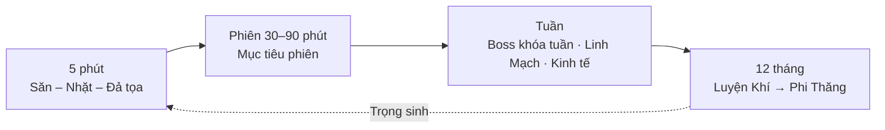
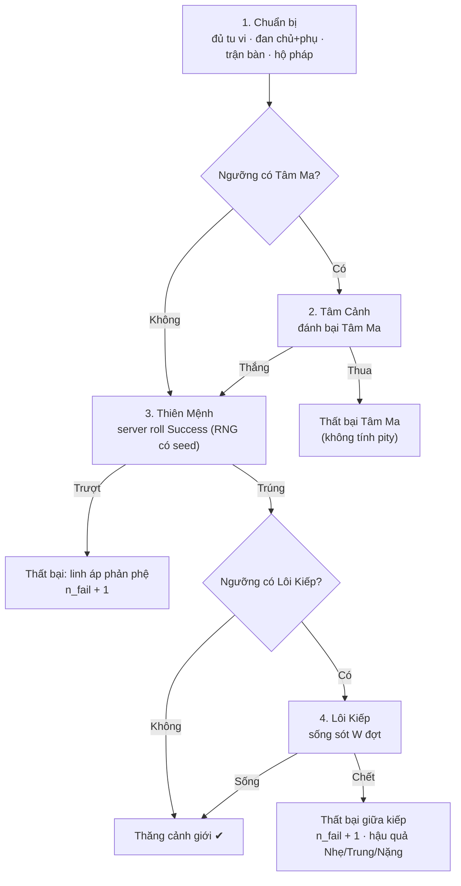

# GDD – MMORPG Tu Tiên "Vạn Giới Tiên Đồ"

> **Nguồn & phạm vi.** Bộ hồ sơ **không có file `.docx` GDD riêng**. GDD gốc (viết khi dự án còn định hướng 3D / UE5) chỉ được **tóm tắt** trong [00-ho-so-tong-hop.md](00-ho-so-tong-hop.md) (§1, §2, §5.1) và được lượng hóa trong [07-cong-thuc-data-schema.md](07-cong-thuc-data-schema.md). Bản này **dựng lại từ các nguồn đó** rồi **thiết kế bổ sung** những phần còn thiếu theo yêu cầu của chủ dự án.
>
> **Chú thích đánh dấu (dùng xuyên suốt):**
>
> - _[Giữ nguyên]_ — nội dung sống sót từ bản dựng lại trước, đã áp dụng toàn bộ [DECISIONS.md](DECISIONS.md) (D1–D13).
> - _[Thiết kế mới – chờ duyệt]_ — phần mới, **chưa có trong tài liệu nguồn**; mọi con số trong các phần này là **Đề xuất – chờ duyệt** trừ khi ghi rõ nguồn (07 / `@vgtd/shared`).
> - _[Cập nhật §4: …]_ — chỗ khác GDD gốc do áp dụng [DECISIONS D1–D13](DECISIONS.md).
>
> **Thứ bậc căn cứ:** [DECISIONS.md](DECISIONS.md) (D14 trở đi) > [00 §3](00-ho-so-tong-hop.md) > [07](07-cong-thuc-data-schema.md) / `@vgtd/shared` (số liệu gameplay) > GDD này. Nếu GDD mâu thuẫn với các mục đứng trước thì GDD sai. Phạm vi closed beta: [10-mvp-scope.md](10-mvp-scope.md). Hệ phái và kỹ năng: [11-he-phai-ky-nang.md](11-he-phai-ky-nang.md). Mảng còn chưa thiết kế: [OPEN-ITEMS.md](OPEN-ITEMS.md).

## 1. Tầm nhìn & trụ cột _[Thiết kế mới – chờ duyệt]_

**Tầm nhìn một câu:** _một thế giới tu tiên 2D isometric nơi mỗi bước đột phá là một khoảnh khắc đáng nhớ, mỗi lựa chọn đạo tâm để lại nghiệp quả, và bạn có thể tu cùng đạo hữu trên bất kỳ thiết bị nào._

| #   | Trụ cột                         | Ý nghĩa thiết kế                                                                                                                                    | Hệ quả cụ thể                                                                                     |
| --- | ------------------------------- | --------------------------------------------------------------------------------------------------------------------------------------------------- | ------------------------------------------------------------------------------------------------- |
| P1  | **Đột phá là khoảnh khắc**      | Cảnh giới là trục tiến trình chính; mỗi ngưỡng lớn là một "sự kiện" có chuẩn bị, hồi hộp, thất bại có ý nghĩa.                                      | Tâm Ma, Lôi Kiếp, pity (07 §2); thất bại không rớt cảnh giới lớn; VFX Lôi Kiếp procedural.        |
| P2  | **Cảnh giới là vua**            | Người cảnh giới cao luôn mạnh hơn; trang bị / công pháp chỉ cộng tối đa 60% chỉ số gốc cùng cảnh giới (07 §1).                                      | Suppress −15% mỗi cảnh giới chênh lệch (07 §4); không có "đồ phế liệu đánh thắng người cao cảnh". |
| P3  | **Nghiệp quả có trọng lượng**   | Chính – Tà – Ma không phải nhãn cosmetic mà đổi cách tu: Ma tu nhanh nhưng đột phá khó dần (07 §2). Lựa chọn của người chơi để lại hậu quả dài hạn. | Nghiệp Lực, Đạo Tâm, nghiệp báo, nhân quả (mục 8).                                                |
| P4  | **Tu cùng đạo hữu**             | MMO đúng nghĩa: tông môn, tổ đội, chợ, chiến tranh Linh Mạch; solo vẫn tiến được nhưng đột phá cao cần hộ pháp / tài nguyên cộng đồng.              | Hộ pháp Lôi Kiếp (07 §3), personal loot theo đội, tông môn (mục 9, 13).                           |
| P5  | **Mượt trên mọi thiết bị**      | Cross-play Web H5 / Mobile / PC; vào game ≤ 25 MB; cùng một tài khoản, cùng một thế giới.                                                           | Ngân sách 00 §3 (draw call, RAM, băng thông); bố cục theo cách nhập (05).                         |
| P6  | **Kinh tế bền, không lạm phát** | Mọi nguồn tiền có sink tương ứng; mục tiêu tiêu hao / sinh ra 0,9–1,0 mỗi tuần (07 §7).                                                             | Thuế CPI, truyền tống, độ bền, Đấu Giá Hội hủy tiền.                                              |

## 2. Người chơi mục tiêu & nền tảng

### 2.1 Chân dung người chơi _[Thiết kế mới – chờ duyệt]_

Thị trường đầu tiên: **người chơi Việt Nam** (UI Việt hóa đầu tiên; Trung / Anh bản địa hóa sau — chữ không vẽ cứng vào ảnh, 02 §5).

| Chân dung                                  | Mô tả                                                                            | Muốn gì                                                       | Thiết kế đáp ứng                                                                                        |
| ------------------------------------------ | -------------------------------------------------------------------------------- | ------------------------------------------------------------- | ------------------------------------------------------------------------------------------------------- |
| **Tu sĩ hoài niệm** (nhân vật cốt lõi)     | 22–40 tuổi, đọc truyện tiên hiệp, chơi PC / Web vào buổi tối, 1–2 giờ mỗi phiên. | Cảm giác "tu luyện thật": cảnh giới, đột phá, Lôi Kiếp.       | Vòng lặp cảnh giới dài hạn (mục 3–5), thẩm mỹ thủy mặc × cyber-xianxia (05).                            |
| **Người chơi mảnh thời gian** (Mobile/Web) | 18–35 tuổi, phiên 10–20 phút, chơi trên điện thoại hoặc tab trình duyệt.         | Tiến bộ rõ ràng sau mỗi phiên ngắn, không bị trừng phạt nặng. | Vòng 5 phút (mục 3), đả tọa / nhiệm vụ ngày, vào game nhanh (≤ 25 MB), thất bại đột phá không rớt cảnh. |
| **Thủ lĩnh / người chơi xã hội**           | 20–40 tuổi, thích tổ chức tông môn, chiến tranh, giao thương.                    | Quyền lực, uy tín, kinh tế.                                   | Tông môn, Linh Mạch, Vạn Bảo Lâu, Đấu Giá Hội (mục 9–10).                                               |

### 2.2 Nền tảng & thông số kỹ thuật _[Giữ nguyên]_

**Vạn Giới Tiên Đồ** (tên tạm) là MMORPG tu tiên **2D Isometric 2:1** _[Cập nhật §4: GDD gốc ghi "MMORPG 3D thế giới mở" → 2D Isometric 2:1, thế giới mở chia chunk 32 × 32 ô]_, chạy đồng thời trên **Web (H5/WebGL), Mobile (iOS/Android) và PC Client, cross-play** _[Cập nhật §4: gốc "PC + Mobile" → Web H5 + Mobile + PC, cross-play]_.

| Hạng mục            | Giá trị hiện hành                                                   | Ghi chú thay đổi                                                                            |
| ------------------- | ------------------------------------------------------------------- | ------------------------------------------------------------------------------------------- |
| Thể loại / góc nhìn | 2D Isometric 2:1 (Dimetric), thế giới mở chia chunk                 | _[Cập nhật §4: thay 3D thế giới mở]_                                                        |
| Engine              | **Cocos Creator 3.x** (dự phòng: Unity 2D, Godot 4)                 | _[Cập nhật §4: thay Unreal Engine 5]_                                                       |
| Nền tảng            | Web H5/WebGL, iOS, Android, PC; cross-play                          | _[Cập nhật §4: thay PC + Mobile]_                                                           |
| Hình thức asset     | Sprite Sheet, Spine 2D, Tilemap diamond, Particle 2D, sprite shader | _[Cập nhật §4: thay Mesh, LOD, Nanite, Niagara]_                                            |
| Gói tải đầu (Web)   | ≤ **25 MB**                                                         | _[Cập nhật §4: thay 30 MB (dự phòng 1 MB → 29 MB)]_                                         |
| Thang phẩm chất     | **6 phẩm: Trắng → Lục → Lam → Tím → Vàng → Đỏ**                     | _[Cập nhật §4: thay thang 5 phẩm]_                                                          |
| Icon                | Nguồn 256, xuất 48 / 64 / 128                                       | _[Cập nhật §4: thay nguồn 512 → hiển thị 256 (3D) và nguồn 256 → hiển thị 128 (Matrix 2D)]_ |

Hệ quả kỹ thuật của việc đổi sang 2D: xem [02](02-asset-matrix-2d.md), [04](04-tilemap.md), [06](06-toi-uu-render.md) và [08](08-server-architecture.md).

### 2.3 Tài khoản & hosting _[Quyết định D26, D27 trong [DECISIONS.md](DECISIONS.md)]_

- **Đăng nhập MVP: tên đăng nhập + mật khẩu** (quyết định của chủ dự án); **Google SSO làm sau**. Một tài khoản dùng chung trên Web / Mobile / PC (cross-play).
- **Hosting quyết định sau:** closed beta chạy **local**; CI chỉ GitHub Actions, không CD. Không có thiết kế nào trong GDD được phép phụ thuộc vào một nhà cung cấp đám mây cụ thể.
- Số nhân vật mỗi tài khoản, đổi tên, xóa nhân vật: xem _Câu hỏi cần chốt_.

## 3. Core loop và bốn tầng thời gian

**Vòng lặp lõi** _[Giữ nguyên]_: Luyện khí → Vượt ải / Săn quái → Tài nguyên, Đan dược → Đột phá → Trọng sinh / Phi Thăng.

Bốn tầng vòng lặp, từ 5 phút đến 12 tháng _[Giữ nguyên khung thời gian; chi tiết từng tầng: Thiết kế mới – chờ duyệt]_:



### 3.1 Tầng 1 — 5 phút: "Săn – Nhặt – Đả tọa"

| Bước | Hành động                                                                                 | Phần thưởng tức thì                                     | Nguồn số liệu        |
| ---- | ----------------------------------------------------------------------------------------- | ------------------------------------------------------- | -------------------- |
| 1    | Kéo một nhóm quái, thi triển 2–4 kỹ năng ([11](11-he-phai-ky-nang.md)).                   | Tu vi từ quái _(Đề xuất)_, Linh thạch hạ phẩm           | 07 §6                |
| 2    | Nhặt vật phẩm rơi (cột sáng theo phẩm 1–6, 02 §3).                                        | Nguyên liệu, đan hồi phục, hiếm: bản vẽ / đan           | 07 §6                |
| 3    | Hồi Chân Nguyên: đả tọa ngắn hoặc uống đan.                                               | Hấp thu linh khí `Absorb(s)`                            | 07 §5                |
| 4    | Lặp: nhịp tham chiếu **~150 quái thường / giờ** (≈ 12 con mỗi 5 phút), 20 tinh anh / giờ. | Kỳ vọng ~180 / ~530 Linh thạch hạ mỗi giờ (cảnh giới 1) | 07 §6 (bảng kỳ vọng) |

Nguyên tắc: một vòng 5 phút phải có **ít nhất một thứ nhìn thấy được** (rơi đồ, lên nấc, hoàn thành mục tiêu nhỏ) để phiên mobile 10 phút vẫn thỏa mãn.

### 3.2 Tầng 2 — Phiên (30–90 phút) _[Thiết kế mới – chờ duyệt]_

Một phiên có **một mục tiêu chính** do người chơi tự chọn từ bảng nhiệm vụ / nhật ký tu hành:

| Mục tiêu phiên           | Nội dung                                                                                         | Nhịp                                                             |
| ------------------------ | ------------------------------------------------------------------------------------------------ | ---------------------------------------------------------------- |
| Tích đủ một nấc          | Đả tọa + săn quái đến khi đủ `Req(s)`; đột phá tiểu cảnh (Base 0,90 / 0,85, không kiếp — 07 §2). | ~10–15 phút tu thuần ở nấc đầu (hệ số 1; 07 §5), tăng dần 8%/nấc |
| Săn tinh anh / Bí cảnh   | Tuyến săn tinh anh; vào bí cảnh PK; đánh boss tuần (chỉ rương lần đầu).                          | 30–60 phút                                                       |
| Chuẩn bị đột phá lớn     | Gom đan chủ + đan phụ (tối đa 3 viên, 07 §2), trận bàn, pháp bảo phòng ngự, hộ pháp.             | Cả phiên                                                         |
| Việc kinh tế             | Luyện đan / chế phù, đăng bán Vạn Bảo Lâu, sửa trang bị, nạp trận tông môn.                      | 10–20 phút xen kẽ                                                |
| Nhiệm vụ ngày + tông môn | Nhiệm vụ ngày, Cống hiến, giao vật phẩm tông môn.                                                | 15–25 phút                                                       |

Giới hạn tự nhiên chống "cày một chỗ": farm liên tục quá 2 giờ trong một vùng thì tỷ lệ rơi × 0,5, hồi sau 6 giờ (07 §6) → người chơi luân chuyển vùng giữa phiên.

### 3.3 Tầng 3 — Tuần _[Thiết kế mới – chờ duyệt, trên các khóa tuần đã có ở 07]_

| Chu kỳ tuần            | Nội dung                                                                                                      | Nguồn                |
| ---------------------- | ------------------------------------------------------------------------------------------------------------- | -------------------- |
| Rương Boss bí cảnh     | 1 lần / boss / người / tuần; giết thêm chỉ nhận Linh thạch × 0,3, không bản vẽ                                | 07 §6                |
| CPI tuần → thuế chợ τ  | Thuế bán 5–10% điều chỉnh theo CPI tuần; vòng điều chỉnh hệ số kinh tế hằng tuần                              | 07 §7                |
| Chiến tranh Linh Mạch  | Một cửa sổ chiến tranh mỗi tuần (Thứ Bảy 20:00–21:30; [14](14-pvp-chien-tranh.md) §5.2)                       | 14                   |
| Nhiệm vụ tuần tông môn | Gom Cống hiến, mở kho tông môn                                                                                | _Đề xuất_            |
| Ngưỡng đột phá lớn     | Người chơi vừa dự kiến ~1–2 tuần giữa hai ngưỡng lớn ở các cảnh giới đầu                                      | _Đề xuất_ (bảng 3.4) |
| Reset hằng ngày        | 1 lần truyền tống miễn phí về Sơn Môn mỗi ngày; reset ngày lúc 05:00 UTC+7, tuần bắt đầu thứ Hai (theo 12 Q2) | 07 §7 / _Đề xuất_    |

### 3.4 Tầng 4 — 12 tháng: hành trình Luyện Khí → Phi Thăng _[Thiết kế mới – chờ duyệt]_

Tu thuần **chỉ khoảng 47 giờ** cho cả 41 nấc (hệ số 1; 07 §5) — phần lớn thời gian trong game là thu thập tài nguyên, đan, trận, hộ pháp, thất bại và thử lại đột phá lớn. Bảng dưới đặt **mục tiêu giờ chơi** (cần mô phỏng xác nhận — OPEN-ITEMS #7):

| Cảnh giới  | Số nấc | Tu thuần (giờ, hệ số 1, 07 §5) | Mục tiêu giờ chơi toàn cảnh giới _(Đề xuất)_ | Tích lũy _(Đề xuất)_ |
| ---------- | ------ | ------------------------------ | -------------------------------------------- | -------------------- |
| Luyện Khí  | 9      | 2,1                            | 6                                            | 6                    |
| Trúc Cơ    | 4      | 1,5                            | 8                                            | 14                   |
| Kim Đan    | 4      | 2,0                            | 12                                           | 26                   |
| Nguyên Anh | 4      | 2,8                            | 20                                           | 46                   |
| Hóa Thần   | 4      | 3,8                            | 35                                           | 81                   |
| Luyện Hư   | 4      | 5,1                            | 50                                           | 131                  |
| Hợp Thể    | 4      | 7,0                            | 70                                           | 201                  |
| Đại Thừa   | 4      | 9,5                            | 90                                           | 291                  |
| Độ Kiếp    | 4      | 13,0                           | 120                                          | 411                  |

(Cột "Tu thuần" tính từ `t(s) = 10 phút · 1,08^(s−1)` cộng theo nấc của từng cảnh giới; tổng 46,8 giờ khớp 07 §5.) Với người chơi vừa ~8 giờ / tuần, 411 giờ ≈ **12 tháng đến cửa Phi Thăng**. Ba cảnh giới đầu (~26 giờ) cố ý nhanh để giữ chân người mới — đây chính là phạm vi closed beta ([10](10-mvp-scope.md)).

**Sau Phi Thăng** _(Đề xuất)_: người chơi chọn một trong hai:

- **Phi Thăng** — nhân vật "thành tiên", vào Tiên Bảng, nhận danh hiệu và vật phẩm trưng bày vĩnh viễn; mở nhân vật mới hoặc nội dung Tiên Giới (chưa thiết kế).
- **Trọng sinh** — quay về Luyện Khí với **Đạo Vận** (bonus nhỏ vĩnh viễn: tốc độ tu, ô túi, cosmetic) để chơi một "kiếp" khác (đổi hệ phái / đạo hướng). Mức Đạo Vận và việc có giữ Linh căn hay roll lại: _Câu hỏi cần chốt_.

## 4. Hệ thống cảnh giới _[Giữ nguyên + cơ chế từng cảnh giới: Thiết kế mới – chờ duyệt]_

- **9 cảnh giới, 41 nấc**: Luyện Khí (9 tầng) và 8 cảnh giới còn lại, mỗi cảnh giới 4 tiểu cảnh (Sơ, Trung, Hậu, Viên Mãn). Thứ tự: Luyện Khí → Trúc Cơ → Kim Đan → Nguyên Anh → Hóa Thần → Luyện Hư → Hợp Thể → Đại Thừa → Độ Kiếp; vượt qua Độ Kiếp là **Phi Thăng**.
- **Thất bại đột phá không rớt cảnh giới lớn.**
- Mỗi cảnh giới mở một **cơ chế mới** (bảng 4.1). Ở các ngưỡng lớn có **Tâm Ma** và/hoặc **Lôi Kiếp** (Kim Đan → Nguyên Anh: 3 đạo; … ; Độ Kiếp → Phi Thăng: Cửu Cửu Thiên Kiếp 81 đạo).

### 4.1 Chín cảnh giới và cơ chế mới

Khóa mở khóa (`unlocks`) và khoảng level lấy từ `realm_progression.json` (`@vgtd/shared`); cột "Hành vi trong game" là thiết kế mới.

| #   | Cảnh giới  | Level (07 §8) | Khóa `unlocks` (07 §8)                      | Cơ chế mới — hành vi trong game _(Đề xuất – chờ duyệt)_                                                                                                                            | Ngưỡng lên cảnh giới sau (07 §2)      |
| --- | ---------- | ------------- | ------------------------------------------- | ---------------------------------------------------------------------------------------------------------------------------------------------------------------------------------- | ------------------------------------- |
| 1   | Luyện Khí  | 1–30          | `linh_can`, `khinh_cong`, `artifact_slot_1` | Thức tỉnh **Linh căn** (5 hệ), **khinh công** (bước nhảy ngắn, vượt vách 1 tầng — 04 §5), ô **pháp bảo** đầu tiên.                                                                 | Base 0,70 · không kiếp                |
| 2   | Trúc Cơ    | 31–50         | `fly_low`, `divine_sense_50m`, `crafting`   | **Ngự kiếm bay thấp** (đi qua ô "chỉ bay qua": nước, hố; không vượt vách > 1 tầng), **thần thức 50 m** (thấy thực thể ẩn / ngắm xa; ~25 ô), **chế tác** (luyện đan, chế phù, rèn). | Base 0,55 · Tâm Ma nhẹ                |
| 3   | Kim Đan    | 51–70         | `fly_free`, `natal_artifact`                | **Bay tự do** (qua mọi vách, đi theo tầng; đây là nơi streaming 02 mở rộng vùng tải trước), **pháp bảo bản mệnh** (nhận một pháp bảo cùng lớn lên với người chơi).                 | Base 0,45 · Lôi Kiếp 3 đạo + Tâm Ma   |
| 4   | Nguyên Anh | 71–90         | `nascent_soul_projection`, `blink`          | **Phân thân Nguyên Anh** (xuất một phân thân thám hiểm / thu hoạch tách khỏi bản thể, ví dụ canh Linh điền hoặc đi nhiệm vụ), **dịch chuyển tức thời** ngắn (blink).               | Base 0,35 · Lôi Kiếp 6 đạo            |
| 5   | Hóa Thần   | 91–110        | `domain`, `upper_realm_access`              | **Lĩnh Vực** (vùng tự dựng quanh người chơi, 5–8 ô bán kính _Đề xuất_: buff đồng đội / debuff địch theo hệ), **vào Thượng giới** (vùng bản đồ cao cấp).                            | Base 0,30 · Tâm Ma đa người           |
| 6   | Luyện Hư   | 111–130       | `combat_clone`, `void_portal`               | **Phân thân chiến đấu** (clone chiến đấu cùng lúc, AI điều khiển — chịu ngân sách thực thể 08), **cổng hư không** (truyền tống nhóm).                                              | Base 0,25 · Lôi Kiếp 9 đạo            |
| 7   | Hợp Thể    | 131–150       | `dharma_avatar`                             | **Pháp Tướng Thiên Địa** (hóa thân khổng lồ có thời hạn; sprite 512 × 512, additive — 02 §1), chỉ số tăng theo thời hạn.                                                           | Base 0,20 · Lôi Kiếp 18 đạo           |
| 8   | Đại Thừa   | 151–170       | `great_dao_law`                             | **Đại Đạo Pháp Tắc** (chọn một pháp tắc làm "luật" áp lên vùng chiến: ví dụ giảm hồi chiêu, đổi hệ nền của vùng).                                                                  | Base 0,15 · Tâm Ma + Lôi Kiếp 36 đạo  |
| 9   | Độ Kiếp    | 171–180       | `ascension_prep`                            | **Chuẩn bị Phi Thăng**: chuỗi nhiệm vụ cuối, mở Cửu Cửu Thiên Kiếp.                                                                                                                | Base 0,10 · Cửu Cửu Thiên Kiếp 81 đạo |

Ràng buộc kỹ thuật cho cơ chế đắt tiền (kiểm tra ở [06](06-toi-uu-render.md), [08](08-server-architecture.md)): Pháp Tướng và Lĩnh Vực tính vào ngân sách VFX (≤ 1.000 hạt Web/Mobile); phân thân chiến đấu tính vào số thực thể mỗi client (120 Mobile, 200 PC — `@vgtd/shared` `NETWORK`). Nếu vượt, tự giảm chất lượng, không bỏ cơ chế.

### 4.2 Chỉ số theo cảnh giới _[Giữ nguyên]_

Stat = B · λ^x, với x = (r − 1) + 0,6·(k − 1)/K_r; λ: HP 1,78 · MP 1,70 · Công 1,75 · Thủ 1,72; Thân pháp tuyến tính. 60% mức tăng nằm ở các tiểu cảnh, 40% dồn vào lần đột phá; số đòn hạ gục cùng cảnh giới chỉ tăng khoảng 10% sau 9 cảnh giới. Trang bị, công pháp, pháp bảo cộng tối đa **60%** chỉ số gốc cùng cảnh giới. (Chi tiết: [07](07-cong-thuc-data-schema.md) §1.)

## 5. Đột phá, Tâm Ma, Lôi Kiếp

### 5.1 Công thức đột phá _[Giữ nguyên; Cập nhật §4: công thức mới]_

Gốc (đã bỏ): cộng dồn `Base + Đan + Trận + Đạo tâm + 8%·thất bại`. Hiện hành:

```latex
\text{Success} = \mathrm{clamp}\big(\text{Base}_{\text{eff}} \cdot (1 + \text{Pill}) - \text{Karma\_Penalty},\; 0{,}05,\; 0{,}95\big)
```

- Clamp 5% – 95%; pity +8% mỗi lần thất bại liên tiếp, **trần +40%** (Base_eff = Base_r + min(0,08·n_fail; 0,40)).
- Đan dược nhân với Base (Pill; tối đa 3 viên), Nghiệp xấu trừ thẳng (Karma_Penalty = 0,20·max(0, −K)/1000) — nên Ma đạo tu nhanh nhưng càng lên cao càng khó đột phá. Nghiệp thiện **không** cộng tỷ lệ; lợi thế của Chính đạo nằm ở chỗ khác (mục 8).
- Đột phá tiểu cảnh: Base 0,90 (Luyện Khí) hoặc 0,85, không kiếp, Karma_Penalty tính một nửa; **không áp đan và pity**, clamp 5–95% (D19 trong [DECISIONS.md](DECISIONS.md)).
- Server roll bằng RNG có seed và ghi log từng lần.
- **Đạo Tâm không nằm trong công thức này** (đã bỏ khỏi bản cộng dồn cũ); Đạo Tâm chỉ tác động lên độ khó Tâm Ma (5.3).

### 5.2 Luồng một lần đột phá lớn _[Thiết kế mới – chờ duyệt]_



Quy tắc:

- **Thứ tự "Tâm Ma → roll → Lôi Kiếp"** _(Đề xuất)_: thất bại rẻ xảy ra sớm; người chơi chỉ phải chịu một Lôi Kiếp đắt khi Thiên Mệnh đã trúng. (Phương án ngược lại — kiếp trước, roll sau — nghe "tự nhiên" hơn nhưng khiến người sống sót 81 đạo vẫn có thể rớt do roll; xem _Câu hỏi cần chốt_.)
- **Thua Tâm Ma không tính `n_fail`** _(Đề xuất)_ để không ai cố ý thua Tâm Ma nhằm nạp pity.
- **Thất bại thường** (trượt roll hoặc chết giữa kiếp): n_fail + 1, tiêu hao đan đã dùng; **không rớt cảnh giới lớn** (không đổi). Hậu quả thêm xem 5.4.
- Mọi bước ghi log phục vụ khiếu nại (07 §2).

### 5.3 Tâm Ma _[Thiết kế mới – chờ duyệt]_

Tâm Ma là **trận chiến trong "Tâm Cảnh"** — một instance riêng, tileset sẵn có + shader đảo màu / méo hình, bố cục sinh theo dữ liệu người chơi, 9 biến thể (02 §2 "Tâm cảnh").

| Loại                       | Ngưỡng (07 §2)                           | Hình thức _(Đề xuất)_                                                                                                                                |
| -------------------------- | ---------------------------------------- | ---------------------------------------------------------------------------------------------------------------------------------------------------- |
| Tâm Ma nhẹ                 | Trúc Cơ → Kim Đan                        | Solo. Một "bóng" sao chép bộ kỹ năng của chính người chơi, chỉ số = chỉ số gốc × độ khó (bên dưới). Thời hạn tối đa 90 giây _(Đề xuất)_.             |
| Tâm Ma + (đi kèm Lôi Kiếp) | Kim Đan → Nguyên Anh, Đại Thừa → Độ Kiếp | Như trên, thêm "Nghiệp Ảnh": mỗi 200 điểm Nghiệp Lực âm sinh một bóng phụ (tối đa 3).                                                                |
| Tâm Ma đa người            | Hóa Thần → Luyện Hư                      | Tổ 2–4 người cùng vào một Tâm Cảnh; mỗi người đối mặt Tâm Ma của chính mình và Tâm Ma của đồng đội xen vào. Hỗ trợ được, nhưng không được "giết hộ". |

**Độ khó Tâm Ma:** `Strength = 1,0 + 0,5 · (1 − ĐạoTâm/100) + Phạt_nghiệp`, với `ĐạoTâm ∈ [0, 100]` và `Phạt_nghiệp = max(0, −K)/2000` _(toàn bộ là Đề xuất)_. Đạo Tâm cao → Tâm Ma yếu tới mức 1,0; Đạo Tâm thấp và nghiệp nặng → Tâm Ma mạnh nhất ~2,0 (Đạo Tâm 0, K = −1000). **Định Tâm Đan** (phụ đan của 07) giảm thêm Strength 10% × phẩm q.

Thua Tâm Ma: thoát Tâm Cảnh, mất đan đã dùng; không phạt độ bền; khóa đột phá lớn 30 phút _(Đề xuất)_.

### 5.4 Lôi Kiếp _[Giữ nguyên số liệu; Cập nhật §4: từ định tính sang số liệu; flow: Thiết kế mới – chờ duyệt]_

Gốc: mô tả định tính (số đạo, telegraph). Hiện hành: **sát thương thuần theo đợt**, `Strike = HP_ref · κ_r · 1,22^(w−1)`, tổng 0,6 → 3,0 × HP_ref; κ_r riêng cho từng ngưỡng; **từ 9 đạo trở lên bắt buộc có nguồn giảm trừ** (kiếp 3 và 6 đạo, tổng 0,6 và 1,2 × HP_ref, có thể qua không cần); chỉ các nguồn liệt kê ở [07](07-cong-thuc-data-schema.md) §3 mới có tác dụng (Phòng ngự / kháng ngũ hành vô hiệu vì sét kiếp là sát thương thuần). Ví dụ lớn nhất: Cửu Cửu Thiên Kiếp 81 đạo.

**VFX Lôi Kiếp: procedural** (fBm, segment mesh, không texture) _[Cập nhật §4: thay flipbook 128 × 512, 8 frame, 4 biến thể]_; bloom giả/thật theo cấp máy — xem [06](06-toi-uu-render.md).

**Flow trải nghiệm** _[Thiết kế mới – chờ duyệt]_:

1. **Chọn Kiếp Đài.** Người chơi vào vùng trống do server cấp (instance nhỏ hoặc khu cấm xây) để sét không đánh nhầm người khác. Mây kiếp (L5) tụ dần; BGM Lôi Kiếp tăng theo số đạo (02 §6).
2. **Bố trí.** Dựng trận bàn (nạp 1 lần / đợt), mặc pháp bảo phòng ngự, mời tối đa **2 đồng đạo hộ pháp** (mỗi người nhận 25% mỗi tia; 07 §3). Thứ tự giảm: trận pháp trước, rồi chia cho hộ pháp; trần giảm 50% áp cho trận pháp + Thể tu gộp (D18).
3. **Giáng kiếp.** Mỗi đợt có m tia cách nhau 1,5 s; các đợt cách nhau 8 s (07 §3). Sét **luôn trúng chủ kiếp** (không né được — nhất quán với "sát thương thuần" của 07); **vòng cảnh báo 1–1,5 s** trên đất (02 §4) dùng để người chơi canh thời điểm kích hoạt khiên / uống Hộ Mạch Đan, không phải để né.
4. **Khóa hồi phục.** Đan hồi máu thường bị khóa trong kiếp; chỉ Hộ Mạch Đan (20% HP_ref, hồi chiêu 45 s) dùng được (07 §3).
5. **Kết cục.** Sống sót hết W đợt → thăng cảnh giới. Chết giữa kiếp → thất bại với hậu quả theo **tiến độ kiếp đã qua**:

| Mức hậu quả | Tiến độ kiếp đã qua _(Đề xuất)_ | Hậu quả _(Đề xuất, ngoài các giá trị đã có)_                                                                                                                                                                 |
| ----------- | ------------------------------- | ------------------------------------------------------------------------------------------------------------------------------------------------------------------------------------------------------------ |
| **Nhẹ**     | ≥ 2/3 số đợt                    | Mất 15% độ bền mọi món đang mặc (07 §7); giữ nguyên tu vi.                                                                                                                                                   |
| **Trung**   | 1/3 đến < 2/3                   | Như Nhẹ + mất 25% tu vi của nấc hiện tại + buff xấu "Đạo Cơ Chấn Động" 24 giờ (−10% chỉ số gốc).                                                                                                             |
| **Nặng**    | < 1/3                           | Như Nhẹ + mất 50% tu vi của nấc hiện tại + "Đạo Cơ Chấn Động" 72 giờ (−20% chỉ số gốc); đan đã dùng mất hết; **khóa đột phá lớn 24 giờ** và mất 1 điểm Đạo Tâm mỗi 10% kiếp chưa qua (Trung / Nhẹ không bị). |

> **Lưu ý nguồn:** 07 §3 viết "mức hậu quả Nhẹ / Trung / Nặng **như trong GDD**" — nhưng GDD gốc không còn trong hồ sơ, nên **ba mức và nội dung của chúng ở trên là dựng lại / thiết kế mới**. Chủ dự án cần đối chiếu với GDD gốc (nếu còn) — xem _Câu hỏi cần chốt_. Ở mọi mức, **không rớt cảnh giới lớn** (00 §3–4).

## 6. Linh căn và Ngũ hành

### 6.1 Ngũ hành _[Giữ nguyên; Cập nhật §4: số mới]_

|                | Gốc (GDD bản đầu)                               | Hiện hành                                                                                                                     |
| -------------- | ----------------------------------------------- | ----------------------------------------------------------------------------------------------------------------------------- |
| **Tương khắc** | +30% sát thương, xuyên 20% kháng                | **+25% sát thương, −15% Phòng ngự (DEF) mục tiêu**; bên bị khắc: **−15% sát thương**                                          |
| **Tương sinh** | +20% buff và hồi phục cho đồng đội hệ được sinh | **Hồi 10% Chân Nguyên** (tối đa) khi hỗ trợ đồng đội hệ được sinh; hồi chiêu 10 s mỗi cặp người nhận; không áp lên chính mình |

- Khắc: Kim → Mộc → Thổ → Thủy → Hỏa → Kim. Sinh: Kim → Thủy → Mộc → Hỏa → Thổ → Kim. Hệ biến dị: Phong → Mộc, Lôi → Kim, Băng → Thủy.
- Ma trận hệ số và công thức sát thương tổng: [07](07-cong-thuc-data-schema.md) §4.

### 6.2 Linh căn _[Giữ nguyên số; ghi chú thiết kế: Thiết kế mới – chờ duyệt]_

Linh căn quyết định **tốc độ tu luyện** và **mức phạt khi dùng kỹ năng ngoài hệ** (07 §5): Đơn 1,6 · Song 1,3 · Tạp Tam / Tứ / Ngũ 1,0 / 0,85 / 0,7; hấp thu ∝ √Match môi trường; tỷ lệ tạo nhân vật 5 / 20 / 35 / 25 / 15%; 2% biến dị (Phong, Lôi, Băng).

Thiết kế mới (không đổi con số 07):

- **Ngũ hành của môi trường (v_e)** ghi trong dữ liệu mỗi map (04 / 07); người chơi đọc được trên minimap "la bàn Bát Quái" để chọn nơi đả tọa: Đơn linh căn có lý do rời thành tìm đất hợp hệ, Tạp linh căn tu ổn ở khắp nơi.
- Linh căn **không đổi được** sau khi tạo nhân vật, ngoại trừ chuỗi nhiệm vụ hiếm "Cải Căn" (chưa thiết kế — xem _Câu hỏi cần chốt_ G11).
- **Kỹ năng và Linh căn:** xem [11](11-he-phai-ky-nang.md) §3 — kỹ năng "Linh căn hóa" dùng hệ của người chơi để Đơn linh căn xấu số không bị phạt oan.

## 7. Hệ phái và kỹ năng _[Thiết kế mới – chờ duyệt]_

Tóm tắt (chi tiết ở [11](11-he-phai-ky-nang.md)):

- Sáu **Đạo Lộ** (hệ phái khởi đầu) _(Đề xuất)_: **Kiếm tu, Pháp tu, Thể tu, Đan/Phù tu, Thương tu, Đao tu** — chọn khi tạo nhân vật; quyết định vai trò, trọng số chỉ số, bộ kỹ năng và hệ chủ đạo. _[Cập nhật D49: 4 → 6 Đạo Lộ; mỗi lớp tự túc solo và chơi nhóm được; hai nhánh công pháp SOLO / TEAM chọn ở level 20 — chi tiết [11](11-he-phai-ky-nang.md).]_
- **Tông môn** (tổ chức xã hội, mục 9) tách khỏi Đạo Lộ: bất kỳ Đạo Lộ nào cũng có thể gia nhập bất kỳ tông môn nào hợp phe.
- Kỹ năng do **server giữ hồi chiêu** (08 §6), sát thương theo công thức 07 §4 với `c_skill`; AOE tính trên **lưới ô isometric** (11 §2).

## 8. Phe phái Chính – Tà – Ma, Nghiệp Lực và Đạo Tâm

### 8.1 Nội dung giữ nguyên _[Giữ nguyên]_

- Phe **Chính – Tà – Ma** theo **Nghiệp Lực** (K ∈ [−1000, +1000]) và **Đạo Tâm**; nghiệp báo, nhân quả tuyến, rơi đồ theo nghiệp.
- Ma đạo (K ≤ −700): mất 14–20 điểm phần trăm tỷ lệ đột phá (07 §2) và hao mòn độ bền × 1,5 (07 §7).

### 8.2 Phân dải phe, biến động Nghiệp, rơi đồ _[Chuyển sang 14]_

Sau khi [14-pvp-chien-tranh.md](14-pvp-chien-tranh.md) được merge, **14 §3 là nguồn chuẩn** cho phần này (GDD không giữ bản riêng để tránh hai con số):

- **Ngưỡng phe** (14 §3.2): Chính đạo K ≥ +300 · Tán tu −299…+299 · Tà đạo −699…−300 · Ma đạo K ≤ −700 (mốc −700 từ 07). Chuyển ngưỡng không tạo hiệu ứng mạnh ngoài những gì 07 đã định (phạt đột phá `0,20 · max(0, −K)/1000`, độ bền × 1,5 ở Ma đạo).
- **Biến động Nghiệp khi PvP** (14 §3.3): ví dụ giết người không cờ −50 / −120; giết người có cờ Gây hấn / Truy nã +10 (≤ +100 mỗi ngày); trong chiến tranh 0; **không có suy giảm nghiệp theo thời gian** — kéo K về 0 bằng nhiệm vụ nhân quả (12 §3.4).
- **Rơi đồ theo nghiệp** (14 §3.4): chỉ khi chết ở vùng PK / bí cảnh `pvp = true`; Tà đạo 10%, Ma đạo 25% rơi 1 món không khóa trong túi, chuyển quyền sở hữu qua Economy Service.
- **Nhiệm vụ nhân quả** (Oán / Ân, "tuyến" nhân quả): 12 §3.4.

Bản GDD trước (ngưỡng ±200, suy giảm 1% / ngày, xác suất rơi 25% / 50%) **bị thay bởi 14**.

### 8.3 Lợi thế phe và Đạo Tâm _[Thiết kế mới – chờ duyệt; chưa thống nhất với 14]_

07 cố ý không cộng tỷ lệ đột phá cho nghiệp thiện; 14 §3.2 cũng nói phe không tạo hiệu ứng mạnh. Phần đề xuất **riêng của GDD** (cần chốt cùng 14 — câu hỏi G14):

| Dải       | Đạo Tâm tối đa | Ghi chú _(Đề xuất)_                                                                         |
| --------- | -------------- | ------------------------------------------------------------------------------------------- |
| Chính đạo | 100            | Tâm Ma yếu hơn (công thức 5.3); lợi thế thẩm mỹ / nhiệm vụ / dịch vụ như 14                 |
| Tán tu    | 100            | —                                                                                           |
| Tà đạo    | 80             | Tâm Ma mạnh hơn                                                                             |
| Ma đạo    | 60             | Tâm Ma mạnh nhất; "Ma đạo tu nhanh" (07 §2) nếu muốn hiện thực thành +% hấp thu tu vi → G14 |

Đạo Tâm ∈ [0, 100] chỉ tác động độ khó Tâm Ma (5.3), không nằm trong công thức đột phá 07 §2. Nguồn tăng / giảm Đạo Tâm: nhiệm vụ đạo tâm, giữ lời thề (+), giết vô tội, chết trong Tâm Cảnh (−) — số cụ thể: chưa thiết kế.

## 9. Tông môn và chiến tranh Linh Mạch

### 9.1 Nội dung giữ nguyên _[Giữ nguyên]_

**Chiến tranh Linh Mạch** giữa các tông môn, có **Hộ Sơn Đại Trận** (chiếm / giữ Linh Mạch); băng thông chiến tranh ~25 KB/s (00 §3, 08); VFX pháp trận và vòm Hộ Sơn Đại Trận ở 02 §2, 06.

### 9.2 Tông môn _[Thiết kế mới – chờ duyệt]_

| Hạng mục     | Thiết kế                                                                                                                                                                                       |
| ------------ | ---------------------------------------------------------------------------------------------------------------------------------------------------------------------------------------------- |
| Phe tông môn | Mỗi tông môn có **phe** Chính / Tà / Ma quyết định kit kiến trúc và theme UI (02 §2, §5). Đệ tử có K lệch hẳn khỏi phe tông (cách ≥ 600 điểm) bị cảnh cáo, sau 7 ngày bị trục xuất.            |
| Chức vị      | Ngoại môn đệ tử → Nội môn đệ tử → Chân truyền → Trưởng lão → Chưởng môn. Chức vị cấp theo cảnh giới + Cống hiến + biểu quyết.                                                                  |
| Cống hiến    | Tiền tệ tông môn, kiếm từ nhiệm vụ tông môn / nạp tài nguyên / chiến tranh; **không giao dịch được**; tiêu ở kho tông môn (bí tịch, đan, trận bàn).                                            |
| Tông môn đầu | Beta: một **Sơn Môn Đại Phái** (Chính đạo; 04 §5) — NPC, không do người chơi lập. Người chơi tự lập tông môn là thiết kế sau closed beta.                                                      |
| Sơn Môn      | Thành chính, vùng an toàn, 5 tầng (04 §5): cổng + chợ đệ tử, quảng trường luyện võ (lôi đài 12 × 12), Tàng Kinh Các / Đan Phòng / Luyện Khí Đường, Đại điện (5 Trận Nhãn), Hậu sơn (Động Phủ). |
| Kho tông môn | Do Trưởng lão quản; gửi / rút theo chức vị; mọi giao dịch ghi sổ.                                                                                                                              |

### 9.3 Linh Mạch và Hộ Sơn Đại Trận _[Chuyển sang 14 §5]_

Cơ chế chiến tranh Linh Mạch (khái niệm, lịch hằng tuần Thứ Hai → Chủ nhật với cửa sổ Thứ Bảy 20:00–21:30, điều kiện tuyên chiến, diễn biến chuẩn bị / công trận / quyết chiến, luật tham chiến, kinh tế chiến tranh) do **[14-pvp-chien-tranh.md](14-pvp-chien-tranh.md) §5** là nguồn chuẩn; GDD không lặp lại. Điểm nhất quán đã kiểm:

- Linh Mạch có phẩm **1–5**, ρ = 1 + 0,25 × phẩm (07 §5; 14 §5.1) — _02 §2 vẽ 6 phẩm_ (cần chốt, G6).
- Quy mô tham chiến tối đa 100 + 20 dự bị mỗi bên (14 §5.2), đúng kịch bản đo AOI 100 vs 100 (OPEN-ITEMS #6); băng thông ~25 KB/s (00 §3).
- Zone Sơn Môn đổi An toàn → PK khi chiến tranh mở (04 §5).
- **Lệch cần chốt:** 14 dùng **3 Trận Nhãn** còn 04 §5 ghi **5 Trận Nhãn** ở Đại điện (G15).
- Chiến tranh Linh Mạch vẫn **ngoài MVP closed beta** ([10](10-mvp-scope.md)).

## 10. Kinh tế

### 10.1 Tiền tệ _[Giữ nguyên]_

- Tiền tệ: **Linh thạch 3 phẩm (hạ / trung / thượng)**, **Tiên Ngọc**, **Cống hiến**.
- Chợ **Vạn Bảo Lâu**: niêm yết 1% + thuế bán 5–10% theo CPI tuần; giao dịch trực tiếp 3%. **Đấu Giá Hội** hủy tiền (tiền sink).
- Mục tiêu: **tiêu hao / sinh ra = 0,9 – 1,0 mỗi tuần**; công cụ chống lạm phát: thuế theo CPI, truyền tống, độ bền (xem [07](07-cong-thuc-data-schema.md) §7).

### 10.2 Tổng quan hệ thống kinh tế _[Số liệu từ 07; mô tả vai trò: Thiết kế mới – chờ duyệt]_

| Tiền tệ                | Giá trị                                              | Cách kiếm                              | Cách tiêu                                                                      | Giao dịch   |
| ---------------------- | ---------------------------------------------------- | -------------------------------------- | ------------------------------------------------------------------------------ | ----------- |
| Linh thạch hạ phẩm     | 1 (đơn vị gốc)                                       | Quái, tinh anh, boss, nhiệm vụ (07 §6) | Sửa đồ, truyền tống, phí niêm yết, đan, vật liệu                               | Có          |
| Linh thạch trung phẩm  | 100 hạ                                               | Tinh anh (8%), boss (100%) — 07 §6     | Đột phá, nạp trận, giao dịch giá trị vừa                                       | Có          |
| Linh thạch thượng phẩm | 10.000 hạ                                            | Tinh anh (0,1%), boss (12%) — 07 §6    | Đột phá cao, Đấu Giá Hội                                                       | Có          |
| Đổi lên phẩm           | Phí 5% (kênh sink, 07 §7)                            | —                                      | —                                                                              | —           |
| **Cống hiến**          | Điểm tông môn                                        | Nhiệm vụ tông môn, chiến tranh         | Kho tông môn                                                                   | **Không**   |
| **Tiên Ngọc**          | Tiền cao cấp — **chưa thiết kế đầy đủ** (OPEN-ITEMS) | Nguyên tắc _Đề xuất_ bên dưới          | Cosmetic, tiện lợi, slot; **không bán trực tiếp đan đột phá hay sức mạnh gốc** | Xem câu hỏi |

**Nguyên tắc Tiên Ngọc** _(Đề xuất – chờ duyệt; hạn chế rủi ro P2 "Cảnh giới là vua" và P6)_: (1) không mua được trực tiếp tỷ lệ đột phá, đan chủ, Linh thạch số lượng lớn; (2) không chuyển đổi trực tiếp thành Linh thạch (tránh mất cân đối sink / source); (3) closed beta: **không bật** Tiên Ngọc, không thu tiền thật.

### 10.3 Nguồn và sink (số từ 07) _[Giữ nguyên số]_

- **Nguồn:** Bảng Drop Rate Matrix 07 §6; kỳ vọng ~1,2 Linh thạch hạ / quái thường (cảnh giới 1), 26,5 / tinh anh, 1.610 / rương boss tuần.
- **Sink mục tiêu:** đột phá 35% · thuế chợ + niêm yết 15% · sửa trang bị 15% · nạp Hộ Sơn Đại Trận / duy trì Linh Mạch 15% · truyền tống 8% · phí đổi phẩm + khác 12% (07 §7).
- **Vòng điều chỉnh tuần:** tỷ lệ tiêu hao / sinh ra < 0,9 trong 2 tuần → nâng sàn τ 1 điểm và nhân phí sửa 1,1; > 1,05 → ngược lại; hệ số nằm trong file dữ liệu (07 §7).

### 10.4 Vạn Bảo Lâu và Đấu Giá Hội _[Thiết kế mới – chờ duyệt]_

| Hạng mục        | Vạn Bảo Lâu (chợ)                                                                                                                           | Đấu Giá Hội                                                                      |
| --------------- | ------------------------------------------------------------------------------------------------------------------------------------------- | -------------------------------------------------------------------------------- |
| Vai trò         | Chợ người-với-người, niêm yết giá cố định hoặc đấu giá ngắn.                                                                                | Sự kiện đấu giá định kỳ (mỗi tuần) cho vật phẩm hiếm do **hệ thống** đưa vào.    |
| Thuế            | Niêm yết 1% (tối thiểu 1 hạ, không hoàn) + thuế bán τ 5–10% theo CPI (07 §7); chuyển trực tiếp 3%.                                          | **100% giá thắng thầu bị hủy** (không trả cho ai) — sink Linh thạch thượng phẩm. |
| Vật phẩm        | Mọi vật phẩm giao dịch được: nguyên liệu, đan, bản vẽ, phù, trang bị.                                                                       | Bản vẽ pháp bảo Vàng – Đỏ, đan đột phá cấp cao, cosmetic hiếm _(Đề xuất)_.       |
| Chống thao túng | Giới hạn số niêm yết đồng thời; giá sàn / trần theo biên quanh giá trung bình tuần (biên: xem _Câu hỏi cần chốt_ G13); log sổ cái kép (08). | Giới hạn mỗi tài khoản 1 lần thắng / vật phẩm / tuần.                            |

## 11. Động Phủ _[Thiết kế mới – chờ duyệt, trên đặc tả kỹ thuật 04 §6]_

**Động Phủ** là không gian riêng của người chơi trong khu **Hậu sơn** Sơn Môn (lớp Buildable; 04 §5). Công trình đặt theo lưới ô, snap-to-grid, server lưu mỗi công trình bằng 4 giá trị (mã, ô gốc i₀ / j₀, xoay; 04 §6).

| Công trình    | Footprint | Chức năng (04 §6)                                           | Vai trò trong gameplay                                                                                                                                                                       |
| ------------- | --------- | ----------------------------------------------------------- | -------------------------------------------------------------------------------------------------------------------------------------------------------------------------------------------- |
| Bồ đoàn thiền | 1 × 1     | Tăng tốc tu luyện khi đả tọa                                | Đả tọa an toàn tại nhà: Hậu sơn thuộc Sơn Môn (thành chính) nên ρ nền = 0,6 (07 §5) + bonus Bồ đoàn / Tụ linh trận (04 §6); Tụ linh nhãn ở Hậu sơn có thể là Linh Mạch (ρ = 1 + 0,25 × phẩm) |
| Linh điền     | 2 × 2     | Trồng 4 cây Tiên Dược (4 trạng thái)                        | Nguồn dược liệu cho Luyện đan; thời gian lớn theo phẩm giống                                                                                                                                 |
| Tụ linh trận  | 3 × 3     | Vùng 5 × 5: Linh điền lớn nhanh +20%, Bồ đoàn +10% tu luyện | Công trình then chốt, tiêu nạp trận bàn định kỳ (sink)                                                                                                                                       |
| Đan lô        | 2 × 2     | Luyện đan                                                   | Thợ đan người chơi (cần `crafting` ở Trúc Cơ)                                                                                                                                                |
| Giá kinh thư  | 1 × 2     | Đọc công pháp, trang trí                                    | Lưu bí tịch / công pháp đã đọc                                                                                                                                                               |

Đề xuất mở rộng (chưa có trong 04): **diện tích Động Phủ tăng theo cảnh giới** (ví dụ 12 × 12 ô từ Luyện Khí 9 → 16 × 16 ở Kim Đan → …), **thăm viếng** (người khác xem nhưng không phá), **trộm dược** có giới hạn nhân quả (nhân quả: [12](12-nhiem-vu-cot-truyen.md) §3.4). Thời gian lớn của Linh điền, giới hạn trộm: _Câu hỏi cần chốt_.

## 12. Cái chết và hình phạt

### 12.1 Giá trị đã có _[Giữ nguyên số, 07 §7]_

| Sự kiện             | Mất độ bền (mọi món đang mặc)      |
| ------------------- | ---------------------------------- |
| Chết khi đánh quái  | −8%                                |
| Chết trong PvP      | −4% (thấp hơn để hạn chế quấy phá) |
| Chết trong Lôi Kiếp | −15%                               |
| Chiến đấu liên tục  | −1% mỗi 30 phút                    |
| Ma đạo (K ≤ −700)   | Mọi mức trên × 1,5                 |

Sửa 1% độ bền tốn 0,4% giá trị gốc (07 §7). Độ bền về 0 thì món đồ mất toàn bộ chỉ số nhưng **không bị hủy**.

### 12.2 Quy tắc hồi sinh và hình phạt _[Thiết kế mới – chờ duyệt]_

| Tình huống               | Hồi sinh                                                                                       | Tu vi                                 | Vật phẩm                                                                               |
| ------------------------ | ---------------------------------------------------------------------------------------------- | ------------------------------------- | -------------------------------------------------------------------------------------- |
| Chết khi săn quái (PvE)  | Điểm hồi sinh gần nhất (lớp Spawn, 04 §4) sau 10 giây, hoặc tại chỗ bằng Hồi Sinh Phù (có phí) | Không mất                             | Không rơi; −8% độ bền; buff "Hư Nhược" 60 giây (−20% chỉ số) _(Đề xuất)_               |
| Chết trong PvP ở vùng PK | Điểm hồi sinh của bản đồ                                                                       | Không mất                             | Không rơi (Chính / Trung lập); Tà / Ma có thể rơi theo 14 §3.4 (10% / 25%); −4% độ bền |
| Chết trong chiến tranh   | Điểm hồi sinh phe (cách xa Linh Mạch Tâm), chờ 30 giây _(Đề xuất)_                             | Không mất                             | Không rơi; −4% độ bền                                                                  |
| Chết trong Tâm Cảnh      | Thoát Tâm Cảnh về ngoài                                                                        | Không mất                             | Mất đan đã dùng; không phạt độ bền                                                     |
| Chết trong Lôi Kiếp      | Về điểm hồi sinh                                                                               | Theo mức Nhẹ / Trung / Nặng (mục 5.4) | −15% độ bền                                                                            |

Nguyên tắc: **không rớt cảnh giới lớn** (00), không mất trang bị đang mặc, không mất tiền khi chết thường — hình phạt đủ nhẹ cho người chơi mobile, nặng ở nơi đáng nặng (Lôi Kiếp, PvP của kẻ nghiệp xấu).

## 13. Xã hội _[Thiết kế mới – chờ duyệt]_

| Hệ thống         | Thiết kế                                                                                                                       | Nguồn / ràng buộc             |
| ---------------- | ------------------------------------------------------------------------------------------------------------------------------ | ----------------------------- |
| Chat             | Kênh Thế giới, Vùng, Đội, Tông môn, Thì thầm; PC có khung chat cố định, Mobile chat gọn.                                       | UI/UX 05                      |
| Bạn bè           | Danh sách bạn, trạng thái online, chat riêng; **Đạo Lữ** (cặp đôi) và **Sư đồ** để sau beta.                                   | _Đề xuất_                     |
| Tổ đội           | 2–4 người (tối đa 4 cho beta); **personal loot hệ số 1/√n** (07 §6); chia sẻ tương sinh Ngũ hành (hồi 10% Chân Nguyên, 07 §4). | 07                            |
| Giao dịch        | Trực tiếp 3% (07), Vạn Bảo Lâu (mục 10.4).                                                                                     | 07                            |
| Tông môn         | Mục 9.                                                                                                                         | —                             |
| An toàn xã hội   | Chặn, tắt chat, báo cáo; PK chỉ ở vùng PK (Zone layer, 04 §4) — vùng an toàn không bị tấn công; spam chat có giới hạn tần số.  | 08 (token bucket) / _Đề xuất_ |
| Hộ pháp Lôi Kiếp | Mối quan hệ xã hội đặc biệt: ân duyên (nhân quả: 12 §3.4).                                                                     | 07 §3                         |

## 14. Vật phẩm & phẩm chất _[Giữ nguyên; Cập nhật §4]_

- Phẩm chất áp dụng cho pháp bảo, đan dược, viền icon: **6 phẩm Trắng → Lục → Lam → Tím → Vàng → Đỏ**, có dấu góc cho người mù màu _[Cập nhật §4: gốc 5 phẩm]_. Hệ số đan q: Trắng 0,6 · Lục 0,8 · Lam 1,0 · Tím 1,2 · Vàng 1,4 · Đỏ 1,6 (07 §2).
- Icon: nguồn 256 × 256, xuất 48 / 64 / 128; viền phẩm ghép lúc chạy (chi tiết [05](05-ui-ux-icon.md)).
- Vạn Kiếm Quy Tông (chiêu hiệu): 1 sprite kiếm + **GPU instancing**, quỹ đạo tính trong vertex shader, dưới 0,5 MB _[Cập nhật §4: gốc Niagara / flipbook]_ — [06](06-toi-uu-render.md) §1.

## 15. Phân kỳ và các mảng còn lại

- **Phạm vi closed beta** (Cảnh giới 1–3, Sơn Môn + Bí Cảnh Rừng Độc, 6 Đạo Lộ, D49): [10-mvp-scope.md](10-mvp-scope.md).
- **Đã có đề xuất ở tài liệu riêng (chờ duyệt)**: nhiệm vụ & cốt truyện ([12](12-nhiem-vu-cot-truyen.md)); nghề chế tạo ([13](13-che-tao.md)); luật PvP, đấu trường, chiến tranh ([14](14-pvp-chien-tranh.md)); kiếm tiền và LiveOps ([15](15-kiem-tien-liveops.md)); onboarding ([16](16-onboarding.md)); telemetry & KPI ([17](17-telemetry-kpi.md)). **Vẫn chưa thiết kế:** Tiên Giới sau Phi Thăng, "Cải Căn" (G11), nguồn Đạo Tâm cụ thể. Bản này đặt **khung** (mục 8–10) để các tài liệu đó không mâu thuẫn.

## Câu hỏi cần chốt

Đã gộp vào [31-bang-quyet-dinh.md](31-bang-quyet-dinh.md), nguồn duy nhất của câu hỏi mở: cột "Câu hỏi" ở đó ghi ID nguồn đã gộp (G1–G15). Nội dung gốc của mục này nằm trong lịch sử git.
