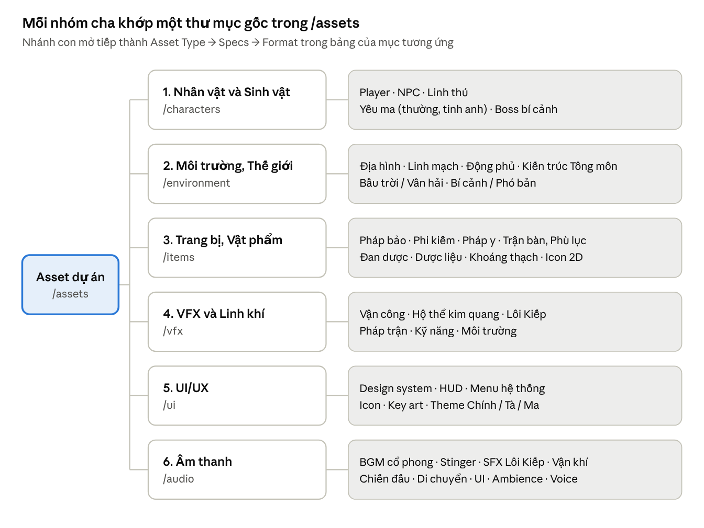

# Asset Breakdown Matrix – MMORPG Tu Tiên 2D Isometric (Web H5 · Mobile · PC)

Oct 31, 2026 · An Nguyen

> **Đã áp dụng "Các quyết định đã thay thế" (Hồ sơ tổng hợp §4).** Mọi chỗ sửa so với docx gốc được đánh dấu bằng ghi chú _[Cập nhật §4: …]_ hoặc khối trích dẫn "Cập nhật". Danh sách tổng hợp: [DECISIONS.md](DECISIONS.md). Gốc: gói tải đầu 29 MB → **25 MB**; thang phẩm 5 → **6 (Trắng → Đỏ)**; icon nguồn 256, hiển thị 128 → **xuất 48 / 64 / 128**; VFX Lôi Kiếp flipbook → **procedural**; kiếm trận → **GPU instancing**.

## Quy ước kỹ thuật 2D

Toàn bộ asset 3D được thay bằng Sprite Sheet, Spine 2D, Tilemap diamond và Particle 2D theo chuẩn Isometric 2:1. Engine đề xuất là **Cocos Creator 3.x**, vì một dự án xuất được Web H5, iOS/Android và PC với runtime web nhẹ, phù hợp mục tiêu initial load **≤ 25 MB** _[Cập nhật §4: gói tải đầu Web 30 MB (dự phòng 1 MB → 29 MB) → 25 MB]_.

> **Cập nhật §4 — Thể loại / engine / nền tảng / hình thức asset:** tài liệu này là bản 2D đã thay GDD 3D: MMORPG 3D thế giới mở → **2D Isometric 2:1, thế giới mở chia chunk**; Unreal Engine 5 → **Cocos Creator 3.x**; PC + Mobile → **Web H5 + Mobile + PC, cross-play**; Mesh / LOD / Nanite / Niagara → **Sprite Sheet, Spine 2D, Tilemap diamond, Particle 2D, sprite shader**.

| Engine            | Web H5                                            | Spine 2D                         | Đánh giá                           |
| ----------------- | ------------------------------------------------- | -------------------------------- | ---------------------------------- |
| Cocos Creator 3.x | Thế mạnh chính, runtime nhỏ                       | Runtime Spine tích hợp sẵn       | **Chọn**                           |
| Unity 2D          | WebGL build nặng, khó giữ initial load dưới 25 MB | spine-unity (runtime chính thức) | Phương án dự phòng nếu đội mạnh C# |
| Godot 4           | Xuất web được nhưng bản C# chưa xuất web          | spine-godot (runtime chính thức) | Hợp cho prototype                  |

### Chuẩn góc nhìn Isometric 2:1 (Dimetric)

- Ô lưới diamond: **64 × 32 px @1x**; asset vẽ bản gốc @2x (128 × 64), xuất @1x cho Web và Mobile cấu hình thấp, @2x cho PC và Mobile cao cấp.
- Góc nghiêng ≈ 26,57° (tỷ lệ cao/rộng 1:2); 1 ô ≈ 1 m gameplay; nhân vật cao khoảng 2,5 ô (96–110 px @1x).
- Nguồn sáng cố định từ hướng NW cho mọi asset vẽ tay và pre-render; bóng đổ về SE.
- Quy đổi tọa độ ô (i, j) sang màn hình @1x:

```latex
x = (i - j) \cdot 32, \qquad y = (i + j) \cdot 16
```

### Quy chuẩn hướng

Mã hướng dùng thống nhất: N, NE, E, SE, S, SW, W, NW. Lật gương tiết kiệm 3/8 số frame, nhưng làm đổi tay cầm vũ khí, nên chỉ dùng cho sinh vật đối xứng.

| Nhóm asset                 | Số hướng vẽ | Hướng vẽ thật                              | Hướng lật gương (flipX)                  |
| -------------------------- | ----------- | ------------------------------------------ | ---------------------------------------- |
| Player, Boss               | 8           | Đủ 8 hướng (vũ khí và pháp y bất đối xứng) | Không                                    |
| Quái thường, NPC, Linh thú | 5           | S, SE, E, NE, N                            | SW ← SE, W ← E, NW ← NE                  |
| Đạn, kiếm khí, tia sét     | 1           | 1 sprite                                   | Xoay theo vector bay, nén trục Y còn 0,5 |
| Prop tĩnh, VFX tròn        | 1           | 1                                          | Không cần                                |

### Hình thức animation

| Hình thức                     | Dùng cho                                      | Ưu điểm                                                                      | Nhược điểm                                                         |
| ----------------------------- | --------------------------------------------- | ---------------------------------------------------------------------------- | ------------------------------------------------------------------ |
| Spine 2D (skeletal)           | Player, Boss lớn, Linh thú, NPC chủ chốt      | Đổi trang bị bằng skin/attachment (paper doll), chuyển động mượt, ít texture | Tốn CPU khi đông nhân vật có mesh deform; rig riêng cho từng hướng |
| Sprite Sheet (frame-by-frame) | Quái thường, NPC đại trà, VFX                 | Rẻ CPU, batch tốt                                                            | Tốn texture, khó đổi trang bị                                      |
| Pre-render 3D → Sprite        | Quái, kiến trúc, pháp bảo (tùy chọn sản xuất) | Ánh sáng 8 hướng đồng nhất, làm nhanh từ model Blender                       | Cần pipeline render và chỉnh tay sau render                        |

Tốc độ khung hình: Sprite Sheet 12–15 fps (idle 8 frame, chạy 8, đánh 10–12); Spine phát 30 fps.

### Atlas và định dạng nén

| Nền tảng             | Atlas tối đa                  | Định dạng nén chính                                                         | Dự phòng                                             |
| -------------------- | ----------------------------- | --------------------------------------------------------------------------- | ---------------------------------------------------- |
| Web H5 / WebGL       | 2048 × 2048                   | KTX2 / Basis Universal: ETC1S cho tile, prop, VFX; UASTC cho nhân vật và UI | WebP (lossy cho nền, lossless cho UI), cuối cùng PNG |
| Mobile iOS / Android | 2048 × 2048                   | ASTC: 4×4 cho UI và nhân vật, 6×6 cho tile và prop, 8×8 cho nền mờ và VFX   | ETC2 cho Android đời cũ                              |
| PC Client            | 2048 (4096 cho atlas map lớn) | PNG / WebP, hoặc BC7 nếu engine hỗ trợ                                      | PNG                                                  |

- Kích thước lũy thừa 2; padding 2 px + extrude 1 px chống rò viền; cắt alpha thừa (trim).
- Thống nhất premultiplied alpha cho toàn bộ atlas Spine và VFX.
- Ngân sách bộ nhớ texture đang nạp (mục tiêu): Web và Mobile thấp ≤ 256 MB, PC ≤ 1 GB.

### Đặt tên và công cụ

| Prefix       | Loại                          | Ví dụ                              |
| ------------ | ----------------------------- | ---------------------------------- |
| spr_         | Sprite Sheet                  | spr_mob_wolfdemon_run_SE           |
| spn_         | Spine (.skel + .atlas + .png) | spn_ply_male_base                  |
| atl_         | Atlas đóng gói                | atl_items_pills_01                 |
| tset_ / map_ | Tileset / chunk tilemap       | tset_sect_tianjian, map_z01_c12_08 |
| vfx_         | Sprite VFX, particle          | vfx_thunder_strike_01              |
| ui_ / fnt_   | UI / bitmap font              | ui_hud_bar_hp, fnt_damage_gold     |
| sfx_ / bgm_  | Âm thanh                      | sfx_qi_circulate_loop              |

Tên animation theo cú pháp hành động_hướng (run_SE, atk1_N). Công cụ: Spine Pro, Aseprite / Photoshop, TexturePacker, Tiled (.tmx), Blender cho pre-render.

## Layering & Depth Sorting (Y-sorting)

Thế giới chia 8 lớp vẽ cố định; chỉ lớp L3 sắp xếp động theo trục Y, nên lỗi đè hình chỉ có thể xảy ra ở một nơi và kiểm soát được bằng quy tắc pivot. Mọi bảng asset bên dưới đều ghi rõ lớp của từng loại.

| Lớp | Tên               | Nội dung                                                                        | Quy tắc sắp xếp                                                         |
| --- | ----------------- | ------------------------------------------------------------------------------- | ----------------------------------------------------------------------- |
| L0  | Ground            | Tilemap nền diamond, mặt nước                                                   | Không sort; vẽ theo hàng ô, batch theo atlas                            |
| L1  | Ground Decal      | Đường đi, vết nứt, trận văn mặt đất, vòng cảnh báo Lôi Kiếp, vòng chọn mục tiêu | Không sort giữa vật thể; thứ tự ưu tiên cố định theo loại               |
| L2  | Shadow            | Bóng ellipse dưới chân, bóng nhà và cây dạng sprite mờ                          | Không sort; luôn vẽ trước L3                                            |
| L3  | World (Y-sort)    | Nhân vật, quái, NPC, linh thú, prop, cây, nhà cắt lát, vật phẩm rơi, đạn        | Sort theo Y của pivot tăng dần (Y lớn hơn vẽ sau); hòa thì so X, rồi ID |
| L4  | Air               | Ngự kiếm bay, thú bay, Pháp Tướng, mây thấp                                     | Vẽ trên L3; trong lớp sort theo Y của bóng dưới đất                     |
| L5  | Weather / Overlay | Mưa, tuyết, Vân hải tiền cảnh, mây kiếp                                         | Không sort; toàn màn hình hoặc parallax                                 |
| L6  | World UI          | Tên, thanh máu, số sát thương, dấu nhiệm vụ                                     | Luôn trên thế giới; trong lớp sort theo Y                               |
| L7  | Screen UI         | HUD, menu, hội thoại                                                            | Theo cây UI                                                             |

### Quy tắc pivot và sort key

- **Pivot = điểm tiếp đất** (giữa hai chân) cho mọi sprite L3; vẽ cố định trong canvas: giữa chiều ngang, cách đáy 12 px @1x. Spine đặt root bone tại điểm này.
- **Sort key = Y mặt đất**, không phải Y hình ảnh: khi nhảy, khinh công hay bị hất tung, sprite dời lên theo độ cao z nhưng vẫn sort theo Y mặt đất.
- **Vật thể nhiều ô** (nhà, sơn môn, vách đá): cắt thành lát dọc rộng 1 ô (64 px @1x), mỗi lát có pivot ở đỉnh dưới của ô diamond nó đứng.
- **Tường, hàng rào dài:** dùng sort line hai điểm theo cạnh đáy; nhân vật được so với đoạn thẳng thay vì một điểm.
- **Cây:** pivot ở gốc; cây tán rộng tách thân (L3) và phần tán vươn ra trên đầu.
- **Che khuất:** người chơi đứng sau vật thể L3 lớn thì vật thể mờ còn 60% alpha; PC có thể thay bằng silhouette nhân vật qua sprite shader.
- **VFX gắn chủ thể:** lấy sort key của chủ thể cộng offset (aura sau lưng −1, nhát chém phía trước +1); VFX mặt đất thuộc L1, VFX trên không thuộc L4.
- **Đạn và vật phẩm rơi:** sort theo bóng dưới đất, không theo độ cao bay.

### Hiệu năng và cách làm theo engine

- Chỉ sort lại vật thể đã di chuyển (dirty flag) bằng insertion sort, vì danh sách gần như đã có thứ tự; giới hạn 300 vật thể L3 trên Mobile.
- Cocos Creator: tự viết component sắp xếp theo Y, cập nhật thứ tự node trong lớp L3.
- Unity 2D: Sorting Layer cho L0–L7, Transparency Sort Axis (0, 1, 0), Sprite Sort Point = Pivot.
- Godot 4: bật y_sort_enabled trên node cha của lớp L3.

## Đóng gói & Streaming

Gói khởi động Web giữ ở **25 MB** (gồm 2 MB dự phòng); mọi thứ khác tải theo nhu cầu, trong đó bản đồ stream theo chunk quanh tọa độ người chơi.

### Ngân sách initial load (Web H5)

| Gói                | Nội dung                                                               | Ngân sách |
| ------------------ | ---------------------------------------------------------------------- | --------- |
| Engine + code game | Runtime engine, logic game, transcoder Basis, đã nén brotli            | 6 MB      |
| UI lõi             | Đăng nhập, tạo nhân vật, HUD, bitmap font (khung 9-slice @1x, icon 48) | 4 MB      |
| Nhân vật           | Spine base 2 giới tính + bộ trang bị tân thủ mỗi lớp                   | 4 MB      |
| Bản đồ tân thủ     | 3 × 3 chunk quanh điểm hồi sinh + tileset vùng đầu                     | 5 MB      |
| Quái + VFX tân thủ | Quái vùng đầu, VFX kỹ năng cơ bản                                      | 3 MB      |
| Âm thanh tối thiểu | SFX giao diện; BGM đầu tiên phát dạng stream                           | 1 MB      |
| Dự phòng           | —                                                                      | 2 MB      |
| **Tổng**           |                                                                        | **25 MB** |

> _[Cập nhật §4: bảng phân bổ cũ 7 + 5 + 5 + 6 + 3 + 2 + 1 = 29 MB được thay bằng 6 + 4 + 4 + 5 + 3 + 1 + 2 = 25 MB, theo bảng "Gói tải ban đầu ≤ 25 MB" của 06-toi-uu-render.md.]_

### Các loại Asset Bundle

| Bundle            | Nội dung                                          | Thời điểm tải                               | Kích thước mục tiêu              |
| ----------------- | ------------------------------------------------- | ------------------------------------------- | -------------------------------- |
| Core              | Như bảng trên                                     | Trước khi vào game                          | ≤ 25 MB _[Cập nhật §4: 29 → 25]_ |
| Class pack        | Spine và VFX kỹ năng của một lớp nhân vật         | Khi chọn lớp hoặc gặp người chơi lớp đó     | 3–6 MB                           |
| Equipment pack    | Attachment Spine của một bộ trang bị / pháp y     | Khi mặc, hoặc khi người mặc bộ đó xuất hiện | 0,2–1 MB mỗi bộ                  |
| Zone pack         | Tileset dùng chung, quái, BGM của một vùng        | Khi đến gần ranh giới vùng                  | 8–15 MB                          |
| Map chunk         | Dữ liệu ô + prop của một chunk                    | Stream theo tọa độ                          | 0,5–2 MB                         |
| Event / Sect pack | Tông môn, chiến tranh Linh Mạch, bí cảnh, sự kiện | Theo lịch, hoặc khi vào                     | 5–20 MB                          |
| Audio stream      | BGM, ambience                                     | Stream liên tục                             | Không tải trọn                   |

### Streaming map theo tọa độ

- Bản đồ chia chunk **32 × 32 ô** (2048 × 1024 px @1x, vừa một atlas 2048).
- Luôn nạp 3 × 3 chunk quanh người chơi; tải trước 5 × 5, ưu tiên các chunk nằm phía trước hướng di chuyển.
- Giải phóng chunk ngoài vùng 7 × 7 theo LRU; giữ cache trên máy (Cache Storage / IndexedDB cho Web, file cache cho bản native).
- Khi ngự kiếm bay tốc độ cao: mở rộng vùng tải trước và dùng ảnh bản đồ độ phân giải thấp làm nền tạm.
- Asset chưa tải xong luôn có placeholder: nhân vật khác hiện bóng mờ + trang bị mặc định, prop hiện ảnh mờ của chunk.

### Phát hành và cập nhật

- Tên file theo hash nội dung; CDN cache dài hạn; manifest so sánh để hot update chỉ phần thay đổi.
- Web dùng Service Worker cache và nén brotli cho JSON, .skel, dữ liệu tilemap.
- Bản Mobile/PC đóng sẵn Core + 1 Zone pack trong file cài đặt; phần còn lại tải như Web.

## Sơ đồ cây phân loại



Cây phân loại asset · 6 nhóm cha và các nhánh con

Cây có bốn tầng: Parent Category (sơ đồ) → Sub-category (sơ đồ) → Asset Type → Specs/Format (các bảng bên dưới).

## 1. Nhân vật & Sinh vật

Player, Boss và Linh thú dùng Spine để đổi trang bị và tiến hóa bằng skin; quái và NPC đại trà dùng Sprite Sheet 5 hướng lật gương để rẻ CPU. Kích thước canvas tính ở @1x.

| Sub-category | Asset Type                                        | Hình thức · Hướng                                                       | Specs                                                                                                                                                   | Layer · Bundle                 | SL MVP                |
| ------------ | ------------------------------------------------- | ----------------------------------------------------------------------- | ------------------------------------------------------------------------------------------------------------------------------------------------------- | ------------------------------ | --------------------- |
| Player       | Body base nam/nữ                                  | Spine · 8 hướng (rig dùng chung giữa hướng đối xứng, vẽ lại lớp vũ khí) | Canvas 128 × 128; 1 atlas 2048 mỗi giới tính; UASTC / ASTC 4×4                                                                                          | L3 · Core                      | 2 giới tính           |
| Player       | Bộ animation                                      | Spine · 8 hướng                                                         | ~18 animation mỗi lớp vũ khí: idle, chạy, khinh công, ngự kiếm, đả tọa, 3 đòn, thi pháp, trúng đòn, chết, độ kiếp                                       | L3 (ngự kiếm: L4) · Class pack | 6 lớp vũ khí          |
| Player       | Mặt, tóc                                          | Spine skin / attachment                                                 | Đầu chỉ khoảng 24 px trên màn hình: ưu tiên dáng tóc và màu sắc hơn chi tiết mặt                                                                        | L3 · Core                      | 12 mặt, 20 kiểu tóc   |
| Player       | Pháp Tướng Thiên Địa                              | Sprite Sheet lớn · 5 hướng                                              | Canvas 512 × 512; vòng lặp 8 frame; additive shader                                                                                                     | L4 · Class pack                | 8                     |
| NPC          | NPC chủ chốt                                      | Spine (rig của Player) · 5 hướng + lật                                  | Canvas 128 × 128; idle, đi, nói, hành động riêng                                                                                                        | L3 · Zone pack                 | 60                    |
| NPC          | NPC đại trà                                       | Sprite Sheet · 5 hướng + lật                                            | 3 animation × 8 frame; biến thể bằng palette swap shader                                                                                                | L3 · Zone pack                 | 30 bộ → 200 biến thể  |
| Linh thú     | Thú đồng hành, thú cưỡi (Hạc, Kỳ Lân, Giao Long…) | Spine · 5 hướng + lật                                                   | Canvas 192 × 192 (thú cưỡi lớn 256); Player gắn vào bone yên khi cưỡi; 3 giai đoạn tiến hóa bằng skin                                                   | L3 (bay: L4) · Equipment pack  | 15 loài × 3 giai đoạn |
| Yêu ma       | Quái thường                                       | Sprite Sheet hoặc pre-render 3D · 5 hướng + lật                         | Canvas 128 × 128; idle 6, chạy 8, đánh 10, trúng đòn 4, chết 10 frame (~190 frame/quái, vừa 1 atlas 2048); biến thể ngũ hành bằng tint / palette shader | L3 · Zone pack                 | 25 loại × 4 biến thể  |
| Yêu ma       | Quái tinh anh                                     | Sprite Sheet · 5 hướng + lật                                            | Canvas 192 × 192; thêm 1 kỹ năng riêng; 2 atlas 2048                                                                                                    | L3 · Zone pack                 | 20                    |
| Boss bí cảnh | Boss nhiều giai đoạn                              | Spine · 8 hướng                                                         | Canvas 384–512; chiếm 2 × 2 đến 3 × 3 ô, pivot tại đỉnh dưới của footprint; đổi phase bằng skin + animation                                             | L3 · Event / Sect pack         | 12                    |
| Dùng chung   | Bóng đổ dưới chân                                 | Sprite tĩnh                                                             | Ellipse mờ 3 cỡ, một atlas nhỏ                                                                                                                          | L2 · Core                      | 3                     |
| Dùng chung   | Chân dung hội thoại                               | Ảnh tĩnh hoặc Spine nhẹ (thở, chớp mắt)                                 | 512 × 512, WebP / KTX2                                                                                                                                  | L7 · tải cùng hội thoại        | 60 + 12 avatar Player |

**Ngân sách hiển thị Mobile / Web:** tối đa 30 Spine cập nhật đầy đủ cùng lúc; nhân vật ở xa giảm tần số cập nhật xuống 15 fps, quá ngưỡng thì chuyển sang tên + bóng (ẩn trang bị chi tiết).

## 2. Môi trường & Thế giới

Thế giới dựng từ Tilemap diamond 64 × 32 px (biên tập trong Tiled, xuất .tmx/.json), chia chunk 32 × 32 ô để stream; mọi vật thể cao hơn mặt đất là sprite L3 có pivot ở chân, vật lớn được cắt lát dọc rộng 1 ô.

| Sub-category       | Asset Type                                         | Hình thức · Hướng                                | Specs                                                                          | Layer · Bundle                        | SL MVP                        |
| ------------------ | -------------------------------------------------- | ------------------------------------------------ | ------------------------------------------------------------------------------ | ------------------------------------- | ----------------------------- |
| Địa hình           | Tile nền theo biome                                | Tile tĩnh · 1 hướng                              | 64 × 32, liền mép; mỗi biome 1 tileset atlas 2048; ETC1S / ASTC 6×6            | L0 · Zone pack                        | 4 biome                       |
| Địa hình           | Tile chuyển tiếp (đất–cỏ, cỏ–cát…)                 | Autotile                                         | Bộ cạnh và góc diamond cho mỗi cặp vật liệu                                    | L0 · Zone pack                        | 16 cặp                        |
| Địa hình           | Vách đá, bậc thềm cao                              | Tile cao · 1 hướng                               | 64 × 64 đến 64 × 96 (mỗi tầng cao thêm 32 px); pivot ở chân vách               | L3 · Map chunk                        | 3 kit × 20 mảnh               |
| Địa hình           | Nước, linh tuyền                                   | Tile động 4–8 frame hoặc shader cuộn UV          | Linh tuyền thêm lớp additive phát sáng; bọt bờ là decal                        | L0 (bọt: L1) · Zone pack              | 8 kiểu                        |
| Địa hình           | Cây, đá, bụi                                       | Sprite tĩnh · 1 hướng                            | Canvas 128–256; cây lay nhẹ bằng vertex shader; cây tán rộng tách thân và tán  | L3 · Map chunk                        | 60 loài                       |
| Địa hình           | Cỏ, hoa, sỏi trang trí                             | Decal sprite                                     | 32–64 px, rải ngẫu nhiên theo ô                                                | L1 · Map chunk                        | 40                            |
| Linh mạch          | Mạch linh khí lộ thiên                             | Decal phát sáng + Particle 2D                    | Tint theo phẩm 1–6                                                             | L1 · Zone pack                        | 6 phẩm _[Cập nhật §4: 5 → 6]_ |
| Linh mạch          | Linh Mạch Tâm                                      | Sprite lớn cắt lát                               | Footprint 3 × 3 ô; 3 trạng thái bằng đổi sprite + glow shader                  | L3 · Event / Sect pack                | 1 / bản đồ chiến tranh        |
| Linh mạch          | Mỏ khoáng, điểm thu hái                            | Sprite 2 trạng thái                              | 64–128 px, đầy / cạn                                                           | L3 · Map chunk                        | 30                            |
| Động phủ           | Kit nền, tường hang động và đình viện              | Tileset + tường cắt lát 1 ô                      | Snap theo ô diamond                                                            | L0 / L3 · Zone pack                   | 150 mảnh                      |
| Động phủ           | Nội thất (bồ đoàn, đan lô, giá kinh, Tụ linh trận) | Sprite · 2 hướng + lật = 4 hướng xoay            | Footprint 1 × 1 đến 2 × 3 ô                                                    | L3 · Equipment pack                   | 80                            |
| Kiến trúc Tông môn | Kit kiến trúc theo phe (Chính / Tà / Ma)           | Sprite cắt lát rộng 1 ô                          | Tường, cột, mái ghép thành nhà; mái tách lớp riêng                             | L3 · Sect pack                        | 3 kit × 120 mảnh              |
| Kiến trúc Tông môn | Landmark (sơn môn, đại điện, tháp)                 | Sprite lớn vẽ tay hoặc pre-render, cắt lát 64 px | 512–1024 px; mái mờ đi khi người chơi vào trong                                | L3 · Sect pack                        | 6 tông × 3                    |
| Kiến trúc Tông môn | Hộ Sơn Đại Trận + Trận Nhãn                        | Sprite vòm bán trong suốt + shader nứt / tan     | Vòm phủ cả núi; Trận Nhãn là prop L3                                           | Vòm: L5 · Event / Sect pack           | 1 hệ dùng chung               |
| Bầu trời / Vân hải | Vân hải quanh phù đảo                              | 2–3 lớp parallax, shader cuộn UV                 | Texture lặp 1024 × 512                                                         | Dưới L0 và L5 (tiền cảnh) · Zone pack | 3 preset                      |
| Bầu trời / Vân hải | Ngày đêm, ánh sáng 2D                              | LUT color grading + light sprite additive        | Không đổi asset theo giờ; đèn lồng, linh quang là sprite sáng                  | L5 · Core                             | 4 LUT                         |
| Bầu trời / Vân hải | Thời tiết, mây kiếp                                | Particle 2D + bóng mây trôi trên đất             | Mưa, tuyết, lá rơi; mây kiếp làm tối cảnh + sprite xoáy                        | L5 (bóng mây: L1) · Zone pack         | 6 thời tiết + 1 kiếp          |
| Bí cảnh / Phó bản  | Phó bản instance                                   | Tilemap riêng                                    | 64 × 64 đến 128 × 128 ô; biome mới (Huyết Hải, Băng Nguyên, Lôi Trì, Hư Không) | L0–L5 · Event pack                    | 10                            |
| Bí cảnh / Phó bản  | Bí cảnh mở theo mùa                                | Tilemap stream theo chunk                        | 256 × 256 ô, nhiều người chơi                                                  | L0–L5 · Event pack                    | 4                             |
| Bí cảnh / Phó bản  | Tâm cảnh (Tâm Ma Kiếp)                             | Tileset sẵn có + shader đảo màu, méo hình        | Bố cục sinh theo dữ liệu người chơi                                            | L0–L5 · Class pack                    | 9 biến thể                    |

Mỗi tilemap có thêm các lớp dữ liệu không hiển thị: ô chặn, ô nước, vùng an toàn, vùng PK và điểm hồi sinh.

## 3. Trang bị & Vật phẩm

Trang bị mặc trên người là attachment Spine 8 hướng theo hệ paper doll; vật phẩm trên mặt đất dùng sprite rơi chung theo nhóm, không làm riêng từng món. Phẩm 1–6 (Trắng · Lục · Lam · Tím · Vàng · Đỏ) thể hiện bằng tint và outline glow shader thay vì vẽ lại. _[Cập nhật §4: thang 5 phẩm → 6 phẩm Trắng → Đỏ, có dấu góc cho người mù màu.]_

| Sub-category | Asset Type                                        | Hình thức · Hướng                                                                                                             | Specs                                                                                                                                                                                                                                              | Layer · Bundle                             | SL MVP                   |
| ------------ | ------------------------------------------------- | ----------------------------------------------------------------------------------------------------------------------------- | -------------------------------------------------------------------------------------------------------------------------------------------------------------------------------------------------------------------------------------------------- | ------------------------------------------ | ------------------------ |
| Pháp bảo     | Dạng cầm tay                                      | Spine attachment · 8 hướng                                                                                                    | Gắn vào bone tay của Player                                                                                                                                                                                                                        | L3 · Equipment pack                        | 12 hình dạng             |
| Pháp bảo     | Dạng lơ lửng quanh người                          | Sprite Sheet · 1 hướng                                                                                                        | 64 × 64, vòng lặp 6 frame; quỹ đạo xoay bằng code                                                                                                                                                                                                  | L3 (sort key của chủ ± 1) · Equipment pack | 12 × 6 phẩm (shader)     |
| Pháp bảo     | Dạng kích hoạt phóng to                           | Sprite Sheet + VFX                                                                                                            | Canvas 256 × 256, 8–12 frame                                                                                                                                                                                                                       | L3 / L4 · Class pack                       | 12                       |
| Phi kiếm     | Cầm tay                                           | Spine attachment · 8 hướng                                                                                                    | Gắn bone tay                                                                                                                                                                                                                                       | L3 · Equipment pack                        | 20 mẫu                   |
| Phi kiếm     | Kiếm cưỡi khi bay                                 | Sprite · 8 hướng vẽ thật (kiếm chéo không lật được)                                                                           | ~128 × 48; vệt kiếm bằng trail 2D                                                                                                                                                                                                                  | L4 · Equipment pack                        | 20 mẫu × 6 phẩm (shader) |
| Phi kiếm     | Kiếm trận, phi kiếm tấn công                      | 1 sprite kiếm + **GPU instancing** (mỗi thanh kiếm là 1 instance chỉ mang chỉ số k và seed; quỹ đạo tính trong vertex shader) | 64 × 16, trail additive; Vạn Kiếm Quy Tông = 1 draw call, < 0,5 MB, không dùng Niagara / flipbook, không Y-sort từng thanh _[Cập nhật §4: thay flipbook / Particle 2D, chi tiết ở 06-toi-uu-render.md]_                                            | L3 / L4 · Class pack                       | 1 hệ dùng chung          |
| Pháp y       | Bộ trang phục (áo, váy, đai, giày, áo choàng, mũ) | Spine skin / attachment · 8 hướng                                                                                             | Tay áo rộng, dải lụa dùng mesh deform + physics constraint của Spine; ≤ 1 atlas 1024 mỗi bộ                                                                                                                                                        | L3 · Equipment pack                        | 40 bộ                    |
| Trận bàn     | Trận bàn, trận kỳ                                 | Sprite triển khai + decal                                                                                                     | Triển khai: 3–5 lá trận kỳ dựng quanh vòng + decal trận văn                                                                                                                                                                                        | Kỳ: L3, trận văn: L1 · Class pack          | 10                       |
| Trận bàn     | Phù lục                                           | Sprite bay khi ném · 1 hướng xoay                                                                                             | 32 × 48; atlas chung mọi loại phù                                                                                                                                                                                                                  | L3 · Class pack                            | 30                       |
| Đan dược     | Đan dược (chỉ icon + VFX khi dùng)                | Icon                                                                                                                          | Viên đan và bình đan; vân đan phát sáng theo phẩm                                                                                                                                                                                                  | L7 · Core / Zone pack                      | 40                       |
| Đan dược     | Đan lô (lò luyện)                                 | Spine nhẹ                                                                                                                     | Canvas 256 × 256; nắp mở, lửa đan; dùng cả trong minigame                                                                                                                                                                                          | L3 / L7 · Zone pack                        | 3                        |
| Dược liệu    | Linh thảo thu hái                                 | Sprite · 3 giai đoạn sinh trưởng                                                                                              | 64–96 px                                                                                                                                                                                                                                           | L3 · Map chunk                             | 50                       |
| Khoáng thạch | Khoáng thạch, Linh thạch hạ/trung/thượng phẩm     | Sprite + icon                                                                                                                 | Tinh thể có glow shader mạnh dần theo phẩm                                                                                                                                                                                                         | L3 · Map chunk                             | 30                       |
| Dùng chung   | Vật phẩm rơi trên đất                             | Sprite chung theo nhóm                                                                                                        | 48 × 48 (túi, rương, linh thạch, trang bị theo loại) + cột sáng theo phẩm                                                                                                                                                                          | L3 · Core                                  | 20 kiểu                  |
| Dùng chung   | Icon vật phẩm                                     | Ảnh tĩnh                                                                                                                      | Nguồn 256, **xuất 48 / 64 / 128** (engine chọn bitmap nhỏ nhất không nhỏ hơn kích thước hiển thị); nền trong suốt, viền phẩm ghép lúc chạy; atlas 2048 _[Cập nhật §4: nguồn 256 / hiển thị 128 → nguồn 256, xuất 48 / 64 / 128]_; UASTC / ASTC 4×4 | L7 · Core + Zone pack                      | ~600 (3 atlas)           |

## 4. Hiệu ứng hình ảnh (VFX) & Linh khí

VFX 2D ghép từ ba thành phần: flipbook Sprite Sheet, Particle 2D của engine và sprite shader (additive, dissolve, cuộn UV; distortion chỉ bật trên PC). Mọi vòng tròn trên mặt đất được vẽ sẵn thành ellipse 2:1, không xoay 3D.

**Ngân sách:** mỗi kỹ năng ≤ 2 draw call; tổng hạt trên màn hình ≤ 1.000 (Web / Mobile) và ≤ 3.000 (PC); atlas VFX nén ETC1S / ASTC 8×8 vì VFX chịu nén tốt. Bảng màu hệ giữ nguyên: Kim vàng trắng · Mộc lục · Thủy lam · Hỏa đỏ cam · Thổ vàng nâu · Phong lục nhạt · Lôi tím · Băng lam nhạt.

| Sub-category     | Asset Type                                  | Hình thức · Hướng                                                         | Specs                                                                                                                                                                                                                                            | Layer · Bundle                        | SL MVP       |
| ---------------- | ------------------------------------------- | ------------------------------------------------------------------------- | ------------------------------------------------------------------------------------------------------------------------------------------------------------------------------------------------------------------------------------------------ | ------------------------------------- | ------------ |
| Vận công         | Đả tọa vận chuyển linh khí                  | Particle 2D + flipbook · 1 hướng                                          | Hạt tụ về đan điền; vòng xoáy ellipse 256 × 128, 8 frame; tint theo hệ                                                                                                                                                                           | L3 (sau lưng −1) + vòng đất L1 · Core | 8 hệ         |
| Vận công         | Aura cảnh giới                              | Flipbook vòng lặp                                                         | 128 × 192, 6–8 frame, ≤ 30 hạt                                                                                                                                                                                                                   | L3 (−1) · Core                        | 9 cấp        |
| Vận công         | Đột phá                                     | Flipbook + sóng xung kích ellipse + chớp màn hình                         | 512 × 512, 12–16 frame                                                                                                                                                                                                                           | L3 / L1 / L5 · Core                   | 2 cấp × 8 hệ |
| Hộ thể kim quang | Khiên hộ thể                                | Sprite vòm + shader viền sáng, phù văn cuộn UV; vỡ bằng flipbook 10 frame | Tách nửa sau (−1) và nửa trước (+1) để nhân vật nằm trong khiên                                                                                                                                                                                  | L3 · Class pack                       | 5 loại       |
| Lôi Kiếp         | Tia sét kiếp                                | **Procedural** (fBm + segment mesh), không texture · 1 hướng              | Không còn flipbook 128 × 512 / 8 frame / 4 biến thể; sét sinh bằng chia đôi đoạn thẳng + nhánh, tia mới mỗi 60 ms; chớp trắng toàn màn hình có tùy chọn giảm cho người nhạy sáng _[Cập nhật §4: flipbook → procedural, xem 06-toi-uu-render.md]_ | L4 + chớp L5 · Event pack             | 4            |
| Lôi Kiếp         | Vòng cảnh báo sét                           | Decal ellipse, shader lấp đầy theo thời gian                              | 1–1,5 giây trước khi sét đánh                                                                                                                                                                                                                    | L1 · Event pack                       | 2 cỡ         |
| Lôi Kiếp         | Hậu quả va chạm                             | Decal cháy + flipbook khói và đá văng                                     | 256 × 256                                                                                                                                                                                                                                        | L1 / L3 · Event pack                  | 3            |
| Pháp trận        | Trận văn mặt đất                            | Decal ellipse 2:1 + shader xoay UV và phát sáng                           | 512 × 256; màu phe ta / phe địch tách bạch; bán kính 8–20 ô                                                                                                                                                                                      | L1 · Class pack                       | 5 loại trận  |
| Kỹ năng          | VFX kỹ năng chiến đấu                       | Flipbook + Particle 2D                                                    | Kỹ năng có hướng (chém, sóng kiếm): 5 hướng + lật, hoặc xoay sprite và nén trục Y 0,5                                                                                                                                                            | L3 / L4 · Class pack                  | ~150         |
| Kỹ năng          | Vệt ngự kiếm, viền Pháp Tướng               | Trail 2D + Particle 2D                                                    | Gắn bone / điểm neo của chủ thể                                                                                                                                                                                                                  | L4 · Class pack                       | 20 + 8       |
| Kỹ năng          | Trạng thái (tê liệt, đóng băng, độc, cháy…) | Tint shader lên sprite + flipbook nhỏ                                     | ≤ 20 hạt mỗi hiệu ứng                                                                                                                                                                                                                            | L3 (+1) · Core                        | 15           |
| Môi trường       | Linh khí, hoa đào rơi, đom đóm              | Particle 2D theo vùng                                                     | Tắt trên máy cấu hình thấp                                                                                                                                                                                                                       | L5 · Zone pack                        | 20           |

## 5. UI/UX – Thủy mặc × Cyber-Xianxia

Phong cách giữ nguyên (nền thủy mặc, phát sáng màu hệ chỉ cho thông tin cần phản ứng); phần thay đổi là chuẩn kỹ thuật đa nền tảng: một bố cục thiết kế 1280 × 720, asset vẽ @2x, Web có thể tải bộ @1x.

**Màn hình:** Mobile và Web co theo chiều cao, tôn trọng safe area (tai thỏ); PC cho phép đổi kích thước cửa sổ và co tới 4K. Nút chạm tối thiểu 88 px @2x (44 pt). Chữ không vẽ cứng vào ảnh để bản địa hóa Việt / Trung / Anh.

| Sub-category  | Asset Type                                    | Hình thức                                         | Specs                                                                                                                         | Layer · Bundle         | SL MVP     |
| ------------- | --------------------------------------------- | ------------------------------------------------- | ----------------------------------------------------------------------------------------------------------------------------- | ---------------------- | ---------- |
| Design system | Style guide, bảng màu, lưới 8 px              | Figma library                                     | Dùng chung giữa art và dev                                                                                                    | —                      | 1          |
| Design system | Kit khung, viền, nút                          | Sprite 9-slice                                    | Viền theo phẩm 1–6 (Trắng → Đỏ); 4 trạng thái nút; atlas UI lõi 2048; UASTC / ASTC 4×4 hoặc WebP lossless để giữ nét          | L7 · Core              | 1 kit      |
| Font          | Font số và tiêu đề cố định                    | Bitmap font (.fnt + atlas)                        | Số sát thương, số vàng, tiêu đề thư pháp; tránh tải web font Hán tự nặng                                                      | L6 / L7 · Core         | 4 bộ       |
| Font          | Font nội dung                                 | TTF động, cắt subset                              | Đủ dấu tiếng Việt; Hán tự cắt theo ký tự thực dùng                                                                            | L7 · Core              | 1–2        |
| HUD           | Thanh HP, Linh lực, Thần thức, kỹ năng, ô phù | Sprite + shader thanh chảy linh khí               | PC: chuột + phím tắt · Mobile / Web chạm: joystick ảo, nút kỹ năng lớn                                                        | L7 · Core              | 2 bố cục   |
| HUD           | Minimap la bàn Bát Quái                       | Vẽ từ dữ liệu tilemap + icon                      | Không cần ảnh bản đồ riêng cho minimap                                                                                        | L7 · Core              | 1          |
| World UI      | Tên, thanh máu, dấu nhiệm vụ, số sát thương   | Sprite + bitmap font                              | Một atlas riêng để batch toàn bộ World UI                                                                                     | L6 · Core              | 1 atlas    |
| Menu hệ thống | Túi đồ (cuộn trúc), nhân vật, trang bị        | Prefab UI + shader mực loang (dissolve noise 512) | Ô đồ hiển thị icon 128 px                                                                                                     | L7 · Core              | 6 màn hình |
| Menu hệ thống | Kinh mạch đồ, Tinh đồ công pháp               | Sprite + shader tiến độ                           | Đường kinh mạch sáng dần theo cảnh giới                                                                                       | L7 · Class pack        | 2          |
| Menu hệ thống | Luyện đan, chế phù, tông môn, Vạn Bảo Lâu     | Prefab UI                                         | Minigame luyện đan dùng Spine đan lô                                                                                          | L7 · Zone / Sect pack  | 5          |
| Menu hệ thống | Bản đồ thế giới                               | Tranh thủy mặc chia tile 512 tải theo mức zoom    | Không dùng một ảnh lớn vì vượt trần atlas 2048                                                                                | L7 · Zone pack         | 4 vùng     |
| Icon          | Icon kỹ năng, trạng thái                      | Ảnh tĩnh                                          | Nguồn 256, xuất 48 / 64 / 128: kỹ năng dùng 64 (thanh) / 128 (chi tiết), trạng thái 48 px _[Cập nhật §4: icon 48 / 64 / 128]_ | L7 · Class pack / Core | 150 + 30   |
| Hình ảnh      | Key art, màn hình tải, khung hội thoại        | Ảnh tĩnh                                          | 1920 × 1080 WebP / KTX2; chỉ 1 ảnh tải nằm trong Core                                                                         | L7 · Core + Event pack | 20         |
| Phe phái      | Theme Chính / Tà / Ma                         | Tham số shader đổi màu                            | Không vẽ lại asset; Ma đạo thêm glitch nhẹ                                                                                    | L7 · Core              | 3 theme    |

## 6. Âm thanh

Nội dung âm nhạc giữ nguyên (nhạc cụ cổ phong thu âm thật + synth pad); thay đổi nằm ở định dạng và cách tải: BGM và ambience luôn stream, SFX ngắn nạp vào bộ nhớ, nhạc thích ứng làm bằng crossfade 2–3 stem trong code.

**Chuẩn chung:** nguồn WAV 48 kHz / 24-bit; Web chỉ phát âm thanh sau thao tác đầu tiên của người chơi (chính sách autoplay của trình duyệt); giới hạn 24 âm cùng lúc trên Mobile / Web, 48 trên PC; âm thanh định vị bằng pan theo vị trí ngang trên màn hình và suy giảm theo khoảng cách ô.

| Sub-category  | Asset Type                                        | Specs                                                                              | Định dạng (Web · Mobile · PC)                      | Bundle             | SL MVP         |
| ------------- | ------------------------------------------------- | ---------------------------------------------------------------------------------- | -------------------------------------------------- | ------------------ | -------------- |
| BGM           | Nhạc khám phá theo vùng                           | Cổ cầm, Địch tử, Tiêu, Cổ tranh; 2–3 stem; vòng lặp 3–5 phút; 96–128 kbps stereo   | M4A/AAC (tương thích Safari) + OGG · OGG/AAC · OGG | Audio stream       | 12             |
| BGM           | Nhạc chiến đấu                                    | Tỳ bà tremolo, trống trận; stem cường độ, chuyển ở ranh giới ô nhịp                | Như trên                                           | Audio stream       | 8              |
| BGM           | Nhạc Boss, Lôi Kiếp, Phi Thăng                    | Đổi theo phase boss; Lôi Kiếp tăng dần theo số đạo sét                             | Như trên                                           | Audio stream       | 12 + 3         |
| BGM           | Chủ đề tông môn theo phe                          | Chính: cổ cầm, chuông đồng · Tà: suona lệch điệu · Ma: hợp xướng trầm, synth méo   | Như trên                                           | Sect pack (stream) | 3 × 2 biến tấu |
| BGM           | Stinger                                           | 2–8 giây: đột phá thành công / thất bại, vật phẩm hiếm, chiếm Linh Mạch            | Nạp vào bộ nhớ                                     | Core               | 30             |
| SFX Lôi Kiếp  | Sấm và sét kiếp                                   | 3 lớp chọn theo khoảng cách ô: xa (rền trầm), trung, gần (nổ sắc); mono 44,1 kHz   | OGG / M4A, giải nén khi nạp                        | Event pack         | 40             |
| SFX Vận khí   | Âm vận công, tụ linh khí                          | Drone lặp theo cảnh giới; cao độ tăng theo tiến độ đột phá (chỉnh pitch bằng code) | Như trên                                           | Core               | 20             |
| SFX Chiến đấu | Kiếm khí, va chạm, kỹ năng ngũ hành               | Bảng âm sắc theo hệ; mono 22–44,1 kHz, ngắn                                        | Như trên                                           | Core + Class pack  | ~600           |
| SFX Di chuyển | Ngự kiếm bay, khinh công, bước chân               | Gió lặp theo tốc độ; bước chân theo loại ô (lấy từ lớp dữ liệu tilemap)            | Như trên                                           | Core               | 120            |
| SFX UI        | Âm giao diện                                      | Cọ lướt giấy, ấn triện, chuông nhỏ, ngọc va; biến thể theo phe                     | Như trên                                           | Core               | 80             |
| Ambience      | Âm nền vùng                                       | Rừng trúc, thác, vân hải, Ma vực; vòng lặp 64–96 kbps                              | Stream                                             | Zone pack          | 30             |
| Voice         | Lồng tiếng NPC, tiếng hô kỹ năng, tâm ma thì thầm | Mono 44,1 kHz; câu thoại dài stream, tiếng hô ngắn nạp sẵn                         | M4A/AAC + OGG                                      | Zone / Class pack  | ~3.000 câu     |
