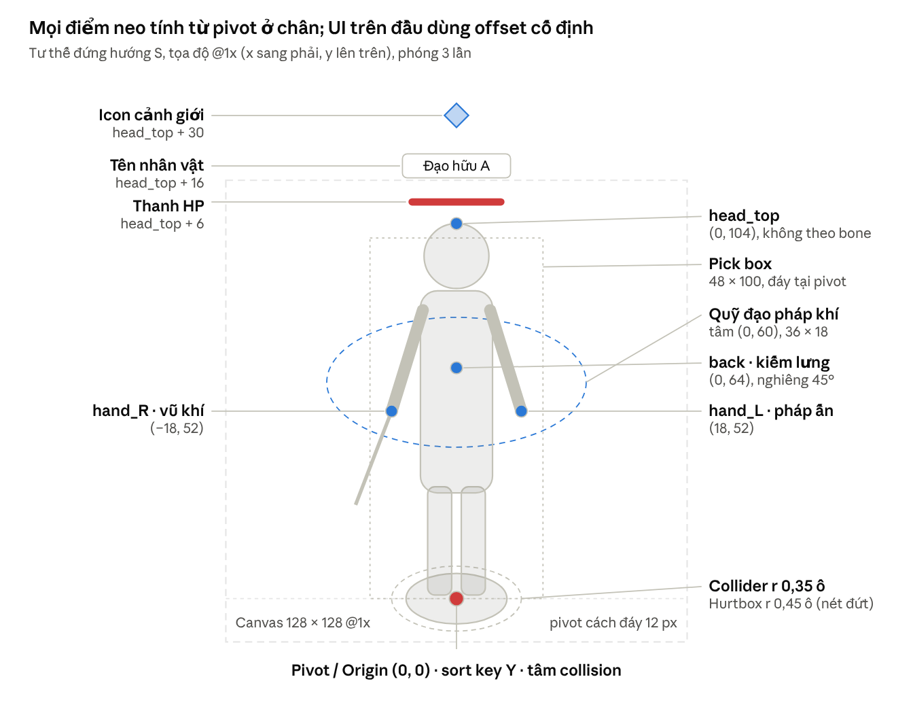

# Đặc tả kỹ thuật Nhân vật & Quái vật – Tu Tiên 2D Isometric

Oct 31, 2026 · An Nguyen

> **[Cập nhật D44: hướng Player mới là premium semi-chibi, khoảng 4,5 đầu, mặt cố định từng Đạo Lộ; áo và vũ khí có hình riêng T1–T5 theo nhóm cảnh giới. Sáu phẩm D6 dùng tint viền/glow runtime, không sinh sáu bộ hình; trang phục cosmetic và skin vũ khí bán riêng. D41 frame-by-frame và D14 5 hướng + lật vẫn áp dụng; chưa thay bộ semi-realistic đang chạy. Chuẩn chi tiết và giới hạn concept: [art/style-semichibi.md](art/style-semichibi.md).]**

> **[Cập nhật D35: hoạt cảnh xương nhân vật dùng **DragonBones** (runtime `dragon-bones` của Cocos 3.8.8, MIT) thay Spine 4.2; mọi chỗ "Spine" bên dưới đọc là "skeleton DragonBones" khi nói về Player / Boss / Linh thú / NPC chủ chốt. Các con số (30 skeleton, 5 hướng + lật, giới hạn bone/slot/đỉnh, 30 fps key) không đổi. Chi tiết, nguồn và rủi ro: [art/dragonbones.md](art/dragonbones.md).]**

## 1. Phương án dựng: Spine 2D hay Pre-render 3D

**Quyết định: dùng hybrid.** Player, Linh thú và Boss dựng bằng Spine 2D vì paperdoll 8 hướng bằng sprite pre-render bùng nổ dung lượng; quái thường và tinh anh dùng Pre-render 3D → Sprite Sheet 5 hướng vì rẻ CPU khi hàng chục con trên màn hình.

### Vì sao paperdoll pre-render không khả thi trên Web/Mobile

Mỗi lớp trang phục pre-render phải có ảnh riêng cho mọi hướng × mọi animation × mọi frame:

```latex
8 \text{ hướng} \times 18 \text{ animation} \times 10 \text{ frame} = 1.440 \text{ frame mỗi lớp}
```

Ở canvas 128 × 128, một atlas 2048 chứa 256 ô, nên mỗi lớp cần khoảng 6 atlas cho một giới tính. Với 7 lớp và 40 bộ trang phục, con số vượt xa ngân sách tải và bộ nhớ. Spine chỉ cần vài chục mảnh ảnh mỗi hướng cho một bộ, còn animation là dữ liệu dùng chung.

### So sánh

| Tiêu chí                       | Spine 2D (Skeletal)                                                  | Pre-render 3D → Sprite Sheet                     |
| ------------------------------ | -------------------------------------------------------------------- | ------------------------------------------------ |
| Dung lượng tải                 | Rất nhỏ: mảnh ảnh + file .skel                                       | Lớn: mỗi frame một ảnh                           |
| Paperdoll / đổi trang bị       | Đổi skin, attachment theo slot, không cần ảnh mới cho từng animation | Mỗi bộ phải render lại toàn bộ animation × hướng |
| Bộ nhớ texture                 | Thấp                                                                 | Cao, tăng theo số frame                          |
| Chi phí CPU                    | Cao hơn khi nhiều mesh deform; cần giới hạn số skeleton cập nhật     | Gần như bằng 0, chỉ đổi UV                       |
| Độ mượt                        | Nội suy, phát được mọi fps; trộn animation (mix)                     | Cố định theo số frame đã render                  |
| Chất lượng hình khối, ánh sáng | Dễ trông phẳng nếu vẽ kém; phải vẽ riêng từng hướng                  | Khối, ánh sáng, nếp vải đồng nhất 8 hướng        |
| Vải, tóc, phi phong            | Physics constraint của Spine, chạy thời gian thực                    | Mô phỏng trong Blender, nướng vào frame          |
| Sửa đổi sau sản xuất           | Sửa mảnh ảnh hoặc keyframe, xuất lại nhanh                           | Phải render lại cả chuỗi                         |
| Nhân lực                       | Cần họa sĩ vẽ mảnh theo hướng + rigger Spine                         | Cần modeler, animator 3D, pipeline render        |

### Phân bổ theo loại

| Loại                  | Phương án                                                 | Lý do chính                                                                 |
| --------------------- | --------------------------------------------------------- | --------------------------------------------------------------------------- |
| Player                | Spine · 8 hướng _[Cập nhật D14: rig 5 hướng + lật gương]_ | Paperdoll 7 lớp _[sau đó dùng 15 lớp, xem §2]_, đổi trang bị thời gian thực |
| Linh thú, thú cưỡi    | Spine · 5 hướng + lật                                     | Tiến hóa bằng skin, Player gắn vào bone yên                                 |
| NPC chủ chốt          | Spine (rig của Player) · 5 hướng + lật                    | Dùng lại thư viện trang phục                                                |
| Quái thường, tinh anh | Pre-render 3D · 5 hướng + lật                             | Đông trên màn hình, không đổi trang bị                                      |
| Boss đột biến         | Spine · 8 hướng _[Cập nhật D14: rig 5 hướng + lật gương]_ | Gãy vỡ từng bộ phận bằng ẩn/đổi attachment                                  |

### Giới hạn rig Spine (quy chuẩn dự án)

| Hạng mục                              | Player                       | Linh thú | Boss     |
| ------------------------------------- | ---------------------------- | -------- | -------- |
| Số bone                               | ≤ 60                         | ≤ 50     | ≤ 120    |
| Số slot                               | ≤ 40                         | ≤ 25     | ≤ 60     |
| Đỉnh mesh deform                      | ≤ 600                        | ≤ 400    | ≤ 1.500  |
| Physics constraint                    | ≤ 6 (tóc, tay áo, phi phong) | ≤ 4      | ≤ 8      |
| Cập nhật đầy đủ cùng lúc (Mobile/Web) | 30 skeleton tổng cộng        | —        | 1–2 boss |

## 2. Kiến trúc Modular Character (Paperdoll 8 hướng)

Nhân vật gồm 15 lớp (13 slot Spine và 2 lớp pháp khí bay là sprite riêng); mỗi bộ trang bị là một skin chỉ chứa attachment cho các slot nó chiếm. Thứ tự vẽ thay đổi theo hướng, nên game giữ 8 preset Draw Order và áp vào skeleton.drawOrder mỗi khi đổi hướng.

### Danh sách slot

| Slot                        | Nội dung                                               | Hình thức                               | Quy tắc xung đột                                                                      |
| --------------------------- | ------------------------------------------------------ | --------------------------------------- | ------------------------------------------------------------------------------------- |
| orbit_back / orbit_front    | Pháp khí bay quanh người (nửa sau / nửa trước quỹ đạo) | Sprite node riêng, không thuộc skeleton | Đổi giữa hai lớp theo góc quỹ đạo: phía trên nhân vật dùng back, phía dưới dùng front |
| wing                        | Cánh linh lực, aura lưng                               | Attachment + flipbook additive          | Ẩn khi đang cưỡi thú                                                                  |
| cape                        | Phi phong                                              | Mesh attachment + physics constraint    | Phi phong dài che phần sau của outfit_lower                                           |
| sword_back                  | Phi kiếm đeo lưng                                      | Attachment gắn bone lưng                | Ẩn khi kiếm đang ở tay hoặc đang ngự kiếm                                             |
| hair_back / hair_front      | Tóc sau / tóc mái                                      | Mesh + physics constraint               | Đội nón: đổi sang biến thể tóc "dưới nón"                                             |
| headwear                    | Nón, mũ, trâm cài                                      | Attachment                              | Mũ trùm đầu ẩn hair_front                                                             |
| head                        | Mặt (biểu cảm bằng đổi attachment mắt, miệng)          | Attachment                              | —                                                                                     |
| body                        | Thân trần: chân, thân, cổ                              | Mesh                                    | Luôn hiện, bị trang phục che                                                          |
| outfit_lower / outfit_upper | Y phục, áo giáp (váy/quần, áo)                         | Mesh, tay áo rộng có physics            | Áo dài liền váy chiếm cả hai slot                                                     |
| arm_L / arm_R               | Tay trái / tay phải kèm ống tay áo                     | Mesh                                    | Ống tay theo bộ outfit_upper                                                          |
| weapon_R                    | Vũ khí chính tay phải (phi kiếm, pháp bảo cầm tay)     | Attachment gắn socket tay               | Vẽ thêm bản lật cho hướng SW, W, NW để lưỡi kiếm đúng chiều                           |

### Draw Order theo hướng (1 = vẽ đầu tiên, nằm sau cùng)

Vũ khí tay phải nằm trước thân ở S, SE, E, NE và sau thân ở N, NW, W, SW. Vì vậy W không thể chỉ là E lật gương: hình được lật, nhưng thứ tự vẽ dùng preset riêng.

| Slot         | S   | SE  | E   | NE  | N   | NW  | W   | SW  |
| ------------ | --- | --- | --- | --- | --- | --- | --- | --- |
| orbit_back   | 1   | 1   | 1   | 1   | 1   | 1   | 1   | 1   |
| wing         | 2   | 2   | 2   | 14  | 14  | 14  | 2   | 2   |
| cape         | 3   | 3   | 3   | 13  | 13  | 13  | 3   | 3   |
| sword_back   | 4   | 4   | 4   | 12  | 12  | 12  | 4   | 4   |
| hair_back    | 5   | 6   | 6   | 8   | 10  | 9   | 7   | 7   |
| body         | 6   | 7   | 7   | 3   | 5   | 4   | 8   | 8   |
| outfit_lower | 7   | 8   | 8   | 4   | 6   | 5   | 9   | 9   |
| outfit_upper | 8   | 9   | 9   | 5   | 7   | 6   | 10  | 10  |
| head         | 9   | 10  | 10  | 6   | 8   | 7   | 11  | 11  |
| hair_front   | 10  | 11  | 11  | 7   | 9   | 8   | 12  | 12  |
| headwear     | 11  | 12  | 12  | 9   | 11  | 10  | 13  | 13  |
| arm_L        | 12  | 5   | 5   | 2   | 3   | 11  | 14  | 14  |
| arm_R        | 13  | 13  | 13  | 10  | 4   | 3   | 6   | 6   |
| weapon_R     | 14  | 14  | 14  | 11  | 2   | 2   | 5   | 5   |
| orbit_front  | 15  | 15  | 15  | 15  | 15  | 15  | 15  | 15  |

Ở NE, N, NW người chơi nhìn thấy lưng, nên phi phong, kiếm lưng và cánh chuyển lên trên cùng. Animation có thể ghi đè tạm thời bằng draw order timeline của Spine (ví dụ vung kiếm qua đầu).

### Dựng rig cho 8 hướng

- Vẽ và rig 5 hướng S, SE, E, NE, N; ba hướng SW, W, NW dùng lại rig SE, E, NE với scaleX = −1.
- Ở ba hướng lật, chỉ vẽ lại attachment bất đối xứng: vũ khí, họa tiết pháp y một bên, tóc rẽ ngôi.
- Mỗi bộ trang bị xuất 1 trang atlas ≤ 1024 cho cả 5 hướng vẽ.
- Khi người chơi đổi trang bị, game đóng gói lại (repack) các attachment đang mặc vào 1 texture 1024–2048, giữ ≤ 2 draw call cho mỗi nhân vật.

## 3. Quy chuẩn FPS hoạt cảnh và kích thước khung hình

Sprite Sheet dùng số frame và fps cố định dưới đây; Spine được key ở 30 fps và nội suy khi phát (60 fps trên PC, 30 fps trên Mobile/Web, 15 fps cho nhân vật ở xa).

### Bảng hoạt cảnh

| Animation                        | Lặp   | Frame (Sprite Sheet) | FPS Sprite | Thời lượng | Ghi chú                                                              |
| -------------------------------- | ----- | -------------------- | ---------- | ---------- | -------------------------------------------------------------------- |
| Idle                             | Có    | 12                   | 12         | 1,0 s      | Spine: chu kỳ thở 1,5–2 s                                            |
| Đả tọa                           | Có    | 8                    | 8          | 1,0 s      | Nhịp thở chậm, linh khí là VFX riêng                                 |
| Walk                             | Có    | 8                    | 12         | 0,67 s     | Độ dài sải bước khớp tốc độ di chuyển, tránh trượt chân              |
| Run                              | Có    | 10                   | 20         | 0,5 s      | Sự kiện bước chân ở frame 2 và 7                                     |
| Khinh công / dash                | Không | 6                    | 24         | 0,25 s     | Kèm vệt mờ chuyển động                                               |
| Ngự kiếm bay                     | Có    | 8                    | 12         | 0,67 s     | Nhấp nhô lên xuống bằng offset, không vẽ vào frame                   |
| Đòn đánh thường (mỗi nhịp combo) | Không | 10                   | 24         | 0,42 s     | Chia 3 pha: lấy đà – trúng đích – thu thế; sự kiện hit ở frame trúng |
| Thi pháp (cast)                  | Không | 14                   | 28         | 0,5 s      | Sự kiện sinh VFX ở frame cuối pha lấy đà                             |
| Vận công kéo dài (channel)       | Có    | 8                    | 20         | 0,4 s      | Nối sau cast cho kỹ năng giữ phím                                    |
| Trúng đòn                        | Không | 4                    | 20         | 0,2 s      | Có thể ngắt mọi animation trừ kỹ năng bất khuất                      |
| Chết                             | Không | 12                   | 15         | 0,8 s      | Giữ frame cuối                                                       |
| Độ kiếp (sự kiện)                | Không | 24                   | 24         | 1,0 s      | Tư thế chịu sét, lặp đoạn giữa theo đợt sét                          |
| Biểu cảm (emote)                 | Không | 12                   | 12         | 1,0 s      | —                                                                    |

**Sự kiện Spine chuẩn:** hit, vfx_spawn, sfx, footstep_L, footstep_R, cancel_window (từ frame này cho phép nối đòn).

### Kích thước khung hình

Pivot luôn nằm giữa chiều ngang và cách đáy canvas 12 px @1x, tức (W/2, H − 12) theo gốc tọa độ góc trên trái.

| Canvas @1x | Canvas @2x  | Dùng cho                                     | Chiều cao hình | Số ô / atlas 2048 @1x                             |
| ---------- | ----------- | -------------------------------------------- | -------------- | ------------------------------------------------- |
| 128 × 128  | 256 × 256   | Player, NPC, quái cỡ người (footprint 1 × 1) | 96–110 px      | 256                                               |
| 192 × 192  | 384 × 384   | Quái tinh anh, thú cưỡi                      | ~140 px        | 100                                               |
| 256 × 256  | 512 × 512   | Linh thú lớn, quái footprint 2 × 2           | ~180 px        | 64                                                |
| 512 × 512  | 1024 × 1024 | Boss footprint 4 × 4, Pháp Tướng             | ~360 px        | 16                                                |
| > 512      | —           | Boss footprint 8 × 8                         | Trên 500 px    | Không dùng Sprite Sheet; chỉ Spine hoặc ghép mảnh |

Ở @2x, canvas 512 chỉ được 4 ô trên atlas 2048, nên mọi thứ từ 4 × 4 trở lên bắt buộc là Spine để giữ trần atlas Web/Mobile.

## 4. Sockets & Attachment Points

Mọi socket là bone hoặc điểm cố định tính từ pivot ở chân; socket gắn bone tự đúng theo từng hướng và animation, còn gốc UI trên đầu cố ý không gắn bone để thanh máu không rung theo nhịp thở.



Điểm neo trên nhân vật 1 × 1 · hướng S, canvas 128 @1x

### Bảng socket (nhân vật 1 × 1, canvas 128 @1x)

Tọa độ là tư thế nghỉ hướng S; mỗi rig hướng khác có vị trí nghỉ riêng, ba hướng lật gương đảo dấu x.

| Socket         | Gắn vào                    | Tọa độ (x, y) @1x                | Dùng cho                                      | Theo animation     |
| -------------- | -------------------------- | -------------------------------- | --------------------------------------------- | ------------------ |
| origin / pivot | root                       | (0, 0)                           | Y-sort, collision, bóng, vòng chọn mục tiêu   | Không              |
| hand_R         | bone hand_R                | (−18, 52)                        | Vũ khí chính, phi kiếm và pháp bảo cầm tay    | Có                 |
| hand_L         | bone hand_L                | (18, 52)                         | Pháp ấn, phù lục khi ném, khiên               | Có                 |
| back           | bone spine_upper           | (0, 64), nghiêng 45°             | Phi kiếm đeo lưng, gốc cánh và phi phong      | Có                 |
| chest          | bone spine_mid             | (0, 48)                          | Điểm trúng đạn và VFX, tâm aura, khiên hộ thể | Có                 |
| head_fx        | bone head                  | (0, 92)                          | Dấu choáng, biểu cảm, thần thức               | Có                 |
| head_top       | Không gắn bone             | (0, 104) theo cỡ nhân vật        | Gốc toàn bộ UI trên đầu                       | Không              |
| orbit_center   | Không gắn bone             | (0, 60); quỹ đạo ellipse 36 × 18 | Pháp khí bay quanh người                      | Không              |
| mount_seat     | Bone yên trên skeleton thú | Theo từng loài                   | Gắn root Player khi cưỡi                      | Có (theo thú)      |
| fly_feet       | root + độ cao z            | (0, 0 + z)                       | Đứng trên phi kiếm khi ngự kiếm               | Nhấp nhô bằng code |

### UI trên đầu (World UI, lớp L6)

| Thành phần               | Offset từ head_top | Kích thước @1x    | Ẩn khi                                           |
| ------------------------ | ------------------ | ----------------- | ------------------------------------------------ |
| Thanh HP                 | +6                 | 48 × 5            | Đầy máu và ngoài chiến đấu (với người chơi khác) |
| Tên + danh hiệu tông môn | +16                | Bitmap font 12 px | Người chơi tắt trong cài đặt                     |
| Icon cảnh giới           | +30                | 16 × 16           | Không                                            |

head_top cộng thêm giá trị khai báo trong dữ liệu khi đội mũ cao (+8), cưỡi thú (chiều cao yên của loài đó) hoặc ngự kiếm (độ cao bay), để UI không đè lên mũ và thú. Boss đa ô dùng thanh máu trên HUD thay vì trên đầu.

## 5. Pivot, Y-Sorting và Collision / Hitbox

Vị trí của mọi thực thể là một điểm trên mặt đất trùng với pivot ở chân; Y-sorting, va chạm và đồng bộ server đều tính từ điểm này. Va chạm tính trong không gian logic (đơn vị ô, chưa chiếu isometric), chỉ chọn mục tiêu bằng chuột/chạm mới tính trên màn hình.

### Pivot và sort key

- Pivot ở (W/2, H − 12) của canvas @1x; Spine đặt root bone tại đúng điểm này, không lệch theo animation.
- Sort key = Y màn hình của pivot; nhảy, khinh công, bị hất tung chỉ cộng offset độ cao z vào hình, không đổi sort key.
- Thực thể nhiều ô dùng đỉnh dưới (đỉnh gần camera nhất) của footprint làm sort key (xem mục 6).
- Bằng sort key thì so X, rồi ID thực thể, để thứ tự không nhấp nháy giữa các frame.

### Các hộp va chạm

| Hộp               | Không gian | Hình dạng                            | Kích thước (thực thể 1 × 1)    | Dùng cho                                                          |
| ----------------- | ---------- | ------------------------------------ | ------------------------------ | ----------------------------------------------------------------- |
| Movement collider | Logic      | Hình tròn                            | r = 0,35 ô                     | Chặn tường, đẩy nhau giữa nhân vật                                |
| Hurtbox           | Logic      | Hình tròn                            | r = 0,45 ô                     | Nhận sát thương; server tính                                      |
| Attack hitbox     | Logic      | Tròn, quạt, đường thẳng theo kỹ năng | Theo dữ liệu kỹ năng           | Gây sát thương; VFX vẽ khớp hình này                              |
| Pick box          | Màn hình   | Chữ nhật                             | 48 × 100 px @1x, đáy tại pivot | Click / chạm chọn mục tiêu; chồng nhau thì chọn sort key lớn nhất |
| Bóng đổ           | Màn hình   | Ellipse 2:1                          | 40 × 20 px @1x                 | Lớp L2                                                            |
| Culling bounds    | Màn hình   | Chữ nhật                             | Bằng canvas                    | Bỏ vẽ khi ra ngoài camera                                         |

Hình tròn logic hiển thị thành ellipse 2:1 trên màn hình; công cụ debug vẽ cả bốn hộp đầu với màu khác nhau để QA kiểm tra lệch hình.

### Quy đổi kích thước theo footprint

| Footprint | Movement collider            | Hurtbox                    | Pick box @1x |
| --------- | ---------------------------- | -------------------------- | ------------ |
| 1 × 1     | r 0,35 ô                     | r 0,45 ô                   | 48 × 100     |
| 2 × 2     | r 0,8 ô                      | r 0,95 ô                   | 120 × 180    |
| 4 × 4     | r 1,7 ô                      | r 1,9 ô                    | 240 × 340    |
| 8 × 8     | Nhiều hình tròn theo bộ phận | Hurtbox riêng từng bộ phận | Theo bộ phận |

## 6. Yêu Ma, Dị Thú & Boss đột biến

Quái chia theo footprint 1 × 1, 2 × 2, 4 × 4 và 8 × 8 ô; footprint càng lớn thì càng ít hướng, càng nhiều mảnh tách rời để sort và gãy vỡ riêng.

### Archetype Yêu Ma, Dị Thú

| Archetype                     | Footprint     | Hình thức · Hướng            | Bộ animation                       | Ghi chú                             |
| ----------------------------- | ------------- | ---------------------------- | ---------------------------------- | ----------------------------------- |
| Thú tứ túc (yêu lang, hổ yêu) | 1 × 1 / 2 × 2 | Pre-render · 5 hướng + lật   | idle, run, attack, skill, hit, die | Skeleton 3D dùng chung theo cỡ      |
| Điểu (hạc yêu, dơi máu)       | 1 × 1         | Pre-render · 5 hướng + lật   | idle bay, lao xuống, hit, die      | Lớp L4; bóng L2 tách xa theo độ cao |
| Xà, Giao                      | 2 × 2         | Spine · 5 hướng + lật        | trườn, quất đuôi, phun, hit, die   | Thân chia đốt theo đường cong       |
| Côn trùng, độc trùng          | 1 × 1         | Pre-render · 5 hướng + lật   | idle, run, attack, die             | Đi bầy, ưu tiên rẻ                  |
| Linh thể, quỷ hồn             | 1 × 1         | Sprite Sheet · 5 hướng + lật | trôi, hiện / ẩn, attack, tan biến  | Bán trong suốt, không có bóng       |
| Khôi lỗi, thạch nhân          | 2 × 2         | Pre-render · 5 hướng + lật   | idle, walk, đập, hit, vỡ           | Thêm 1 bộ phận có thể gãy           |

### Boss đa ô (Multi-tile Boss)

| Footprint | Diamond trên màn hình @1x | Canvas @1x        | Hình thức · Hướng                                               | Sort                        | Ví dụ                       |
| --------- | ------------------------- | ----------------- | --------------------------------------------------------------- | --------------------------- | --------------------------- |
| 2 × 2     | 128 × 64                  | 256 × 256         | Spine hoặc pre-render · 5 hướng + lật                           | Đỉnh dưới footprint         | Hổ vương, Khôi lỗi tướng    |
| 4 × 4     | 256 × 128                 | 512 × 512         | Spine · 8 hướng _[Cập nhật D14: rig 5 hướng + lật gương]_       | Đỉnh dưới + sort line chữ V | Giao Long, Huyết Lang Vương |
| 8 × 8     | 512 × 256                 | Theo từng bộ phận | Spine nhiều skeleton ghép · 1–3 hướng (đứng yên hoặc xoay chậm) | Mỗi bộ phận sort riêng      | Thao Thiết, Cửu Đầu Xà      |

Sort key của boss n × n lấy đỉnh dưới footprint, cách tâm footprint n × 16 px theo trục Y @1x:

```latex
sortY = y_{\text{tâm}} + n \times 16
```

- **Sort line chữ V (4 × 4 trở lên):** người chơi đứng sát hai góc trái/phải có Y nhỏ hơn đỉnh dưới nhưng về hình vẫn đứng trước sườn boss. Game so vị trí người chơi với hai cạnh trước của footprint (hình chữ V): nằm dưới cạnh thì vẽ trước boss.
- **Chiếm ô navgrid:** toàn bộ ô footprint bị khóa đường đi; footprint vuông nên xoay hướng không làm đổi ô bị chiếm.
- **Boss 8 × 8 ghép mảnh:** thân, các đầu, đuôi là skeleton riêng, bám vị trí bone của thân bằng code; mỗi mảnh có sort key và hurtbox riêng, nên người chơi có thể đứng giữa hai cái đầu mà không đè sai.
- **Đấu trường:** boss 8 × 8 đặt trong arena thiết kế sẵn, không đi lang thang, để giữ số hướng tối thiểu.

### Gãy vỡ bộ phận (Part-breaking)

Mỗi bộ phận gãy được là một slot Spine với 3 attachment và một máu bộ phận riêng.

| Trạng thái | Điều kiện         | Thay đổi hình ảnh                                                                       | Gameplay                                    |
| ---------- | ----------------- | --------------------------------------------------------------------------------------- | ------------------------------------------- |
| Nguyên vẹn | Máu bộ phận > 50% | Attachment gốc                                                                          | Kỹ năng gắn bộ phận dùng bình thường        |
| Nứt        | Máu bộ phận ≤ 50% | Đổi sang attachment _cracked + tia lửa, khói nhỏ                                        | Kỹ năng đó yếu đi                           |
| Gãy        | Máu bộ phận = 0   | Ẩn attachment, hiện _stump; sinh mảnh vỡ là Sprite Sheet 8–12 frame bay theo đường cong | Khóa kỹ năng gắn bộ phận; rơi vật liệu hiếm |

Quái pre-render chỉ được tối đa 1 bộ phận gãy, làm bằng Sprite Sheet nền đã bỏ bộ phận đó cộng một lớp sheet bộ phận chồng lên, khớp từng frame.

### Chuyển phase và biến hình (Sprite / Skin Swap)

- **Kích hoạt:** máu boss chạm ngưỡng (ví dụ 60% và 25%); boss bất tử trong suốt chuỗi chuyển.
- **transform_start** (0,8 s): animation gồng mình, VFX linh khí hút vào.
- **Che khoảnh khắc đổi:** chớp sáng hoặc mực loang phủ boss 2–3 frame.
- **Swap:** đổi skin Spine (sừng, cánh, giáp mới), đổi trang atlas và tint shader của phase mới, đúng trong khung bị che.
- **transform_end** (1,0 s): gầm, sóng xung kích; đồng thời đổi decal hoặc lớp tilemap của đấu trường.
- Atlas các phase sau được tải trước ngay khi trận boss bắt đầu, không đợi tới ngưỡng, để tránh giật hình trên Web.
- **Biến thể đột biến** (Huyết sắc, Ma hóa, Lôi hóa) dùng lại skeleton gốc: palette/tint shader + attachment gai, sừng thêm + scale 1,1–1,3; không vẽ lại boss.
