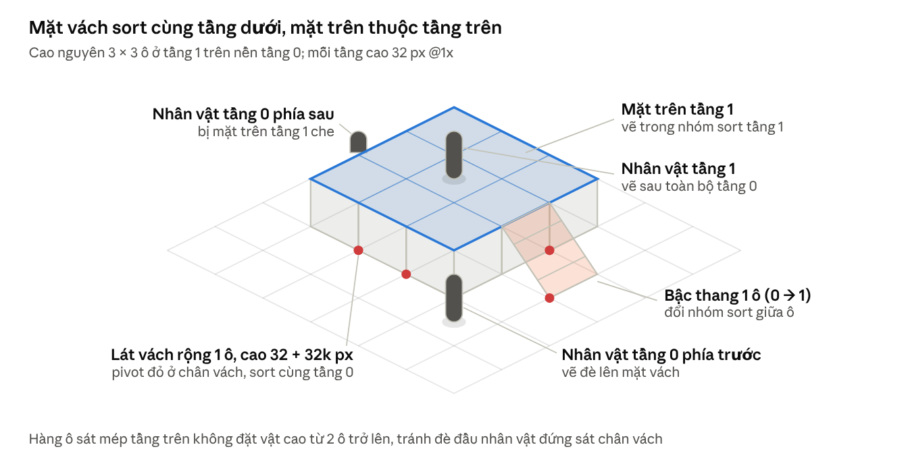

# Đặc tả Tilemap Isometric – Sơn Môn Đại Phái & Bí Cảnh Rừng Độc

Oct 31, 2026 · An Nguyen

## 1. Quy chuẩn lưới Diamond

**Chọn: ô logic 64 × 32 px @1x, vẽ bản gốc 128 × 64 px @2x.** Web màn hình nhỏ và Mobile tải bản @1x; PC 2K và Mobile cao cấp tải bản @2x với hệ số render 2. Mọi nền tảng vì thế nhìn thấy cùng số ô, giữ công bằng tầm nhìn khi PvP.

### So sánh ba kích thước

| Ô cơ sở (logic) | Số ô ngang ở khung 1280 × 720 | Ô trên atlas 2048 | Đánh giá |
|---|---|---|---|
| 64 × 32 | 20 | 2.048 (@1x) / 512 (@2x) | **Chọn.** Tầm nhìn rộng đủ cho chiến đấu MMO; nét trên 2K nhờ bản @2x |
| 128 × 64 | 10 | 512 | Tầm nhìn quá hẹp, atlas nhanh đầy, tải Web nặng gấp 4 |
| 256 × 128 | 5 | 128 | Chỉ hợp tile cảnh trang trí lớn, không dùng làm lưới |


### Tọa độ và quy đổi

Ở @1x, ô (i, j) có đỉnh trên tại tọa độ màn hình dưới đây; phép ngược dùng để chọn ô bằng chuột / chạm (lấy phần nguyên).

```latex
x = (i - j) \cdot 32, \quad y = (i + j) \cdot 16 \qquad\qquad i = \tfrac{1}{2}\left(\tfrac{x}{32} + \tfrac{y}{16}\right), \quad j = \tfrac{1}{2}\left(\tfrac{y}{16} - \tfrac{x}{32}\right)
```

### Quy chuẩn ảnh tile

| Loại tile | Canvas @1x | Neo (anchor) | Ghi chú |
|---|---|---|---|
| Ô nền phẳng | 64 × 32 | Hình thoi khít canvas | Liền mép bốn cạnh |
| Ô nền có viền dày (bờ đất, mép nước) | 64 × 48 | Mặt thoi ở 32 px trên cùng, 16 px phía dưới là vạt đất | Che khe giữa hai tầng chất liệu |
| Ô vách / bậc cao k tầng | 64 × (32 + 32k) | Đỉnh dưới của mặt thoi đáy | Xem mục 3 |
| Decal trang trí | 32–64 px | Tâm | Không thuộc lưới, rải tự do |


### Chống khe hở và nhòe

- Atlas tile có padding 2 px và extrude 2 px; tắt mipmap cho atlas nền.
- Camera và vị trí tile làm tròn về pixel nguyên ở hệ số render hiện tại.
- Bản đồ chia chunk 32 × 32 ô (2.048 × 1.024 px @1x) để stream; mỗi chunk tham chiếu tileset theo vùng.

## 2. Auto-tiling: luật nối viền

Dùng **Wang theo góc (corner Wang)**: level designer tô chất liệu lên 4 đỉnh của hình thoi, công cụ tự chọn tile. Mỗi cặp chất liệu cần 16 tile thay vì 47 của blob vuông, vì viền tự nhiên mềm không cần phân biệt cạnh với góc. Trong Tiled, đây là Terrain Set kiểu Corner.

### Chỉ số tile

Mỗi đỉnh N, E, S, W mang bit 1 nếu là chất liệu phủ, 0 nếu là chất liệu nền; chỉ số 0 là ô nền thuần, 15 là ô phủ thuần, 14 giá trị còn lại là ô chuyển tiếp.

```latex
index = N \cdot 1 + E \cdot 2 + S \cdot 4 + W \cdot 8
```

### Ma trận cặp chuyển tiếp

| Cặp (nền → phủ) | Cho phép | Bộ tile | Hình ảnh viền | Gameplay của ô phủ |
|---|---|---|---|---|
| Đất đá → Đất cỏ | Có | 16 Wang + 6 biến thể | Cỏ mọc lấn, rìa cỏ lởm chởm | Đi bình thường; tiếng bước chân cỏ |
| Nước sông → Đất cỏ | Có | 16 Wang (canvas 64 × 48 có vạt bờ) | Bờ đất, lau sậy, bọt nước | Viền nước nông giảm 30% tốc độ; nước sâu chặn đi bộ |
| Nước sông → Đất đá | Có | 16 Wang (64 × 48) | Bờ đá, rêu ướt | Như trên |
| Nham thạch → Đất đá | Có | 16 Wang | Vỏ đá nguội nứt, viền phát sáng đỏ | Nham thạch chặn đi bộ; bay qua được nhưng mất máu theo giây |
| Nham thạch ↔ Đất cỏ | **Không** | — | Công cụ tự chèn 1 hàng Đất đá cháy xém ở giữa | — |
| Nham thạch ↔ Nước sông | **Không** | — | Công cụ tự chèn 1 hàng Đất đá | — |


### Biến thể và chuyển động

- Ô thuần (chỉ số 0 và 15) có ít nhất 4 biến thể, rải ngẫu nhiên theo trọng số 70 / 10 / 10 / 10 để phá lặp.
- Nước và nham thạch thuần là ô động: nước 8 frame ở 8 fps hoặc shader cuộn UV; nham thạch 8 frame ở 6 fps cộng shader nhịp phát sáng.
- Ô chuyển tiếp của chất lỏng là ảnh tĩnh có alpha, đặt trên lớp con riêng phía trên lớp chất lỏng động. Nhờ vậy không cần vẽ 16 tile × 8 frame.
- Decal (sỏi, hoa, vết nứt) rải trên lớp Ground Decal để che đường lưới.

### Ngân sách atlas

Mỗi cặp khoảng 22 tile, 4 cặp khoảng 88 tile cộng biến thể ô thuần và frame động: dưới 200 ô, vừa trong một atlas 2048 cả ở @2x (512 ô).

## 3. Elevation & vách đá nhiều tầng

Mỗi tầng cao 32 px @1x (bằng chiều cao một ô), tối đa 4 tầng trên nền. Quy tắc then chốt: **mặt vách đứng thuộc nhóm sort của tầng dưới, mặt trên thuộc tầng trên**, và các nhóm vẽ lần lượt từ tầng thấp lên cao.



Vách đá một tầng · cắt lát, bậc thang và nhóm sort

### Thứ tự vẽ theo tầng

- Ground của tầng 0.
- Nhóm Y-sort tầng 0: nhân vật, quái, vật cản đang ở tầng 0 **và mặt vách của tầng 1** (pivot ở chân vách).
- Ground (mặt trên) của tầng 1, dịch lên 32 px.
- Nhóm Y-sort tầng 1 gồm cả mặt vách tầng 2; lặp lại cho tầng 2–4.
- Overhead và các lớp phía trên.

Nhân vật thuộc nhóm của tầng đang đứng (lấy từ lớp Elevation); hình dịch lên 32 px mỗi tầng, sort key vẫn tính trong nhóm đó.

### Bộ tile vách (mỗi skin: đá xanh, rễ cây, đất ẩm)

| Mảnh | Vị trí | Canvas @1x (k = số tầng chênh) | Ghi chú |
|---|---|---|---|
| Mặt SW | Ô mép phía tây nam | 64 × (32 + 32k), mặt vách chỉ ở nửa trái | 2 biến thể để phá lặp |
| Mặt SE | Ô mép phía đông nam | 64 × (32 + 32k), mặt vách chỉ ở nửa phải | 2 biến thể |
| Góc ngoài (S) | Ô góc gần camera | 64 × (32 + 32k), cả hai mặt | Chỗ hai mặt gặp nhau |
| Góc trong | Góc lõm (hình chữ L) | 64 × (32 + 32k) | Che khe giữa hai mặt |
| Mép N, E, W | Mép phía sau | 64 × 48 | Chỉ là viền đất trên mặt, không có mặt đứng (camera không thấy) |
| Bậc thang SW / SE | Thay một ô mặt vách | 64 × (64 + 32k), lấn ra 1 ô tầng dưới | Đi được; độ cao nội suy 0 → k |


- Vách cao 2 tầng trở lên ghép từ mảnh 1 tầng (đỉnh, thân lặp, chân) để không phải vẽ mỗi chiều cao một bộ.
- Lớp Collision khóa cạnh giữa hai tầng; chỉ bậc thang, dốc và kỹ năng khinh công / ngự kiếm đổi tầng.
- Trên bậc thang, nhân vật chuyển sang nhóm sort tầng trên khi đi qua giữa ô.
- Hàng ô sát mép tầng trên không đặt vật cản cao từ 2 ô trở lên, vì vật đó vẽ sau nhóm tầng dưới và sẽ đè đầu nhân vật đứng sát chân vách.

## 4. Phân loại Layers trên engine

Mỗi bản đồ có 3 nhóm hiển thị (Ground, Obstacle/Decor, Overhead) và một nhóm lớp dữ liệu ẩn; chỉ Obstacle/Decor được Y-sort cùng nhân vật và quái, khớp lớp L0–L5 của Asset Breakdown Matrix.

### Lớp hiển thị

| Lớp engine | Lớp chuẩn | Nội dung | Sắp xếp | Va chạm |
|---|---|---|---|---|
| Ground_Liquid | L0 | Nước sông, nham thạch (ô động) | Không | Theo chất liệu |
| Ground_Base | L0 | Gạch lát, đất cỏ, đất đá | Không | Không |
| Ground_Transition | L0 | Ô chuyển tiếp có alpha phủ lên chất lỏng | Không | Không |
| Ground_Decal | L1 | Thảm cỏ phẳng, sỏi, hoa, đường mòn, vết nứt, trận văn | Không | Không |
| Obstacle / Decor | L3 | Cổ thụ (thân), bia đá, lò luyện đan, tảng đá lớn, tường, mặt vách đá, công trình Động Phủ | Y-sort cùng nhân vật | Footprint theo ô |
| Overhead | L4–L5 | Tán cây cao, mái đình, cổng vòm, mây trôi trên đầu | Không (luôn trên nhân vật) | Không |


### Footprint vật cản thường gặp

| Vật thể | Footprint chặn | Phần Overhead | Pivot |
|---|---|---|---|
| Cổ thụ | 1 × 1 (thân) | Tán 3 × 3 | Gốc cây |
| Bia đá | 1 × 1 | Không | Chân bia |
| Lò luyện đan | 2 × 2 | Không (khói là VFX) | Đỉnh dưới footprint |
| Tảng đá lớn | 2 × 2 hoặc 3 × 2 | Không | Đỉnh dưới footprint |
| Đình, điện | Theo tường | Mái toàn bộ | Mỗi lát tường một pivot |


Vật cản cao hơn 2 ô che quá 40% nhân vật của người chơi thì tự mờ còn 60% alpha, như quy tắc che khuất chung.

### Quy tắc tự mờ của Overhead

- Mỗi vật Overhead có **vùng kích hoạt** riêng (polygon theo hình chiếu mái hoặc tán xuống đất), tách khỏi khung sprite.
- Pivot nhân vật của chính người chơi vào vùng: alpha giảm từ 100% xuống 35% trong 0,2 s; ra khỏi vùng: tăng lại trong 0,3 s.
- Chỉ nhân vật của client hiện tại kích hoạt; người chơi khác và quái không, để mái không nhấp nháy giữa chợ đông người.
- Mái đình khi mờ thì hiện lớp nội thất bên dưới (bàn, đan lô, NPC trong điện).
- Mây trôi trên đầu luôn ở 60–80% alpha, cuộn parallax nhẹ, không kích hoạt.
- Làm mờ bằng tint alpha trên chính sprite, không thêm draw call.

### Lớp dữ liệu (không hiển thị)

| Lớp | Giá trị mỗi ô | Dùng cho |
|---|---|---|
| Collision | Đi được / chặn / chỉ bay qua | Di chuyển, tìm đường |
| Elevation | Tầng 0–4 | Chọn nhóm sort, chặn đi qua vách |
| Terrain | Cỏ / đá / nước nông / nước sâu / nham thạch | Tốc độ, tiếng bước chân, sát thương môi trường |
| Zone | An toàn / PK / bí cảnh / sự kiện | Luật PvP, nhạc nền |
| Buildable | Được xây / cấm xây | Hệ thống Động Phủ (mục 6) |
| Spawn | Điểm sinh quái, NPC, hồi sinh | Server |


## 5. Đặc tả hai bản đồ

Sơn Môn Đại Phái là thành chính tông môn xây theo chiều cao (5 tầng, đi lên bằng bậc thang); Bí Cảnh Rừng Độc là bản đồ PK phẳng hơn nhưng bị tán rừng che kín, nên thách thức kỹ thuật chính là Overhead và sương độc.

### So sánh nhanh

| Thông số | Sơn Môn Đại Phái | Bí Cảnh Rừng Độc |
|---|---|---|
| Loại bản đồ | Thành chính tông môn, vùng an toàn | Bí cảnh mở theo mùa, vùng PK |
| Kích thước | 256 × 256 ô (8 × 8 chunk) | 192 × 192 ô (6 × 6 chunk) |
| Số tầng cao | 0–4 | 0–2 |
| Chất liệu | Đất cỏ, đất đá, nước (suối, thác); nham thạch chỉ ở Địa Hỏa thất | Cỏ độc, đá rêu, đầm độc (biến thể nước), nham thạch ở Độc Hỏa Đàm |
| Vách và lối lên | Vách đá xanh; bậc thang lát đá rộng 3 ô | Rễ cổ thụ và vách đất ẩm (cùng chuẩn cliff, khác skin) |
| Overhead | Mái đình điện, tán tùng, mây núi | Tán rừng liền khối + lớp sương độc |
| Ánh sáng | Sáng, theo chu kỳ ngày đêm | Tối; nấm phát quang và đầm độc là light sprite |
| Tileset | 1 tileset vùng núi + kit kiến trúc Chính đạo | 1 tileset rừng độc + kit rễ cây |
| Bundle | Sect pack 12–15 MB | Event pack 10–15 MB |


### Sơn Môn Đại Phái – các khu vực

| Khu vực | Tầng | Diện tích (ô) | Nội dung chính |
|---|---|---|---|
| Chân núi & Cổng sơn môn | 0 | 64 × 48 | Landmark cổng, trận truyền tống, chợ đệ tử, suối chảy dưới cầu đá |
| Quảng trường luyện võ | 1 | 48 × 40 | Sân lát đá, hàng bia đá, lôi đài 12 × 12 |
| Tàng Kinh Các, Đan Phòng, Luyện Khí Đường | 2 | 64 × 40 | Lò luyện đan 2 × 2; Địa Hỏa thất có hồ nham thạch 6 × 6 |
| Đại điện chưởng môn | 3 | 40 × 32 | Đại điện mái lớn (Overhead), 5 Trận Nhãn của Hộ Sơn Đại Trận |
| Hậu sơn | 4 | 56 × 48 | Thác nước, Tụ linh nhãn, khu Động Phủ đệ tử (lớp Buildable) |


- Bậc thang chính rộng 3 ô nối liên tiếp các tầng theo trục giữa; lối tắt khinh công đặt ở vách 1 tầng.
- Toàn bản đồ là vùng an toàn, trừ khi chiến tranh tông môn mở: khi đó Zone đổi sang PK và Hộ Sơn Đại Trận bật.

### Bí Cảnh Rừng Độc – các khu vực

| Khu vực | Tầng | Diện tích (ô) | Nội dung chính |
|---|---|---|---|
| Bìa rừng (cổng vào) | 0 | 48 × 32 | Điểm vào bí cảnh, tán còn thưa để người chơi làm quen |
| Đầm lầy độc | 0 | 64 × 64 | Đầm độc mất máu theo giây; lối đi bằng ván gỗ và đá kê |
| Cổ thụ trung tâm | 1–2 | 48 × 48 | Rễ cây tạo vách và cầu nhiều tầng; linh dược hiếm |
| Độc Hỏa Đàm | 0 | 40 × 40 | Nham thạch xanh độc quanh đấu trường boss 4 × 4 |
| Lối thoát | 0 | 16 × 16 | Trận truyền tống ra ngoài, mở theo thời gian |


**Xử lý tán rừng liền khối:** thay vì hàng trăm sprite tán riêng, tán rừng là một tilemap Overhead dùng ô lớn 256 × 128 px @1x (gấp 4 ô cơ sở) để batch gọn. Quanh nhân vật của người chơi, shader khoét một vùng nhìn xuyên hình ellipse bán kính 3 ô, mép mờ dần, thay cho làm mờ từng sprite.

**Sương độc:** lớp L5 dạng texture lặp 1024 × 512 cuộn chậm, mật độ tăng ở Đầm lầy độc; vùng nhìn xuyên của tán cũng làm loãng sương quanh người chơi.

## 6. Động Phủ & Nông trại Linh Dược

Công trình Động Phủ đặt theo lưới ô logic 64 × 32, chỉ trên ô có Buildable = 1; server lưu mỗi công trình bằng 4 giá trị: mã công trình, ô gốc (i₀, j₀) và hướng xoay.

### Luật Snap-to-grid

- **Ô gốc** là ô góc N của footprint (i và j nhỏ nhất); footprint w × h ô tính từ đó.
- **Xoay:** 2 trạng thái, đổi w × h thành h × w và lật sprite; công trình vuông không đổi footprint.
- **Hợp lệ khi** mọi ô footprint: Buildable = 1, cùng một tầng Elevation, không bị Collision chặn, không chồng công trình khác.
- **Phản hồi:** sprite bóng mờ 50% bám theo ô dưới con trỏ; mỗi ô footprint tô thoi xanh (hợp lệ) hoặc đỏ (vi phạm). Trên Mobile, bóng mờ đặt cao hơn ngón tay 1,5 ô để không bị che, có nút Xác nhận / Xoay / Hủy.
- **Sort key** của công trình nhiều ô là đỉnh dưới (đỉnh S) của footprint, tính ở @1x:

```latex
sortY = (i_0 + w + j_0 + h) \cdot 16
```

### Footprint công trình

| Công trình | Footprint | Sprite @1x | Lớp | Chức năng |
|---|---|---|---|---|
| Bồ đoàn thiền | 1 × 1 | 64 × 64 | Obstacle (Y-sort) | Tăng tốc tu luyện khi đả tọa |
| Linh điền | 2 × 2 | Nền 128 × 64 + 4 ô trồng | Nền: Ground_Decal; cây: Obstacle | Trồng 4 cây Tiên Dược, mỗi ô 1 cây |
| Tụ linh trận | 3 × 3 | Decal trận 192 × 96 + 4 trụ trận kỳ ở góc | Decal: Ground_Decal; trụ: Obstacle | Vùng 5 × 5 quanh tâm: Linh điền lớn nhanh +20%, Bồ đoàn +10% tu luyện |
| Đan lô | 2 × 2 | 128 × 160 | Obstacle | Luyện đan; khói là VFX |
| Giá kinh thư | 1 × 2 | 64 × 96 | Obstacle | Đọc công pháp, trang trí |
| Thủy tạ (đình nghỉ) | 3 × 3 | 192 × 192 | Cột: Obstacle; mái: Overhead | Trang trí; mái tự mờ khi bước vào |


Tụ linh trận không cộng dồn: một ô nằm trong vùng của hai trận chỉ nhận hiệu ứng một lần.

### Bốn trạng thái Tiên Dược

Mỗi cây chiếm 1 ô của Linh điền, pivot tại tâm ô để sort đúng với nhân vật đứng giữa các luống. Mốc thời gian ví dụ cho Thanh Linh Thảo (chu kỳ 8 giờ thực).

| # | Trạng thái | Mốc thời gian | Hình ảnh (canvas 64 × 64 @1x) | Chuyển động / VFX | Tương tác |
|---|---|---|---|---|---|
| 1 | Hạt mầm | 0–15% | Ụ đất ẩm + hạt, cao ~16 px | Tĩnh | Tưới, bón linh phân để tăng tốc |
| 2 | Nảy mầm | 15–50% | Hai lá non, cao ~28 px | Lay nhẹ bằng vertex shader | Tưới |
| 3 | Trưởng thành | 50–100% | Thân lá đầy đủ, nụ khép, cao ~44 px | Lay nhẹ bằng vertex shader | Chưa thu hoạch được |
| 4 | Phát sáng thu hoạch | 100% | Hoa nở + viền sáng theo màu hệ | Shader nhịp sáng chu kỳ 1,5 s; ≤ 12 hạt linh khí bay lên; tiếng chuông nhỏ; icon trên đầu | Chạm để thu hoạch, ô trở về trạng thái 1 |


- Mỗi loài cần 4 sprite tĩnh; chuyển động dùng shader thay cho frame, nên một atlas 2048 @2x chứa hơn 100 loài.
- Phẩm cấp linh dược dùng tint shader trên cùng sprite; không vẽ lại theo phẩm.
- Nông trại lớn (hơn 100 cây) gom vào một batch tĩnh; chỉ cây ở trạng thái 4 mới bật particle.
