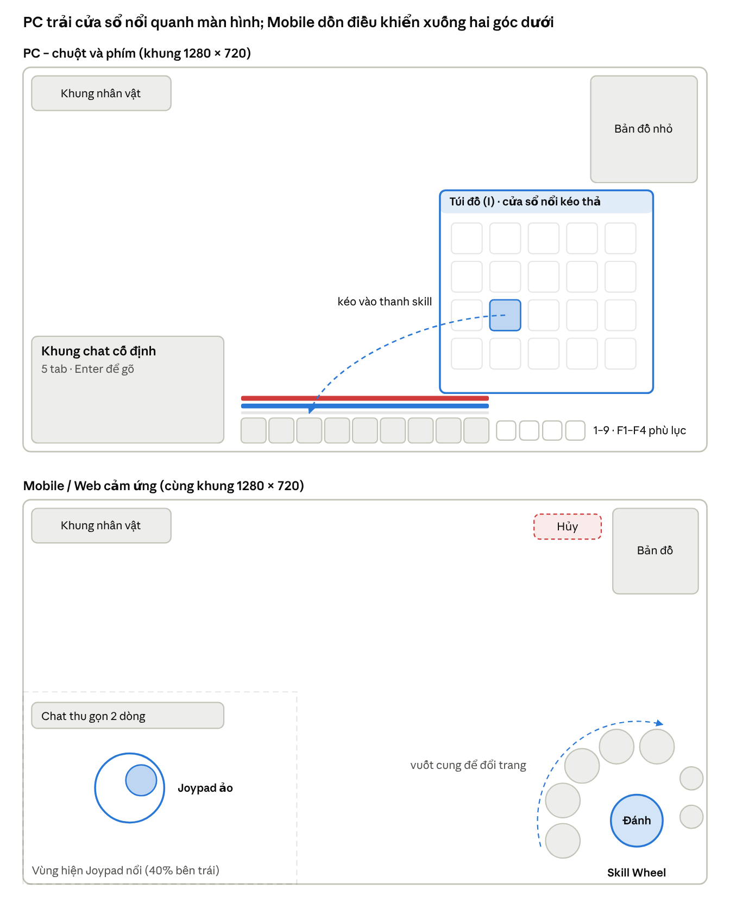

# Đặc tả UI/UX & Icon Cross-platform – Tu Tiên 2D

Oct 31, 2026 · An Nguyen

## 1. Nền tảng & chế độ nhập

Bố cục được chọn theo **cách nhập liệu**, không theo thiết bị: Web trên máy tính dùng chuột thì ra bố cục PC, Web trên điện thoại hoặc máy tính bảng cảm ứng thì ra bố cục Mobile. Người chơi luôn có thể ép chế độ trong Cài đặt.

| Chế độ                  | Kích hoạt khi                                            | Thao tác chính                                                | Vùng chạm / bấm tối thiểu |
| ----------------------- | -------------------------------------------------------- | ------------------------------------------------------------- | ------------------------- |
| PC                      | Client PC; hoặc Web có (pointer: fine) và (hover: hover) | Chuột + phím, phím tắt 1–9, kéo thả cửa sổ                    | 24 px logic               |
| Mobile / Web cảm ứng    | App iOS/Android; hoặc Web có (pointer: coarse)           | Joypad ảo, Skill Wheel, chạm và giữ                           | 44 pt (88 px @2x)         |
| Lai (tablet + bàn phím) | Có cả hai loại sự kiện                                   | Chuyển nóng sang PC khi có phím/chuột, về Mobile khi chạm lại | Theo chế độ hiện tại      |

### Độ phân giải và hệ số scale

Thiết kế trên khung logic 1280 × 720; hệ số UI bằng tỷ lệ nhỏ hơn giữa chiều rộng và chiều cao màn hình so với khung này, nhân thêm thanh trượt của người chơi (80–120%).

| Màn hình            | Hệ số | Bộ asset nạp                               |
| ------------------- | ----- | ------------------------------------------ |
| 1280 × 720 (720p)   | 1,0   | @1x                                        |
| 1920 × 1080 (1080p) | 1,5   | @2x (thu nhỏ)                              |
| 2560 × 1440 (2K)    | 2,0   | @2x                                        |
| 3840 × 2160 (4K)    | 3,0   | @3x (chỉ khung 9-slice, icon, bitmap font) |

- Ngưỡng chọn bộ: hệ số ≤ 1,25 dùng @1x; ≤ 2,25 dùng @2x; lớn hơn dùng @3x.
- Bộ @3x chỉ có trong bản PC tải về, không nằm trong gói Core của Web để giữ initial load dưới 30 MB.
- Màn hình dài (19,5:9, 21:9): các cụm UI bám mép, nội dung giữa (cửa sổ, hội thoại) giới hạn rộng 1280 logic.
- Tôn trọng safe area (tai thỏ, thanh home) trên Mobile; thanh skill và Joypad cách safe area thêm 16 px.

## 2. Layout thích ứng

Hai bố cục dùng chung khung logic 1280 × 720 và cùng bộ asset; chỉ vị trí, kích thước vùng chạm và cách mở cửa sổ khác nhau.



Bố cục PC và Mobile/Web trên khung logic 1280 × 720

Trên Mobile, hai nút nhỏ bên phải Skill Wheel là ngự kiếm / khinh công và ô phù lục nhanh; vùng Hủy chỉ hiện khi đang giữ để nhắm.

| Vùng                     | PC                                           | Mobile / Web cảm ứng                             |
| ------------------------ | -------------------------------------------- | ------------------------------------------------ |
| Di chuyển                | Chuột trái vào đất hoặc WASD                 | Joypad nổi góc trái                              |
| Kỹ năng                  | Thanh 1–9 giữa đáy + thanh phụ Shift + F1–F4 | Skill Wheel góc phải dưới, 2 trang × 5 kỹ năng   |
| Chat                     | Cố định góc dưới trái, 360 × 200             | Dải 2 dòng trên Joypad, chạm để mở toàn màn hình |
| Túi đồ và các bảng       | Cửa sổ nổi kéo thả, tối đa 4 cửa sổ          | Toàn màn hình dạng tab, mỗi lúc một bảng         |
| Khung nhân vật, mục tiêu | Góc trên trái                                | Góc trên trái                                    |
| Bản đồ nhỏ               | Góc trên phải, 200 × 200                     | Góc trên phải, 160 × 160                         |

## 3. Hành vi tương tác

PC ưu tiên đa nhiệm (nhiều cửa sổ cùng mở, kéo thả tự do); Mobile ưu tiên một việc mỗi lúc (màn hình toàn phần, chạm và giữ). Kích thước dưới đây tính ở khung logic 1280 × 720.

### Chế độ PC

**Khung chat (cố định góc dưới trái)**

- 360 × 200, cố định vị trí, cho kéo đổi chiều cao 120–400; nền mờ 40% khi không dùng.
- Tab: Thế giới, Tông môn, Đội, Riêng, Hệ thống; Enter để gõ, Esc để thoát.

**Cửa sổ nổi đa nhiệm**

| Cửa sổ              | Phím tắt | Kích thước mặc định |
| ------------------- | -------- | ------------------- |
| Túi đồ              | I        | 420 × 480           |
| Nhân vật & trang bị | C        | 420 × 520           |
| Kỹ năng / Công pháp | K        | 560 × 480           |
| Tông môn            | G        | 640 × 480           |
| Bản đồ thế giới     | M        | 900 × 600           |
| Vạn Bảo Lâu         | B        | 720 × 520           |

- Kéo bằng thanh tiêu đề; hút dính vào mép màn hình và mép cửa sổ khác khi cách dưới 8 px.
- Tối đa 4 cửa sổ cùng mở; bấm vào cửa sổ để đưa lên trên; Esc đóng cửa sổ trên cùng.
- Vị trí cửa sổ lưu theo tài khoản và theo độ phân giải.

**Kéo thả vật phẩm**

- Kéo giữa túi đồ ↔ ô trang bị ↔ thanh skill (đan dược, phù lục) ↔ Vạn Bảo Lâu ↔ khung chat (chèn link vật phẩm).
- Khi kéo: bóng icon 60% alpha đi theo chuột; ô nhận hợp lệ sáng viền, ô không hợp lệ hiện dấu cấm.
- Thả ra ngoài mọi cửa sổ = vứt bỏ, luôn hỏi xác nhận; vật phẩm khóa không vứt được.
- Chuột phải = dùng / mặc; Shift + chuột trái = link vào chat; Ctrl + chuột trái = tách chồng.

**Thanh skill 1–9**

- Giữa đáy màn hình, 9 ô × 48 px, khoảng cách 4 px; phía trên là thanh HP, Linh lực, tu vi.
- Shift giữ = thanh phụ thứ hai (Shift + 1–9); F1–F4 là 4 ô phù lục bên phải thanh.
- Mỗi ô hiện phím tắt ở góc trên trái, quét hồi chiêu dạng kim đồng hồ, số giây còn lại ở giữa.

### Chế độ Mobile / Web cảm ứng

**Joypad ảo (góc trái)**

- Mặc định nổi: hiện tại chỗ ngón cái chạm trong 40% màn hình bên trái; tùy chọn cố định.
- Bán kính 64, vùng chết 10%; di chuyển tự do 360°, có tùy chọn khóa 8 hướng isometric.

**Skill Wheel (góc phải dưới)**

- Nút đánh thường 96 px ở tâm; 5 nút kỹ năng 64 px xếp vòng cung quanh nút này.
- Vuốt dọc vòng cung để xoay sang trang kỹ năng thứ hai (đó là "bánh xe"); một nút riêng cho ngự kiếm / khinh công và một ô phù lục nhanh.
- Chạm nhanh = tự nhắm mục tiêu gần nhất; giữ và kéo = nhắm hướng, hiện vòng ellipse 2:1 trên mặt đất; kéo tới vùng "Hủy" ở góc trên phải để hủy.

**Túi đồ toàn màn hình dạng tab**

- Tab: Tất cả, Trang bị, Đan dược, Nguyên liệu, Phù lục & Bí tịch, Nhiệm vụ.
- Lưới 6 cột icon 64 px (5 cột trên màn hình hẹp); chạm = bảng chi tiết bên phải có nút Dùng / Mặc / Bán.
- Giữ 0,4 s = chọn nhiều; giữ rồi kéo ra mép phải = gán vào ô phù lục nhanh.

**Chat:** thu gọn thành dải 2 dòng phía trên Joypad; chạm để mở toàn màn hình.

### Riêng cho Web

- Chặn menu chuột phải mặc định của trình duyệt trong vùng game.
- Có nút Toàn màn hình (Fullscreen API); trên iOS Safari, gợi ý "Thêm vào màn hình chính" để có không gian đủ lớn.
- Mất focus tab trình duyệt thì tự tạm dừng âm thanh và giảm tần số vẽ.

## 4. Quy chuẩn 9-Slice

Mọi khung có góc không bao giờ bị kéo giãn: góc chỉ đổi theo bộ @1x / @2x / @3x đã chọn ở mục 1, còn cạnh và vùng giữa giãn hoặc lặp để vừa nội dung. Vì inset luôn là số nguyên ở cả ba bộ, khung giữ nét từ 720p đến 4K.

### Bốn họ khung

| Họ khung                | Dùng cho                                               | Ảnh nguồn @1x | Inset trái / trên / phải / dưới @1x | Vùng giữa                   | Ghi chú                                                    |
| ----------------------- | ------------------------------------------------------ | ------------- | ----------------------------------- | --------------------------- | ---------------------------------------------------------- |
| Gỗ cổ                   | Cửa sổ chính, túi đồ, cửa hàng NPC                     | 96 × 96       | 24 / 32 / 24 / 24                   | **Lặp** (vân gỗ)            | Cạnh trên dày hơn vì có bảng tên; góc đinh đồng            |
| Ngọc bích               | Tooltip, ô kỹ năng, nút chính, popup phần thưởng       | 64 × 64       | 16 / 16 / 16 / 16                   | Giãn (dải màu ngọc)         | Tùy chọn shader óng ánh chạy chéo                          |
| Thủy mặc                | Hội thoại, bảng nhiệm vụ, bản đồ, thông báo cốt truyện | 128 × 96      | 32 / 24 / 32 / 24                   | Giãn + nhiễu giấy tuyên lặp | Nét cọ trang trí vượt ra ngoài khung 12 px là sprite riêng |
| Viền sáng Cyber-Xianxia | HUD nhỏ, khung mục tiêu, thanh máu                     | 32 × 32       | 8 / 8 / 8 / 8                       | Giãn                        | Viền phát sáng theo màu hệ bằng shader                     |

Inset ở @2x và @3x là đúng gấp 2 và gấp 3 giá trị @1x; họa sĩ vẽ góc sao cho đường cắt rơi đúng số nguyên ở cả ba bộ.

### Quy tắc dựng

- **Giãn hay lặp:** vật liệu có vân (gỗ, giấy, đá) phải lặp; dải màu và ánh sáng (ngọc, viền sáng) được giãn. Nếu engine không hỗ trợ vùng giữa dạng lặp trong 9-slice, tách vùng giữa thành sprite tile riêng.
- **Kích thước tối thiểu** của khung = tổng inset trái + phải và trên + dưới, cộng 8 px nội dung.
- **Padding nội dung** = inset + 8 px ở mỗi cạnh.
- **Họa tiết trang trí** (tua rua, ấn triện, nét cọ tràn viền) là sprite riêng neo vào góc, không nằm trong ảnh 9-slice.
- **Chống khe hở:** vị trí và kích thước làm tròn về pixel màn hình nguyên sau khi nhân hệ số; atlas UI extrude 2 px quanh mỗi ảnh 9-slice.
- **Xuất file:** ui_frame_wood_9s@2x.png kèm file JSON ghi 4 giá trị inset, để code không phải nhập tay.

### Kiểm thử bắt buộc

Mỗi khung render ở 720p, 1080p, 1440p, 4K với ba kích thước (tối thiểu, thường dùng, lớn nhất); QA kiểm tra khe sáng giữa các mảnh, góc mờ và vân gỗ bị giãn.

## 5. Icon Sheet quy chuẩn

Mỗi icon vẽ một bản gốc 256 × 256 và xuất ra ba kích thước 48, 64, 128; engine chọn bitmap nhỏ nhất không nhỏ hơn kích thước hiển thị thực tế trên màn hình, không bao giờ phóng to quá 110%. Icon có nền trong suốt; khung phẩm chất (mục 7) ghép lúc chạy.

### Ba kích thước

| Kích thước | Dùng điển hình                               | Nền tảng                       | Ô trên atlas 2048 (padding 2 px) |
| ---------- | -------------------------------------------- | ------------------------------ | -------------------------------- |
| 48 × 48    | Ô túi đồ, thanh skill, buff                  | Web cấu hình thấp, Mobile 720p | 1.521 (39 × 39)                  |
| 64 × 64    | Ô túi đồ, thanh skill, cửa hàng (tiêu chuẩn) | Mobile và PC 1080p             | 900 (30 × 30)                    |
| 128 × 128  | Tooltip lớn, bảng luyện đan, xem chi tiết    | PC 2K / 4K, Mobile cao cấp     | 225 (15 × 15)                    |

### Lưới an toàn (trên lưới 64)

- Vùng nội dung 52 × 52 ở giữa (chừa 6 px mỗi cạnh cho khung viền 4 px và hào quang).
- Hình chính chiếm ít nhất 70% vùng nội dung; hướng sáng từ trên trái (NW), giống quy chuẩn môi trường.
- Bản 48 có lượt chỉnh tay riêng: tăng tương phản, viền tối 1 px, bỏ chi tiết dưới 2 px. Không chỉ thu nhỏ tự động.
- Không vẽ chữ Latinh lên icon; chữ Hán trên bùa / sách chỉ là họa tiết, không mang thông tin bắt buộc.

### Đóng gói và đặt tên

- Tên file: icon_<nhóm>_<mã>_<kích thước>.png, ví dụ icon_pill_cuuchuyen_64.png.
- Nhóm: pill (đan dược), talisman (phù lục), manual (bí tịch), material, equip, skill, buff.
- Atlas theo nhóm × kích thước (atl_icon_pill_64), nén UASTC / ASTC 4×4 hoặc WebP lossless để giữ nét.
- Bản 48 nằm trong gói Core của Web; bản 128 chỉ tải khi mở tooltip lớn hoặc khi client là PC.

### Kiểm thử đọc hình

Đặt toàn bộ icon trong cùng nhóm ở kích thước 48, chuyển thang xám: mỗi icon phải phân biệt được bằng hình dáng. Phẩm chất không được chỉ dựa vào màu (xem dấu góc ở mục 7).

## 6. Thiết kế icon phân cấp

Độ quý của vật phẩm tăng theo ba tín hiệu cùng lúc: hình phức tạp hơn, màu nóng và sáng hơn, chuyển động nhiều lớp hơn. Hiệu ứng động không vẽ vào ảnh icon mà chạy bằng shader trong game và CSS trên các trang web (tra cứu vật phẩm, sự kiện).

### Đan dược

| Đan dược           | Cấp                      | Hình dáng                                               | Bảng màu             | Chi tiết nhận diện | Hiệu ứng viền động                                                                  |
| ------------------ | ------------------------ | ------------------------------------------------------- | -------------------- | ------------------ | ----------------------------------------------------------------------------------- |
| Trúc Cơ Đan        | Sơ cấp (đột phá Trúc Cơ) | Viên tròn trơn đặt trên lá sen nhỏ                      | Lục ngọc, lõi sáng   | 1 vòng vân xoáy    | Nhịp sáng nhẹ, chu kỳ 2,4 s                                                         |
| Tẩy Tủy Đan        | Trung cấp                | Viên trắng ngà đục, làn khói sữa bốc lên                | Trắng ngà, lam nhạt  | 2 sợi khói cuộn    | Nhịp sáng + khói cuộn chậm (chỉ ở bản 128)                                          |
| Cửu Chuyển Kim Đan | Cực phẩm                 | Viên vàng kim lơ lửng, 9 vòng vân xoáy, 4 tia hào quang | Vàng kim, lõi cam đỏ | 9 vân + tia sáng   | Hào quang xoay 6 s/vòng, quét sáng chéo mỗi 3 s, 6 hạt bay lên (bản 128 và tooltip) |

### Thông số hiệu ứng phát sáng

| Thông số              | Sơ cấp | Trung cấp | Cực phẩm            |
| --------------------- | ------ | --------- | ------------------- |
| Chu kỳ nhịp sáng      | 2,4 s  | 2,0 s     | 1,6 s               |
| Cường độ (alpha đỉnh) | 0,5    | 0,7       | 1,0                 |
| Lớp quét sáng chéo    | Không  | Không     | Mỗi 3 s             |
| Hào quang xoay        | Không  | Không     | 6 s / vòng          |
| Hạt bay               | Không  | Không     | 6 hạt (chỉ bản 128) |

- Chỉ tối đa 20 icon động cùng lúc trên màn hình; phần còn lại hiện khung sáng tĩnh.
- Tôn trọng tùy chọn giảm chuyển động của người chơi và của hệ điều hành.
- Mặt nạ hào quang (alpha icon đã làm mờ) được nướng sẵn vào một kênh riêng của atlas, nên shader không phải blur lúc chạy.

**Shader trong game (rút gọn):**

```glsl
// base: màu icon; m: mặt nạ hào quang nướng sẵn; uv: tọa độ 0–1 trong ô icon
float pulse = 0.65 + 0.35 * sin(6.2832 * u_time / u_period);
float p = fract(u_time / u_sweepPeriod) * 2.0 - 0.5;
float sweep = 1.0 - smoothstep(0.0, 0.06, abs((uv.x + uv.y) * 0.5 - p));
vec3 glow = u_glowColor * m * pulse * u_intensity + u_sweepColor * sweep * base.a * u_sweepOn;
gl_FragColor = vec4(base.rgb + glow, max(base.a, m * pulse * u_intensity));
```

**CSS cho trang web:**

```css
.icon-glow {
  position: relative;
  --glow: #7ee0a1;
  --period: 2.4s;
}
.icon-glow::after {
  content: '';
  position: absolute;
  inset: -4px;
  border-radius: 8px;
  box-shadow: 0 0 6px 2px var(--glow);
  animation: icon-pulse var(--period) ease-in-out infinite;
}
.icon-glow.supreme {
  --glow: #ffd45a;
  --period: 1.6s;
}
.icon-glow.supreme::before {
  content: '';
  position: absolute;
  inset: -6px;
  border-radius: 50%;
  background: conic-gradient(transparent 0 70%, rgba(255, 212, 90, 0.8) 85%, transparent);
  mix-blend-mode: screen;
  animation: icon-spin 6s linear infinite;
}
@keyframes icon-pulse {
  0%,
  100% {
    opacity: 0.35;
  }
  50% {
    opacity: 1;
  }
}
@keyframes icon-spin {
  to {
    transform: rotate(360deg);
  }
}
@media (prefers-reduced-motion: reduce) {
  .icon-glow::before,
  .icon-glow::after {
    animation: none;
  }
}
```

### Phù lục & Bí tịch

Ba vật phẩm có ba hình dáng khác hẳn nhau (sách nằm ngang, thẻ ngọc đứng mảnh, lá bùa đứng nghiêng) để phân biệt ngay ở 48 px.

| Vật phẩm                  | Dùng cho                       | Hình dáng                                                            | Bảng màu                           | Biến thể theo cấp                                                               |
| ------------------------- | ------------------------------ | -------------------------------------------------------------------- | ---------------------------------- | ------------------------------------------------------------------------------- |
| Sách cổ rách (Bí tịch)    | Công pháp sơ – trung cấp       | Sách đóng chỉ nằm nghiêng, gáy sờn, góc trang rách, dải lụa đánh dấu | Giấy vàng úa, bìa nâu hoặc lam đậm | Màu bìa theo hệ ngũ hành; cấp cao thêm khóa đồng và ánh sáng rò ra từ trang     |
| Ngọc giản (thẻ ngọc)      | Công pháp cao cấp, truyền thừa | Thẻ ngọc dài dẹt đứng, chữ khắc chìm, dây tua đỏ                     | Ngọc lục hoặc trắng                | Cấp càng cao ngọc càng trong; chữ khắc chạy sáng bằng shader                    |
| Bùa vàng chữ đỏ (Phù lục) | Phù lục tiêu hao               | Lá bùa chữ nhật đứng nghiêng 15°, chữ chu sa, đuôi lụa               | Vàng nghệ, đỏ chu sa               | Ký hiệu hệ ở đầu bùa (lửa, sét, nước…); cấp cao có viền vàng kim, chữ phát sáng |

## 7. Khung viền icon 6 cấp phẩm chất

Sáu cấp từ Phàm phẩm (Trắng) đến Tiên phẩm (Đỏ) thay cho thang 5 phẩm trong các tài liệu trước. Mỗi cấp khác nhau ở màu, dấu góc và chuyển động, để người mù màu vẫn đọc được phẩm chất qua dấu góc.

| Cấp | Tên        | Màu chính         | Dấu góc (không phụ thuộc màu)      | Nền trong khung       | Hiệu ứng động                                            |
| --- | ---------- | ----------------- | ---------------------------------- | --------------------- | -------------------------------------------------------- |
| 1   | Phàm phẩm  | Trắng ngà #E8E4DA | Không có                           | Xám trung tính        | Không                                                    |
| 2   | Linh phẩm  | Lục #5FBF6A       | 1 chấm ở góc trên trái             | Lục 20%               | Không                                                    |
| 3   | Huyền phẩm | Lam #4A90D9       | 2 chấm ở hai góc trên              | Lam 25%               | Ánh sáng tĩnh ở mép trong                                |
| 4   | Địa phẩm   | Tím #A05FD6       | Hoa văn mây ở 4 góc                | Tím 25%               | Nhịp sáng chu kỳ 3 s                                     |
| 5   | Thiên phẩm | Vàng #E8B540      | Góc rồng cuộn vàng kim             | Vàng 30%, vân tỏa tia | Nhịp sáng 2 s + quét sáng chéo mỗi 4 s                   |
| 6   | Tiên phẩm  | Đỏ #E0483A        | Góc rồng + ấn triện đỏ ở cạnh trên | Đỏ 30%, vân lửa mực   | Nhịp sáng 1,6 s + hào quang xoay + hạt lửa mực (bản 128) |

### Quy chuẩn dựng khung

- Khung xuất riêng cho từng kích thước icon (48, 64, 128) × 6 cấp = 18 ảnh; viền dày 3 px ở bản 48, 4 px ở bản 64, 6 px ở bản 128.
- Lớp ghép lúc chạy, từ dưới lên: nền trong khung → icon → khung viền → hiệu ứng động (shader ở mục 6, dùng cùng tham số chu kỳ theo cấp).
- Tên vật phẩm trong tooltip và chat dùng cùng sắc màu, chỉnh độ sáng để đạt tương phản 4,5:1 trên cả nền sáng lẫn nền tối.
- Đồng bộ ngoài UI: cột sáng của vật phẩm rơi trên đất và âm thanh nhặt đồ tăng dần theo cùng 6 cấp; Thiên phẩm và Tiên phẩm có thông báo toàn kênh.
