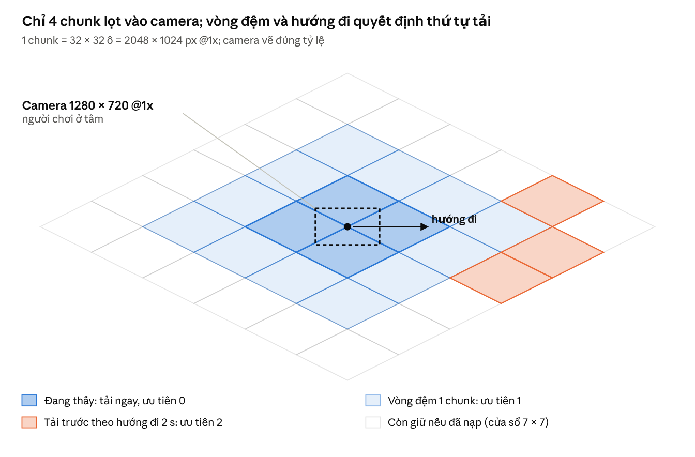

# Giải pháp tối ưu render 2D – VFX, Shader & Bộ nhớ (Tu Tiên 2D)

Oct 31, 2026 · An Nguyen

> **[Cập nhật D35: hoạt cảnh xương nhân vật dùng **DragonBones** (runtime `dragon-bones` của Cocos 3.8.8, MIT) thay Spine 4.2; mọi chỗ "Spine" bên dưới đọc là "skeleton DragonBones" khi nói về Player / Boss / Linh thú / NPC chủ chốt. Các con số (30 skeleton, 5 hướng + lật, giới hạn bone/slot/đỉnh, 30 fps key) không đổi. Chi tiết, nguồn và rủi ro: [art/dragonbones.md](art/dragonbones.md).]**

## 1. Vạn Kiếm Quy Tông: 1 sprite + GPU Instancing

Cả chiêu dùng **một sprite kiếm 64 × 16 px** và **một draw call**: mỗi thanh kiếm là một instance chỉ mang 2 số (chỉ số k và seed), còn vị trí, hướng, độ kéo dài đều tính trong vertex shader từ thời gian. CPU chỉ cập nhật một uniform thời gian mỗi frame.

### So sánh phương án

| Phương án                                 | Texture cần                                                  | Bộ nhớ ước tính                           | Draw call              | Chi phí CPU mỗi frame    | Nhược điểm                            |
| ----------------------------------------- | ------------------------------------------------------------ | ----------------------------------------- | ---------------------- | ------------------------ | ------------------------------------- |
| Flipbook toàn chiêu (512 × 512, 48 frame) | 3 atlas 2048                                                 | ~12,6 MB (ASTC 4×4), ~50 MB nếu không nén | 1–3                    | Thấp                     | Hình cố định, không bám theo mục tiêu |
| Particle CPU, 200 sprite                  | 1 sprite                                                     | Không đáng kể                             | 1                      | 200 lần cập nhật trên JS | Giật trên Mobile/Web yếu              |
| **GPU Instancing (chọn)**                 | 1 sprite kiếm + 1 flipbook va chạm 256² × 8 frame dùng chung | < 0,5 MB                                  | 1 (kiếm) + 1 (va chạm) | Gần 0                    | Không Y-sort từng thanh               |

### Bốn pha và quỹ đạo (tổng 2,4 s)

- **Triệu kiếm (0–0,6 s):** kiếm hiện trên vòng xoáy quanh người thi triển, bán kính tăng dần.
- **Tụ trận (0,6–1,2 s):** kiếm bay lên xếp thành đĩa xoắn Fibonacci phía trên mục tiêu, mũi chĩa xuống.
- **Vạn kiếm giáng (1,2–2,0 s):** từng thanh lao xuống một điểm rơi ngẫu nhiên trong vùng bán kính R, lệch nhịp theo seed.
- **Tan (2,0–2,4 s):** mờ dần; flipbook va chạm chỉ phát ở khoảng 12 điểm, không phải mỗi thanh.

Với N thanh, seed hash ra hai số ngẫu nhiên s₁, s₂; hàm iso() nén trục Y còn một nửa theo tỷ lệ 2:1:

```latex
\begin{aligned}
\text{Pha 1: } & \theta_k = \tfrac{2\pi k}{N} + \omega t, \quad p = C + \mathrm{iso}\big(r(t)\,(\cos\theta_k, \sin\theta_k)\big) \\
\text{Pha 2: } & \varphi_k = k \cdot 2{,}39996, \quad p = T + \mathrm{iso}\big(R_d \sqrt{k/N}\,(\cos\varphi_k, \sin\varphi_k)\big) - (0, H) \\
\text{Pha 3: } & L_k = T + \mathrm{iso}\big(R\sqrt{s_1}\,(\cos 2\pi s_2, \sin 2\pi s_2)\big), \quad p = \mathrm{mix}(P_2, L_k, u^3)
\end{aligned}
```

Trong đó C là người thi triển, T là mục tiêu, H là độ cao tụ trận, 2,39996 rad là góc vàng, u là tiến độ pha 3 đã lệch nhịp theo seed.

### Vertex shader (GLSL ES 3.0 / WebGL2)

```glsl
#version 300 es
layout(location = 0) in vec2 a_quad;   // đỉnh quad đơn vị -0.5..0.5
layout(location = 1) in vec2 a_inst;   // x = chỉ số k, y = seed (divisor = 1)
uniform float u_t, u_count, u_radius;
uniform vec2 u_caster, u_target, u_uvMin, u_uvMax;
uniform mat3 u_view;
out vec2 v_uv; out float v_alpha;

vec2 iso(vec2 p) { return vec2(p.x, p.y * 0.5); }
float hash(float n) { return fract(sin(n * 91.345) * 47453.21); }
vec2 ring(float t, float k) {
  float th = 6.2832 * k / u_count + 4.0 * t;
  return u_caster + iso(vec2(cos(th), sin(th)) * 60.0 * smoothstep(0.0, 0.6, t)) - vec2(0.0, 40.0);
}
vec2 swordPos(float t, float k, float s) {
  if (t < 0.6) return ring(t, k);
  vec2 disk = u_target - vec2(0.0, 220.0)
            + iso(vec2(cos(k * 2.39996), sin(k * 2.39996)) * u_radius * sqrt(k / u_count));
  if (t < 1.2) return mix(ring(0.6, k), disk, smoothstep(0.6, 1.2, t));
  float a = hash(s) * 6.2832, r = u_radius * sqrt(hash(s + 1.7));
  vec2 land = u_target + iso(vec2(cos(a), sin(a)) * r);
  float u = clamp((t - 1.2 - 0.25 * s) / 0.5, 0.0, 1.0);
  return mix(disk, land, u * u * u);
}
void main() {
  vec2 p0 = swordPos(u_t, a_inst.x, a_inst.y);
  vec2 p1 = swordPos(u_t + 0.016, a_inst.x, a_inst.y);
  vec2 dir = normalize(p1 - p0 + vec2(0.0, 1e-4));            // mũi kiếm theo hướng bay
  float stretch = 1.0 + clamp(length(p1 - p0) * 0.15, 0.0, 2.0); // kéo dài theo tốc độ = vệt mờ giả
  vec2 l = vec2(a_quad.x * 64.0 * stretch, a_quad.y * 16.0);
  vec2 world = p0 + vec2(dir.x * l.x - dir.y * l.y, dir.y * l.x + dir.x * l.y);
  gl_Position = vec4((u_view * vec3(world, 1.0)).xy, 0.0, 1.0);
  v_uv = mix(u_uvMin, u_uvMax, a_quad + 0.5);                  // ô kiếm trong atlas
  v_alpha = 1.0 - smoothstep(2.0, 2.4, u_t);
}
```

### Ghi chú triển khai

- Vạn kiếm vẽ ở lớp L4 (trên không) để giữ 1 draw call; đổi lại không Y-sort từng thanh.
- Số thanh: 200 trên PC, 120 trên Mobile/Web; cùng shader, chỉ đổi u_count.
- WebGL2 hỗ trợ instancing sẵn; WebGL1 dùng extension ANGLE_instanced_arrays. Máy không có instancing: CPU ghi N × 4 đỉnh vào một vertex buffer động mỗi frame, vẫn 1 draw call.
- Theo engine: Godot 4 dùng MultiMeshInstance2D; Unity dùng Graphics.RenderMeshInstanced; Cocos Creator viết render component riêng với thuộc tính instance.
- Cùng khung này dùng lại cho mọi chiêu "nhiều vật thể bay": mưa phù lục, bầy linh điểu, kiếm trận hộ thân.

## 2. Lôi Kiếp: Procedural Lightning

Tia sét sinh bằng thuật toán chia đôi đoạn thẳng (midpoint displacement), dựng thành triangle strip và tô bằng shader không cần texture. Mỗi tia khác nhau, bộ nhớ gần như bằng 0, thay cho bộ flipbook 4 biến thể × 8 frame.

### So sánh với flipbook

| Tiêu chí           | Flipbook (128 × 512, 8 frame × 4 biến thể) | Procedural (chọn)                                   |
| ------------------ | ------------------------------------------ | --------------------------------------------------- |
| Bộ nhớ texture @1x | ~2,1 MB (ASTC 4×4), ~8,4 MB không nén      | 0 (profile tính trong shader)                       |
| Bộ nhớ @2x         | ~8,4 MB (ASTC 4×4)                         | 0                                                   |
| Biến thể           | 4, người chơi nhận ra lặp                  | Vô hạn, theo seed                                   |
| Bám điểm đánh      | Phải xoay / co kéo ảnh                     | Điểm đầu và cuối là tham số                         |
| Chi phí CPU        | Đổi UV                                     | Sinh ~80 điểm mỗi lần làm mới (dưới 0,1 ms trên JS) |

### Thuật toán sinh tia

- Điểm đầu A trên trời (cao hơn mục tiêu 400 px @1x), điểm cuối B tại mục tiêu trên mặt đất.
- Chia đôi 5 thế hệ (32 đoạn); mỗi điểm giữa lệch vuông góc một lượng ngẫu nhiên, biên độ khởi đầu 25% độ dài AB, giảm một nửa mỗi thế hệ.
- Ở 3 thế hệ đầu, mỗi điểm giữa có 30% khả năng mọc nhánh: lệch 20–40°, dài 30–60% quãng còn lại, nhỏ bằng nửa nhánh mẹ, tối đa 2 cấp nhánh.
- Mỗi tia sống 0,3 s; sinh lại đường đi mỗi 60 ms với cùng A, B để tạo nhấp nháy.
- Dựng triangle strip: hai đỉnh mỗi điểm theo pháp tuyến; độ rộng thu nhỏ dần về cuối (còn 40%).

```ts
function bolt(a: Vec2, b: Vec2, gens: number, amp: number, out: Vec2[][], depth = 0) {
  let pts = [a, b];
  for (let g = 0; g < gens; g++) {
    const next: Vec2[] = [pts[0]];
    for (let i = 0; i < pts.length - 1; i++) {
      const p = pts[i],
        q = pts[i + 1];
      const n = perp(normalize(sub(q, p)));
      const m = add(lerp(p, q, 0.5), mul(n, (rand() * 2 - 1) * amp));
      next.push(m, q);
      if (depth < 2 && g < 3 && rand() < 0.3) {
        // nhánh phụ
        const ang = (rand() < 0.5 ? -1 : 1) * (0.35 + rand() * 0.35);
        const end = add(m, mul(rotate(sub(b, m), ang), 0.3 + rand() * 0.3));
        bolt(m, end, gens - g - 1, amp * 0.5, out, depth + 1);
      }
    }
    pts = next;
    amp *= 0.5;
  }
  out.push(pts); // mỗi phần tử = 1 strip
}
```

### Shader tia (blend cộng ONE, ONE)

```glsl
// v_uv.y chạy 0..1 ngang qua bề rộng tia; không cần texture
float core = 1.0 - abs(v_uv.y * 2.0 - 1.0);
float a = pow(core, u_sharp) * u_alpha * (0.75 + 0.25 * sin(u_time * 90.0));
fragColor = vec4(u_color * a, a);
```

### Bloom 2D theo cấp máy

| Cấp          | Cách làm                                                                                                       | Chi phí                                                                 |
| ------------ | -------------------------------------------------------------------------------------------------------------- | ----------------------------------------------------------------------- |
| Mobile / Web | **Bloom giả:** vẽ mỗi strip 2 lần, lõi 6 px trắng tím (u_sharp = 4) + quầng 28 px tím alpha 0,35 (u_sharp = 1) | Thêm 1 draw call, không có render texture                               |
| PC cao       | Bloom thật: lọc điểm sáng ở 1/2 độ phân giải, làm mờ Gaussian 2 lượt ở 1/4, cộng lại                           | 3 render texture nhỏ; chỉ bật trong sự kiện Lôi Kiếp hoặc thiết lập Cao |

### Hiệu ứng đi kèm

- Chớp màn hình: lớp phủ trắng alpha 0,25 tắt dần trong 0,15 s; có tùy chọn giảm chớp cho người nhạy sáng.
- Ánh sáng mặt đất: light sprite cộng bán kính 3 ô tại điểm đánh, kèm decal cháy xém ở lớp L1.
- Cửu Cửu Thiên Kiếp 81 đạo: tối đa 3 tia cùng lúc; tia từ đạo 37 trở đi tăng độ rộng và số nhánh qua tham số, không thêm asset.

## 3. Sprite Shaders đặc thù

Ba shader viết bằng GLSL ES 1.0 để chạy được cả WebGL1; cùng phép toán chuyển sang ShaderLab (Unity: tex2D, _Time.y), Cocos Effect (CCProgram) hoặc Godot (shader_type canvas_item, TEXTURE, TIME). Nguyên tắc chung: tham số riêng từng sprite đi qua vertex color hoặc thuộc tính đỉnh, không qua uniform, để không vỡ batch.

### 3.1 Mờ khi bị che / Silhouette X-Ray

| Cách                                 | Áp lên                                               | Nền tảng       | Chi phí                                       |
| ------------------------------------ | ---------------------------------------------------- | -------------- | --------------------------------------------- |
| **Khoét lỗ mờ trên vật che** (chính) | Cây, nhà, vật cản đứng trước người chơi              | Mọi nền tảng   | Vài phép tính mỗi pixel, không thêm draw call |
| Silhouette X-Ray                     | Nhân vật của người chơi, vẽ thêm một lượt sau lớp L3 | PC, Mobile cao | 1 draw call + mặt nạ che 1/4 độ phân giải     |

CPU chỉ bật cờ "đứng trước người chơi" cho vật có sort key lớn hơn người chơi và khung chồng lên pick box của họ. Cờ ghi vào kênh B của vertex color (dành riêng cho shader này); vị trí người chơi là uniform toàn cục dùng chung.

```glsl
// Vật che: khoét lỗ ellipse mờ quanh người chơi
precision mediump float;
varying vec2 v_uv; varying vec4 v_color;      // v_color.b = cờ đứng trước (0..1, CPU làm mượt)
uniform sampler2D u_tex;
uniform vec2 u_player;                         // vị trí ngực người chơi, cùng hệ với gl_FragCoord
uniform float u_radius, u_soft, u_minAlpha;    // ví dụ 70 px, 30 px, 0.35
void main() {
  vec4 c = texture2D(u_tex, v_uv);
  vec2 d = (gl_FragCoord.xy - u_player) * vec2(1.0, 1.6);   // ellipse đứng
  float hole = 1.0 - smoothstep(u_radius, u_radius + u_soft, length(d));
  c.a *= mix(1.0, u_minAlpha, hole * v_color.b);
  gl_FragColor = vec4(c.rgb * c.a, c.a);       // premultiplied alpha
}
```

```glsl
// X-Ray: lượt vẽ thứ hai của nhân vật, chỉ hiện ở phần đang bị che
uniform sampler2D u_tex, u_occMask;            // u_occMask: alpha các vật đứng trước, 1/4 độ phân giải
uniform vec2 u_screen; uniform vec3 u_silColor;
void main() {
  float a = texture2D(u_tex, v_uv).a;
  float occ = texture2D(u_occMask, gl_FragCoord.xy / u_screen).r;
  gl_FragColor = vec4(u_silColor, 1.0) * (a * occ * 0.55);
}
```

### 3.2 Kim Quang Hộ Thể (viền sáng quanh nhân vật)

Viền lấy từ 8 mẫu alpha xung quanh (4 mẫu trên Mobile): pixel nằm ngoài hình nhưng gần hình thì phát sáng, cộng thêm noise chảy lên trên cho cảm giác kim quang bốc.

```glsl
precision mediump float;
varying vec2 v_uv;
uniform sampler2D u_tex, u_noise;              // u_noise: 64 × 64 lặp, dùng chung toàn game
uniform vec4 u_rect;                           // ô sprite trong atlas (UV min, max)
uniform vec2 u_texel;                          // 1 / kích thước texture
uniform float u_radius, u_time;                // bán kính viền: 3 texel Mobile, 5 PC
uniform vec3 u_glow;                           // vàng kim
float alphaAt(vec2 uv) {                       // không đọc lấn sang sprite bên cạnh trong atlas
  float inside = step(u_rect.x, uv.x) * step(uv.x, u_rect.z) * step(u_rect.y, uv.y) * step(uv.y, u_rect.w);
  return texture2D(u_tex, uv).a * inside;
}
void main() {
  vec4 base = texture2D(u_tex, v_uv);
  float m = 0.0;
  for (int i = 0; i < 8; i++) {
    float ang = float(i) * 0.7854;
    m = max(m, alphaAt(v_uv + vec2(cos(ang), sin(ang)) * u_radius * u_texel));
  }
  float rim = clamp(m - base.a, 0.0, 1.0);
  float flow = texture2D(u_noise, v_uv * 6.0 + vec2(0.0, -u_time * 0.6)).r;
  float pulse = 0.75 + 0.25 * sin(u_time * 4.0);
  vec3 glow = u_glow * rim * (0.6 + 0.8 * flow) * pulse;
  gl_FragColor = vec4(base.rgb * base.a + glow, max(base.a, rim * pulse));
}
```

- Quad của sprite phải rộng thêm đúng bán kính viền (nới đỉnh trong vertex shader hoặc chừa padding 6 px trong atlas), nếu không viền bị cắt ở mép khung.
- **Nhân vật Spine:** không áp shader lên từng attachment (sẽ hiện viền giữa các mảnh áo, tay). Vẽ cả nhân vật vào một render texture 256 × 256 rồi mới áp viền; giới hạn 6 nhân vật cùng lúc trên Mobile, số còn lại dùng sprite khiên rẻ trong bảng VFX.

### 3.3 Sông nước Linh Tuyền (méo sóng + phản chiếu)

Hai lớp noise cuộn ngược chiều tạo độ méo; texture phản chiếu bị méo theo cùng sóng, cộng vân sáng đáy nước mang màu linh quang.

```glsl
precision mediump float;
varying vec2 v_world;                          // tọa độ thế giới: texture liền giữa các ô
varying vec2 v_screenUV;
uniform sampler2D u_water, u_flow, u_reflect;  // nước lặp 256×128, noise 128×128, phản chiếu
uniform float u_time;
uniform vec3 u_spirit;                         // màu linh quang
void main() {
  vec2 f1 = texture2D(u_flow, v_world * 0.004 + vec2(u_time * 0.02, 0.0)).rg * 2.0 - 1.0;
  vec2 f2 = texture2D(u_flow, v_world * 0.007 - vec2(0.0, u_time * 0.03)).rg * 2.0 - 1.0;
  vec2 dist = (f1 + f2) * 0.012;
  vec3 water = texture2D(u_water, v_world * 0.004 + dist).rgb;
  vec4 refl = texture2D(u_reflect, v_screenUV + dist * 1.5);
  float caustic = pow(max(0.0, 1.0 - abs(f1.x + f2.y)), 6.0);
  vec3 col = mix(water, refl.rgb, refl.a * 0.45) + u_spirit * caustic * 0.35;
  gl_FragColor = vec4(col, 0.92);
}
```

| Cấp          | Nguồn u_reflect                                                                                                                           | Phản chiếu nhân vật |
| ------------ | ----------------------------------------------------------------------------------------------------------------------------------------- | ------------------- |
| Mobile / Web | Render texture tĩnh 1/4 độ phân giải, vẽ một lần khi chunk được nạp, từ các sprite phản chiếu (lật dọc, tối đi) level designer đặt dọc bờ | Không               |
| PC           | Render texture mỗi frame, 1/2 độ phân giải, lật dọc các vật L3 gần mặt nước                                                               | Có                  |

## 4. Draw Call Batching

Trần draw call: **80 trên Mobile/Web, 150 trên PC**. Các sprite liền nhau trong thứ tự vẽ chỉ gộp thành 1 draw call khi giống nhau đủ 4 điều: cùng trang atlas, cùng shader/material, cùng chế độ blend, không đổi uniform hay mask giữa chừng.

### Ngân sách theo lớp

| Lớp                  | Cách gom atlas                                                                       | Draw call Mobile/Web | Draw call PC |
| -------------------- | ------------------------------------------------------------------------------------ | -------------------- | ------------ |
| L0 Ground            | 1 atlas tileset mỗi vùng; tilemap vẽ theo chunk                                      | ≤ 6                  | ≤ 10         |
| L1 Ground Decal      | 1 atlas decal mỗi vùng (gồm cả trận văn, vòng cảnh báo)                              | ≤ 4                  | ≤ 8          |
| L2 Shadow            | 1 atlas bóng nhỏ; không sort nên vẽ gộp một lượt                                     | 1                    | 1            |
| L3 Y-sort            | Atlas vùng gồm prop + quái (≤ 2 trang); nhân vật người chơi chia sẻ trang atlas động | ≤ 35                 | ≤ 70         |
| L4 Air + VFX         | Atlas VFX theo Class pack; vẽ toàn bộ blend thường trước, blend cộng sau             | ≤ 15                 | ≤ 30         |
| L5 Weather / Overlay | 1–2 texture lặp                                                                      | ≤ 4                  | ≤ 6          |
| L6 World UI          | 1 atlas chứa cả thanh máu, icon và bitmap font                                       | ≤ 3                  | ≤ 5          |
| L7 Screen UI         | Atlas UI lõi + atlas icon + atlas động cho chữ                                       | ≤ 12                 | ≤ 20         |
| **Tổng**             |                                                                                      | **≤ 80**             | **≤ 150**    |

### Giữ batch ở lớp Y-sort

Y-sort xen kẽ nhân vật, quái và prop theo vị trí, nên mỗi lần đổi texture là một draw call mới. Ba biện pháp:

- **Atlas vùng:** mọi prop và quái của một vùng nằm trong tối đa 2 trang 2048, để hai vật liền nhau trong thứ tự sort thường dùng cùng trang.
- **Atlas động cho nhân vật:** skin Spine sau khi repack (mục Paperdoll) được đặt vào trang chung 2048 chứa 16 nhân vật (mỗi ô 512 × 512 @1x), thay vì mỗi người một texture. Runtime Spine tự gộp các skeleton liền nhau cùng texture.
- **Tham số qua đỉnh:** tint, độ mờ, cờ che khuất, phẩm chất viền đều ghi vào vertex color; mỗi lớp dùng một material chung.

### Những thứ hay làm vỡ batch

| Nguyên nhân                                        | Thay bằng                                  |
| -------------------------------------------------- | ------------------------------------------ |
| Chữ TTF động, mỗi label một texture                | Bitmap font, hoặc đưa ký tự vào atlas động |
| Mask stencil trong danh sách cuộn (túi đồ, chat)   | Cắt bằng scissor hình chữ nhật             |
| Material instance riêng cho từng sprite để đổi màu | Vertex color                               |
| Xen kẽ VFX blend cộng với blend thường             | Tách thành hai lượt liên tiếp              |
| Trộn atlas @1x và @2x trong cùng một lớp           | Một bộ cho cả lớp theo cấp máy             |

### Đo đạc

Mỗi bản build chạy 3 cảnh chuẩn: chợ tông môn 50 người chơi, sự kiện Lôi Kiếp, chiến tranh tông môn 100 vs 100 (VFX người khác giảm mật độ). Web chụp frame bằng Spector.js; vượt trần ở bất kỳ cảnh nào là lỗi chặn phát hành.

## 5. Chunk Streaming theo vùng nhìn camera

Vì một chunk (2048 × 1024 px) lớn hơn khung camera 1280 × 720, camera thấy tối đa 4 chunk cùng lúc. Thứ tự tải do ba tập quyết định: chunk đang thấy, vòng đệm 1 chunk quanh chúng, và chunk camera sẽ tới trong 2 giây theo vận tốc hiện tại.



Các vòng tải chunk quanh camera · người chơi đang đi về phía đông

### Thuật toán (chạy mỗi 200 ms)

- Quy đổi 4 góc khung camera sang tọa độ ô bằng công thức ngược của tài liệu Tilemap, chia 32 để ra chỉ số chunk; giữ các chunk có hình thoi giao với khung camera.
- Vòng đệm = tập đang thấy nới thêm 1 chunk theo cả hai trục.
- Tải trước = tập đang thấy của khung camera dự đoán sau 2 s (3 s khi ngự kiếm bay nhanh).
- Hàng đợi xếp theo ưu tiên rồi theo khoảng cách tới tâm camera; tối đa 4 yêu cầu song song, 2 khi đang chiến đấu.
- Chunk ra khỏi cửa sổ 7 × 7 quanh camera và không dùng trong 30 s thì được phép giải phóng; thực sự bị đẩy ra theo LRU khi texture vượt 90% ngân sách.
- Dịch chuyển tức thời (truyền tống, hồi sinh): hủy hàng đợi, hiện màn che mực loang đến khi đủ chunk đang thấy.

```ts
function updateStreaming(cam: Rect, vel: Vec2, inCombat: boolean, flying: boolean) {
  const vis = chunksInRect(cam);
  const ring = expand(vis, 1);
  const ahead = chunksInRect(offset(cam, mul(vel, flying ? 3 : 2)));
  for (const c of vis) want(c, 0);
  for (const c of ring) want(c, 1);
  for (const c of ahead) want(c, 2);
  queue.sortBy((r) => r.priority * 1e6 + dist(r.center, cam.center));
  pump(inCombat ? 2 : 4); // số yêu cầu song song
  for (const c of loaded) if (!inWindow(c, cam, 3)) markEvictable(c, now());
  if (textureBytes() > 0.9 * TEXTURE_BUDGET) evictLRU();
}

function chunksInRect(r: Rect): ChunkId[] {
  const t = [r.tl, r.tr, r.bl, r.br].map(screenToTile); // công thức ngược isometric
  const u0 = Math.floor(Math.min(...t.map((p) => p.i)) / 32),
    u1 = Math.floor(Math.max(...t.map((p) => p.i)) / 32);
  const v0 = Math.floor(Math.min(...t.map((p) => p.j)) / 32),
    v1 = Math.floor(Math.max(...t.map((p) => p.j)) / 32);
  return range2d(u0, u1, v0, v1).filter((c) => intersects(chunkDiamond(c), r));
}
```

### Nội dung một chunk

- Dữ liệu ô (các lớp hiển thị + lớp dữ liệu) và vị trí prop, nén brotli; texture dùng chung atlas của vùng nên mỗi chunk chủ yếu là dữ liệu.
- Atlas vùng tải một lần khi vào vùng và được giữ đến khi rời vùng; chỉ atlas riêng của landmark lớn mới đi theo chunk.
- Giải nén và dựng mesh tilemap chạy trong Web Worker, luồng chính chỉ nhận buffer đã dựng.

## 6. Ngân sách bộ nhớ & băng thông

Trên Web, tổng bộ nhớ của tab game không vượt **500 MB** và gói tải ban đầu không vượt **25 MB** (thay cho mức 29 MB trong Asset Breakdown Matrix). Âm thanh nền, thoại và VFX cao cấp đều tải lười.

### Phân bổ 500 MB RAM (Web)

| Hạng mục                      | Ngân sách  | Ghi chú                                         |
| ----------------------------- | ---------- | ----------------------------------------------- |
| Runtime engine + code JS/WASM | 60 MB      | —                                               |
| Dữ liệu game trên JS heap     | 70 MB      | Thực thể, dữ liệu map, mạng                     |
| Texture GPU (atlas đang nạp)  | 220 MB     | Cache LRU tính theo byte; máy yếu hạ còn 150 MB |
| Render texture                | 30 MB      | Kim Quang, bloom, phản chiếu, mặt nạ che        |
| Âm thanh đã giải mã           | 40 MB      | Chỉ SFX; BGM không bao giờ giải mã toàn bộ      |
| Bộ đệm tải và giải nén tạm    | 30 MB      | Giải phóng ngay sau khi lên GPU                 |
| Trình duyệt, DOM, dự phòng    | 50 MB      | —                                               |
| **Tổng**                      | **500 MB** |                                                 |

### Bộ nhớ của một atlas 2048 × 2048 trên GPU

| Định dạng                  | Bit / pixel | Bộ nhớ  | Dùng cho                                   |
| -------------------------- | ----------- | ------- | ------------------------------------------ |
| RGBA8 không nén            | 32          | 16 MB   | Chỉ khi máy không hỗ trợ định dạng nén nào |
| ASTC 4×4, BC7, ETC2 RGBA   | 8           | 4 MB    | Nhân vật, UI, icon                         |
| ETC1S (Basis) → ETC1 / BC1 | 4           | 2 MB    | Tileset, prop                              |
| ASTC 6×6                   | 3,56        | ~1,8 MB | Tile, prop trên Mobile                     |
| ASTC 8×8                   | 2           | 1 MB    | VFX, nền mờ                                |

Ngân sách 220 MB vì vậy tương đương khoảng 55 atlas ở 4 MB. Nếu máy không có định dạng nén nào (atlas thành 16 MB), game tự hạ xuống bộ @1x và giảm nửa kích thước cache. Tắt mipmap cho UI và tile (mipmap cộng thêm 33%).

### Gói tải ban đầu ≤ 25 MB

| Gói               | Nội dung                                          | Ngân sách |
| ----------------- | ------------------------------------------------- | --------- |
| Engine + code     | Runtime, logic game, transcoder Basis, nén brotli | 6 MB      |
| UI lõi            | Khung 9-slice @1x, icon 48, bitmap font           | 4 MB      |
| Nhân vật          | Spine base 2 giới tính + bộ trang bị tân thủ      | 4 MB      |
| Bản đồ tân thủ    | 3 × 3 chunk quanh điểm hồi sinh + tileset         | 5 MB      |
| Quái + VFX cơ bản | Quái vùng đầu, VFX kỹ năng cấp 1                  | 3 MB      |
| Âm thanh          | Chỉ SFX giao diện                                 | 1 MB      |
| Dự phòng          | —                                                 | 2 MB      |

### Danh sách tải lười (lazy-load)

| Nội dung                                             | Thời điểm tải                                      | Cách tải                                        |
| ---------------------------------------------------- | -------------------------------------------------- | ----------------------------------------------- |
| BGM, ambience                                        | Sau thao tác đầu tiên của người chơi               | Stream bằng media element, không giải mã cả bài |
| SFX chiến đấu đầy đủ                                 | 10 s sau khi vào game, tải nền                     | Giải mã vào bộ nhớ                              |
| Thoại (VO)                                           | Khi mở hội thoại                                   | Stream                                          |
| VFX cao cấp (Lôi Kiếp, Pháp Tướng, va chạm Vạn Kiếm) | Khi học kỹ năng, hoặc 10 s trước sự kiện kiếp      | Atlas VFX theo Class pack                       |
| Class pack lớp khác                                  | Khi gặp người chơi lớp đó (hiện placeholder trước) | Bundle                                          |
| Bộ @2x / @3x                                         | Sau khi game ổn định, theo hệ số màn hình          | Thay dần từng atlas                             |
| Atlas boss                                           | Khi vào phó bản                                    | Bundle sự kiện                                  |
| Icon 128                                             | Khi mở tooltip lớn                                 | Theo atlas nhóm                                 |

### Kỷ luật băng thông và bộ nhớ lúc chạy

- Tối đa 4 yêu cầu tải song song; hạ xuống 2 khi đang chiến đấu để không giật mạng.
- Ảnh thường giải mã bằng createImageBitmap ngoài luồng chính; KTX2 chuyển mã trong Web Worker.
- Mỗi phút âm thanh stereo 44,1 kHz giải mã ra float32 tốn khoảng 21 MB, nên chỉ SFX ngắn mới được giải mã sẵn.
- Khi chạm 90% ngân sách texture: đẩy atlas chunk cũ nhất ra (LRU), sau đó hạ @2x về @1x, cuối cùng giảm mật độ VFX.

### [Cập nhật D71] Atlas chibi: nén, bundle theo hướng, tier độ phân giải

Hàng "Nhân vật" ở bảng trên nay là **nhóm `loco` của một hướng** lớp người chơi (≈ 0,9 MB ASTC 6x6 ở tier `full`, ≈ 0,5 MB ASTC 4x4 ở tier `1x`; WebP 0,38 / 0,19 MB). Mọi hướng khác, nhóm `rest` và lớp của NPC nạp nền sau khi chơi được. Quyết định, ngân sách và cách chọn tier: [DECISIONS D71](DECISIONS.md); công cụ: `tools/procgen` (`pipeline/chibi_runtime.mts`, cổng `npm run budget`); client: `apps/client-cocos/assets/scripts/ChibiAssets.ts`.

Đo `npm run perf:p1` (headless Chrome, SwiftShader có ASTC, bản đồ 1 chunk, 20 NPC chibi 6 lớp), trước/sau:

| Chỉ tiêu P1 (docs/10 §12)             |  Trần |   Trước (PNG, #195) |         Sau (D71) |
| ------------------------------------- | ----: | ------------------: | ----------------: |
| Draw call                             |  ≤ 80 |                  45 |                43 |
| RAM (heap + texture, MB)              | ≤ 500 |               536,9 |              90,6 |
| FPS trung vị (GL mềm)                 |  ≥ 30 |                41,5 |              44,8 |
| Gói tải đầu đến khi chơi được (MB)    |  ≤ 25 | 135,8 (tính cả NPC) |  9,09 (gzip 3,29) |
| Tổng đã tải sau khi NPC nạp xong (MB) |     – |               135,8 | 12,32 (gzip 4,59) |

Toàn bộ 14 hướng đã merge: PNG nguồn 124,2 MB → ASTC 80,6 MB (cả hai tier) hoặc WebP 33,0 MB (cả hai tier). Chưa đo trên điện thoại thật; WebP (desktop không có ASTC) chưa chạy `perf:p1`.

Đo `npm run perf:p1 -w client-cocos -- --route` (bản đồ 8×8 chunk, 20 NPC chibi, bản release không có art dev): draw call 69 (≤ 80), RAM 172,8 MB (≤ 500), FPS trung vị 33,1 (≥ 30, GL mềm), gói tải đầu đến khi chơi được **7,29 MB** (gzip 2,51; ≤ 25), tổng cả lượt chạy 13,46 MB. Trước D71 (số của worker 37 trong #198): 31 MB, 302 MB RAM (0 NPC) và 700 MB RAM (20 NPC).
