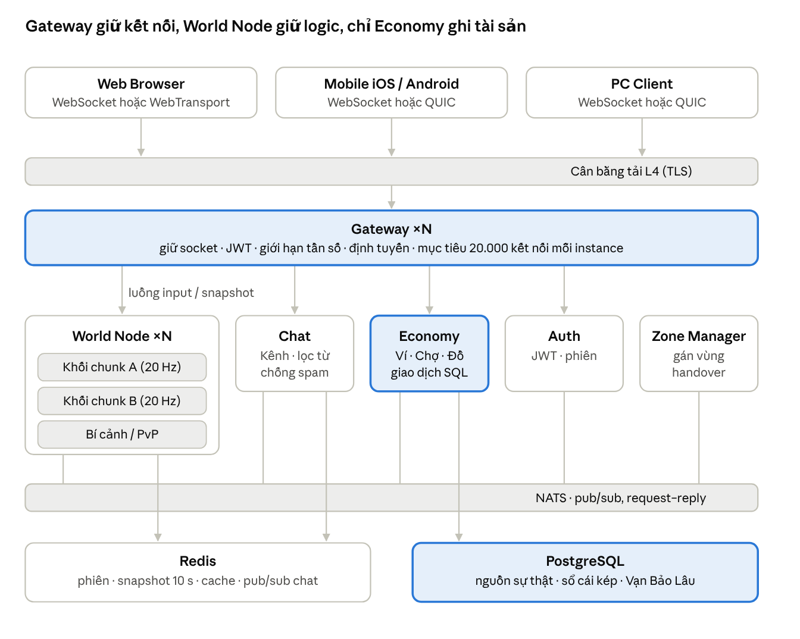

# Kiến trúc Server Thời gian thực – MMORPG Tu Tiên 2D

Oct 31, 2026 · An Nguyen

## 1. Tổng quan kiến trúc

Cả ba nền tảng nói chung một giao thức nhị phân với Gateway. World Node mô phỏng 20 Hz và quyết định mọi vị trí, sát thương, hồi chiêu; mọi thay đổi tài sản đi qua Economy vào PostgreSQL. Hai khối được tô màu nhấn là nơi duy nhất chạm vào trạng thái cần bảo toàn: sổ cái tài sản và điểm vào của mọi kết nối.



Kiến trúc tổng quan · client → Gateway → service → dữ liệu

Gateway chuyển input và snapshot qua luồng trực tiếp tới World Node đang sở hữu nhân vật; các service còn lại trao đổi sự kiện qua NATS. Auth và Zone Manager cũng lưu trạng thái trong Redis (sơ đồ lược bớt dây nối đó).

## 2. AOI trên Diamond Grid

Server dùng hai lưới khác nhau cho hai việc: lưới **chunk (i, j)** 32 × 32 ô để chia quyền sở hữu giữa các World Node, và **spatial hash căn theo màn hình** (tọa độ u = i − j, w = i + j) để truy vấn AOI. Vì khung nhìn của người chơi là hình chữ nhật trên màn hình, băm theo (u, w) biến truy vấn AOI thành một phép lấy dải ô vuông góc, không phải cắt hình thoi.

### Hệ tọa độ

```latex
u = i - j, \qquad w = i + j \qquad\Longrightarrow\qquad x_{\text{màn hình}} = 32u, \quad y_{\text{màn hình}} = 16w \quad (\text{px @1x})
```

- Vị trí thực thể lưu dạng số thực theo đơn vị ô (i, j); va chạm và tìm đường đều làm trong không gian này.
- Khóa hash: cell = (floor(u / 16), floor(w / 16)); mỗi ô hash rộng 512 × 256 px trên màn hình.
- Bản đồ 256 × 256 ô có u ∈ [−255, 255], w ∈ [0, 510], tức 32 × 32 ô hash: dùng mảng dày đặc thay cho HashMap, mỗi ô chứa danh sách thực thể kèm chỉ số để xóa O(1) bằng swap-remove.

### Vùng AOI "2 màn hình"

AOI là hình chữ nhật 2 × 2 khung màn hình (2560 × 1440 px logic) tâm tại người chơi, tức mỗi phía rộng thêm nửa màn hình ngoài phần đang thấy. Quy ra (u, w):

| Tham số                          | Giá trị                    | Ghi chú                             |
| -------------------------------- | -------------------------- | ----------------------------------- |
| Nửa rộng AOI theo u              | 40 ô                       | 1280 px ÷ 32                        |
| Nửa cao AOI theo w               | 45 ô                       | 720 px ÷ 16                         |
| Ô hash cần quét                  | tối đa 6 × 7 = 42          | Sau đó lọc chính xác từng thực thể  |
| Bán kính thoát (hysteresis)      | 1,15 × bán kính vào        | Tránh thực thể nhấp nháy ở mép      |
| Dịch tâm khi bay                 | + vận tốc × 0,5 s          | AOI lệch về phía trước khi ngự kiếm |
| Trần thực thể gửi cho mỗi client | 120 (Mobile/Web), 200 (PC) | Ưu tiên theo loại và khoảng cách    |

### Vòng cập nhật AOI (10 Hz, tách khỏi tick mô phỏng 20 Hz)

- Thực thể di chuyển: tính lại khóa ô; chỉ khi khóa đổi mới gỡ khỏi ô cũ và thêm vào ô mới.
- Với mỗi người chơi: quét các ô giao vùng AOI (đã dịch tâm nếu đang bay), lọc chính xác bằng |u − u₀| ≤ 40 và |w − w₀| ≤ 45 (thoát thì dùng 46 và 52).
- So với tập đang thấy: thực thể mới → gói **Spawn** (trạng thái đầy đủ); thực thể ra khỏi vùng → **Despawn**; còn lại → cập nhật delta ở tick mạng.
- Vượt trần: xếp theo ưu tiên (đồng đội, kẻ đang nhắm mình, người chơi, quái, NPC và linh thú) rồi theo khoảng cách; phần dư bị cắt khỏi tập.

```ts
function aoiQuery(grid: CellGrid, me: Entity, out: Set<EntityId>, exiting: boolean) {
  const lead = me.flying ? 0.5 : 0; // dịch tâm theo hướng bay
  const u0 = me.i - me.j + (me.vi - me.vj) * lead;
  const w0 = me.i + me.j + (me.vi + me.vj) * lead;
  const hu = exiting ? 46 : 40,
    hw = exiting ? 52 : 45;
  for (let cw = Math.floor((w0 - hw) / 16); cw <= Math.floor((w0 + hw) / 16); cw++)
    for (let cu = Math.floor((u0 - hu) / 16); cu <= Math.floor((u0 + hu) / 16); cu++)
      for (const e of grid.cell(cu, cw)) {
        const du = e.i - e.j - u0,
          dw = e.i + e.j - w0;
        if (Math.abs(du) <= hu && Math.abs(dw) <= hw) out.add(e.id);
      }
}
```

### Tần số gửi theo khoảng cách

| Vùng       | Điều kiện                                           | Tần số cập nhật vị trí |
| ---------- | --------------------------------------------------- | ---------------------- |
| Gần        | Trong khung màn hình đang thấy                      | 20 Hz (mỗi tick mạng)  |
| Giữa       | Trong AOI, ngoài khung thấy                         | 10 Hz                  |
| Xa         | Gần mép AOI (> 80% bán kính)                        | 5 Hz                   |
| Luôn 20 Hz | Đồng đội, mục tiêu đang chọn, kẻ đang tấn công mình | Bất kể khoảng cách     |

[Cập nhật D73: vùng tính theo **khoảng cách ô** tới người nhận: gần ≤ 10 ô (20 Hz), giữa ≤ 25 ô (10 Hz), xa > 25 ô (5 Hz); chỉ 40 thực thể gần nhất được 20 Hz (`AOI.NEAR_MAX_ENTITIES`); bản ghi không đổi (vị trí lượng tử, anim, hướng, HP) bị bỏ qua. Bảng trên là bản gốc; DECISIONS D73 thắng. Dòng "Luôn 20 Hz" chưa cài (chưa có nhóm / chọn mục tiêu).]

## 3. Cell Handover khi ngự kiếm

Chuyển vùng có hai cấp. Qua ranh giới ô hash hay chunk **trong cùng một World Node** chỉ là bước so tập AOI ở mục 2. Qua ranh giới **giữa hai World Node** cần chuyển quyền điều khiển nhân vật mà client không phải kết nối lại; Gateway giữ nguyên socket và chỉ đổi đích chuyển tiếp.

### Vùng đệm và thực thể bóng (ghost)

- Mỗi World Node sở hữu một khối chunk. Dải 1 bán kính AOI (khoảng 45 ô) dọc biên là **vùng đệm**.
- Thực thể trong vùng đệm của Node A được sao chép sang Node B dưới dạng ghost chỉ-đọc, cập nhật 10 Hz qua bus nội bộ. Người chơi đứng sát biên vẫn thấy và đánh được thực thể bên kia; sát thương lên ghost được chuyển về node chủ để xử lý.
- Mỗi thực thể mang một **epoch quyền sở hữu**; mọi lệnh có epoch cũ bị bỏ, nên không có hai node cùng ghi một nhân vật.

### Giao thức chuyển quyền

- **Làm ấm trước:** Node A dự đoán vị trí sau 1 s (vị trí + vận tốc × 1 s). Nếu dự đoán vượt biên, A yêu cầu B tạo ghost và nạp trước chunk đích. Ngự kiếm 18 ô/s nên bước này đi trước khoảng 18 ô.
- **Vượt biên + 2 ô (hysteresis):** A dừng nhận input của nhân vật ở số thứ tự S, đóng gói trạng thái (vị trí, vận tốc, máu, buff, mốc hồi chiêu theo giờ server, trạng thái chiến đấu, epoch + 1) và gửi cho B.
- **B nhận quyền:** B áp trạng thái, trả ACK; Gateway đổi bảng định tuyến nhân vật → B một cách nguyên tử. Input có số thứ tự > S mà Gateway đã đệm trong lúc chuyển (thường dưới 50 ms) được phát lại sang B.
- **A dọn dẹp:** A biến nhân vật thành ghost, xóa hẳn khi nhân vật ra khỏi vùng đệm.
- **Lỗi:** B không ACK trong 200 ms thì A giữ quyền và thử lại; sau 3 lần thất bại, nhân vật bị chặn ở biên và Zone Manager được báo động.

### Những gì client thấy

- Không có màn hình tải, không kết nối lại; gói Spawn/Despawn vẫn theo cùng luật AOI.
- Tập thực thể đang thấy được B tính lại từ thực thể của B cộng ghost của A, nên không có khoảng trống khi bay qua biên.
- Truyền tống (dịch chuyển tức thời) không dùng cơ chế này: chuyển trạng thái trọn gói và client hiện màn che mực loang cho đến khi chunk đích sẵn sàng.

## 4. Server-authoritative Movement

Client chỉ gửi **ý định** (hướng và cờ hành động), không bao giờ gửi vị trí. World Node mô phỏng ở 20 Hz (tick 50 ms), áp input theo thứ tự số hiệu, tính va chạm trên lưới ô rồi phát vị trí. Mã di chuyển là một module TypeScript dùng chung cho server và client, để client dự đoán ra cùng kết quả (mục 5).

### Gói input (client → server)

| Trường | Kiểu         | Ý nghĩa                                                                  |
| ------ | ------------ | ------------------------------------------------------------------------ |
| seq    | uint16, vòng | Số thứ tự input, dùng để đối soát                                        |
| dtMs   | uint8        | Thời gian client tuyên bố cho input này (8–50 ms)                        |
| dir    | uint8        | Góc hướng di chuyển trong không gian ô, lượng tử 256 mức; 255 = đứng yên |
| mag    | uint4        | Độ lớn cần analog 0–15 (Joystick); chuột luôn 15                         |
| flags  | uint4        | Né (Space), bật/tắt ngự kiếm, khinh công                                 |

Một gói gom 1–3 input liên tiếp, gửi 20–30 lần mỗi giây (khoảng 6 byte mỗi input). Click-to-move trên PC được client chuyển thành chuỗi hướng dọc đường A*, nên server chỉ có một loại input duy nhất.

### Tốc độ (ô / giây, đơn vị không gian ô)

| Trạng thái   | Tốc độ          | Ghi chú                                          |
| ------------ | --------------- | ------------------------------------------------ |
| Đi bộ / chạy | 4,5             | Nhân thêm Thân pháp: × (1 + (TP − 100) / 400)    |
| Né (dash)    | 12 trong 0,25 s | Hồi 1,5 s, bất tử 0,15 s đầu                     |
| Ngự kiếm     | 18              | Bỏ qua vật cản mặt đất, bị chặn bởi vùng cấm bay |

Tốc độ đều trong không gian ô, nên đi theo trục dọc màn hình trông chậm hơn theo trục ngang, đúng với phối cảnh isometric.

### Va chạm trên lưới

- Nhân vật là hình tròn r = 0,35 ô (bảng collision của tài liệu nhân vật); ô chặn là hình vuông trong không gian (i, j).
- Di chuyển tách trục: dịch theo i rồi kiểm tra, sau đó dịch theo j rồi kiểm tra, nên nhân vật trượt dọc tường thay vì dính lại.
- Bước dịch lớn hơn 0,5 ô (ngự kiếm, dash) được chia nhỏ, chống xuyên tường.
- Đổi tầng elevation chỉ qua ô bậc thang hoặc kỹ năng; cạnh giữa hai tầng là tường.
- Không có va chạm cứng người chơi – người chơi (chống chặn đường quấy rối); quái có lực đẩy mềm để không chồng lên nhau.

```ts
export function step(s: MoveState, inp: Input, grid: CollisionGrid): MoveState {
  const dt = Math.min(inp.dtMs, 50) / 1000;
  const speed = speedOf(s, inp.flags); // đi, dash hoặc ngự kiếm
  const ang = (inp.dir / 256) * Math.PI * 2;
  const k = inp.dir === 255 ? 0 : (inp.mag / 15) * speed * dt;
  let di = Math.cos(ang) * k,
    dj = Math.sin(ang) * k;
  const n = Math.max(1, Math.ceil(Math.hypot(di, dj) / 0.5)); // chia bước nhỏ
  let { i, j } = s;
  for (let q = 0; q < n; q++) {
    if (!grid.circleBlocked(i + di / n, j, 0.35, s.layer)) i += di / n; // trục i
    if (!grid.circleBlocked(i, j + dj / n, 0.35, s.layer)) j += dj / n; // trục j
  }
  return { ...s, i, j, vi: (i - s.i) / dt, vj: (j - s.j) / dt };
}
```

### Mỗi tick của World Node

- Lấy input đã đến của từng người chơi, áp theo seq; tối đa đủ input cho 50 ms × 1,25 (phần dư bị giữ lại, xem mục 6).
- Chạy AI quái, kỹ năng, sát thương, buff.
- Ghi lastProcessedSeq của từng người chơi vào snapshot gửi về chính họ.
- Cứ 2 tick (10 Hz) chạy vòng AOI; mỗi tick gửi delta cho thực thể ở vùng gần.

## 5. Client Prediction, Reconciliation & Entity Interpolation

Nhân vật của chính mình được **dự đoán** (đi ngay khi bấm, không chờ server); mọi thực thể khác được **nội suy** trễ một khoảng nhỏ giữa hai snapshot. Kết quả: thao tác tức thì, người khác chuyển động mượt dù mạng Mobile/Web dao động.

### Nhân vật của mình: dự đoán + đối soát

- Mỗi frame client tạo input, gửi đi, đồng thời chạy ngay hàm step() dùng chung với server và lưu input vào hàng đợi chờ.
- Khi snapshot về kèm vị trí server và lastProcessedSeq: bỏ các input đã xử lý, đặt lại trạng thái theo server, chạy lại các input còn chờ.
- Sai lệch sau khi chạy lại:
  - dưới 0,15 ô: kéo dần về trong 100 ms (mắt không thấy);
  - 0,15 – 2 ô: kéo trong 200 ms;
  - trên 2 ô (bị đẩy lùi, bị khống chế): đặt thẳng vị trí mới.

```ts
function onSnapshot(me: Predicted, snap: SelfSnapshot) {
  me.pending = me.pending.filter((inp) => seqNewer(inp.seq, snap.lastSeq));
  let s = snap.state;
  for (const inp of me.pending) s = step(s, inp, grid); // chạy lại phần chưa được xác nhận
  const err = Math.hypot(s.i - me.state.i, s.j - me.state.j);
  if (err > 2)
    me.renderOffset = { i: 0, j: 0 }; // đặt thẳng
  else me.renderOffset = { i: me.render.i - s.i, j: me.render.j - s.j, decayMs: err < 0.15 ? 100 : 200 };
  me.state = s;
}
```

### Thực thể khác: bộ đệm nội suy

- Client vẽ thực thể khác ở thời điểm serverNow − interpDelay, nội suy giữa hai snapshot kẹp thời điểm đó.
- interpDelay thích ứng theo độ dao động mạng (jitter):

```latex
\text{interpDelay} = \mathrm{clamp}\big(2 \cdot \Delta t_{\text{snapshot}} + 2 \cdot \text{jitter},\; 100 \text{ ms},\; 250 \text{ ms}\big)
```

- Nội suy Hermite dùng cả vận tốc trong snapshot, nên đường bay ngự kiếm cong mượt thay vì gãy khúc.
- Thiếu snapshot: ngoại suy theo vận tốc tối đa 250 ms rồi đứng yên chờ; snapshot về thì kéo dần trong 150 ms.
- Thực thể ở vùng Xa (5 Hz) tự có khoảng nội suy dài hơn mà không cần thêm logic.

### Đồng bộ đồng hồ và kỹ năng

- Đồng hồ server: 8 gói ping/pong khi vào game, lấy trung vị độ lệch; cập nhật lại mỗi 10 s bằng gói nhịp tim.
- Kỹ năng của mình: phát animation ngay (dự đoán), nhưng số sát thương và hiệu ứng trúng chỉ hiện khi server xác nhận.
- **Bù trễ cho kỹ năng nhắm mục tiêu tức thời:** server tua vị trí mục tiêu lùi về đúng thời điểm client thấy (tối đa 200 ms) để kiểm tra trúng. Kỹ năng vùng đặt trên đất thì dùng thời điểm thi triển trên server, không tua.

### Thông số theo nền tảng

| Thông số                        | PC           | Mobile / Web                   |
| ------------------------------- | ------------ | ------------------------------ |
| Tần số gửi input                | 30 Hz        | 20 Hz                          |
| interpDelay mặc định            | 100 ms       | 150 ms (tự tăng tới 250 ms)    |
| Giới hạn tua lag compensation   | 200 ms       | 200 ms                         |
| Ngưỡng hiện cảnh báo "mạng yếu" | RTT > 250 ms | RTT > 300 ms hoặc mất gói > 5% |

## 6. Anti-cheat: Speedhack và Cooldown hack

Vì server quyết định vị trí và hồi chiêu, client sửa bộ nhớ không đổi được kết quả; hack chỉ còn cách gửi input nhanh hơn thời gian thật hoặc xin dùng chiêu sớm. Cả hai đều bị chặn bằng ngân sách thời gian phía server, và mọi vi phạm cộng vào một điểm nghi vấn có suy giảm theo thời gian.

### Speedhack: ngân sách thời gian input

[Cập nhật D83: các guard dưới đây (ngân sách thời gian, hàng đợi input, cửa sổ tỷ lệ, túi token cast, hồi chiêu / GCD) tính theo **giờ mô phỏng cộng tín dụng trễ** của khách (giờ thật đã trôi mà giờ sim không trôi kể từ khi vào, do máy chủ chạy chậm), nên máy chủ quá tải không kick khách trung thực; cận hợp lệ vẫn là giờ thật kể từ khi vào. Xem DECISIONS D83.]

Speedhack làm đồng hồ client chạy nhanh, nên tổng thời gian input tuyên bố vượt thời gian thực trên server:

```latex
\text{Budget}(t) = 1{,}02 \cdot (t - t_{\text{vào}}) + 250 \text{ ms}, \qquad \text{Claimed}(t) = \sum \text{dtMs}
```

- Input làm Claimed vượt Budget bị **giữ lại, không áp** (nhân vật không đi nhanh hơn được) và cộng 1 điểm vi phạm.
- Ngân sách trượt: mỗi 10 s, nếu Claimed thấp hơn Budget quá 1 s (mạng lag, máy treo) thì kéo Budget xuống còn Claimed + 1 s, để người chơi không "để dành" thời gian rồi chạy bù.
- Kiểm tra độc lập: quãng đường mỗi tick ≤ tốc độ cho phép × 50 ms × 1,05, cộng các lực đẩy do server tạo ra.
- Tỷ lệ Claimed / thời gian thật trong cửa sổ 60 s: trên 1,03 kéo dài thì gắn cờ, trên 1,10 thì ngắt kết nối và ghi log.

### Cooldown hack: hồi chiêu chỉ do server giữ

- Server lưu readyAt[skill] theo giờ server; yêu cầu thi triển hợp lệ khi:

```latex
t_{\text{server}} \;\ge\; \text{readyAt} - \min\!\left(\tfrac{RTT}{2},\; 100 \text{ ms}\right)
```

- Kèm các kiểm tra: đủ Chân Nguyên, hồi chiêu chung (GCD), không đang bị khống chế, trong tầm, có đường ngắm trên lưới.
- Yêu cầu bị từ chối: server gửi lại trạng thái hồi chiêu đúng để client sửa giao diện, cộng 1 điểm vi phạm.
- Giới hạn tần số gói thi triển: tối đa 10 gói mỗi giây cho mỗi người chơi (token bucket), vượt thì bỏ gói.
- Thanh hồi chiêu trên client luôn chạy theo mốc thời gian server gửi, không tự đếm.

### Bảng tổng hợp

| Kiểu gian lận          | Dấu hiệu                            | Server phát hiện bằng                              | Xử lý                              |
| ---------------------- | ----------------------------------- | -------------------------------------------------- | ---------------------------------- |
| Speedhack              | Input dồn dập, đồng hồ client nhanh | Ngân sách thời gian, giới hạn quãng đường mỗi tick | Bỏ input dư; tỷ lệ > 1,10 thì ngắt |
| Teleport / sửa tọa độ  | Không áp dụng được                  | Client không gửi vị trí                            | —                                  |
| Cooldown hack          | Xin dùng chiêu trước readyAt        | So readyAt với giờ server                          | Từ chối, gửi lại trạng thái đúng   |
| Spam gói / bot macro   | Tần số đều bất thường               | Token bucket, độ đều khoảng cách giữa các input    | Bỏ gói; gắn cờ xem xét             |
| Phát lại gói (replay)  | Gói cũ gửi lại                      | Số thứ tự + mã phiên                               | Bỏ gói                             |
| Sửa sát thương, rơi đồ | Không áp dụng được                  | Mọi phép tính ở server                             | —                                  |

**Điểm nghi vấn:** mỗi vi phạm +1, giảm 1 điểm mỗi phút. 20 điểm: cảnh báo trong log; 50 điểm: ngắt kết nối; 3 lần ngắt trong 24 giờ: chuyển hàng đợi kiểm tra thủ công. Không cấm tài khoản tự động chỉ dựa trên một chỉ số, vì mạng Mobile có thể tạo dương tính giả.

## 7. Microservices

Nguyên tắc tách: Gateway giữ kết nối nhưng không giữ logic; World Node giữ logic thời gian thực nhưng không bao giờ ghi tiền tệ; mọi thay đổi tài sản đi qua Economy Service với giao dịch PostgreSQL. Các service nói chuyện qua bus nội bộ NATS (pub/sub và request–reply).

### Danh sách service

| Service        | Trách nhiệm                                                                                                                                                                  | Trạng thái                                                            | Mở rộng                                                          | Công nghệ gợi ý                                             |
| -------------- | ---------------------------------------------------------------------------------------------------------------------------------------------------------------------------- | --------------------------------------------------------------------- | ---------------------------------------------------------------- | ----------------------------------------------------------- |
| Gateway        | WebSocket và WebTransport cho Web, cùng giao thức cho Mobile/PC; xác thực JWT; giới hạn tần số; định tuyến gói tới World Node / Chat / Economy; hàng đợi gửi có backpressure | Không lưu trạng thái game; bảng định tuyến trong Redis + bộ nhớ đệm   | Ngang, sau cân bằng tải L4; mục tiêu 20.000 kết nối mỗi instance | Rust (tokio, QUIC) hoặc Go                                  |
| Zone Manager   | Gán khối chunk và bí cảnh cho World Node, theo dõi tải, tách vùng nóng, điều phối handover                                                                                   | Bản đồ phân vùng trong Redis                                          | 2 instance (chủ – dự phòng)                                      | Go                                                          |
| World Node     | Mô phỏng 20 Hz: di chuyển, quái, kỹ năng, PvP, chiến tranh tông môn, instance bí cảnh                                                                                        | Trạng thái thực thể trong RAM, snapshot người chơi vào Redis mỗi 10 s | Mỗi khối chunk hoặc mỗi instance là một tiến trình đơn luồng     | TypeScript (Node.js) để dùng chung module step() với client |
| Economy        | Túi đồ, Linh thạch, Vạn Bảo Lâu, kết quả luyện đan / chế tạo, rơi đồ                                                                                                         | PostgreSQL là nguồn sự thật; Redis làm cache                          | Ngang, khóa theo nhân vật                                        | Go hoặc Kotlin                                              |
| Chat           | Kênh thế giới, tông môn, đội, riêng, hệ thống; lọc từ; chống spam                                                                                                            | Redis pub/sub + lịch sử ngắn                                          | Ngang theo kênh                                                  | Go                                                          |
| Auth / Session | Đăng nhập, cấp JWT, phiên                                                                                                                                                    | Redis                                                                 | Ngang                                                            | Bất kỳ                                                      |

### Phân chia dữ liệu Redis và PostgreSQL

| Dữ liệu                                           | Redis                                                       | PostgreSQL                                          |
| ------------------------------------------------- | ----------------------------------------------------------- | --------------------------------------------------- |
| Phiên, trạng thái online, bảng định tuyến Gateway | Có (TTL)                                                    | —                                                   |
| Snapshot vị trí / máu người chơi                  | Mỗi 10 s                                                    | Khi thoát, đổi vùng, sự kiện quan trọng             |
| Linh thạch, túi đồ, giao dịch                     | Cache đọc, khóa idempotency                                 | **Nguồn sự thật**, sổ cái kép                       |
| Niêm yết Vạn Bảo Lâu                              | Chỉ mục tìm kiếm, giá trung bình (CPI)                      | Bản ghi niêm yết, lịch sử bán                       |
| Chat                                              | Pub/sub, 200 tin gần nhất mỗi kênh, token bucket chống spam | Tin riêng và tông môn giữ 30 ngày (ghi bất đồng bộ) |
| Bảng xếp hạng                                     | Sorted set                                                  | Ảnh chụp mỗi ngày                                   |

### Giao dịch kinh tế: ví dụ mua trên Vạn Bảo Lâu

Một giao dịch PostgreSQL duy nhất, có khóa idempotency để bấm Mua hai lần không trừ tiền hai lần; sổ cái kép luôn cân bằng về 0, thuế chợ ghi vào tài khoản hủy (sink).

```sql
BEGIN;
INSERT INTO idempotency_keys(key, created_at) VALUES ($req_id, now());      -- trùng key = đã xử lý, rollback
SELECT * FROM listings WHERE id = $listing AND status = 'active' FOR UPDATE;
UPDATE wallets SET spirit_stone = spirit_stone - $price
  WHERE char_id = $buyer AND spirit_stone >= $price;                        -- 0 dòng = không đủ tiền
UPDATE wallets SET spirit_stone = spirit_stone + $price - $tax WHERE char_id = $seller;
UPDATE items SET owner_id = $buyer, location = 'mailbox' WHERE id = $item;
UPDATE listings SET status = 'sold', sold_at = now() WHERE id = $listing;
INSERT INTO ledger(tx_id, account, delta) VALUES
  ($tx, $buyer, -$price), ($tx, $seller, $price - $tax), ($tx, 'SINK_AUCTION_TAX', $tax);
INSERT INTO outbox(topic, payload) VALUES ('economy.auction.sold', $event_json);
COMMIT;
```

Một tiến trình đọc bảng outbox phát sự kiện lên NATS (thông báo cho người bán, xóa cache Redis, cập nhật CPI). World Node muốn trao vật phẩm rơi thì gửi yêu cầu kèm khóa idempotency tới Economy, không tự ghi.

### Vận hành

- Triển khai trên Kubernetes; World Node chạy dạng StatefulSet để giữ định danh khi Zone Manager gán vùng.
- Instance bí cảnh và đấu trường PvP được tạo theo yêu cầu, tự hủy sau khi trống 5 phút.
- Gateway khởi động lại không làm mất nhân vật: client tự kết nối lại trong 10 s với mã phiên, World Node giữ nhân vật đứng yên trong thời gian đó.

## 8. Giao thức & ngân sách băng thông

Một giao thức nhị phân duy nhất chạy trên hai lớp vận chuyển: WebTransport (HTTP/3) khi trình duyệt hỗ trợ, WebSocket cho mọi trường hợp còn lại; client tự dò khả năng khi kết nối. Mobile và PC dùng cùng định dạng gói qua WebSocket hoặc thư viện QUIC native. Mục tiêu: dưới 8 KB/s chiều xuống khi đánh quái thường, dưới 25 KB/s trong chiến tranh tông môn.

### Ánh xạ loại tin lên lớp vận chuyển

| Loại tin                                    | Hướng           | WebTransport                                          | WebSocket                            | Tần số                   |
| ------------------------------------------- | --------------- | ----------------------------------------------------- | ------------------------------------ | ------------------------ |
| Input                                       | Client → Server | Datagram, mỗi gói kèm lại 2 input trước để bù mất gói | Frame nhị phân                       | 20–30 Hz                 |
| Snapshot vị trí                             | Server → Client | Datagram, delta so với snapshot client đã ACK         | Delta so với snapshot gửi ngay trước | 20 / 10 / 5 Hz theo vùng |
| Spawn, Despawn, kỹ năng, sát thương, rơi đồ | Server → Client | Stream tin cậy                                        | Frame nhị phân                       | Theo sự kiện             |
| Chat, kinh tế, giao diện                    | Hai chiều       | Stream tin cậy riêng                                  | Frame nhị phân                       | Theo sự kiện             |

- Client ghi số snapshot đã nhận gần nhất vào mỗi gói input; server mã hóa delta dựa trên snapshot đó, quá 1 s chưa có ACK thì gửi trạng thái đầy đủ.
- Snapshot đóng gói bit thủ công; sự kiện dùng Protobuf hoặc FlatBuffers. Tắt nén permessage-deflate cho snapshot để đỡ CPU, bật cho chat.
- Số sát thương trong giao tranh lớn được gộp mỗi 100 ms cho mỗi mục tiêu.

### Bản ghi một thực thể trong snapshot

| Trường                 | Bit       | Ghi chú                                                                |
| ---------------------- | --------- | ---------------------------------------------------------------------- |
| Chỉ số cục bộ          | 10        | Vị trí trong danh sách đang thấy của client (≤ 1.024)                  |
| Delta vị trí i, j      | 2 × 8     | Lượng tử 1/32 ô; delta vượt khoảng thì gửi tọa độ tuyệt đối 2 × 16 bit |
| Animation / trạng thái | 6         | Đứng, chạy, đánh, bay, chết…                                           |
| Hướng                  | 3         | 8 hướng                                                                |
| Có đổi máu             | 1         | Nếu 1 thì thêm 7 bit phần trăm máu                                     |
| **Tổng điển hình**     | **36–43** | Khoảng 5–6 byte                                                        |

### Ước tính băng thông chiều xuống

| Tình huống                        | Thực thể gần / giữa / xa | Snapshot                              | Sự kiện + header                      | Tổng            |
| --------------------------------- | ------------------------ | ------------------------------------- | ------------------------------------- | --------------- |
| Đánh quái dã ngoại                | 30 / 20 / 20             | 30×20×6 + 20×10×6 + 20×5×6 ≈ 5,4 KB/s | ~2 KB/s                               | **~7–8 KB/s**   |
| Chợ tông môn đông (trần 120)      | 60 / 40 / 20             | ≈ 10,2 KB/s                           | ~3 KB/s                               | **~13 KB/s**    |
| Chiến tranh 100 vs 100 (trần 120) | 60 / 40 / 20             | ≈ 10,2 KB/s                           | ~10–14 KB/s (kỹ năng, sát thương gộp) | **~20–25 KB/s** |

Chiều lên dưới 1 KB/s. Một giờ đánh quái tốn khoảng 28 MB dữ liệu di động.
