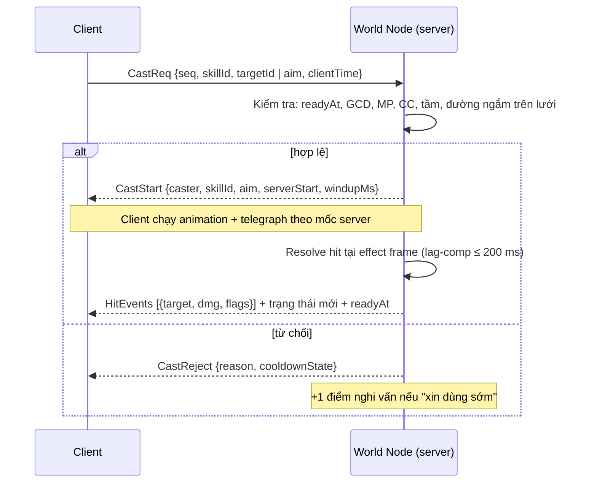

# Hệ phái & Hệ thống kỹ năng

> **Trạng thái: thiết kế mới – chờ duyệt.** Toàn bộ tài liệu này là **thiết kế bổ sung** (không có trong 8 tài liệu gốc). Mọi con số là **Đề xuất – chờ duyệt**, trừ những chỗ ghi rõ nguồn [07](07-cong-thuc-data-schema.md) / `@vgtd/shared` / [08](08-server-architecture.md). Thứ bậc căn cứ: [DECISIONS.md](DECISIONS.md) (D14+) > [00 §3–§4](00-ho-so-tong-hop.md) > 07 / `@vgtd/shared` > tài liệu này; không mâu thuẫn các mục trước. Bối cảnh: [01-gdd.md](01-gdd.md) §7; phạm vi closed beta: [10-mvp-scope.md](10-mvp-scope.md).
>
> **[Cập nhật D49 (2026-11-08)]:** chủ dự án duyệt **làm lại hệ kỹ năng** — 6 Đạo Lộ (thêm **Thương tu**, **Đao tu**), mỗi lớp tự túc solo và chơi nhóm được, hai nhánh công pháp SOLO / TEAM chọn ở level 20. Mục 2, 4, 6 được viết lại; mô phỏng cân bằng ở `@vgtd/shared` (4.8). Mọi số liệu mới là **Đề xuất – chờ duyệt**.
>
> **Cách dùng số liệu:** mọi hệ số sát thương dùng công thức tổng ở 07 §4 (`Raw = ATK · c_skill`, `DMG = Raw² / (Raw + DEF_eff) · M_elem · Crit · Suppress · U(0,95; 1,05)`); chỉ số gốc ở 07 §1. Dữ liệu kỹ năng đã hiện thực trong `@vgtd/shared` (`src/schemas/skill_definitions.schema.json`, `src/data/skills.json`, `src/formulas/skills.ts`, `src/formulas/skill_sim.ts`) theo khuôn của `realm_progression.json` / `elemental_matrix.json` (mục 6).

## 1. Hệ phái: Đạo Lộ và Tông môn

Hai khái niệm tách bạch:

| Khái niệm               | Là gì                                                                                            | Chọn khi nào                          | Quyết định                                                |
| ----------------------- | ------------------------------------------------------------------------------------------------ | ------------------------------------- | --------------------------------------------------------- |
| **Đạo Lộ** (hệ phái tu) | Con đường chiến đấu: vai trò, trọng số chỉ số, bộ kỹ năng, vũ khí / animation.                   | Lúc tạo nhân vật                      | Bộ kỹ năng, vai trò trong đội                             |
| **Tông môn**            | Tổ chức xã hội: phe Chính / Tà / Ma, Cống hiến, kho, chiến tranh Linh Mạch ([01 §9](01-gdd.md)). | Sau tutorial (beta: Sơn Môn Đại Phái) | Xã hội, tiếp cận kho / bí tịch; **không** khóa Đạo Lộ nào |

- **6 Đạo Lộ khởi đầu** _(Đề xuất; [Cập nhật D49: 4 → 6])_: **Kiếm tu**, **Pháp tu**, **Thể tu**, **Đan/Phù tu** cùng hai lớp mới **Thương tu** (trường thương, tiên phong tầm trung) và **Đao tu** (trảm đao hạng nặng, cuồng chiến hút máu). Lý do mở rộng: bản 4 lớp ép đội phải đủ tam giác Tank – DPS – Hỗ trợ và Pháp tu / Đan/Phù tu không solo nổi; 6 lớp đều tự túc solo (2.0) và vẫn có vai trò đội qua nhánh công pháp. Thể tu đã được nhắc ở 07 §3 (công pháp Thể tu giảm sát thương Lôi Kiếp).
- **Không đổi Đạo Lộ trong một "kiếp" ở beta** _(Đề xuất)_. Hướng mở sau: **Phụ tu** — ở Kim Đan học được 2 kỹ năng của Đạo Lộ khác (không phải ultimate). Xem _Câu hỏi cần chốt_.
- **Nghề (luyện đan / chế phù / rèn)** mở ở Trúc Cơ (`crafting`, 07 §8) cho mọi Đạo Lộ; Đan/Phù tu chỉ được **bonus**, không độc quyền. Chi tiết nghề: [13](13-che-tao.md) (đề xuất, chờ duyệt).

## 2. Sáu Đạo Lộ _[Cập nhật D49: 4 → 6 Đạo Lộ, mỗi lớp tự túc solo và có hai nhánh công pháp]_

### 2.0 Nguyên tắc thiết kế (chủ dự án duyệt 2026-11-07, D49)

Bộ kỹ năng cũ có Pháp tu và Đan/Phù tu quá thiên hỗ trợ (DPS xoay vòng mô phỏng cũ: Kiếm ×1,70, Pháp ×1,68, Thể ×1,45, Đan/Phù ≈ ×1,1), nên các lớp phụ thuộc nhau. Năm nguyên tắc sau thay thế logic "tam giác Tank – DPS – Hỗ trợ":

1. **Mỗi lớp tự túc khi solo:** có xoay vòng sát thương, **tự duy trì hoặc tự bảo vệ** (hút máu / khiên / hồi máu tự thi triển), **cơ động / thoát thân** và **khống chế (CC)**. Bộ kiểm tra `validateSkillDefinitions` chặn dữ liệu thiếu một trong bốn.
2. **Kỹ năng dual-use (⚑D):** không kỹ năng nào vô dụng khi solo. Ví dụ: hồi dư → khiên (Hồi Xuân Chú); vùng hồi máu có gai độc gây sát thương (Vạn Mộc Hồi Xuân); khiên vỡ/hết hạn thì nổ (Thiết Bố Sam, Linh Quang Thuẫn); mọi buff đồng đội **luôn gồm người thi triển**; kỹ năng nhắm đồng đội đều là `ally_or_self`.
3. **Kỹ năng context-aware (⚑C):** hiệu ứng đổi theo ngữ cảnh. **Solo** = không còn đồng đội còn sống; **Nhóm** = còn ít nhất một đồng đội. Mỗi effect có trường `context` (`any` mặc định, `solo`, `group`). Ví dụ: Khiêu Khích — nhóm: ép quái đánh mình; solo: kéo gom quái và hút máu 15%. Thiên Y Vô Phùng — nhóm: hồi sinh đồng đội; solo (hoặc không ai chết): mưa phù + hồi máu bản thân.
4. **Hai nhánh công pháp mỗi lớp**, chọn ở **level 20**, **đổi được ngoài chiến đấu**: nhánh **SOLO** (sát thương / duy trì) và nhánh **TEAM** (tank / hỗ trợ). Nhánh TEAM giảm **15–20% sát thương** và đổi lại giá trị đội đo bằng mô phỏng (4.8): hồi/khiên/giảm sát thương cho người khác, aggro, buff, giảm giáp. Cả hai nhánh vẫn solo được.
5. **Không nội dung nào đòi một lớp cụ thể:** Đan dược (đan hồi 18% HP, hồi chiêu chung 8 s) là hồi phục phổ quát; **mọi cơ chế boss giải được bằng bất kỳ CC cứng / ngắt chiêu nào** (choáng, trói, hất tung, đóng băng, hoặc hất lùi). Đây là ngoại lệ có chủ ý của "boss miễn choáng / trói" (3.4): CC cứng **không** làm boss choáng nhưng **ngắt** chiêu đang niệm của boss và làm boss **hở sườn** (+20% sát thương nhận, 2 s). Hỗ trợ đội chỉ là phần thưởng, không bao giờ là cổng chặn.

### 2.1 Tổng quan vai trò

| Đạo Lộ         | Vai trò                                       | Vũ khí / animation (02 §1: ~18 anim mỗi lớp)                   | Tầm đánh    | Hệ chủ đạo (fixed)                    | Nhánh SOLO / TEAM                        | Độ khó nhập môn |
| -------------- | --------------------------------------------- | -------------------------------------------------------------- | ----------- | ------------------------------------- | ---------------------------------------- | --------------- |
| **Kiếm tu**    | DPS cận / trung, cơ động, burst               | Kiếm; ngự kiếm (L4) làm trọn bản sắc                           | 2,5 – 8 ô   | **Kim** (+ biến dị Lôi)               | Ngự Kiếm Đạo / **Hộ Kiếm Đạo** (đỡ đòn)  | Dễ              |
| **Pháp tu**    | DPS tầm xa, AOE, khống chế                    | **Quạt** (D42; thay "pháp trượng / quạt" của bản cũ)           | 8 ô         | **Hỏa, Thủy** (còn lại theo Linh căn) | Hỏa Bạo (burst) / **Thủy Khống**         | Trung bình      |
| **Thể tu**     | Tank / cận chiến, kháng kiếp                  | Quyền sáo                                                      | 1,8 – 2,8 ô | **Thổ**                               | Bá Quyền / **Kim Cương** (tank đội)      | Dễ              |
| **Đan/Phù tu** | Hỗ trợ có sát thương: phù, hồi máu, linh thú  | Phất trần + bút phù; Phù lục (ô F1–F4, [05](05-ui-ux-icon.md)) | 7 – 8 ô     | **Mộc, Kim**                          | Phù Sát (độc phù) / **Đan Y** (y sư)     | Khó (hỗ trợ)    |
| **Thương tu**  | **MỚI.** Tiên phong tầm trung, đâm xuyên hàng | Trường thương (3–4 ô), đâm xuyên, lao, quét, hất tung          | 3 – 4 ô     | **Lôi** (đề xuất)                     | Lôi Thương (sát thương) / **Tiên Phong** | Trung bình      |
| **Đao tu**     | **MỚI.** Cuồng chiến cận chiến, hút máu       | Trảm đao hạng nặng: chém rộng, xoay, nộ (rage), hút máu        | 2,5 – 3,5 ô | **Phong** (đề xuất)                   | Huyết Đao (cuồng chiến) / **Trấn Đao**   | Dễ, rủi ro cao  |

Vai trò đội 4 người _(Đề xuất, không bắt buộc)_: đội mạnh nhất vẫn là 1 người tank (Kim Cương / Tiên Phong / Trấn Đao) + 1 người hỗ trợ (Đan Y / Thủy Khống) + 2 DPS, nhưng mô phỏng (4.8) cho thấy đội **toàn DPS không tank / không hồi máu vẫn hạ boss trước khi cuồng nộ**, và đội bốn người cùng một Đạo Lộ cũng thắng.

### 2.2 Trọng số chỉ số (hệ số nhân lên B của 07 §1)

Chỉ số lớp = `Stat(r, k) = B · m_lớp · λ^x(r, k)` — tức **hệ số m_lớp nhân vào chỉ số gốc 07 §1**, không đổi λ, không đổi công thức tăng trưởng. Ràng buộc: m nằm trong **[0,85; 1,25]** và không vi phạm trần "trang bị + công pháp + pháp bảo ≤ +60% chỉ số gốc cùng cảnh giới" (07 §1) — m_lớp **không tính** vào trần này vì là bản chất Đạo Lộ, không phải trang bị. _[Cập nhật D49: thêm Thương tu và Đao tu; ATK các lớp được kéo lại gần nhau (1,02–1,10) vì mô phỏng cho thấy chênh ATK cơ bản là nguyên nhân chính khiến Thể / Đan/Phù chậm hơn hẳn khi dọn đàn quái; Pháp tu tăng HP / DEF vì quá giòn khi solo.]_

| Đạo Lộ     | Khí Huyết (HP) | Chân Nguyên (MP) | Công kích | Phòng ngự | Thân pháp | Thay đổi so với bản 4 lớp                        |
| ---------- | -------------- | ---------------- | --------- | --------- | --------- | ------------------------------------------------ |
| Kiếm tu    | 0,95           | 0,90             | 1,06      | 0,92      | 1,10      | ATK 1,08 → 1,06                                  |
| Pháp tu    | 0,95           | 1,25             | 1,10      | 0,88      | 0,95      | HP 0,85 → 0,95; ATK 1,12 → 1,10; DEF 0,85 → 0,88 |
| Thể tu     | 1,20           | 0,85             | 1,02      | 1,15      | 0,95      | ATK 0,92 → 1,02                                  |
| Đan/Phù tu | 1,00           | 1,15             | 1,04      | 0,95      | 1,05      | ATK 0,88 → 1,04                                  |
| Thương tu  | 1,05           | 0,95             | 1,04      | 1,00      | 1,05      | mới                                              |
| Đao tu     | 1,10           | 0,85             | 1,06      | 0,90      | 1,00      | mới                                              |

**Kiểm tra cân bằng tĩnh** (đòn c = 1, hai bên cùng nấc, trung tính Ngũ hành, bỏ crit / jitter) — số đòn để tiêu diệt đối thủ theo công thức 07 §4; mốc trung tính không phân Đạo Lộ là 33 đòn (07 §1). Hàng = người tấn công, cột = người bị đánh. Bảng này được tái hiện thành test (`staticTtkMatrix()` trong `@vgtd/shared`, `test/skills-data.test.ts`):

| atk \ def | kiem | phap | the | dan_phu | thuong | dao |
| --------- | ---- | ---- | --- | ------- | ------ | --- |
| kiem      | 29   | 28   | 40  | 31      | 33     | 33  |
| phap      | 27   | 27   | 38  | 29      | 31     | 31  |
| the       | 30   | 30   | 42  | 32      | 35     | 35  |
| dan_phu   | 30   | 29   | 41  | 31      | 34     | 34  |
| thuong    | 30   | 29   | 41  | 31      | 34     | 34  |
| dao       | 29   | 28   | 40  | 31      | 33     | 33  |

Nhận xét: mọi ô nằm trong **27–42 đòn**, tức **nằm trong dải 23–51 của bản cũ** (và hẹp hơn: chênh ATK giữa các lớp được thu lại có chủ ý). Thể tu vẫn cao nhất khi bị đánh (đúng vai tank), Pháp tu thấp nhất (giòn). Đây là kiểm tra tĩnh; cân bằng động nằm ở mục 4.8 (mô phỏng PvE) — PvP vẫn chờ (OPEN-ITEMS #7).

### 2.3 Ngũ hành affinity và Linh căn

- 07 §4: _hệ tấn công = hệ của kỹ năng đang dùng; đòn thường lấy hệ Linh căn chính_; 07 §5: _kỹ năng ngoài hệ chịu phạt sát thương_ (Đơn −30%, Song −15%, Tạp 0%).
- **Vấn đề:** Linh căn ngẫu nhiên (Đơn chỉ 5%). Nếu một Kiếm tu Đơn Mộc phải dùng toàn kỹ năng Kim thì mất 30% mà không do lựa chọn của họ. **Giải pháp đề xuất — hai loại hệ của kỹ năng:**

| Loại hệ kỹ năng                                    | `element` trong dữ liệu | Ý nghĩa                                                                                                                        | Phạt ngoài hệ (07 §5)  |
| -------------------------------------------------- | ----------------------- | ------------------------------------------------------------------------------------------------------------------------------ | ---------------------- |
| **Linh căn hóa** (adaptive) — đa số kỹ năng cơ bản | `root_main`             | Lấy hệ của **Linh căn chính** người chơi lúc thi triển (và hệ biến dị nếu có). Đơn Mộc → kiếm khí Mộc. Không bao giờ ngoài hệ. | **Không áp dụng**      |
| **Bản mệnh Đạo Lộ** (fixed) — kỹ năng đặc trưng    | `kim` / `hoa` / …       | Hệ cố định của Đạo Lộ, cho bản sắc VFX / sinh khắc. **Có** phạt nếu Linh căn không chứa hệ đó.                                 | Áp dụng đúng như 07 §5 |

Nhờ đó: Đơn Kim + Kiếm tu = tối ưu (mọi kỹ năng Kim); Đơn Mộc + Kiếm tu vẫn chơi tốt bằng kỹ năng linh căn hóa, chỉ mất sức mạnh ở 3 kỹ năng đặc trưng Kim. Phạt chỉ áp lên **sát thương**; hồi máu / khiên / khống chế không bị phạt.

- **Dấu hệ (elemental rider) của kỹ năng linh căn hóa** _(Đề xuất)_ — mỗi hệ gắn một hiệu ứng phụ nhỏ, làm Linh căn có ý nghĩa gameplay ngoài tốc độ tu:

| Hệ    | Dấu hệ khi đánh trúng kỹ năng linh căn hóa                          |
| ----- | ------------------------------------------------------------------- |
| Kim   | Xuyên giáp +15% cho đòn đó (cộng vào Pen, trần 0,4 — 07 §4)         |
| Mộc   | Hồi lại bản thân 8% sát thương gây ra                               |
| Thủy  | Làm chậm mục tiêu 20% trong 2 giây                                  |
| Hỏa   | Bỏng: thêm DoT 30% sát thương đòn đó trong 3 giây                   |
| Thổ   | Giảm 10% sát thương nhận của bản thân trong 3 giây                  |
| Phong | Hồi chiêu đòn thường −10% trong 3 giây (biến dị của Mộc)            |
| Lôi   | 20% xác suất tê liệt 0,5 giây (biến dị của Kim)                     |
| Băng  | Đóng băng nhẹ: mục tiêu bị chậm 35% trong 1 giây (biến dị của Thủy) |

- **Tương sinh khi hỗ trợ** (07 §4): do **engine** xử lý tự động cho mọi kỹ năng `heal` / `shield` / buff đồng đội — nếu hệ của người thi triển sinh hệ của đồng đội thì đồng đội hồi 10% Chân Nguyên tối đa (hồi chiêu 10 s mỗi cặp, không áp lên bản thân). Không khai báo trong từng skill. Đây là lý do Đan/Phù tu có kỹ năng cả Mộc và Kim: Mộc sinh Hỏa, Kim sinh Thủy, tức chăm tổ đội có Pháp tu Hỏa / Thủy.

### 2.4 Chi phí Chân Nguyên và hồi phục

MP lớn chậm hơn Công kích (λ 1,70 vs 1,75; 07 §1) nên chi phí kỹ năng tính **theo % MP tối đa** (`mp_pct`) — tự co giãn theo cảnh giới, không cần bảng chi phí theo cảnh giới.

| Tham số _(Đề xuất)_    | Giá trị                                                           |
| ---------------------- | ----------------------------------------------------------------- |
| Hồi MP trong chiến đấu | 1,0% MP tối đa / giây                                             |
| Hồi MP ngoài chiến đấu | 4% MP tối đa / giây                                               |
| Đả tọa                 | 8% MP tối đa / giây (ngoài chiến đấu) + tu vi `Absorb(s)` (07 §5) |
| Mỗi đòn thường trúng   | +0,5% MP tối đa                                                   |
| Đan hồi MP             | Theo phẩm; hồi chiêu đan chung 8 giây                             |

Mô phỏng xoay vòng tham chiếu (mục 4.8, dummy 120 s): tiêu MP Kiếm ≈ 1,8%/s, Thể ≈ 1,9%/s, Đan/Phù ≈ 2,1%/s, Thương ≈ 2,1%/s, Đao ≈ 2,1%/s, Pháp ≈ 2,6%/s. Với hồi 1%/s + 0,5%/đòn thường, các lớp cận chiến gần như bền vững trong trận 30–60 giây; Pháp tu hết MP sau ~1,5–2 phút xoay liên tục — **chủ ý**: Pháp tu phải xen đòn thường / đan / Phiến Phong Bộ (hồi 6% MP).

## 3. Mô hình dữ liệu kỹ năng

### 3.1 Vòng đời một lần thi triển

Tên thông điệp dưới đây là khái niệm; định dạng thật nằm ở [24-giao-thuc-mang.md](24-giao-thuc-mang.md) §5 (`CastReq` ≈ `skill_cast` / `skill_cast_ground`, `CastStart` ≈ `cast_start`, `HitEvents` ≈ `skill_result`, `CastReject` ≈ `skill_result` với `CastReason`). Mọi thi triển do **server quyết định** (08): client chỉ gửi yêu cầu; hồi chiêu, Chân Nguyên, kết quả sát thương đều ở server.



Quy tắc (nguồn 08 §6 trừ ghi chú _Đề xuất_):

- Điều kiện hợp lệ: `t_server ≥ readyAt − min(RTT/2, 100 ms)`; đủ Chân Nguyên; **GCD**; không bị khống chế; trong tầm; có đường ngắm trên lưới. Từ chối thì gửi lại `readyAt` đúng để client sửa thanh hồi chiêu. Tối đa **10 gói thi triển / giây / người chơi** (token bucket). Thanh hồi chiêu trên client **chạy theo mốc server gửi**, không tự đếm.
- **Lag compensation:** tua tối đa **200 ms** (`NETWORK.LAG_COMP_MAX_MS`) — áp lên vị trí **mục tiêu** khi resolve đòn của người chơi. Né sát thương từ quái / boss **không** được tua (người chơi thấy telegraph chạy theo giờ server; thêm **dung sai 100 ms** _(Đề xuất)_ ở mốc nổ).
- **GCD = 800 ms** _(Đề xuất; 08 chỉ nêu có GCD)_. Kỹ năng di chuyển (`gcd: false`) và passive không dính GCD.
- **Hồi chiêu bắt đầu khi hiệu lực kích hoạt** (hết `cast_ms`), không bắt đầu khi bị ngắt trước đó; ngắt trước hiệu lực: hoàn 50% MP, không tính hồi chiêu _(Đề xuất)_. Giảm hồi chiêu cộng dồn **trần 30%**.
- **`move_during_cast`:** `lock` (đứng yên), `slow` (đi 50% tốc độ), `free`. **Channel** (`channel_ms` + `channel_ticks`) bị ngắt khi mất khống chế hoặc di chuyển nếu `lock`.
- Cast bình thường không bị ngắt bởi sát thương; bị ngắt bởi **choáng / đóng băng / hất tung** (khống chế cứng) nếu `interruptible: true`.

### 3.2 Trường dữ liệu chính của một kỹ năng

| Nhóm       | Trường                                                                                                                                 | Ghi chú                                                                                                                                                                                                |
| ---------- | -------------------------------------------------------------------------------------------------------------------------------------- | ------------------------------------------------------------------------------------------------------------------------------------------------------------------------------------------------------ |
| Định danh  | `id`, `name_key`, `desc_key`, `icon_id`                                                                                                | Văn bản qua khóa i18n (Việt / Trung / Anh; 02 §5). Icon nguồn 256, xuất 48 / 64 / 128 ([05](05-ui-ux-icon.md)).                                                                                        |
| Phân loại  | `owner` (player / mob / elite / boss), `path`, `kind` (active / passive), `tier` (basic / core / ultimate)                             | Skill của quái dùng chung schema; chỉ khác có `telegraph` thay `cost`/`progression`.                                                                                                                   |
| Hệ         | `element` (`kim`…`bang`, `root_main`, `none`), `elemental_rider`                                                                       | `root_main` = linh căn hóa (2.3).                                                                                                                                                                      |
| Mở khóa    | `unlock.level_min`, `realm_min`, `source` (level / tome / quest / sect_shop)                                                           | Level theo `realm_progression.json` (07 §8).                                                                                                                                                           |
| Nhắm       | `targeting.mode`, `range_tiles`, `requires_los`, `aim_ui`                                                                              | Chế độ: self / ally / enemy / ground / direction / auto_nearest_enemy. `aim_ui`: tap (chạm = nhắm tự động) / drag_aim / drag_ground — khớp Skill Wheel ([05](05-ui-ux-icon.md): "kéo nhắm", vùng hủy). |
| Hình dạng  | `shape` (3.3)                                                                                                                          | Tính trên lưới ô logic.                                                                                                                                                                                |
| Thời gian  | `timing.cast_ms`, `channel_ms`, `channel_ticks`, `recovery_ms`, `cooldown_ms`, `gcd`, `move_during_cast`, `interruptible`, `invuln_ms` | `cooldown_ms` do server giữ (`readyAt`); `invuln_ms` ≤ 500 cho kỹ năng lướt (K5).                                                                                                                      |
| Chi phí    | `cost.mp_pct` (hoặc `item_id` + `item_qty` cho Phù lục)                                                                                | `% MP tối đa`.                                                                                                                                                                                         |
| Hiệu ứng   | `effects[]` (3.4)                                                                                                                      | Mỗi phần tử có hệ số co giãn.                                                                                                                                                                          |
| Cảnh báo   | `telegraph` (3.5)                                                                                                                      | Bắt buộc cho quái / tinh anh / boss.                                                                                                                                                                   |
| Tiến trình | `progression` (5)                                                                                                                      | Bắt buộc cho `owner = player`.                                                                                                                                                                         |
| Hình ảnh   | `vfx.cast_fx`, `projectile_fx`, `hit_fx`, `max_draw_calls` ≤ 2, `instanced`                                                            | **≤ 2 draw call mỗi kỹ năng** ([02 §4](02-asset-matrix-2d.md)); chiêu nhiều thực thể (Vạn Kiếm) dùng GPU instancing ([06](06-toi-uu-render.md)).                                                       |

### 3.3 Hình dạng AOE trên lưới isometric

**Nguyên tắc:** server tính **toàn bộ trong tọa độ logic ô (i, j)** — đơn vị là **ô**, không phải pixel màn hình. Client chỉ vẽ lại bằng phép chiếu 2:1 (x = (i − j)·32, y = (i + j)·16; 00 §3). Hệ quả quan trọng:

- **Vòng tròn logic bán kính r ô** hiện trên màn hình là **ellipse 2:1** có bán kính nửa trục `a = 32·√2·r ≈ 45,25·r px` (ngang) và `b = 16·√2·r ≈ 22,6·r px` (dọc) @1x. Ví dụ r = 4 ô → ellipse ~362 × 181 px. Khớp quy ước "mọi vòng tròn trên mặt đất vẽ sẵn thành ellipse 2:1" ([02 §4](02-asset-matrix-2d.md)). Người chơi trải nghiệm vùng "tròn" đúng với lưới.
- **Hướng nhắm liên tục** (góc φ trong mặt phẳng (i, j)), không bị cắt vào 8 hướng; **sprite** chỉ hiển thị hướng gần nhất trong số hướng đã vẽ (rig Spine Player / Boss vẽ 5 hướng + lật gương; animation bất đối xứng có thể vẽ đủ 8 — D14). **Gốc tọa độ:** (i, j) nguyên là đỉnh N của ô, tâm ô = (i + 0,5; j + 0,5) (D15); mọi vị trí thực thể và tâm vùng đánh dùng quy ước này.
- Kiểm tra trúng: khoảng cách tính **đến tâm hurtbox** (bán kính 0,45 ô; `HURTBOX_RADIUS_TILES`) — thực thể trúng khi `dist(tâm, hurtbox) ≤ r + 0,45` _(Đề xuất, ổn định cho server)_.

| `shape.type` | Tham số                                             | Hit test (logic ô)                                                 | Telegraph / vẽ                                                 |
| ------------ | --------------------------------------------------- | ------------------------------------------------------------------ | -------------------------------------------------------------- |
| `single`     | —                                                   | Một mục tiêu đã chọn, trong tầm                                    | Vòng chọn dưới chân + đường nối                                |
| `circle`     | `radius`, `anchor` (caster / target / ground_point) | `dist ≤ r`                                                         | Ellipse 2:1 đổ đầy theo thời gian                              |
| `ring`       | `radius`, `inner_radius`, `anchor`                  | `inner ≤ dist ≤ r`                                                 | Hai ellipse đồng tâm                                           |
| `cone`       | `radius` (tầm), `angle_deg`, hướng φ                | `dist ≤ R` và `abs(Δθ) ≤ angle/2` quanh φ                          | Quạt xoay theo φ rồi chiếu 2:1 (một sprite hình quạt + shader) |
| `line`       | `length`, `width`                                   | Hình chữ nhật dài `length`, rộng `width` từ người thi triển theo φ | Dải chữ nhật chiếu thành bình hành trên màn hình               |

- Giới hạn: bán kính tối đa **12 ô** (≤ ½ cạnh AOI 2 × 2 màn hình, `AOI.HALF_U = 40`); chiều dài `line` ≤ 16; **tối đa 12 mục tiêu / lần thi triển** (`max_targets_per_cast`, _Đề xuất_ — bảo vệ CPU World Node và băng thông ~8 KB/s khi đánh quái; chọn 12 mục tiêu gần nhất).
- **Đường ngắm** (`requires_los`): tia trên lưới ô (Bresenham), bị chặn bởi ô `Collision = chặn` và bởi vách ≥ 2 tầng (`Elevation`, 04 §4); bay thấp / bay tự do không đổi luật ngắm.
- **Tầng cao:** đòn chỉ trúng thực thể **cùng nhóm tầng hoặc ±1 tầng** _(Đề xuất)_ — tránh đánh xuyên 3 tầng ở Sơn Môn (5 tầng).

### 3.4 Hiệu ứng và công thức co giãn

> **Bị động không co giãn theo rank:** `passive_stat` giữ nguyên `magnitude` ở mọi rank (kỹ năng bị động khai báo `max_rank: 1`, `coeff_per_rank: 0`), để các giá trị có nguồn như +10% giảm Lôi Kiếp của Thể tu (07 §3) không bị trôi. Bảng 4.3 – 4.4 và mục 5 chỉ áp rank cho kỹ năng chủ động.

Mỗi `effect` có `scale: {stat, coeff}`. Công thức thống nhất với 07 §4:

```latex
\begin{aligned}
c_{\text{eff}} &= c_0 \cdot \big(1 + 0{,}05\,(\text{rank} - 1)\big) \cdot \text{pvp\_mult} \\
\text{Raw} &= \text{ATK}_{\text{eff}} \cdot c_{\text{eff}} \qquad\text{(sát thương; mỗi } \texttt{hit} \text{ tính riêng)} \\
\text{DMG} &= \frac{\text{Raw}^2}{\text{Raw} + \text{DEF}_{\text{eff}}} \cdot M_{\text{elem}} \cdot \text{Crit} \cdot \text{Suppress} \cdot U(0{,}95;\,1{,}05) \\
\text{Heal} &= \text{ATK}_{\text{eff}} \cdot c_{\text{heal}} \cdot (1 + \text{bonus}) \qquad \text{Shield} = \text{scale\_stat} \cdot s
\end{aligned}
```

- `DEF_eff`, `M_elem`, `Crit` (×1,5), `Suppress`, jitter, **hệ ngoài hệ −30/−15/0%**: giữ nguyên 07 §4–§5; **không có công thức sát thương thứ hai**.
- **Tính chất lồi của `Raw²/(Raw+DEF)`:** chia một đòn thành nhiều hit nhỏ làm tổng yếu đi, đòn lớn mạnh vượt trội. Nên thiết kế dùng **chỉ số E = hits · f(c)/f(1)** (f(c) = c²/(c + d), d = DEF/ATK ≈ 0,667 trung tính) làm "tương đương đòn thường" (c = 1, E = 1) — đây là số dùng để cân (mục 4).
- **Hồi máu / khiên** co giãn theo `atk` (hỗ trợ) hoặc `hp_max` (Thể tu tự bảo vệ): ví dụ `heal: atk × 4,0` ≈ 17,6% Khí Huyết tối đa người nhận ở cùng cảnh giới (ATK Đan/Phù tu 0,88 · 60 ≈ 53; HP 1.200). Khiên và hồi máu cũng cộng dồn tối đa 60% từ trang bị như chỉ số khác (07 §1).
- **PvP:** `effects[].pvp_mult` mặc định 1; dùng để hạ riêng khống chế / burst trong PvP mà không đổi PvE (luật PvP: [14 §4](14-pvp-chien-tranh.md), đề xuất chờ duyệt).
- **Khống chế (CC):** choáng / đóng băng / trói chặt giảm dần: lần 2 trong 8 giây còn 50% thời lượng, lần 3 miễn nhiễm 4 giây _(Đề xuất)_; **boss miễn choáng / trói**, chỉ chịu làm chậm 50% hiệu lực.

### 3.5 Telegraph (cảnh báo) cho quái, tinh anh, boss

Mọi kỹ năng của quái có khung **telegraph** (decal ellipse đổ đầy theo thời gian; 02 §4 dùng 1–1,5 giây cho vòng cảnh báo sét):

| Loại        | `telegraph.duration_ms` _(Đề xuất)_ | Hình              | Ghi chú                                           |
| ----------- | ----------------------------------- | ----------------- | ------------------------------------------------- |
| Quái thường | 800 – 1.200                         | circle / cone nhỏ | Chỉ đòn mạnh có telegraph; đòn thường không       |
| Tinh anh    | 1.000 – 1.500                       | circle / line     | Mỗi tinh anh 1 kỹ năng riêng (02 §1)              |
| Boss        | 1.000 – 2.000                       | mọi hình, cả ring | Chuyển phase đổi skin (03 §6); thêm "cảnh báo âm" |

Sát thương **nổ ở cuối telegraph theo giờ server**, tính vị trí mục tiêu tại thời điểm nổ; người chơi Mobile (150–250 ms trễ nội suy) vì vậy được cộng dung sai 100 ms ở 3.1. Mọi telegraph hiển thị theo `visible_to` (mặc định `all`).

## 4. Bộ kỹ năng MVP (6 Đạo Lộ × 8) _[Cập nhật D49]_

**Phạm vi:** 48 kỹ năng (42 chủ động + 6 bị động; Pháp tu không còn bị động — bị động MP cũ được gộp vào Phiến Phong Bộ), mở theo **level 1–70** (Luyện Khí → Kim Đan; `level_range` 07 §8) cùng **12 công pháp nhánh** (2 mỗi Đạo Lộ, chọn ở level 20). Dữ liệu thật: `packages/shared/src/data/skills.json` (schema `skill_definitions.schema.json`, mục 6); mô phỏng cân bằng: `skill_sim.ts` (4.8). Khớp bố cục 05: PC có thanh 1–9 (+ Shift), Mobile Skill Wheel 2 trang × 5; mỗi Đạo Lộ tối đa **8 chủ động** + đòn thường + ngự kiếm / khinh công + ô phù lục F1–F4. So với ~150 VFX kỹ năng của toàn game ([02 §4](02-asset-matrix-2d.md)): beta dùng 42 kỹ năng chủ động (~28%).

**Đòn thường** _(chung)_: combo 3 đòn (02 §1 "3 đòn"); hệ = Linh căn chính; `c` = 0,9 / 0,9 / 1,3; chu kỳ ~0,9 giây một đòn; không tốn MP; mỗi đòn trúng +0,5% MP. Tầm: Kiếm 2,5 ô · Pháp 8 · Thể 1,8 · Đan/Phù 7 · Thương 3,5 · Đao 2,5.

**Cách đọc bảng:** `Cast` = thời gian biến chiêu (giây, gồm channel); `CD` = hồi chiêu (giây); `MP` = % MP tối đa; `Hit×c` = số hit × hệ số mỗi hit **ở rank 1**; `E` = tương đương đòn thường (3.4); ⚑C = context-aware, ⚑D = dual-use (bảng nhãn ở 2.0). **Mọi số liệu trong mục này, kể cả hệ số nhánh, là Đề xuất – chờ duyệt** và chỉ có hiệu lực sau khi qua mô phỏng 4.8.

**Quy ước context:** hiệu ứng khai báo `context: "solo"` chỉ chạy khi không còn đồng đội sống; `context: "group"` chỉ khi còn ít nhất một đồng đội; không khai báo = luôn chạy. Buff `applies_to: "all"` luôn gồm người thi triển; `heal`/`shield` `applies_to: "ally"` kèm `targeting.mode = ally_or_self`.

### 4.1 Kiếm tu (kiếm; Kim)

| #   | `id`                 | Tên                     | Lv  | Hệ           | Hình · Tầm                | Cast | CD  | MP  | Hit×c | E    | Mô tả (⚑ = context-aware / dual-use)                                                                                                                          |
| --- | -------------------- | ----------------------- | --- | ------------ | ------------------------- | ---- | --- | --- | ----- | ---- | ------------------------------------------------------------------------------------------------------------------------------------------------------------- |
| K1  | `kiem_khi_tram`      | Kiếm Khí Trảm           | 1   | Linh căn hóa | Cone 90° · 2,5 ô          | 0,4  | 3   | 1%  | 1×1,3 | 1,43 | Chém quạt lấp khoảng trống.                                                                                                                                   |
| K2  | `lien_hoan_kiem`     | Liên Hoàn Kiếm          | 5   | Linh căn hóa | Cone 60° · 3 ô            | 1    | 7   | 2%  | 3×0,8 | 2,18 | 3 nhát liên tiếp (channel 1 s, `lock`).                                                                                                                       |
| K3  | `phi_kiem_thuat`     | Phi Kiếm Thuật          | 12  | Linh căn hóa | Line 1 × 8 ô              | 0,5  | 5   | 2%  | 1×1,6 | 1,88 | Phi kiếm xuyên hàng, đòn tầm xa đầu tiên của Kiếm tu.                                                                                                         |
| K4  | `kim_quang_quet`     | Kim Quang Quét          | 20  | **Kim**      | Cone 120° · 3,5 ô         | 0,6  | 10  | 4%  | 1×2   | 2,5  | Quét ngang xuyên giáp +15%; **choáng 0,6 s** (CC + ngắt chiêu boss).                                                                                          |
| K5  | `thiem_kiem_bo`      | Thiểm Kiếm Bộ ⚑C ⚑D     | 31  | Linh căn hóa | Line 1 × 5 ô              | 0,3  | 12  | 2%  | 1×1   | 1    | Lướt xuyên mục tiêu, bất tử 0,3 s. **Dual-use:** thêm khiên 10% HP; **context nhóm:** đồng đội r4 +20% tốc chạy 3 s.                                          |
| K6  | `kiem_tam` (bị động) | Kiếm Tâm ⚑D             | 40  | —            | —                         | —    | —   | —   | —     | —    | +5% chí mạng, +6% xuyên giáp, **+4% hút máu** (tự duy trì khi solo).                                                                                          |
| K7  | `ngu_kiem_tran`      | Ngự Kiếm Trận ⚑C ⚑D     | 51  | **Kim**      | Circle r4 · tầm 8, ground | 3    | 18  | 6%  | 6×0,9 | 5,17 | Kiếm trận channel 3 s (6 nhịp). **Buff luôn gồm người thi triển:** +12% chí mạng r4 trong 8 s cho cả đội; **context solo:** hồi 0,35·ATK mỗi 0,5 s trong 3 s. |
| K8  | `van_kiem_quy_tong`  | Vạn Kiếm Quy Tông ⚑C ⚑D | 65  | **Kim**      | Circle r6 · tầm 8, ground | 4    | 60  | 15% | 8×1,1 | 9,13 | **Ultimate.** Vạn kiếm 4 s (8 nhịp; 1 sprite + GPU instancing). Khiên 20% HP cho bản thân; **context nhóm:** +10% sát thương cho đồng đội r6 trong 8 s.       |

**Hệ số chỉ số m (mục 2.2):** HP 0,95 · MP 0,9 · ATK 1,06 · DEF 0,92 · AGI 1,1. Đòn thường: tầm 2,5 ô.

**Công pháp (chọn ở level 20, đổi ngoài chiến đấu) — số liệu Đề xuất – chờ duyệt:**

| Nhánh           | Chế độ | Hệ số                                                                                                                   |
| --------------- | ------ | ----------------------------------------------------------------------------------------------------------------------- |
| `kiem_ngu_kiem` | SOLO   | sát thương ×1,05; Thiểm Kiếm Bộ: cooldown ×0,85                                                                         |
| `kiem_ho_kiem`  | TEAM   | sát thương ×0,82; sát thương nhận ×0,88; đồng đội +10% chí mạng; Ngự Kiếm Trận: buff ×1,8; Vạn Kiếm Quy Tông: buff ×1,5 |

### 4.2 Pháp tu (quạt; Hỏa/Thủy)

| #   | `id`                   | Tên                   | Lv  | Hệ           | Hình · Tầm                | Cast | CD  | MP  | Hit×c | E    | Mô tả (⚑ = context-aware / dual-use)                                                                                             |
| --- | ---------------------- | --------------------- | --- | ------------ | ------------------------- | ---- | --- | --- | ----- | ---- | -------------------------------------------------------------------------------------------------------------------------------- |
| P1  | `linh_khi_dan`         | Linh Khí Đạn          | 1   | Linh căn hóa | Single · 8 ô              | 0,5  | 2,5 | 2%  | 1×1,4 | 1,58 | Đạn linh khí đơn mục tiêu (quạt phóng phiến ảnh).                                                                                |
| P2  | `ngu_hanh_chu`         | Ngũ Hành Chú          | 5   | Linh căn hóa | Circle r2 · tầm 8, ground | 0,8  | 6   | 4%  | 1×1,4 | 1,58 | AOE nhỏ lấy hệ Linh căn.                                                                                                         |
| P3  | `linh_quang_thuan`     | Linh Quang Thuẫn ⚑D   | 12  | Linh căn hóa | Đồng đội/self · 8 ô       | 0,3  | 14  | 5%  | —     | —    | **Có thể đặt lên đồng đội hoặc bản thân** (ally_or_self). Khiên 27% HP người nhận 6 s; **khiên vỡ/hết hạn nổ** gây 1,2·ATK r2,5. |
| P4  | `lien_chau_dan`        | Liên Châu Đạn         | 20  | Linh căn hóa | Cone 30° · 8 ô            | 0,8  | 8   | 4%  | 3×0,9 | 2,59 | Ba đạn quạt hẹp.                                                                                                                 |
| P5  | `bang_phong_thuat`     | Băng Phong Thuật      | 31  | **Thủy**     | Circle r3 · tầm 8, ground | 0,8  | 12  | 5%  | 1×1   | 1    | AOE 1,0·ATK + **trói 2 s** (quái thường) / làm chậm 50% (boss; vẫn **ngắt chiêu boss**).                                         |
| P6  | `liet_diem_phan_thien` | Liệt Diễm Phần Thiên  | 40  | **Hỏa**      | Circle r3 · tầm 8, ground | 1,2  | 16  | 8%  | 1×2,6 | 3,45 | Nổ lửa lớn + bỏng 3 s; `lock` khi niệm.                                                                                          |
| P7  | `phien_phong_bo`       | Phiến Phong Bộ ⚑D     | 48  | Linh căn hóa | Line 1 × 4 ô              | 0,2  | 10  | 2%  | —     | —    | **Thoái bộ 4 ô** (bất tử 0,2 s), làm chậm quái 60% trong 3 s, hồi 6% MP (thay bị động MP cũ). Kỹ năng thoát thân của Pháp tu.    |
| P8  | `thien_hoa_luu_tinh`   | Thiên Hỏa Lưu Tinh ⚑D | 60  | **Hỏa**      | Circle r4 · tầm 9, ground | 3    | 60  | 15% | 5×1,6 | 9,41 | **Ultimate.** Mưa sao lửa channel 3 s (5 nhịp).                                                                                  |

**Hệ số chỉ số m (mục 2.2):** HP 0,95 · MP 1,25 · ATK 1,1 · DEF 0,88 · AGI 0,95. Đòn thường: tầm 8 ô.

**Công pháp (chọn ở level 20, đổi ngoài chiến đấu) — số liệu Đề xuất – chờ duyệt:**

| Nhánh             | Chế độ | Hệ số                                                                                                        |
| ----------------- | ------ | ------------------------------------------------------------------------------------------------------------ |
| `phap_hoa_bao`    | SOLO   | sát thương ×1,12; sát thương nhận ×0,85; Liệt Diễm Phần Thiên: damage ×1,15; Thiên Hỏa Lưu Tinh: damage ×1,1 |
| `phap_thuy_khong` | TEAM   | sát thương ×1; Băng Phong Thuật: cooldown ×0,7; Linh Quang Thuẫn: shield ×1,8, cooldown ×0,7                 |

### 4.3 Thể tu (quyền sáo; Thổ)

| #   | `id`                      | Tên                   | Lv  | Hệ           | Hình · Tầm              | Cast | CD  | MP  | Hit×c | E    | Mô tả (⚑ = context-aware / dual-use)                                                                                                                     |
| --- | ------------------------- | --------------------- | --- | ------------ | ----------------------- | ---- | --- | --- | ----- | ---- | -------------------------------------------------------------------------------------------------------------------------------------------------------- |
| T1  | `phach_quyen`             | Phách Quyền           | 1   | Linh căn hóa | Single · 1,8 ô          | 0,4  | 2,5 | 1%  | 1×1,2 | 1,29 | Đấm đơn mục tiêu; mỗi đòn trúng +1 tầng **Khí Huyết An**.                                                                                                |
| T2  | `thiet_bo_sam`            | Thiết Bố Sam ⚑D       | 5   | **Thổ**      | Self                    | 0,3  | 16  | 3%  | —     | —    | Khiên 12% HP 8 s; **khiên vỡ/hết hạn nổ** 5,5·ATK r2,8 (dual-use: phòng thủ + AOE).                                                                      |
| T3  | `dia_chan`                | Địa Chấn              | 12  | **Thổ**      | Circle r2,5 · tâm người | 0,6  | 7   | 4%  | 1×1,6 | 1,88 | AOE quanh người, làm chậm 30% trong 2 s.                                                                                                                 |
| T4  | `khieu_khich`             | Khiêu Khích ⚑C ⚑D     | 20  | —            | Circle r4 · tâm người   | 0,3  | 15  | 3%  | —     | —    | **Context-aware.** Nhóm: quái trong r4 **buộc đánh** người thi triển 4 s. Solo: **kéo gom** quái về sát người + **hút máu 15%** 5 s.                     |
| T5  | `long_ho_quyen`           | Long Hổ Quyền         | 31  | Linh căn hóa | Circle r2,8 · tâm người | 0,8  | 8   | 4%  | 2×1,5 | 3,46 | Hai quyền quét vòng quanh người.                                                                                                                         |
| T6  | `kim_than_cong` (bị động) | Kim Thân Công ⚑D      | 45  | —            | —                       | —    | —   | —   | —     | —    | +8% Phòng ngự, +10% giảm sát thương Lôi Kiếp (07 §3), **+4% hút máu**.                                                                                   |
| T7  | `thiet_son_khao`          | Thiết Sơn Kháo        | 51  | Linh căn hóa | Line 1,5 × 4 ô          | 0,5  | 14  | 4%  | 1×1,5 | 1,73 | Húc tới 4 ô, hất lùi 2 ô (knockback = ngắt chiêu boss).                                                                                                  |
| T8  | `ba_the_bat_hoai`         | Bá Thể Bất Hoại ⚑C ⚑D | 62  | **Thổ**      | Circle r5 · tâm người   | 0,3  | 75  | 12% | —     | —    | **Ultimate, context-aware.** Giảm 40% sát thương nhận 6 s. Solo: +25% hút máu, +20% sát thương. Nhóm: khiêu khích r5 + đồng đội r5 −15% sát thương nhận. |

**Hệ số chỉ số m (mục 2.2):** HP 1,2 · MP 0,85 · ATK 1,02 · DEF 1,15 · AGI 0,95. Đòn thường: tầm 1,8 ô. **Nội tại `khi_huyet_an`:** mỗi đòn trúng +1 tầng (tối đa 5, 8 s); mỗi tầng −3% sát thương nhận, +1% hút máu.

**Công pháp (chọn ở level 20, đổi ngoài chiến đấu) — số liệu Đề xuất – chờ duyệt:**

| Nhánh           | Chế độ | Hệ số                                                                                                                                                 |
| --------------- | ------ | ----------------------------------------------------------------------------------------------------------------------------------------------------- |
| `the_ba_quyen`  | SOLO   | sát thương ×0,8; Thiết Bố Sam: cooldown ×0,8; Long Hổ Quyền: damage ×1,1                                                                              |
| `the_kim_cuong` | TEAM   | sát thương ×0,71; sát thương nhận ×0,85; aggro ×3; đồng đội −8% sát thương nhận; Khiêu Khích: duration ×1,5, cooldown ×0,8; Thiết Bố Sam: shield ×1,4 |

### 4.4 Đan/Phù tu (phất trần + phù; Mộc/Kim)

| #   | `id`                 | Tên                    | Lv  | Hệ           | Hình · Tầm                | Cast | CD  | MP  | Hit×c | E    | Mô tả (⚑ = context-aware / dual-use)                                                                                                                          |
| --- | -------------------- | ---------------------- | --- | ------------ | ------------------------- | ---- | --- | --- | ----- | ---- | ------------------------------------------------------------------------------------------------------------------------------------------------------------- |
| D1  | `phu_tien`           | Phù Tiễn ⚑D            | 1   | Linh căn hóa | Single · 7 ô              | 0,4  | 2   | 2%  | 1×1,6 | 1,88 | Bắn phù, gắn **Phù Ấn** (tối đa 3 tầng, 10 s); đủ 3 tầng **tự nổ** 1,2·ATK/tầng và lan 60% sang quái r2,5.                                                    |
| D2  | `hoi_xuan_chu`       | Hồi Xuân Chú ⚑D        | 5   | **Mộc**      | Đồng đội/self · 8 ô       | 0,8  | 4   | 5%  | —     | —    | **Tự thi triển được.** Hồi 4·ATK; **hồi dư → khiên** (60% lượng dư, 6 s).                                                                                     |
| D3  | `van_moc_hoi_xuan`   | Vạn Mộc Hồi Xuân ⚑D    | 12  | **Mộc**      | Circle r4 · tầm 8, ground | 0,8  | 10  | 8%  | —     | —    | Vùng 5 s: **hồi máu đồng đội + người thi triển**, đồng thời **gai độc** gây sát thương cho quái trong vùng (dual-use).                                        |
| D4  | `dinh_than_phu`      | Định Thân Phù          | 20  | **Kim**      | Single · 7 ô              | 0,5  | 12  | 5%  | —     | —    | Choáng 2 s, **không tốn Phù lục**; người thi triển lùi 3 ô (thoát thân). Boss: ngắt chiêu.                                                                    |
| D5  | `ho_the_phu`         | Hộ Thể Phù ⚑D          | 31  | **Kim**      | Đồng đội/self · 8 ô       | 0,5  | 12  | 5%  | —     | —    | **Tự thi triển được.** Khiên 5·ATK 8 s lên đồng đội / bản thân.                                                                                               |
| D6  | `phu_linh` (bị động) | Phù Linh ⚑D            | 35  | **Mộc**      | —                         | —    | —   | —   | —     | —    | **Bị động.** Triệu hồi **Phù Linh** (linh thú nhỏ): đánh 0,7·ATK / 1,2 s vào quái gần nhất; +12% hiệu lực đan.                                                |
| D7  | `tuong_sinh_phap`    | Tương Sinh Pháp ⚑D     | 51  | **Thủy**     | Circle r5 · tâm người     | 0,5  | 30  | 8%  | —     | —    | Buff +10% Công 10 s cho đồng đội r5 **gồm bản thân**; **kích nổ mọi Phù Ấn** trong r5 (0,8·ATK/tầng).                                                         |
| D8  | `thien_y_vo_phung`   | Thiên Y Vô Phùng ⚑C ⚑D | 62  | **Mộc**      | Circle r4 · tầm 8, ground | 2    | 120 | 20% | 8×0,9 | 6,89 | **Ultimate, context-aware.** Nhóm: **hồi sinh** đồng đội đã chết (40% HP). Không ai chết / solo: **mưa phù** 2 s (8 nhịp) + hồi 35% HP bản thân (dư → khiên). |

**Hệ số chỉ số m (mục 2.2):** HP 1 · MP 1,15 · ATK 1,04 · DEF 0,95 · AGI 1,05. Đòn thường: tầm 7 ô.

**Công pháp (chọn ở level 20, đổi ngoài chiến đấu) — số liệu Đề xuất – chờ duyệt:**

| Nhánh             | Chế độ | Hệ số                                                                  |
| ----------------- | ------ | ---------------------------------------------------------------------- |
| `dan_phu_phu_sat` | SOLO   | sát thương ×0,87; Phù Tiễn: damage ×1,15; Tương Sinh Pháp: damage ×1,3 |
| `dan_phu_dan_y`   | TEAM   | sát thương ×0,75; hồi máu ×1,7; khiên ×1,5; Tương Sinh Pháp: buff ×1,5 |

### 4.5 Thương tu (trường thương; Lôi) — MỚI

| #   | `id`                                                                                                                                                                                                      | Tên                                                                                     | Lv  | Hệ           | Hình · Tầm            | Cast | CD  | MP  | Hit×c | E    | Mô tả (⚑ = context-aware / dual-use)                                                    |
| --- | --------------------------------------------------------------------------------------------------------------------------------------------------------------------------------------------------------- | --------------------------------------------------------------------------------------- | --- | ------------ | --------------------- | ---- | --- | --- | ----- | ---- | --------------------------------------------------------------------------------------- |
| S1  | [Chốt D49] Bộ Đạo Lộ: 6 (Kiếm / Pháp / Thể / Đan-Phù + Thương + Đao), mỗi lớp tự túc solo, hỗ trợ là phần thưởng không bắt buộc. Còn cần chốt: tên / concept ngoại hình hai lớp mới và bộ hệ Lôi / Phong. | **Giữ 6 Đạo Lộ** theo D49; hai lớp mới dùng hệ Lôi (Thương) và Phong (Đao) làm đề xuất. |
| S2  | `hoi_thuong_quet`                                                                                                                                                                                         | Hồi Thương Quét                                                                         | 5   | Linh căn hóa | Cone 130° · 3 ô       | 0,6  | 6   | 3%  | 1×1,3 | 1,43 | Quét cung rộng 130°.                                                                    |
| S3  | `truy_phong_xung`                                                                                                                                                                                         | Truy Phong Xung                                                                         | 12  | Linh căn hóa | Line 1,2 × 4 ô        | 0,3  | 10  | 3%  | 1×1,4 | 1,58 | Lao 4 ô xuyên hàng, gây sát thương dọc đường.                                           |
| S4  | `kinh_loi_thich`                                                                                                                                                                                          | Kinh Lôi Thích                                                                          | 20  | **Lôi**      | Line 1,5 × 4 ô        | 0,6  | 9   | 4%  | 1×2   | 2,5  | Đâm xuyên 4 ô + **hất tung 1 s** (CC cứng, ngắt chiêu boss).                            |
| S5  | `thuong_vu`                                                                                                                                                                                               | Thương Vũ ⚑D                                                                            | 31  | Linh căn hóa | Circle r3 · tâm người | 1    | 14  | 5%  | 4×0,7 | 2,39 | Xoay thương channel 1 s (4 nhịp), **giảm 30% sát thương nhận** trong lúc xoay.          |
| S6  | `loi_thuong_y` (bị động)                                                                                                                                                                                  | Lôi Thương Ý ⚑D                                                                         | 40  | —            | —                     | —    | —   | —   | —     | —    | **Bị động:** +6% chí mạng, +5% hút máu.                                                 |
| S7  | `doan_hon_thich`                                                                                                                                                                                          | Đoạn Hồn Thích ⚑C ⚑D                                                                    | 51  | **Lôi**      | Line 1,5 × 4 ô        | 0,5  | 12  | 5%  | 1×3,2 | 4,41 | Đâm xuyên 3,2·ATK + **giảm giáp 15%** 6 s (đồng đội hưởng); **solo:** +10% hút máu 4 s. |
| S8  | `loi_long_pha_quan`                                                                                                                                                                                       | Lôi Long Phá Quân ⚑D                                                                    | 65  | **Lôi**      | Line 2 × 6 ô          | 0,5  | 60  | 14% | 1×3,5 | 4,9  | **Ultimate.** Lao 6 ô, 3,5·ATK, **choáng 1,5 s**, khiên 20% HP.                         |

**Hệ số chỉ số m (mục 2.2):** HP 1,05 · MP 0,95 · ATK 1,04 · DEF 1 · AGI 1,05. Đòn thường: tầm 3,5 ô.

**Công pháp (chọn ở level 20, đổi ngoài chiến đấu) — số liệu Đề xuất – chờ duyệt:**

| Nhánh               | Chế độ | Hệ số                                                                                                              |
| ------------------- | ------ | ------------------------------------------------------------------------------------------------------------------ |
| `thuong_loi_thuong` | SOLO   | sát thương ×0,95; Kinh Lôi Thích: damage ×1,1                                                                      |
| `thuong_tien_phong` | TEAM   | sát thương ×0,75; aggro ×1,5; đồng đội +5% sát thương; Đoạn Hồn Thích: debuff ×1,6; Kinh Lôi Thích: cooldown ×0,75 |

### 4.6 Đao tu (trảm đao hạng nặng; Phong) — MỚI

| #   | `id`                 | Tên                      | Lv  | Hệ           | Hình · Tầm            | Cast | CD  | MP  | Hit×c  | E    | Mô tả (⚑ = context-aware / dual-use)                                                                                                |
| --- | -------------------- | ------------------------ | --- | ------------ | --------------------- | ---- | --- | --- | ------ | ---- | ----------------------------------------------------------------------------------------------------------------------------------- |
| O1  | `pha_thien_chem`     | Phá Thiên Trảm           | 1   | Linh căn hóa | Cone 120° · 2,5 ô     | 0,5  | 3   | 1%  | 1×1,4  | 1,58 | Chém nặng quạt rộng 120°.                                                                                                           |
| O2  | `huyet_nguyet_quet`  | Huyết Nguyệt Quét        | 5   | Linh căn hóa | Cone 140° · 3 ô       | 0,6  | 6   | 3%  | 1×1,4  | 1,58 | Quét cung 140°.                                                                                                                     |
| O3  | `cuong_phong_xoay`   | Cuồng Phong Xoay ⚑D      | 12  | Linh căn hóa | Circle r2 · tâm người | 1    | 9   | 4%  | 4×0,65 | 2,14 | Xoay đao channel 1 s (4 nhịp), +10% hút máu trong lúc xoay.                                                                         |
| O4  | `thiet_ky_xung`      | Thiết Kỵ Xung            | 20  | Linh căn hóa | Line 1,5 × 4 ô        | 0,3  | 12  | 3%  | 1×1,4  | 1,58 | Lao 4 ô + **choáng 1 s** (thoát thân / ngắt chiêu boss).                                                                            |
| O5  | `cuong_huyet`        | Cuồng Huyết ⚑C ⚑D        | 31  | —            | Self                  | 0,3  | 20  | 3%  | —      | —    | **Rage:** +25% sát thương, +12% hút máu, **−15% Phòng ngự** 8 s (rủi ro); nhóm: đồng đội r5 +6% sát thương.                         |
| O6  | `dao_y` (bị động)    | Đao Ý ⚑D                 | 40  | —            | —                     | —    | —   | —   | —      | —    | **Bị động:** +4% hút máu; dưới 40% HP +12% sát thương.                                                                              |
| O7  | `liet_dia_tram`      | Liệt Địa Trảm ⚑C         | 51  | **Phong**    | Cone 80° · 3,5 ô      | 0,8  | 10  | 5%  | 1×3    | 4,09 | Chém giáng 3,0·ATK, làm chậm 40% + **choáng 0,7 s**. **Solo:** +15% hút máu 3 s. **Nhóm:** khiêu khích r3,5 trong 2,5 s (off-tank). |
| O8  | `thien_dia_dao_than` | Thiên Địa Đao Thần ⚑C ⚑D | 65  | **Phong**    | Circle r5 · tâm người | 2,4  | 60  | 12% | 6×1,3  | 8,59 | **Ultimate.** Xoáy đao channel 2,4 s (6 nhịp), hút máu +40% trong lúc xoáy; nhóm: đồng đội r5 +10% hút máu 8 s.                     |

**Hệ số chỉ số m (mục 2.2):** HP 1,1 · MP 0,85 · ATK 1,06 · DEF 0,9 · AGI 1. Đòn thường: tầm 2,5 ô. **Nội tại `cuong_no`:** mỗi đòn trúng / bị trúng +1 tầng (tối đa 5, 6 s); mỗi tầng +4% sát thương, +1.5% hút máu.

**Công pháp (chọn ở level 20, đổi ngoài chiến đấu) — số liệu Đề xuất – chờ duyệt:**

| Nhánh           | Chế độ | Hệ số                                                                                                                              |
| --------------- | ------ | ---------------------------------------------------------------------------------------------------------------------------------- |
| `dao_huyet_dao` | SOLO   | sát thương ×0,95; +3% hút máu; Cuồng Huyết: cooldown ×0,85                                                                         |
| `dao_tran_dao`  | TEAM   | sát thương ×0,71; sát thương nhận ×0,88; aggro ×2,2; đồng đội +6% sát thương; Liệt Địa Trảm: cooldown ×0,8; Cuồng Huyết: buff ×1,6 |

### 4.7 Clip animation và VFX kỹ năng cần có

Clip lấy từ bảng `ANIMATIONS` của `@vgtd/character` (D41/D46); cột "Clip" là clip thi triển chính, "VFX" là mã hiệu ứng (≤ 2 draw call mỗi kỹ năng; `instanced` = GPU instancing). Hai lớp mới cần bộ clip riêng theo vũ khí (xem ghi chú dưới bảng).

| Lớp     | `id`                   | Clip       | VFX (cast / projectile / hit)                                  | Draw call     |
| ------- | ---------------------- | ---------- | -------------------------------------------------------------- | ------------- |
| kiem    | `kiem_khi_tram`        | `attack`   | `fx_kiem_khi_cast` / `fx_kiem_khi_hit`                         | 1             |
| kiem    | `lien_hoan_kiem`       | `channel`  | `fx_lien_hoan_cast` / `fx_lien_hoan_hit`                       | 1             |
| kiem    | `phi_kiem_thuat`       | `cast`     | `fx_phi_kiem_cast` / `fx_phi_kiem_proj` / `fx_phi_kiem_hit`    | 1             |
| kiem    | `kim_quang_quet`       | `attack_2` | `fx_kim_quang_cast` / `fx_kim_quang_hit`                       | 2             |
| kiem    | `thiem_kiem_bo`        | `dash`     | `fx_thiem_kiem_cast` / `fx_thiem_kiem_hit`                     | 1             |
| kiem    | `kiem_tam`             | —          | icon + hào quang bị động nhẹ (tùy chọn)                        | —             |
| kiem    | `ngu_kiem_tran`        | `channel`  | `fx_ngu_kiem_cast` / `fx_ngu_kiem_hit`                         | 2             |
| kiem    | `van_kiem_quy_tong`    | `channel`  | `fx_van_kiem_cast` / `fx_van_kiem_proj` / `fx_van_kiem_hit`    | 1 (instanced) |
| phap    | `linh_khi_dan`         | `cast`     | `fx_linh_khi_cast` / `fx_linh_khi_proj` / `fx_linh_khi_hit`    | 1             |
| phap    | `ngu_hanh_chu`         | `cast`     | `fx_ngu_hanh_cast` / `fx_ngu_hanh_hit`                         | 1             |
| phap    | `linh_quang_thuan`     | `cast`     | `fx_linh_quang_thuan_cast` / `fx_linh_quang_thuan_hit`         | 1             |
| phap    | `lien_chau_dan`        | `cast`     | `fx_lien_chau_cast` / `fx_lien_chau_proj` / `fx_lien_chau_hit` | 1             |
| phap    | `bang_phong_thuat`     | `cast`     | `fx_bang_phong_cast` / `fx_bang_phong_hit`                     | 2             |
| phap    | `liet_diem_phan_thien` | `cast`     | `fx_liet_diem_cast` / `fx_liet_diem_hit`                       | 2             |
| phap    | `phien_phong_bo`       | `dash`     | `fx_phien_phong_cast` / `fx_phien_phong_hit`                   | 1             |
| phap    | `thien_hoa_luu_tinh`   | `channel`  | `fx_thien_hoa_cast` / `fx_thien_hoa_hit`                       | 2             |
| the     | `phach_quyen`          | `attack`   | `fx_phach_quyen_cast` / `fx_phach_quyen_hit`                   | 1             |
| the     | `thiet_bo_sam`         | `cast`     | `fx_thiet_bo_sam_cast` / `fx_thiet_bo_sam_hit`                 | 1             |
| the     | `dia_chan`             | `attack_2` | `fx_dia_chan_cast` / `fx_dia_chan_hit`                         | 1             |
| the     | `khieu_khich`          | `cast`     | `fx_khieu_khich_cast` / `fx_khieu_khich_hit`                   | 1             |
| the     | `long_ho_quyen`        | `attack_3` | `fx_long_ho_cast` / `fx_long_ho_hit`                           | 1             |
| the     | `kim_than_cong`        | —          | icon + hào quang bị động nhẹ (tùy chọn)                        | —             |
| the     | `thiet_son_khao`       | `dash`     | `fx_thiet_son_cast` / `fx_thiet_son_hit`                       | 1             |
| the     | `ba_the_bat_hoai`      | `cast`     | `fx_ba_the_cast` / `fx_ba_the_hit`                             | 2             |
| dan_phu | `phu_tien`             | `cast`     | `fx_phu_tien_cast` / `fx_phu_tien_proj` / `fx_phu_tien_hit`    | 1             |
| dan_phu | `hoi_xuan_chu`         | `cast`     | `fx_hoi_xuan_cast` / `fx_hoi_xuan_hit`                         | 1             |
| dan_phu | `van_moc_hoi_xuan`     | `cast`     | `fx_van_moc_cast` / `fx_van_moc_hit`                           | 2             |
| dan_phu | `dinh_than_phu`        | `cast`     | `fx_dinh_than_cast` / `fx_dinh_than_hit`                       | 1             |
| dan_phu | `ho_the_phu`           | `cast`     | `fx_ho_the_cast` / `fx_ho_the_hit`                             | 1             |
| dan_phu | `phu_linh`             | —          | linh thú Phù Linh (sprite loop + 2 clip: bay, đánh)            | —             |
| dan_phu | `tuong_sinh_phap`      | `cast`     | `fx_tuong_sinh_cast` / `fx_tuong_sinh_hit`                     | 2             |
| dan_phu | `thien_y_vo_phung`     | `channel`  | `fx_thien_y_cast` / `fx_thien_y_hit`                           | 2             |
| thuong  | `xuyen_van_thich`      | `attack`   | `fx_xuyen_van_cast` / `fx_xuyen_van_hit`                       | 1             |
| thuong  | `hoi_thuong_quet`      | `attack_2` | `fx_hoi_thuong_cast` / `fx_hoi_thuong_hit`                     | 1             |
| thuong  | `truy_phong_xung`      | `dash`     | `fx_truy_phong_cast` / `fx_truy_phong_hit`                     | 1             |
| thuong  | `kinh_loi_thich`       | `attack_3` | `fx_kinh_loi_cast` / `fx_kinh_loi_hit`                         | 2             |
| thuong  | `thuong_vu`            | `channel`  | `fx_thuong_vu_cast` / `fx_thuong_vu_hit`                       | 2             |
| thuong  | `loi_thuong_y`         | —          | icon + hào quang bị động nhẹ (tùy chọn)                        | —             |
| thuong  | `doan_hon_thich`       | `attack_3` | `fx_doan_hon_cast` / `fx_doan_hon_hit`                         | 2             |
| thuong  | `loi_long_pha_quan`    | `dash`     | `fx_loi_long_cast` / `fx_loi_long_hit`                         | 2             |
| dao     | `pha_thien_chem`       | `attack`   | `fx_pha_thien_cast` / `fx_pha_thien_hit`                       | 1             |
| dao     | `huyet_nguyet_quet`    | `attack_2` | `fx_huyet_nguyet_cast` / `fx_huyet_nguyet_hit`                 | 1             |
| dao     | `cuong_phong_xoay`     | `channel`  | `fx_cuong_phong_cast` / `fx_cuong_phong_hit`                   | 2             |
| dao     | `thiet_ky_xung`        | `dash`     | `fx_thiet_ky_cast` / `fx_thiet_ky_hit`                         | 1             |
| dao     | `cuong_huyet`          | `cast`     | `fx_cuong_huyet_cast` / `fx_cuong_huyet_hit`                   | 1             |
| dao     | `dao_y`                | —          | icon + hào quang bị động nhẹ (tùy chọn)                        | —             |
| dao     | `liet_dia_tram`        | `attack_3` | `fx_liet_dia_cast` / `fx_liet_dia_hit`                         | 2             |
| dao     | `thien_dia_dao_than`   | `channel`  | `fx_thien_dia_cast` / `fx_thien_dia_hit`                       | 2             |

**Clip bổ sung cho lớp mới (cần vẽ, theo D41/D45/D46 — body/weapon/FX tách lớp):**

- **Thương tu:** `attack` / `attack_2` / `attack_3` = đâm thẳng, quét cung, đâm hất tung; `dash` = lao thương (tư thế cúi); `channel` = xoay thương (4 nhịp); `cast` = giơ thương. Weapon layer thương dài 3–4 ô nên cần khung hitbox/socket dài hơn.
- **Đao tu:** `attack` / `attack_2` / `attack_3` = chém ngang nặng, quét cung, giáng đất; `dash` = xung kích; `channel` = xoáy đao (6 nhịp, có thể loop 2 vòng); `cast` = gầm nộ (Cuồng Huyết). Trạng thái **Cuồng Nộ** cần overlay FX (viền đỏ) dùng chung layer FX.
- **Pháp tu (quạt, D42):** `cast`/`channel` dùng động tác phẩy quạt; thêm `dash` thoái bộ (Phiến Phong Bộ) hướng ngược.
- **Đan/Phù tu:** `cast` hai biến thể (bắn phù / niệm hồi) — chung clip, khác FX; Phù Linh là thực thể phụ (không phải paperdoll người chơi).
- **FX trạng thái dùng chung:** khiên nổ (vỡ → nổ r2,5–2,8), vùng gai độc + hồi (Vạn Mộc), dấu Phù Ấn trên đầu quái (3 mức), vòng khiêu khích (nhóm) / vòng kéo gom (solo), hào quang hút máu, telegraph ellipse 2:1 cho Nuke boss.

### 4.8 Mô phỏng cân bằng (D49)

Mô phỏng thật nằm trong `@vgtd/shared` (`src/formulas/skill_sim.ts`; test `test/skill-balance.test.ts`; báo cáo in bằng `VGTD_SIM_REPORT=<file> npx vitest run test/skill-sim-report.test.ts` trong `packages/shared`). Thay thế bảng "mô phỏng tham lam" cũ (×1,70 / 1,68 / 1,45 / 1,1) — những con số đó chỉ để loại lỗi cấu hình, không đo được dọn đàn quái hay đội.

**Mô hình:** tick cố định 20 Hz (`NETWORK.TICK_MS`), PRNG `mulberry32` có seed, không `Math.random` / `Date.now`; mọi sát thương qua `computeDamage` (07 §4); hit test hình học trên lưới ô logic với hurtbox 0,45 ô; crit tính theo kỳ vọng (5% gốc + công pháp), bỏ jitter; Ngũ hành trung tính, rank 1, Linh căn khớp (dấu hệ không mô phỏng); chỉ số ở Kim Đan sơ kỳ (x = 2, chỉ tỉ lệ quan trọng). AI người chơi là xoay vòng tham lam sinh từ **dữ liệu kỹ năng** (không viết tay theo id): cắt khi cooldown sẵn, ưu tiên ngắt chiêu boss, né quét boss bằng kỹ năng lướt, hồi máu đồng đội yếu nhất, khiên cho người đang giữ aggro, uống đan khi HP < 40% (3 viên, hồi chiêu 8 s — chung mọi lớp). Quái dàn nửa vòng quanh người chơi (±140°), boss đứng yên.

**Ba kịch bản:**

1. **Dummy 120 s** — "DPS ×đòn thường" (Đan/Phù **không** tính linh thú Phù Linh, báo riêng).
2. **Dọn đàn quái solo:** 6 quái (HP ≈ 1,0× HP người chơi, ATK 1,0× ATK người chơi nhân hệ 0,9–1,3 theo seed, đánh mỗi 2,4 s), 24 seed; số liệu: thời gian dọn, tỉ lệ chết, HP còn lại.
3. **Boss nhóm 4 người:** boss HP lớn, đánh thường lên mục tiêu có aggro cao nhất, **quét** r3,5 mỗi 9 s (telegraph 1,5 s, tránh được bằng kỹ năng lướt), **Đại Chiêu** toàn đội mỗi 25 s (niệm 3 s; **ngắt được bằng bất kỳ CC cứng hoặc hất lùi**), cuồng nộ sau 300 s. **ETD** (Effective Team DPS) của một thành viên = sát thương gây ra + sát thương đồng đội gây thêm nhờ buff của người đó + 0,5 × (HP hồi / khiên hấp thụ / sát thương giảm cho người khác + sát thương gánh thay nhờ khiêu khích). Hệ số 0,5 là **Đề xuất – chờ duyệt**.

Kết quả (chạy trên nhánh này; test khẳng định các ngưỡng bên dưới):

#### 1. Solo rotation DPS vs a dummy (120 s, x basic attack of the same class)

| Path    | Solo ratio | Team ratio | Team/Solo DPS | Pet DPS | MP use %/s |
| ------- | ---------- | ---------- | ------------- | ------- | ---------- |
| Kiếm    | 1.70       | 1.40       | 0.824         | 0       | 1.8        |
| Pháp    | 1.68       | 1.41       | 0.841         | 0       | 2.6        |
| Thể     | 1.59       | 1.30       | 0.821         | 0       | 1.9        |
| Đan/Phù | 1.55       | 1.25       | 0.807         | 54      | 2.1        |
| Thương  | 1.65       | 1.35       | 0.821         | 0       | 2.1        |
| Đao     | 1.70       | 1.40       | 0.823         | 0       | 2.1        |

#### 2. Solo pack clear (6 mobs, 24 seeds, mob ATK 0.9-1.3x)

| Path    | Solo clear s | Solo death | Solo end HP | Team clear s | Team death |
| ------- | ------------ | ---------- | ----------- | ------------ | ---------- |
| Kiếm    | 25.0         | 8%         | 36%         | 30.6         | 17%        |
| Pháp    | 24.4         | 21%        | 27%         | 30.3         | 17%        |
| Thể     | 27.4         | 0%         | 64%         | 38.3         | 0%         |
| Đan/Phù | 26.5         | 0%         | 95%         | 29.4         | 0%         |
| Thương  | 23.9         | 13%        | 36%         | 28.3         | 25%        |
| Đao     | 24.5         | 0%         | 56%         | 28.1         | 0%         |

#### 3. Group boss (24 seeds; nuke needs any hard CC / knockback interrupt)

| Team                                  | Win  | Kill s | Deaths/run | Team ETD |
| ------------------------------------- | ---- | ------ | ---------- | -------- |
| 4x kiem (solo branch)                 | 100% | 109    | 0.00       | 1100     |
| 4x phap (solo branch)                 | 100% | 137    | 0.00       | 835      |
| 4x the (solo branch)                  | 100% | 159    | 0.00       | 727      |
| 4x dan_phu (solo branch)              | 100% | 82     | 0.00       | 1385     |
| 4x thuong (solo branch)               | 100% | 134    | 1.00       | 853      |
| 4x dao (solo branch)                  | 100% | 113    | 0.00       | 1083     |
| kiem+phap+thuong+dao (no tank/healer) | 100% | 117    | 0.00       | 1021     |
| the+dan_phu solo + kiem+phap          | 100% | 116    | 0.00       | 1019     |
| the+dan_phu TEAM + kiem+phap          | 100% | 129    | 0.00       | 918      |
| hard boss x1.6: all solo              | 100% | 116    | 0.00       | 1041     |
| hard boss x1.6: tank+healer TEAM      | 100% | 128    | 0.00       | 938      |

Effective team DPS (ETD) = damage + damage others gained from the member's buffs + 0.5 x HP healed/shielded/mitigated for others (+ aggro soak).

#### 4. Team value: one member swapped solo -> team branch (3 solo reference allies)

| Path    | Team ETD solo br. | Team ETD team br. | Ratio | Kill s solo/team |
| ------- | ----------------- | ----------------- | ----- | ---------------- |
| Kiếm    | 1086              | 1085              | 1.00  | 112 / 112        |
| Pháp    | 1023              | 991               | 0.97  | 116 / 121        |
| Thể     | 1089              | 1043              | 0.96  | 112 / 116        |
| Đan/Phù | 1088              | 1028              | 0.94  | 112 / 119        |
| Thương  | 1052              | 1106              | 1.05  | 114 / 112        |
| Đao     | 1087              | 1129              | 1.04  | 112 / 112        |

**Ngưỡng được test khẳng định:**

| Mục tiêu (chủ dự án)                                                                                     | Ngưỡng test                                                               | Kết quả                                               |
| -------------------------------------------------------------------------------------------------------- | ------------------------------------------------------------------------- | ----------------------------------------------------- |
| DPS solo ×đòn thường: Kiếm 1,70, Pháp 1,70, Thương ≈1,65, Đao ≈1,70, Thể 1,60, Đan/Phù 1,55 (+ linh thú) | ±0,05 mỗi lớp                                                             | 1,70 / 1,68 / 1,65 / 1,70 / 1,59 / 1,55 (+54 DPS pet) |
| Thời gian dọn đàn quái solo lệch ≤ ±10%                                                                  | ±10% quanh trung bình 6 lớp                                               | 23,9 – 27,4 s (trung bình ≈ 25,3 s)                   |
| Tỉ lệ chết tương đương                                                                                   | mọi lớp ≤ 25%, chênh lớp–lớp ≤ 25 điểm %                                  | 0% – 21%                                              |
| Nhánh TEAM kém 15–20% DPS                                                                                | tỉ lệ DPS TEAM/SOLO trong 0,79–0,86                                       | 0,807 – 0,841                                         |
| Giá trị đội bù đắp                                                                                       | ETD cả đội khi đổi 1 thành viên sang nhánh TEAM: 0,93–1,10×               | 0,94 – 1,05                                           |
| Bảng TTK tĩnh trong dải 23–51                                                                            | 36 ô ∈ [23, 51]                                                           | 27 – 42                                               |
| Mỗi lớp ngắt được Đại Chiêu boss                                                                         | ≥ 1 lần ngắt / trận cho cả 6 lớp (`PlayerCounters.interrupts`)            | đạt (AI giữ kỹ năng ngắt cho Đại Chiêu)               |
| Không lớp nào bắt buộc                                                                                   | đội 4× cùng một lớp thắng ≥ 90%, đội 4 DPS không tank / healer thắng 100% | thắng 100% cả 6 lớp, đội DPS 117 s, 0 chết            |

**Cách bù đắp giữa DPS và sống sót:** Thể tu và Đan/Phù tu có DPS ×đòn thường thấp nhất nhưng dọn đàn quái ngang các lớp nhờ **AOE gắn với phòng thủ** (khiên nổ, kéo gom, vùng gai độc, Phù Ấn nổ lan) và sống sót cao nhất (HP còn lại 64% / 95%); Kiếm / Thương / Pháp chết nhiều hơn khi quái mạnh (0,9→1,3×) — cái giá của burst; Đao tu đổi rủi ro (−15% phòng ngự khi Cuồng Huyết) lấy hút máu.

**Giới hạn của mô phỏng (xem OPEN-ITEMS #7 và §14):** chưa có PvP; quái không có CC; Pháp tu chưa mô hình hóa "kite" liên tục; dấu hệ Linh căn và phạt ngoài hệ chưa tính; boss một mục tiêu nên AOE chưa lợi; ETD là thước đo đề xuất, không phải cân bằng cuối. Tất cả hệ số kỹ năng / nhánh / quái / boss là **Đề xuất – chờ duyệt**.

## 5. Tiến trình kỹ năng _[Thiết kế mới – chờ duyệt]_

| Khía cạnh             | Thiết kế                                                                                                                                                                                                                                                        |
| --------------------- | --------------------------------------------------------------------------------------------------------------------------------------------------------------------------------------------------------------------------------------------------------------- |
| Học                   | Tự động mở khi đủ `level_min` (nguồn `level`), hoặc học từ **Bí Tịch** (nguồn `tome`: rơi từ tinh anh / boss, mua bằng Cống hiến ở Tàng Kinh Các). MVP: K1–K3, P1–P2, T1–T3, D1–D3, S1–S3, O1–O3 mở theo level; còn lại bằng bí tịch cơ bản mua được ở Sơn Môn. |
| Rank                  | 1–5. `c_eff = c_0 · (1 + 0,05·(rank − 1))` (3.4): rank 5 = **+20% hệ số**, ≈ **+29% sát thương đòn đơn** do tính lồi của công thức 07 §4. `mp_pct × (1 − 0,03·(rank − 1))`: rank 5 giảm 12% chi phí.                                                            |
| Giới hạn rank         | Theo cảnh giới: Luyện Khí tối đa **rank 3**, Trúc Cơ **rank 4**, Kim Đan trở lên **rank 5** _(Đề xuất)_. Không cần nâng hết — cân giữa số kỹ năng và rank.                                                                                                      |
| Chi phí nâng rank     | **Bí Tịch Tàn Trang + Cống hiến** (không Linh thạch → không chạm các sink đã cân ở 07 §7). Rank 2: 5 trang · 20 CH; rank 3: 10 · 50; rank 4: 20 · 120; rank 5: 40 · 300. Tàn Trang rơi từ tinh anh / boss, mua ở kho tông môn.                                  |
| Cường hóa (rank 3, 5) | Mỗi mốc chọn **1 trong 2** cường hóa nhỏ (ví dụ: mở rộng góc quạt 90° → 120°, hoặc giảm hồi chiêu −20%). Có thể **đổi lại** bằng phí nhỏ — khuyến khích thử nghiệm build.                                                                                       |
| Tinh đồ công pháp     | Giao diện lưới sao hiển thị cây kỹ năng 8 nút mỗi Đạo Lộ + nhánh công pháp + trạng thái rank ([02 §5](02-asset-matrix-2d.md) "Kinh mạch đồ, Tinh đồ công pháp"; Class pack 3–6 MB).                                                                             |
| Công pháp tông môn    | Bí tịch của tông môn (mua bằng Cống hiến) là kênh mở rộng kỹ năng sau beta; MVP chỉ bán Bí Tịch rank-up.                                                                                                                                                        |
| Công pháp nhánh (D49) | Level 20: chọn nhánh SOLO hoặc TEAM của Đạo Lộ; đổi lại **ngoài chiến đấu** (phí đổi: câu hỏi S12). Nhánh chỉ đổi hệ số / patch kỹ năng (4.1–4.6), không đổi bộ 8 kỹ năng.                                                                                      |
| Chuyển / Phụ tu       | Beta: không. Hướng sau: Kim Đan học 2 kỹ năng Đạo Lộ khác (không ultimate).                                                                                                                                                                                     |
| Đặt phím              | PC: thanh 1–9 giữa đáy + Shift + 1–9; Mobile: Skill Wheel 2 trang × 5 ô (05). tối đa 8 chủ động mỗi Đạo Lộ ≤ 9 ô PC; trên Mobile dùng cả 2 trang (trang 1: 5 kỹ năng hay dùng; trang 2: 3 kỹ năng còn lại như chiêu cuối).                                      |

## 6. JSON Schema và dữ liệu kỹ năng _[Cập nhật D49: đã hiện thực trong `@vgtd/shared`]_

Phần schema và dữ liệu mẫu dài trước đây trong mục này **đã được hiện thực thật** nên không lặp lại ở đây (tránh lệch): schema **JSON Schema draft 2020-12** ở `packages/shared/src/schemas/skill_definitions.schema.json`, dữ liệu 6 Đạo Lộ × 8 kỹ năng + 12 nhánh ở `packages/shared/src/data/skills.json`, kiểu TypeScript và hàm trợ giúp ở `src/formulas/skills.ts`, kiểm tra Ajv + luật cấu trúc ở `validateSkillDefinitions` (`src/validators.ts`). Sau khi sửa JSON/schema chạy `npm run gen:data -w @vgtd/shared` (test chặn `generated.ts` cũ). Kỹ năng quái / boss dùng chung schema trong thiết kế gốc; bản hiện thực này mới chỉ phủ `owner = player` — kỹ năng quái / boss sẽ mở rộng schema khi làm nội dung quái (OPEN-ITEMS).

**Khác biệt so với phác thảo cũ:**

| Hạng mục         | Thay đổi D49                                                                                                                                                                             |
| ---------------- | ---------------------------------------------------------------------------------------------------------------------------------------------------------------------------------------- |
| Cấp cao nhất     | Thêm `classes[]` (`stat_weights`, đòn thường, nội tại tầng, nhánh solo / team), `branches[]` (`mode`, `unlock_level`, `switch`, `stat_mods`, `skill_patches`).                           |
| `path`           | `kiem`, `phap`, `the`, `dan_phu`, **`thuong`, `dao`**.                                                                                                                                   |
| `effect.context` | `any` / `solo` / `group` — cơ chế context-aware.                                                                                                                                         |
| Loại `effect`    | Thêm `pull`, `buff`, `debuff`, `mark`, `detonate`, `summon`, `restore_mp`; `shield.explode` (nổ khi vỡ), `heal.overheal_to_shield`, `status_id` ∈ stun/root/slow/freeze/knockup/silence. |
| `targeting`      | Thêm `ally_or_self` (bắt buộc cho mọi kỹ năng nhắm đồng đội: luôn tự thi triển được).                                                                                                    |
| `tags[]`         | `context_aware`, `dual_use`, `cc`, `interrupt`, `mobility`, `sustain`, `pet`; `anim_clip` (bảng clip 4.7).                                                                               |
| `stat` mở rộng   | `dmg_pct`, `dr_pct`, `lifesteal`, `move_speed_pct`, `def_shred`, `low_hp_dmg_pct`.                                                                                                       |

**Luật cấu trúc do `validateSkillDefinitions` kiểm tra** (thay danh sách "script CI đề xuất" cũ; test ở `test/skills-data.test.ts`):

- `id` không trùng; mỗi `path` đúng 8 kỹ năng, level mở khóa tăng dần, đúng 1 ultimate, tối đa 8 chủ động; mỗi `path` đúng 1 nhánh `solo` + 1 nhánh `team`, mở ở level 20, patch trỏ đúng kỹ năng.
- Bộ solo đủ **sát thương, tự duy trì, cơ động, CC**; mỗi `path` có ít nhất một CC cứng hoặc hất lùi để **ngắt chiêu boss** (nguyên tắc 5).
- Mọi kỹ năng chủ động **không vô dụng khi solo** và có hiệu ứng khi chơi nhóm; buff / hot đồng đội **gồm người thi triển**; kỹ năng nhắm đồng đội là `ally_or_self`; thẻ `context_aware` phải khớp với việc có effect `solo` / `group`.
- **E** (3.4) nằm trong biên theo `tier` (basic ≤ 3,5; core ≤ 6; ultimate 4 – 16; ultimate thuần phòng thủ có thẻ `sustain` được miễn); `cooldown × (1 − cdr_cap) ≥ cast + channel`; `damage.hits = channel_ticks` với kỹ năng channel.

## Câu hỏi cần chốt

| #   | Câu hỏi                                                                                                                                                                                                          | Mặc định đề xuất                                                                        |
| --- | ---------------------------------------------------------------------------------------------------------------------------------------------------------------------------------------------------------------- | --------------------------------------------------------------------------------------- |
| S1  | [Chốt D49] Bộ Đạo Lộ: 6 (Kiếm / Pháp / Thể / Đan-Phù + Thương + Đao), mỗi lớp tự túc solo, hỗ trợ là phần thưởng không bắt buộc. Còn cần chốt: tên / concept ngoại hình hai lớp mới và bộ hệ Lôi / Phong.        | **Giữ 6 Đạo Lộ** theo D49; hai lớp mới dùng hệ Lôi (Thương) và Phong (Đao) làm đề xuất. |
| S2  | Phương án "Linh căn hóa vs Bản mệnh" (2.3): kỹ năng cơ bản lấy hệ Linh căn, kỹ năng đặc trưng fixed có phạt ngoài hệ — hay mọi kỹ năng đều fixed theo Đạo Lộ (đơn giản hơn nhưng Đơn linh căn xấu số chịu phạt)? | **Linh căn hóa + fixed** như đề xuất.                                                   |
| S3  | Hệ số chỉ số lớp m (2.2) và dải 0,85–1,25 có chấp nhận được? PvP sẽ lệch ra sao khi luật PvP được thiết kế?                                                                                                      | Giữ bảng 2.2; chỉnh sau mô phỏng PvE / PvP.                                             |
| S4  | GCD 800 ms, hồi chiêu đếm từ lúc hiệu lực kích hoạt, hoàn 50% MP khi bị ngắt, trần giảm hồi chiêu 30% — OK? (08 chỉ nêu "có GCD".)                                                                               | OK như 3.1.                                                                             |
| S5  | Chân Nguyên: hồi 1%/giây trong chiến đấu, 4%/giây ngoài chiến đấu, đả tọa 8%/giây — OK? Pháp tu cạn MP sau ~2 phút có chấp nhận?                                                                                 | OK; Pháp tu chủ ý bị giới hạn MP.                                                       |
| S6  | Chi phí nâng rank bằng **Bí Tịch Tàn Trang + Cống hiến** (không Linh thạch) có chấp nhận? Lý do: tránh làm lệch bảng sink 07 §7.                                                                                 | OK. Ngưỡng cụ thể sẽ chỉnh sau.                                                         |
| S7  | Có **Phụ tu** (học 2 kỹ năng từ Đạo Lộ khác ở Kim Đan) và **chuyển Đạo Lộ** sau beta không?                                                                                                                      | Phụ tu có, chuyển Đạo Lộ không (chỉ qua Trọng sinh).                                    |
| S8  | Hồi sinh đồng đội (D8) có được dùng trong PvP / chiến tranh?                                                                                                                                                     | Không trong chiến tranh Linh Mạch; có trong PvE.                                        |
| S9  | Crit: tỷ lệ gốc chí mạng là bao nhiêu? (07 chỉ nêu `Crit ×1,5`.)                                                                                                                                                 | 5% gốc; Kiếm Tâm +5%; trang bị cộng thêm trong trần 60% (07 §1).                        |
| S10 | PvP: có áp `pvp_mult` giảm khống chế / burst không? (luật PvP: 14 §4, đề xuất chờ duyệt).                                                                                                                        | Có: khống chế × 0,6 thời lượng, burst không đổi; xác nhận sau khi có luật PvP.          |
| S11 | Đòn thường: "3 đòn" — tự động liên tục khi giữ phím / chạm hay chỉ khi bấm từng lần? (ảnh hưởng thiết kế cảm ứng.)                                                                                               | Tự động lặp khi giữ nút; Mobile: giữ nút đánh.                                          |
| S12 | Phí và hồi chiêu đổi nhánh công pháp ngoài chiến đấu (D49)? Có khóa theo Cống hiến / đan?                                                                                                                        | Miễn phí lần đầu, về sau phí nhỏ bằng Cống hiến; chỉ ngoài chiến đấu và ngoài trận PvP. |
| S13 | Hệ số mô phỏng 4.8 (ETD hệ số 0,5, mob 6 con, boss mẫu) có là mốc cân bằng chính thức không?                                                                                                                     | Không: chỉ là mốc kiểm tra; cân bằng cuối cần game designer duyệt + dữ liệu chơi thật.  |
| S14 | Kỹ năng quái / boss dùng chung schema cần thêm `telegraph`, `owner`; mở rộng khi làm nội dung quái.                                                                                                              | Mở rộng schema ở PR nội dung quái.                                                      |
