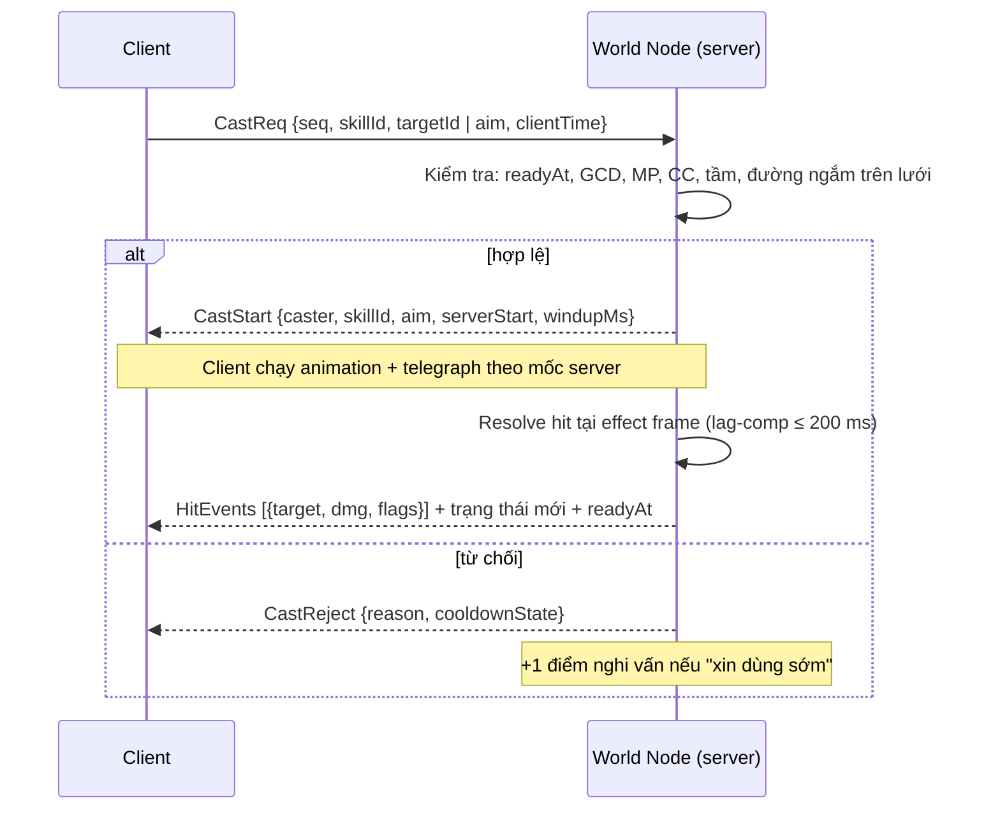

# Hệ phái & Hệ thống kỹ năng

> **Trạng thái: thiết kế mới – chờ duyệt.** Toàn bộ tài liệu này là **thiết kế bổ sung** (không có trong 8 tài liệu gốc). Mọi con số là **Đề xuất – chờ duyệt**, trừ những chỗ ghi rõ nguồn [07](07-cong-thuc-data-schema.md) / `@vgtd/shared` / [08](08-server-architecture.md). Không mâu thuẫn [00 §3–§4](00-ho-so-tong-hop.md). Bối cảnh: [01-gdd.md](01-gdd.md) §7; phạm vi closed beta: [10-mvp-scope.md](10-mvp-scope.md).
>
> **Cách dùng số liệu:** mọi hệ số sát thương dùng công thức tổng ở 07 §4 (`Raw = ATK · c_skill`, `DMG = Raw² / (Raw + DEF_eff) · M_elem · Crit · Suppress · U(0,95; 1,05)`); chỉ số gốc ở 07 §1. Phần JSON Schema (mục 6) là **đề xuất để hiện thực sau** trong `@vgtd/shared` (`src/schemas/skill_definitions.schema.json`, `src/data/skills.json`, `src/formulas/skill.ts`) theo đúng khuôn của `realm_progression.json` / `elemental_matrix.json`.

## 1. Hệ phái: Đạo Lộ và Tông môn

Hai khái niệm tách bạch:

| Khái niệm               | Là gì                                                                                            | Chọn khi nào                          | Quyết định                                                |
| ----------------------- | ------------------------------------------------------------------------------------------------ | ------------------------------------- | --------------------------------------------------------- |
| **Đạo Lộ** (hệ phái tu) | Con đường chiến đấu: vai trò, trọng số chỉ số, bộ kỹ năng, vũ khí / animation.                   | Lúc tạo nhân vật                      | Bộ kỹ năng, vai trò trong đội                             |
| **Tông môn**            | Tổ chức xã hội: phe Chính / Tà / Ma, Cống hiến, kho, chiến tranh Linh Mạch ([01 §9](01-gdd.md)). | Sau tutorial (beta: Sơn Môn Đại Phái) | Xã hội, tiếp cận kho / bí tịch; **không** khóa Đạo Lộ nào |

- **4 Đạo Lộ khởi đầu** _(Đề xuất)_: **Kiếm tu**, **Pháp tu**, **Thể tu**, **Đan/Phù tu**. Lý do 4 (không phải 6 như "6 lớp vũ khí" ở [02 §1](02-asset-matrix-2d.md)): đủ tam giác Tank – DPS – Hỗ trợ + một DPS tầm xa, vừa với ngân sách closed beta; 2 lớp vũ khí còn lại để mở sau. **Thể tu** đã được nhắc ở 07 §3 (công pháp Thể tu giảm sát thương Lôi Kiếp).
- **Không đổi Đạo Lộ trong một "kiếp" ở beta** _(Đề xuất)_. Hướng mở sau: **Phụ tu** — ở Kim Đan học được 2 kỹ năng của Đạo Lộ khác (không phải ultimate). Xem _Câu hỏi cần chốt_.
- **Nghề (luyện đan / chế phù / rèn)** mở ở Trúc Cơ (`crafting`, 07 §8) cho mọi Đạo Lộ; Đan/Phù tu chỉ được **bonus**, không độc quyền. Chi tiết nghề: chưa thiết kế ([OPEN-ITEMS](OPEN-ITEMS.md)).

## 2. Bốn Đạo Lộ

### 2.1 Tổng quan vai trò

| Đạo Lộ         | Vai trò                                 | Vũ khí / animation (02 §1: ~18 anim mỗi lớp)                                | Tầm đánh    | Hệ chủ đạo (fixed)                    | Độ khó nhập môn |
| -------------- | --------------------------------------- | --------------------------------------------------------------------------- | ----------- | ------------------------------------- | --------------- |
| **Kiếm tu**    | DPS cận / trung, cơ động, burst         | Kiếm; ngự kiếm (L4) làm trọn bản sắc                                        | 2,5 – 8 ô   | **Kim** (+ biến dị Lôi)               | Dễ              |
| **Pháp tu**    | DPS tầm xa, AOE, khống chế              | Pháp trượng / quạt                                                          | 8 ô         | **Hỏa, Thủy** (còn lại theo Linh căn) | Trung bình      |
| **Thể tu**     | Tank / cận chiến, kháng kiếp            | Quyền sáo                                                                   | 1,8 – 2,5 ô | **Thổ**                               | Dễ              |
| **Đan/Phù tu** | Hỗ trợ: hồi máu, khiên, khống chế, buff | Phất trần / bút phù; Phù lục (ô F1–F4, [05](05-ui-ux-icon.md) §Thanh skill) | 7 – 8 ô     | **Mộc, Kim**                          | Khó (hỗ trợ)    |

Vai trò đội 4 người _(Đề xuất)_: 1 Thể tu (tank) + 1 Đan/Phù tu (hỗ trợ) + 2 DPS (Kiếm / Pháp). Solo vẫn khả thi ở cả 4 Đạo Lộ nhờ đòn thường và kỹ năng sinh tồn riêng (khiên, hồi máu).

### 2.2 Trọng số chỉ số (hệ số nhân lên B của 07 §1)

Chỉ số lớp = `Stat(r, k) = B · m_lớp · λ^x(r, k)` — tức **hệ số m_lớp nhân vào chỉ số gốc 07 §1**, không đổi λ, không đổi công thức tăng trưởng. Ràng buộc: m nằm trong **[0,85; 1,25]** và không vi phạm trần "trang bị + công pháp + pháp bảo ≤ +60% chỉ số gốc cùng cảnh giới" (07 §1) — m_lớp **không tính** vào trần này vì là bản chất Đạo Lộ, không phải trang bị.

| Đạo Lộ     | Khí Huyết (HP) | Chân Nguyên (MP) | Công kích | Phòng ngự | Thân pháp |
| ---------- | -------------- | ---------------- | --------- | --------- | --------- |
| Kiếm tu    | 0,95           | 0,90             | 1,08      | 0,92      | 1,10      |
| Pháp tu    | 0,85           | 1,25             | 1,12      | 0,85      | 0,95      |
| Thể tu     | 1,20           | 0,85             | 0,92      | 1,15      | 0,95      |
| Đan/Phù tu | 1,00           | 1,15             | 0,88      | 0,95      | 1,05      |

**Kiểm tra cân bằng tĩnh** (đòn c = 1, hai bên cùng nấc, trung tính Ngũ hành, bỏ crit / jitter) — số đòn để tiêu diệt đối thủ theo công thức 07 §4; mốc trung tính không phân Đạo Lộ là 33 đòn (07 §1). Hàng = người tấn công, cột = người bị đánh:

| Tấn công \ Phòng thủ | Kiếm tu | Pháp tu | Thể tu | Đan/Phù tu |
| -------------------- | ------- | ------- | ------ | ---------- |
| **Kiếm tu**          | 28      | 24      | 38     | 29         |
| **Pháp tu**          | 26      | 23      | 36     | 28         |
| **Thể tu**           | 34      | 30      | 48     | 37         |
| **Đan/Phù tu**       | 37      | 32      | 51     | 39         |

Nhận xét: mọi ô nằm trong **23–51 đòn** (quanh 33 trung tính), Thể tu cao nhất khi bị đánh (đúng vai tank), Pháp tu thấp nhất (giòn). Đây là kiểm tra tĩnh; cân bằng thật cần mô phỏng PvE / PvP (OPEN-ITEMS #7). Công thức kiểm tra nằm trong `@vgtd/shared` (`formulas/combat.ts`, `formulas/stats.ts`) — khi hiện thực, đưa bảng này thành test.

### 2.3 Ngũ hành affinity và Linh căn

- 07 §4: _hệ tấn công = hệ của kỹ năng đang dùng; đòn thường lấy hệ Linh căn chính_; 07 §5: _kỹ năng ngoài hệ chịu phạt sát thương_ (Đơn −30%, Song −15%, Tạp 0%).
- **Vấn đề:** Linh căn ngẫu nhiên (Đơn chỉ 5%). Nếu một Kiếm tu Đơn Mộc phải dùng toàn kỹ năng Kim thì mất 30% mà không do lựa chọn của họ. **Giải pháp đề xuất — hai loại hệ của kỹ năng:**

| Loại hệ kỹ năng                                    | `element` trong dữ liệu | Ý nghĩa                                                                                                                        | Phạt ngoài hệ (07 §5)  |
| -------------------------------------------------- | ----------------------- | ------------------------------------------------------------------------------------------------------------------------------ | ---------------------- |
| **Linh căn hóa** (adaptive) — đa số kỹ năng cơ bản | `root_main`             | Lấy hệ của **Linh căn chính** người chơi lúc thi triển (và hệ biến dị nếu có). Đơn Mộc → kiếm khí Mộc. Không bao giờ ngoài hệ. | **Không áp dụng**      |
| **Bản mệnh Đạo Lộ** (fixed) — kỹ năng đặc trưng    | `kim` / `hoa` / …       | Hệ cố định của Đạo Lộ, cho bản sắc VFX / sinh khắc. **Có** phạt nếu Linh căn không chứa hệ đó.                                 | Áp dụng đúng như 07 §5 |

Nhờ đó: Đơn Kim + Kiếm tu = tối ưu (mọi kỹ năng Kim); Đơn Mộc + Kiếm tu vẫn chơi tốt bằng kỹ năng linh căn hóa, chỉ mất sức mạnh ở 3 kỹ năng đặc trưng Kim. Phạt chỉ áp lên **sát thương**; hồi máu / khiên / khống chế không bị phạt.

- **Dấu hệ (elemental rider) của kỹ năng linh căn hóa** _(Đề xuất)_ — mỗi hệ gắn một hiệu ứng phụ nhỏ, làm Linh căn có ý nghĩa gameplay ngoài tốc độ tu:

| Hệ    | Dấu hệ khi đánh trúng kỹ năng linh căn hóa                          |
| ----- | ------------------------------------------------------------------- |
| Kim   | Xuyên giáp +15% cho đòn đó (cộng vào Pen, trần 0,4 — 07 §4)         |
| Mộc   | Hồi lại bản thân 8% sát thương gây ra                               |
| Thủy  | Làm chậm mục tiêu 20% trong 2 giây                                  |
| Hỏa   | Bỏng: thêm DoT 30% sát thương đòn đó trong 3 giây                   |
| Thổ   | Giảm 10% sát thương nhận của bản thân trong 3 giây                  |
| Phong | Hồi chiêu đòn thường −10% trong 3 giây (biến dị của Mộc)            |
| Lôi   | 20% xác suất tê liệt 0,5 giây (biến dị của Kim)                     |
| Băng  | Đóng băng nhẹ: mục tiêu bị chậm 35% trong 1 giây (biến dị của Thủy) |

- **Tương sinh khi hỗ trợ** (07 §4): do **engine** xử lý tự động cho mọi kỹ năng `heal` / `shield` / buff đồng đội — nếu hệ của người thi triển sinh hệ của đồng đội thì đồng đội hồi 10% Chân Nguyên tối đa (hồi chiêu 10 s mỗi cặp, không áp lên bản thân). Không khai báo trong từng skill. Đây là lý do Đan/Phù tu có kỹ năng cả Mộc và Kim: Mộc sinh Hỏa, Kim sinh Thủy, tức chăm tổ đội có Pháp tu Hỏa / Thủy.

### 2.4 Chi phí Chân Nguyên và hồi phục

MP lớn chậm hơn Công kích (λ 1,70 vs 1,75; 07 §1) nên chi phí kỹ năng tính **theo % MP tối đa** (`mp_pct`) — tự co giãn theo cảnh giới, không cần bảng chi phí theo cảnh giới.

| Tham số _(Đề xuất)_    | Giá trị                                                           |
| ---------------------- | ----------------------------------------------------------------- |
| Hồi MP trong chiến đấu | 1,0% MP tối đa / giây                                             |
| Hồi MP ngoài chiến đấu | 4% MP tối đa / giây                                               |
| Đả tọa                 | 8% MP tối đa / giây (ngoài chiến đấu) + tu vi `Absorb(s)` (07 §5) |
| Mỗi đòn thường trúng   | +0,5% MP tối đa                                                   |
| Đan hồi MP             | Theo phẩm; hồi chiêu đan chung 8 giây                             |

Mô phỏng xoay vòng tham chiếu (mục 4): Kiếm tu tiêu ≈ 1,9%/s, Thể tu ≈ 1,6%/s, Pháp tu ≈ 2,7%/s. Với hồi 1%/s + 0,5%/đòn thường, Kiếm / Thể tu gần như bền vững trong trận 30–60 giây; Pháp tu hết MP sau ~1,5–2 phút xoay liên tục — **chủ ý**: Pháp tu phải xen đòn thường / đan / nghỉ.

## 3. Mô hình dữ liệu kỹ năng

### 3.1 Vòng đời một lần thi triển

Mọi thi triển do **server quyết định** (08): client chỉ gửi yêu cầu; hồi chiêu, Chân Nguyên, kết quả sát thương đều ở server.



Quy tắc (nguồn 08 §6 trừ ghi chú _Đề xuất_):

- Điều kiện hợp lệ: `t_server ≥ readyAt − min(RTT/2, 100 ms)`; đủ Chân Nguyên; **GCD**; không bị khống chế; trong tầm; có đường ngắm trên lưới. Từ chối thì gửi lại `readyAt` đúng để client sửa thanh hồi chiêu. Tối đa **10 gói thi triển / giây / người chơi** (token bucket). Thanh hồi chiêu trên client **chạy theo mốc server gửi**, không tự đếm.
- **Lag compensation:** tua tối đa **200 ms** (`NETWORK.LAG_COMP_MAX_MS`) — áp lên vị trí **mục tiêu** khi resolve đòn của người chơi. Né sát thương từ quái / boss **không** được tua (người chơi thấy telegraph chạy theo giờ server; thêm **dung sai 100 ms** _(Đề xuất)_ ở mốc nổ).
- **GCD = 800 ms** _(Đề xuất; 08 chỉ nêu có GCD)_. Kỹ năng di chuyển (`gcd: false`) và passive không dính GCD.
- **Hồi chiêu bắt đầu khi hiệu lực kích hoạt** (hết `cast_ms`), không bắt đầu khi bị ngắt trước đó; ngắt trước hiệu lực: hoàn 50% MP, không tính hồi chiêu _(Đề xuất)_. Giảm hồi chiêu cộng dồn **trần 30%**.
- **`move_during_cast`:** `lock` (đứng yên), `slow` (đi 50% tốc độ), `free`. **Channel** (`channel_ms` + `channel_ticks`) bị ngắt khi mất khống chế hoặc di chuyển nếu `lock`.
- Cast bình thường không bị ngắt bởi sát thương; bị ngắt bởi **choáng / đóng băng / hất tung** (khống chế cứng) nếu `interruptible: true`.

### 3.2 Trường dữ liệu chính của một kỹ năng

| Nhóm       | Trường                                                                                                                                 | Ghi chú                                                                                                                                                                                                |
| ---------- | -------------------------------------------------------------------------------------------------------------------------------------- | ------------------------------------------------------------------------------------------------------------------------------------------------------------------------------------------------------ |
| Định danh  | `id`, `name_key`, `desc_key`, `icon_id`                                                                                                | Văn bản qua khóa i18n (Việt / Trung / Anh; 02 §5). Icon nguồn 256, xuất 48 / 64 / 128 ([05](05-ui-ux-icon.md)).                                                                                        |
| Phân loại  | `owner` (player / mob / elite / boss), `path`, `kind` (active / passive), `tier` (basic / core / ultimate)                             | Skill của quái dùng chung schema; chỉ khác có `telegraph` thay `cost`/`progression`.                                                                                                                   |
| Hệ         | `element` (`kim`…`bang`, `root_main`, `none`), `elemental_rider`                                                                       | `root_main` = linh căn hóa (2.3).                                                                                                                                                                      |
| Mở khóa    | `unlock.level_min`, `realm_min`, `source` (level / tome / quest / sect_shop)                                                           | Level theo `realm_progression.json` (07 §8).                                                                                                                                                           |
| Nhắm       | `targeting.mode`, `range_tiles`, `requires_los`, `aim_ui`                                                                              | Chế độ: self / ally / enemy / ground / direction / auto_nearest_enemy. `aim_ui`: tap (chạm = nhắm tự động) / drag_aim / drag_ground — khớp Skill Wheel ([05](05-ui-ux-icon.md): "kéo nhắm", vùng hủy). |
| Hình dạng  | `shape` (3.3)                                                                                                                          | Tính trên lưới ô logic.                                                                                                                                                                                |
| Thời gian  | `timing.cast_ms`, `channel_ms`, `channel_ticks`, `recovery_ms`, `cooldown_ms`, `gcd`, `move_during_cast`, `interruptible`, `invuln_ms` | `cooldown_ms` do server giữ (`readyAt`); `invuln_ms` ≤ 500 cho kỹ năng lướt (K5).                                                                                                                      |
| Chi phí    | `cost.mp_pct` (hoặc `item_id` + `item_qty` cho Phù lục)                                                                                | `% MP tối đa`.                                                                                                                                                                                         |
| Hiệu ứng   | `effects[]` (3.4)                                                                                                                      | Mỗi phần tử có hệ số co giãn.                                                                                                                                                                          |
| Cảnh báo   | `telegraph` (3.5)                                                                                                                      | Bắt buộc cho quái / tinh anh / boss.                                                                                                                                                                   |
| Tiến trình | `progression` (5)                                                                                                                      | Bắt buộc cho `owner = player`.                                                                                                                                                                         |
| Hình ảnh   | `vfx.cast_fx`, `projectile_fx`, `hit_fx`, `max_draw_calls` ≤ 2, `instanced`                                                            | **≤ 2 draw call mỗi kỹ năng** ([02 §4](02-asset-matrix-2d.md)); chiêu nhiều thực thể (Vạn Kiếm) dùng GPU instancing ([06](06-toi-uu-render.md)).                                                       |

### 3.3 Hình dạng AOE trên lưới isometric

**Nguyên tắc:** server tính **toàn bộ trong tọa độ logic ô (i, j)** — đơn vị là **ô**, không phải pixel màn hình. Client chỉ vẽ lại bằng phép chiếu 2:1 (x = (i − j)·32, y = (i + j)·16; 00 §3). Hệ quả quan trọng:

- **Vòng tròn logic bán kính r ô** hiện trên màn hình là **ellipse 2:1** có bán kính nửa trục `a = 32·√2·r ≈ 45,25·r px` (ngang) và `b = 16·√2·r ≈ 22,6·r px` (dọc) @1x. Ví dụ r = 4 ô → ellipse ~362 × 181 px. Khớp quy ước "mọi vòng tròn trên mặt đất vẽ sẵn thành ellipse 2:1" ([02 §4](02-asset-matrix-2d.md)). Người chơi trải nghiệm vùng "tròn" đúng với lưới.
- **Hướng nhắm liên tục** (góc φ trong mặt phẳng (i, j)), không bị cắt vào 8 hướng; **sprite** chỉ hiển thị hướng gần nhất trong số hướng đã vẽ (rig Spine Player / Boss vẽ 5 hướng + lật gương; animation bất đối xứng có thể vẽ đủ 8 — D14). **Gốc tọa độ:** (i, j) nguyên là đỉnh N của ô, tâm ô = (i + 0,5; j + 0,5) (D15); mọi vị trí thực thể và tâm vùng đánh dùng quy ước này.
- Kiểm tra trúng: khoảng cách tính **đến tâm hurtbox** (bán kính 0,45 ô; `HURTBOX_RADIUS_TILES`) — thực thể trúng khi `dist(tâm, hurtbox) ≤ r + 0,45` _(Đề xuất, ổn định cho server)_.

| `shape.type` | Tham số                                             | Hit test (logic ô)                                                 | Telegraph / vẽ                                   |
| ------------ | --------------------------------------------------- | ------------------------------------------------------------------ | ------------------------------------------------ |
| `single`     | —                                                   | Một mục tiêu đã chọn, trong tầm                                    | Vòng chọn dưới chân + đường nối                  |
| `circle`     | `radius`, `anchor` (caster / target / ground_point) | `dist ≤ r`                                                         | Ellipse 2:1 đổ đầy theo thời gian                |
| `ring`       | `radius`, `inner_radius`, `anchor`                  | `inner ≤ dist ≤ r`                                                 | Hai ellipse đồng tâm                             |
| `cone`       | `radius` (tầm), `angle_deg`, hướng φ                | `dist ≤ R` và `                                                    | Δθ                                               | ≤ angle/2` quanh φ | Quạt xoay theo φ rồi chiếu 2:1 (một sprite hình quạt + shader) |
| `line`       | `length`, `width`                                   | Hình chữ nhật dài `length`, rộng `width` từ người thi triển theo φ | Dải chữ nhật chiếu thành bình hành trên màn hình |

- Giới hạn: bán kính tối đa **12 ô** (≤ ½ cạnh AOI 2 × 2 màn hình, `AOI.HALF_U = 40`); chiều dài `line` ≤ 16; **tối đa 12 mục tiêu / lần thi triển** (`max_targets_per_cast`, _Đề xuất_ — bảo vệ CPU World Node và băng thông ~8 KB/s khi đánh quái; chọn 12 mục tiêu gần nhất).
- **Đường ngắm** (`requires_los`): tia trên lưới ô (Bresenham), bị chặn bởi ô `Collision = chặn` và bởi vách ≥ 2 tầng (`Elevation`, 04 §4); bay thấp / bay tự do không đổi luật ngắm.
- **Tầng cao:** đòn chỉ trúng thực thể **cùng nhóm tầng hoặc ±1 tầng** _(Đề xuất)_ — tránh đánh xuyên 3 tầng ở Sơn Môn (5 tầng).

### 3.4 Hiệu ứng và công thức co giãn

Mỗi `effect` có `scale: {stat, coeff}`. Công thức thống nhất với 07 §4:

```latex
\begin{aligned}
c_{\text{eff}} &= c_0 \cdot \big(1 + 0{,}05\,(\text{rank} - 1)\big) \cdot \text{pvp\_mult} \\
\text{Raw} &= \text{ATK}_{\text{eff}} \cdot c_{\text{eff}} \qquad\text{(sát thương; mỗi } \texttt{hit} \text{ tính riêng)} \\
\text{DMG} &= \frac{\text{Raw}^2}{\text{Raw} + \text{DEF}_{\text{eff}}} \cdot M_{\text{elem}} \cdot \text{Crit} \cdot \text{Suppress} \cdot U(0{,}95;\,1{,}05) \\
\text{Heal} &= \text{ATK}_{\text{eff}} \cdot c_{\text{heal}} \cdot (1 + \text{bonus}) \qquad \text{Shield} = \text{scale\_stat} \cdot s
\end{aligned}
```

- `DEF_eff`, `M_elem`, `Crit` (×1,5), `Suppress`, jitter, **hệ ngoài hệ −30/−15/0%**: giữ nguyên 07 §4–§5; **không có công thức sát thương thứ hai**.
- **Tính chất lồi của `Raw²/(Raw+DEF)`:** chia một đòn thành nhiều hit nhỏ làm tổng yếu đi, đòn lớn mạnh vượt trội. Nên thiết kế dùng **chỉ số E = hits · f(c)/f(1)** (f(c) = c²/(c + d), d = DEF/ATK ≈ 0,667 trung tính) làm "tương đương đòn thường" (c = 1, E = 1) — đây là số dùng để cân (mục 4).
- **Hồi máu / khiên** co giãn theo `atk` (hỗ trợ) hoặc `hp_max` (Thể tu tự bảo vệ): ví dụ `heal: atk × 4,0` ≈ 17,6% Khí Huyết tối đa người nhận ở cùng cảnh giới (ATK Đan/Phù tu 0,88 · 60 ≈ 53; HP 1.200). Khiên và hồi máu cũng cộng dồn tối đa 60% từ trang bị như chỉ số khác (07 §1).
- **PvP:** `effects[].pvp_mult` mặc định 1; dùng để hạ riêng khống chế / burst trong PvP mà không đổi PvE (luật PvP chưa thiết kế — [OPEN-ITEMS](OPEN-ITEMS.md)).
- **Khống chế (CC):** choáng / đóng băng / trói chặt giảm dần: lần 2 trong 8 giây còn 50% thời lượng, lần 3 miễn nhiễm 4 giây _(Đề xuất)_; **boss miễn choáng / trói**, chỉ chịu làm chậm 50% hiệu lực.

### 3.5 Telegraph (cảnh báo) cho quái, tinh anh, boss

Mọi kỹ năng của quái có khung **telegraph** (decal ellipse đổ đầy theo thời gian; 02 §4 dùng 1–1,5 giây cho vòng cảnh báo sét):

| Loại        | `telegraph.duration_ms` _(Đề xuất)_ | Hình              | Ghi chú                                           |
| ----------- | ----------------------------------- | ----------------- | ------------------------------------------------- |
| Quái thường | 800 – 1.200                         | circle / cone nhỏ | Chỉ đòn mạnh có telegraph; đòn thường không       |
| Tinh anh    | 1.000 – 1.500                       | circle / line     | Mỗi tinh anh 1 kỹ năng riêng (02 §1)              |
| Boss        | 1.000 – 2.000                       | mọi hình, cả ring | Chuyển phase đổi skin (03 §6); thêm "cảnh báo âm" |

Sát thương **nổ ở cuối telegraph theo giờ server**, tính vị trí mục tiêu tại thời điểm nổ; người chơi Mobile (150–250 ms trễ nội suy) vì vậy được cộng dung sai 100 ms ở 3.1. Mọi telegraph hiển thị theo `visible_to` (mặc định `all`).

## 4. Bộ kỹ năng MVP (4 Đạo Lộ × 8)

**Phạm vi:** 32 kỹ năng (28 chủ động + 4 bị động), mở theo **level 1–70** (Luyện Khí → Kim Đan; `level_range` 07 §8). Khớp bố cục 05: PC có thanh 1–9 (+ Shift), Mobile Skill Wheel 2 trang × 5; mỗi Đạo Lộ tối đa **7 chủ động** + đòn thường + ngự kiếm / khinh công + ô phù lục F1–F4. So với ~150 VFX kỹ năng của toàn game ([02 §4](02-asset-matrix-2d.md)): beta dùng 32 (~21%).

**Đòn thường** _(chung)_: combo 3 đòn (02 §1 "3 đòn"); hệ = Linh căn chính; `c` = 0,9 / 0,9 / 1,3; chu kỳ ~0,9 giây một đòn; không tốn MP; mỗi đòn trúng +0,5% MP. Tầm: Kiếm 2,5 ô · Pháp 8 · Thể 1,8 · Đan/Phù 7.

**Cách đọc bảng:** `Cast` = thời gian biến chiêu (giây, gồm channel); `CD` = hồi chiêu (giây); `MP` = % MP tối đa; `Hit×c` = số hit × hệ số mỗi hit **ở rank 1**; `E` = tương đương đòn thường (3.4). Mọi giá trị là **Đề xuất – chờ duyệt**, cần chỉnh qua mô phỏng.

### 4.1 Kiếm tu (DPS cận / trung, cơ động)

| #   | `id`                 | Tên               | Lv  | Hệ           | Hình · Tầm                         | Cast | CD  | MP  | Hit×c | E    | Mô tả                                                                                                                          |
| --- | -------------------- | ----------------- | --- | ------------ | ---------------------------------- | ---- | --- | --- | ----- | ---- | ------------------------------------------------------------------------------------------------------------------------------ |
| K1  | `kiem_khi_tram`      | Kiếm Khí Trảm     | 1   | Linh căn hóa | Cone 90° · 2,5 ô                   | 0,4  | 3   | 1%  | 1×1,3 | 1,43 | Chém quạt, kỹ năng lấp khoảng trống.                                                                                           |
| K2  | `lien_hoan_kiem`     | Liên Hoàn Kiếm    | 5   | Linh căn hóa | Cone 60° · 3 ô                     | 1,0  | 7   | 2%  | 3×0,8 | 2,18 | 3 nhát liên tiếp (channel 1 giây, `lock`).                                                                                     |
| K3  | `phi_kiem_thuat`     | Phi Kiếm Thuật    | 12  | Linh căn hóa | Line 1 × 8 ô (đạn, trúng đầu tiên) | 0,5  | 5   | 2%  | 1×1,6 | 1,88 | Phóng phi kiếm; cho Kiếm tu đòn tầm xa đầu tiên.                                                                               |
| K4  | `kim_quang_quet`     | Kim Quang Quét    | 20  | **Kim**      | Cone 120° · 3,5 ô                  | 0,6  | 10  | 4%  | 1×2,0 | 2,50 | Quét ngang, đặc trưng Kim (xuyên giáp +15% như dấu hệ Kim).                                                                    |
| K5  | `thiem_kiem_bo`      | Thiểm Kiếm Bộ     | 31  | Linh căn hóa | Dash 5 ô, Line rộng 1              | 0,3  | 12  | 2%  | 1×1,0 | 1,00 | Lướt xuyên mục tiêu, **bất tử 0,3 giây** khi lướt; không dính GCD.                                                             |
| K6  | `kiem_tam` (bị động) | Kiếm Tâm          | 40  | —            | —                                  | —    | —   | —   | —     | —    | +5% tỷ lệ chí mạng, +6% xuyên giáp (nằm trong trần Pen 0,4; 07 §4).                                                            |
| K7  | `ngu_kiem_tran`      | Ngự Kiếm Trận     | 51  | **Kim**      | Circle r4 · tầm 8, ground          | 3,0  | 18  | 6%  | 6×0,9 | 5,17 | Triệu hồi kiếm bay quanh vùng, channel 3 giây (6 nhịp).                                                                        |
| K8  | `van_kiem_quy_tong`  | Vạn Kiếm Quy Tông | 65  | **Kim**      | Circle r6 · tầm 8, ground          | 4,0  | 60  | 15% | 8×1,1 | 9,13 | **Ultimate.** Vạn kiếm trút xuống 4 giây (8 nhịp); 1 sprite kiếm + GPU instancing, 1 draw call ([06](06-toi-uu-render.md) §1). |

### 4.2 Pháp tu (DPS tầm xa, AOE)

| #   | `id`                            | Tên                  | Lv  | Hệ           | Hình · Tầm                  | Cast | CD  | MP  | Hit×c | E    | Mô tả                                                                                   |
| --- | ------------------------------- | -------------------- | --- | ------------ | --------------------------- | ---- | --- | --- | ----- | ---- | --------------------------------------------------------------------------------------- |
| P1  | `linh_khi_dan`                  | Linh Khí Đạn         | 1   | Linh căn hóa | Single · 8 ô (đạn)          | 0,5  | 2,5 | 2%  | 1×1,4 | 1,58 | Đạn linh khí đơn mục tiêu, kỹ năng chính khi mới chơi.                                  |
| P2  | `ngu_hanh_chu`                  | Ngũ Hành Chú         | 5   | Linh căn hóa | Circle r2,5 · tầm 8, ground | 0,8  | 6   | 4%  | 1×1,4 | 1,58 | AOE nhỏ lấy hệ Linh căn; mỗi mục tiêu trúng một lần.                                    |
| P3  | `linh_quang_thuan`              | Linh Quang Thuẫn     | 12  | Linh căn hóa | Self                        | 0,3  | 20  | 5%  | khiên | —    | Khiên 12% Khí Huyết tối đa, 6 giây (`scale: hp_max × 0,12`).                            |
| P4  | `lien_chau_dan`                 | Liên Châu Đạn        | 20  | Linh căn hóa | Cone 30° · 8 ô (3 đạn)      | 0,8  | 8   | 4%  | 3×0,9 | 2,59 | Ba đạn quạt hẹp; mạnh khi mục tiêu to / boss.                                           |
| P5  | `bang_phong_thuat`              | Băng Phong Thuật     | 31  | **Thủy**     | Circle r3 · tầm 8, ground   | 0,8  | 14  | 5%  | 1×1,0 | 1,00 | Trói chặt 1,5 giây (quái thường) / làm chậm 50% (boss); khống chế.                      |
| P6  | `liet_diem_phan_thien`          | Liệt Diễm Phần Thiên | 40  | **Hỏa**      | Circle r3,5 · tầm 8, ground | 1,2  | 16  | 8%  | 1×2,6 | 3,45 | Nổ lửa lớn, burst chính; `lock` khi niệm.                                               |
| P7  | `ngu_hanh_thong_linh` (bị động) | Ngũ Hành Thông Linh  | 48  | —            | —                           | —    | —   | —   | —     | —    | +10% MP tối đa, +0,3% MP/giây hồi chiến đấu (bù khả năng cạn MP).                       |
| P8  | `thien_hoa_luu_tinh`            | Thiên Hỏa Lưu Tinh   | 60  | **Hỏa**      | Circle r5 · tầm 9, ground   | 3,0  | 60  | 15% | 5×1,6 | 9,41 | **Ultimate.** Mưa sao lửa channel 3 giây (5 nhịp), telegraph bắn cho đối thủ trong PvP. |

### 4.3 Thể tu (Tank cận chiến, kháng kiếp)

| #   | `id`                      | Tên                | Lv  | Hệ           | Hình · Tầm              | Cast | CD  | MP  | Hit×c | E    | Mô tả                                                                                                                          |
| --- | ------------------------- | ------------------ | --- | ------------ | ----------------------- | ---- | --- | --- | ----- | ---- | ------------------------------------------------------------------------------------------------------------------------------ |
| T1  | `phach_quyen`             | Phách Quyền        | 1   | Linh căn hóa | Single · 1,8 ô          | 0,4  | 2,5 | 1%  | 1×1,2 | 1,29 | Đấm đơn mục tiêu, kỹ năng lấp.                                                                                                 |
| T2  | `thiet_bo_sam`            | Thiết Bố Sam       | 5   | **Thổ**      | Self                    | 0,3  | 20  | 3%  | khiên | —    | Khiên 10% Khí Huyết tối đa, 8 giây.                                                                                            |
| T3  | `dia_chan`                | Địa Chấn           | 12  | **Thổ**      | Circle r2,5 · tâm người | 0,6  | 9   | 4%  | 1×1,2 | 1,29 | AOE quanh người, làm chậm 30% trong 2 giây.                                                                                    |
| T4  | `khieu_khich`             | Khiêu Khích        | 20  | Không hệ     | Circle r4 · tâm người   | 0,3  | 15  | 3%  | —     | —    | **PvE:** quái trong vùng buộc đánh người thi triển 4 giây. **PvP:** không có tác dụng lên người chơi.                          |
| T5  | `long_ho_quyen`           | Long Hổ Quyền      | 31  | Linh căn hóa | Cone 120° · 2,5 ô       | 0,8  | 8   | 4%  | 2×1,3 | 2,86 | Hai quyền quét rộng.                                                                                                           |
| T6  | `kim_than_cong` (bị động) | Kim Thân Công      | 45  | —            | —                       | —    | —   | —   | —     | —    | +8% Phòng ngự; **+10% giảm sát thương Lôi Kiếp** (đúng "Công pháp Thể tu", 07 §3; trận pháp + Thể tu gộp chung trần 50%, D18). |
| T7  | `thiet_son_khao`          | Thiết Sơn Kháo     | 51  | Linh căn hóa | Dash 4 ô, Line rộng 1,5 | 0,5  | 14  | 4%  | 1×1,5 | 1,73 | Húc tới, hất lùi 2 ô; đột kích / cắt đường.                                                                                    |
| T8  | `kim_cuong_bat_hoai`      | Kim Cương Bất Hoại | 62  | **Thổ**      | Self + Circle r5        | 0,3  | 75  | 12% | —     | —    | **Ultimate.** Giảm 40% sát thương nhận trong 6 giây + khiêu khích r5 (PvE).                                                    |

### 4.4 Đan/Phù tu (Hỗ trợ)

| #   | `id`                           | Tên                | Lv  | Hệ           | Hình · Tầm                | Cast | CD  | MP  | Hit×c / hồi                             | E    | Mô tả                                                                                                 |
| --- | ------------------------------ | ------------------ | --- | ------------ | ------------------------- | ---- | --- | --- | --------------------------------------- | ---- | ----------------------------------------------------------------------------------------------------- |
| D1  | `phu_tien`                     | Phù Tiễn           | 1   | Linh căn hóa | Single · 7 ô (đạn)        | 0,4  | 2,0 | 2%  | 1×1,1                                   | 1,14 | Bắn phù đơn mục tiêu; sát thương yếu nhất 4 Đạo Lộ (đã tính ở TTK 2.2).                               |
| D2  | `hoi_xuan_chu`                 | Hồi Xuân Chú       | 5   | **Mộc**      | Single ally · 8 ô         | 0,8  | 4   | 5%  | hồi `atk × 4,0` (~17,6% HP)             | —    | Hồi máu đơn mục tiêu; kích hoạt Tương sinh nếu Mộc sinh hệ đồng đội.                                  |
| D3  | `van_moc_hoi_xuan`             | Vạn Mộc Hồi Xuân   | 12  | **Mộc**      | Circle r4 · tầm 8, ground | 0,8  | 14  | 8%  | HoT `atk × 1,2` × 5 nhịp (~26% HP tổng) | —    | Vùng hồi máu 5 giây cho cả đội.                                                                       |
| D4  | `dinh_than_phu`                | Định Thân Phù      | 20  | **Kim**      | Single enemy · 7 ô        | 0,5  | 16  | 5%  | —                                       | —    | Trói mục tiêu 2 giây (boss miễn); cần đúng Phù: tiêu 1 Phù lục thường _(Đề xuất)_.                    |
| D5  | `ho_the_phu`                   | Hộ Thể Phù         | 31  | **Kim**      | Single ally · 8 ô         | 0,5  | 12  | 5%  | khiên `atk × 5,0` (~22% HP) 8 s         | —    | Khiên Kim Quang Hộ Thể lên đồng đội (shader Kim Quang, [06](06-toi-uu-render.md)).                    |
| D6  | `dan_dao_tinh_thong` (bị động) | Đan Đạo Tinh Thông | 35  | —            | —                         | —    | —   | —   | —                                       | —    | +12% hiệu lực đan hồi phục dùng lên bản thân và đồng đội, +5% tỷ lệ thành công luyện đan.             |
| D7  | `tuong_sinh_phap`              | Tương Sinh Pháp    | 51  | **Thủy**     | Circle r5 · tâm người     | 0,5  | 30  | 8%  | buff +10% Công 10 s                     | —    | Buff Công cho đồng đội trong vùng; mọi đồng đội được sinh nhận Tương sinh (07 §4).                    |
| D8  | `thien_y_vo_phung`             | Thiên Y Vô Phùng   | 62  | **Mộc**      | Single ally · 8 ô         | 2,0  | 120 | 20% | hồi sinh + hồi 40% HP                   | —    | **Ultimate.** Hồi sinh đồng đội chết ≤ 30 giây; không dùng được khi người đó vừa chết trong Lôi Kiếp. |

### 4.5 Kiểm tra cân bằng nhanh

Mô phỏng xoay vòng tham lam 120 giây (chọn kỹ năng có E/giây cao nhất khi sẵn sàng, nếu không thì đòn thường), trung tính, bỏ crit / jitter:

| Đạo Lộ  | DPS trên đòn thường (nhân) | MP tiêu hao (%/giây) | Ghi chú                                       |
| ------- | -------------------------- | -------------------- | --------------------------------------------- |
| Kiếm tu | ×1,70                      | 1,9                  | Mục tiêu 1,5 – 1,8 so với đánh thường         |
| Pháp tu | ×1,68                      | 2,7                  | Tiêu MP nhanh nhất; AOE chưa tính vào         |
| Thể tu  | ×1,45                      | 1,6                  | Thấp hơn vì vai trò tank (khiên, khiêu khích) |
| Đan/Phù | ≈ ×1,1                     | 0,8 (chưa gồm hồi)   | Giá trị nằm ở hồi máu / khiên, không ở DPS    |

Số mô phỏng này chỉ để **loại trừ lỗi cấu hình tệ** (DPS vô lý, MP vô lý) — không thay thế mô phỏng kinh tế / chiến đấu (OPEN-ITEMS #7).

## 5. Tiến trình kỹ năng _[Thiết kế mới – chờ duyệt]_

| Khía cạnh             | Thiết kế                                                                                                                                                                                                                                          |
| --------------------- | ------------------------------------------------------------------------------------------------------------------------------------------------------------------------------------------------------------------------------------------------- |
| Học                   | Tự động mở khi đủ `level_min` (nguồn `level`), hoặc học từ **Bí Tịch** (nguồn `tome`: rơi từ tinh anh / boss, mua bằng Cống hiến ở Tàng Kinh Các). MVP: K1–K3, P1–P2, T1–T3, D1–D3 mở theo level; còn lại bằng bí tịch cơ bản mua được ở Sơn Môn. |
| Rank                  | 1–5. `c_eff = c_0 · (1 + 0,05·(rank − 1))` (3.4): rank 5 = **+20% hệ số**, ≈ **+29% sát thương đòn đơn** do tính lồi của công thức 07 §4. `mp_pct × (1 − 0,03·(rank − 1))`: rank 5 giảm 12% chi phí.                                              |
| Giới hạn rank         | Theo cảnh giới: Luyện Khí tối đa **rank 3**, Trúc Cơ **rank 4**, Kim Đan trở lên **rank 5** _(Đề xuất)_. Không cần nâng hết — cân giữa số kỹ năng và rank.                                                                                        |
| Chi phí nâng rank     | **Bí Tịch Tàn Trang + Cống hiến** (không Linh thạch → không chạm các sink đã cân ở 07 §7). Rank 2: 5 trang · 20 CH; rank 3: 10 · 50; rank 4: 20 · 120; rank 5: 40 · 300. Tàn Trang rơi từ tinh anh / boss, mua ở kho tông môn.                    |
| Cường hóa (rank 3, 5) | Mỗi mốc chọn **1 trong 2** cường hóa nhỏ (ví dụ: mở rộng góc quạt 90° → 120°, hoặc giảm hồi chiêu −20%). Có thể **đổi lại** bằng phí nhỏ — khuyến khích thử nghiệm build.                                                                         |
| Tinh đồ công pháp     | Giao diện lưới sao hiển thị cây kỹ năng 8 nút mỗi Đạo Lộ + trạng thái rank ([02 §5](02-asset-matrix-2d.md) "Kinh mạch đồ, Tinh đồ công pháp"; Class pack 3–6 MB).                                                                                 |
| Công pháp tông môn    | Bí tịch của tông môn (mua bằng Cống hiến) là kênh mở rộng kỹ năng sau beta; MVP chỉ bán Bí Tịch rank-up.                                                                                                                                          |
| Chuyển / Phụ tu       | Beta: không. Hướng sau: Kim Đan học 2 kỹ năng Đạo Lộ khác (không ultimate).                                                                                                                                                                       |
| Đặt phím              | PC: thanh 1–9 giữa đáy + Shift + 1–9; Mobile: Skill Wheel 2 trang × 5 ô (05). 7 chủ động mỗi Đạo Lộ ≤ 9 ô PC; trên Mobile dùng cả 2 trang (trang 1: 5 kỹ năng hay dùng; trang 2: 2 kỹ năng còn lại như chiêu cuối).                               |

## 6. JSON Schema đề xuất cho định nghĩa kỹ năng

Viết theo **JSON Schema draft 2020-12** (như 07 §8–§9), kiểm bằng Ajv trong CI. File dữ liệu đề xuất: `packages/shared/src/data/skills.json`; schema: `packages/shared/src/schemas/skill_definitions.schema.json`. Một schema dùng chung cho kỹ năng người chơi và kỹ năng quái / boss (khác ở `owner`).

### Schema

```json
{
  "$schema": "https://json-schema.org/draft/2020-12/schema",
  "$id": "https://data.tutien.game/schema/skill_definitions.schema.json",
  "title": "skill_definitions",
  "type": "object",
  "required": ["schema_version", "skills"],
  "additionalProperties": false,
  "properties": {
    "schema_version": { "type": "string", "pattern": "^\\d+\\.\\d+\\.\\d+$" },
    "global": {
      "type": "object",
      "additionalProperties": false,
      "properties": {
        "gcd_ms": { "type": "integer", "minimum": 0, "maximum": 2000 },
        "max_targets_per_cast": { "type": "integer", "minimum": 1, "maximum": 32 },
        "cdr_cap": { "$ref": "#/$defs/ratio" }
      }
    },
    "skills": { "type": "array", "minItems": 1, "items": { "$ref": "#/$defs/skill" } }
  },
  "$defs": {
    "ratio": { "type": "number", "minimum": 0, "maximum": 1 },
    "id": { "type": "string", "pattern": "^[a-z0-9_]+$" },
    "element": { "enum": ["kim", "moc", "thuy", "hoa", "tho", "phong", "loi", "bang", "root_main", "none"] },
    "stat": { "enum": ["atk", "def", "hp_max", "mp_max", "agi"] },
    "scale": {
      "type": "object",
      "required": ["stat", "coeff"],
      "additionalProperties": false,
      "properties": {
        "stat": { "$ref": "#/$defs/stat" },
        "coeff": { "type": "number", "exclusiveMinimum": 0 }
      }
    },
    "shape": {
      "type": "object",
      "required": ["type"],
      "additionalProperties": false,
      "properties": {
        "type": { "enum": ["single", "circle", "ring", "cone", "line"] },
        "anchor": { "enum": ["caster", "target", "ground_point"] },
        "radius": { "type": "number", "exclusiveMinimum": 0, "maximum": 12 },
        "inner_radius": { "type": "number", "minimum": 0, "maximum": 12 },
        "angle_deg": { "type": "number", "exclusiveMinimum": 0, "maximum": 360 },
        "length": { "type": "number", "exclusiveMinimum": 0, "maximum": 16 },
        "width": { "type": "number", "exclusiveMinimum": 0, "maximum": 8 }
      },
      "allOf": [
        {
          "if": { "properties": { "type": { "enum": ["circle", "ring"] } }, "required": ["type"] },
          "then": { "required": ["radius", "anchor"] }
        },
        {
          "if": { "properties": { "type": { "const": "ring" } }, "required": ["type"] },
          "then": { "required": ["inner_radius"] }
        },
        {
          "if": { "properties": { "type": { "const": "cone" } }, "required": ["type"] },
          "then": { "required": ["radius", "angle_deg"] }
        },
        {
          "if": { "properties": { "type": { "const": "line" } }, "required": ["type"] },
          "then": { "required": ["length", "width"] }
        }
      ]
    },
    "effect": {
      "type": "object",
      "required": ["type"],
      "additionalProperties": false,
      "properties": {
        "type": {
          "enum": [
            "damage",
            "heal",
            "shield",
            "dot",
            "hot",
            "status",
            "dash",
            "knockback",
            "taunt",
            "revive",
            "passive_stat"
          ]
        },
        "applies_to": { "enum": ["enemy", "ally", "self", "all"] },
        "scale": { "$ref": "#/$defs/scale" },
        "hits": { "type": "integer", "minimum": 1, "maximum": 20 },
        "duration_ms": { "type": "integer", "minimum": 1 },
        "tick_interval_ms": { "type": "integer", "minimum": 50 },
        "status_id": { "$ref": "#/$defs/id" },
        "magnitude": { "type": "number" },
        "distance_tiles": { "type": "number", "exclusiveMinimum": 0, "maximum": 8 },
        "stat": {
          "enum": [
            "crit_chance",
            "pen",
            "def_pct",
            "max_mp_pct",
            "mp_regen_pct_per_s",
            "tribulation_reduction",
            "potion_power"
          ]
        },
        "pvp_mult": { "type": "number", "minimum": 0, "maximum": 2 }
      },
      "allOf": [
        {
          "if": {
            "properties": { "type": { "enum": ["damage", "heal", "shield", "dot", "hot"] } },
            "required": ["type"]
          },
          "then": { "required": ["scale"] }
        },
        {
          "if": {
            "properties": { "type": { "enum": ["dot", "hot", "status", "taunt", "shield"] } },
            "required": ["type"]
          },
          "then": { "required": ["duration_ms"] }
        },
        {
          "if": { "properties": { "type": { "enum": ["dot", "hot"] } }, "required": ["type"] },
          "then": { "required": ["tick_interval_ms"] }
        },
        {
          "if": { "properties": { "type": { "const": "status" } }, "required": ["type"] },
          "then": { "required": ["status_id"] }
        },
        {
          "if": { "properties": { "type": { "enum": ["dash", "knockback"] } }, "required": ["type"] },
          "then": { "required": ["distance_tiles"] }
        },
        {
          "if": { "properties": { "type": { "const": "passive_stat" } }, "required": ["type"] },
          "then": { "required": ["stat", "magnitude"] }
        }
      ]
    },
    "skill": {
      "type": "object",
      "required": ["id", "name_key", "owner", "kind", "element", "targeting", "shape", "timing", "effects"],
      "additionalProperties": false,
      "properties": {
        "id": { "$ref": "#/$defs/id" },
        "name_key": { "type": "string", "minLength": 1 },
        "desc_key": { "type": "string", "minLength": 1 },
        "owner": { "enum": ["player", "mob", "elite", "boss"] },
        "path": { "enum": ["kiem", "phap", "the", "dan_phu"] },
        "kind": { "enum": ["active", "passive"] },
        "tier": { "enum": ["basic", "core", "ultimate"] },
        "element": { "$ref": "#/$defs/element" },
        "elemental_rider": { "type": "boolean" },
        "unlock": {
          "type": "object",
          "required": ["level_min"],
          "additionalProperties": false,
          "properties": {
            "level_min": { "type": "integer", "minimum": 1 },
            "realm_min": { "type": "string", "pattern": "^[a-z_]+$" },
            "source": { "enum": ["level", "tome", "quest", "sect_shop"] }
          }
        },
        "targeting": {
          "type": "object",
          "required": ["mode"],
          "additionalProperties": false,
          "properties": {
            "mode": { "enum": ["self", "ally", "enemy", "ground", "direction", "auto_nearest_enemy"] },
            "range_tiles": { "type": "number", "minimum": 0, "maximum": 16 },
            "requires_los": { "type": "boolean" },
            "aim_ui": { "enum": ["tap", "drag_aim", "drag_ground"] }
          }
        },
        "shape": { "$ref": "#/$defs/shape" },
        "timing": {
          "type": "object",
          "required": ["cast_ms", "cooldown_ms"],
          "additionalProperties": false,
          "properties": {
            "cast_ms": { "type": "integer", "minimum": 0 },
            "channel_ms": { "type": "integer", "minimum": 0 },
            "channel_ticks": { "type": "integer", "minimum": 1, "maximum": 20 },
            "recovery_ms": { "type": "integer", "minimum": 0 },
            "cooldown_ms": { "type": "integer", "minimum": 0 },
            "gcd": { "type": "boolean" },
            "move_during_cast": { "enum": ["lock", "slow", "free"] },
            "interruptible": { "type": "boolean" },
            "invuln_ms": { "type": "integer", "minimum": 0, "maximum": 500 }
          }
        },
        "cost": {
          "type": "object",
          "additionalProperties": false,
          "properties": {
            "mp_pct": { "$ref": "#/$defs/ratio" },
            "item_id": { "$ref": "#/$defs/id" },
            "item_qty": { "type": "integer", "minimum": 1 }
          }
        },
        "effects": { "type": "array", "minItems": 1, "items": { "$ref": "#/$defs/effect" } },
        "telegraph": {
          "type": "object",
          "required": ["duration_ms", "visible_to"],
          "additionalProperties": false,
          "properties": {
            "duration_ms": { "type": "integer", "minimum": 400, "maximum": 3000 },
            "fill": { "enum": ["timer", "none"] },
            "visible_to": { "enum": ["all", "enemies"] }
          }
        },
        "progression": {
          "type": "object",
          "required": ["max_rank"],
          "additionalProperties": false,
          "properties": {
            "max_rank": { "type": "integer", "minimum": 1, "maximum": 5 },
            "coeff_per_rank": { "type": "number", "minimum": 0, "maximum": 0.2 },
            "mp_cost_reduction_per_rank": { "type": "number", "minimum": 0, "maximum": 0.1 },
            "rank_costs": {
              "type": "array",
              "items": {
                "type": "object",
                "required": ["rank", "tome_fragments", "contribution"],
                "additionalProperties": false,
                "properties": {
                  "rank": { "type": "integer", "minimum": 2, "maximum": 5 },
                  "tome_fragments": { "type": "integer", "minimum": 0 },
                  "contribution": { "type": "integer", "minimum": 0 }
                }
              }
            },
            "enhancements": {
              "type": "array",
              "items": {
                "type": "object",
                "required": ["rank", "options"],
                "additionalProperties": false,
                "properties": {
                  "rank": { "enum": [3, 5] },
                  "options": {
                    "type": "array",
                    "minItems": 2,
                    "maxItems": 2,
                    "items": {
                      "type": "object",
                      "required": ["id", "patch"],
                      "additionalProperties": false,
                      "properties": {
                        "id": { "$ref": "#/$defs/id" },
                        "patch": { "type": "object" }
                      }
                    }
                  }
                }
              }
            }
          }
        },
        "vfx": {
          "type": "object",
          "additionalProperties": false,
          "properties": {
            "cast_fx": { "$ref": "#/$defs/id" },
            "projectile_fx": { "$ref": "#/$defs/id" },
            "hit_fx": { "$ref": "#/$defs/id" },
            "max_draw_calls": { "type": "integer", "minimum": 1, "maximum": 2 },
            "instanced": { "type": "boolean" }
          }
        },
        "icon_id": { "$ref": "#/$defs/id" }
      },
      "allOf": [
        {
          "if": { "properties": { "owner": { "const": "player" } }, "required": ["owner"] },
          "then": { "required": ["path", "unlock", "progression"] }
        },
        {
          "if": { "properties": { "owner": { "enum": ["mob", "elite", "boss"] } }, "required": ["owner"] },
          "then": { "required": ["telegraph"] }
        },
        {
          "if": { "properties": { "kind": { "const": "active" } }, "required": ["kind"] },
          "then": { "required": ["cost"] }
        }
      ]
    }
  }
}
```

### Dữ liệu mẫu (4 kỹ năng: linh căn hóa, fixed, bị động, kỹ năng tinh anh có telegraph)

```json
{
  "schema_version": "0.1.0",
  "global": { "gcd_ms": 800, "max_targets_per_cast": 12, "cdr_cap": 0.3 },
  "skills": [
    {
      "id": "kiem_khi_tram",
      "name_key": "skill.kiem_khi_tram.name",
      "desc_key": "skill.kiem_khi_tram.desc",
      "owner": "player",
      "path": "kiem",
      "kind": "active",
      "tier": "basic",
      "element": "root_main",
      "elemental_rider": true,
      "unlock": { "level_min": 1, "realm_min": "luyen_khi", "source": "level" },
      "targeting": { "mode": "direction", "range_tiles": 2.5, "requires_los": false, "aim_ui": "drag_aim" },
      "shape": { "type": "cone", "anchor": "caster", "radius": 2.5, "angle_deg": 90 },
      "timing": { "cast_ms": 400, "cooldown_ms": 3000, "gcd": true, "move_during_cast": "slow", "interruptible": true },
      "cost": { "mp_pct": 0.01 },
      "effects": [{ "type": "damage", "applies_to": "enemy", "scale": { "stat": "atk", "coeff": 1.3 }, "hits": 1 }],
      "progression": {
        "max_rank": 5,
        "coeff_per_rank": 0.05,
        "mp_cost_reduction_per_rank": 0.03,
        "rank_costs": [
          { "rank": 2, "tome_fragments": 5, "contribution": 20 },
          { "rank": 3, "tome_fragments": 10, "contribution": 50 },
          { "rank": 4, "tome_fragments": 20, "contribution": 120 },
          { "rank": 5, "tome_fragments": 40, "contribution": 300 }
        ],
        "enhancements": [
          {
            "rank": 3,
            "options": [
              { "id": "wide_arc", "patch": { "shape": { "angle_deg": 120 } } },
              { "id": "quick_draw", "patch": { "timing": { "cooldown_ms": 2400 } } }
            ]
          }
        ]
      },
      "vfx": { "cast_fx": "fx_kiem_khi_cast", "hit_fx": "fx_kiem_khi_hit", "max_draw_calls": 1 },
      "icon_id": "icon_skill_kiem_khi_tram"
    },
    {
      "id": "liet_diem_phan_thien",
      "name_key": "skill.liet_diem_phan_thien.name",
      "owner": "player",
      "path": "phap",
      "kind": "active",
      "tier": "core",
      "element": "hoa",
      "unlock": { "level_min": 40, "realm_min": "truc_co", "source": "tome" },
      "targeting": { "mode": "ground", "range_tiles": 8, "requires_los": true, "aim_ui": "drag_ground" },
      "shape": { "type": "circle", "anchor": "ground_point", "radius": 3.5 },
      "timing": {
        "cast_ms": 1200,
        "cooldown_ms": 16000,
        "gcd": true,
        "move_during_cast": "lock",
        "interruptible": true
      },
      "cost": { "mp_pct": 0.08 },
      "effects": [{ "type": "damage", "applies_to": "enemy", "scale": { "stat": "atk", "coeff": 2.6 }, "hits": 1 }],
      "progression": { "max_rank": 5, "coeff_per_rank": 0.05, "mp_cost_reduction_per_rank": 0.03 },
      "vfx": { "cast_fx": "fx_hoa_cast", "hit_fx": "fx_hoa_burst", "max_draw_calls": 2 },
      "icon_id": "icon_skill_liet_diem"
    },
    {
      "id": "kim_than_cong",
      "name_key": "skill.kim_than_cong.name",
      "owner": "player",
      "path": "the",
      "kind": "passive",
      "element": "tho",
      "unlock": { "level_min": 45, "realm_min": "truc_co", "source": "tome" },
      "targeting": { "mode": "self" },
      "shape": { "type": "single", "anchor": "caster" },
      "timing": { "cast_ms": 0, "cooldown_ms": 0, "gcd": false },
      "effects": [
        { "type": "passive_stat", "applies_to": "self", "stat": "def_pct", "magnitude": 0.08 },
        { "type": "passive_stat", "applies_to": "self", "stat": "tribulation_reduction", "magnitude": 0.1 }
      ],
      "progression": { "max_rank": 5, "coeff_per_rank": 0.05 }
    },
    {
      "id": "doc_thiem_phun_doc",
      "name_key": "skill.doc_thiem_phun_doc.name",
      "owner": "elite",
      "kind": "active",
      "element": "thuy",
      "targeting": { "mode": "ground", "range_tiles": 7, "requires_los": true },
      "shape": { "type": "circle", "anchor": "ground_point", "radius": 2.5 },
      "timing": {
        "cast_ms": 1200,
        "cooldown_ms": 9000,
        "gcd": false,
        "move_during_cast": "lock",
        "interruptible": false
      },
      "cost": {},
      "effects": [
        { "type": "damage", "applies_to": "enemy", "scale": { "stat": "atk", "coeff": 1.6 }, "hits": 1 },
        {
          "type": "dot",
          "applies_to": "enemy",
          "scale": { "stat": "atk", "coeff": 0.3 },
          "duration_ms": 3000,
          "tick_interval_ms": 1000
        }
      ],
      "telegraph": { "duration_ms": 1200, "fill": "timer", "visible_to": "all" },
      "vfx": { "cast_fx": "fx_doc_spit", "hit_fx": "fx_doc_pool", "max_draw_calls": 2 }
    }
  ]
}
```

> **Đã kiểm tra:** schema và dữ liệu mẫu trên được biên dịch và xác thực bằng Ajv 8 (draft 2020-12, chế độ strict mặc định) khi soạn tài liệu; 7 trường hợp sai (thiếu `cost`, vòng tròn thiếu `radius`, quái thiếu `telegraph`, `max_draw_calls` = 3, kỹ năng người chơi thiếu `unlock`, `dot` thiếu `tick_interval_ms`, hệ nguyên tố không tồn tại) đều bị từ chối.

### Kiểm tra bổ sung ngoài schema (script CI đề xuất)

- `id` không trùng; mọi `name_key` / `desc_key` có bản dịch Việt.
- Với `owner = player`: trong mỗi `path`, `unlock.level_min` tăng theo thứ tự K1 → K8; tổng kỹ năng chủ động mỗi `path` ≤ 7 ở beta (vừa thanh kỹ năng 05).
- Tính **E** (3.4) từ `scale.coeff` × `hits` rồi so với biên cho phép theo `tier` (basic 1,0 – 3,0; core 1,5 – 6,0; ultimate 6,0 – 12,0); lệch thì chặn build.
- `cooldown_ms × (1 − cdr_cap)` ≥ `cast_ms + channel_ms` (không bao giờ thi triển liên tục chồng chéo).
- Với `element = root_main`, không được có `elemental_rider = false` cho kỹ năng chủ động của người chơi (tránh vô tình bỏ dấu hệ).
- `shape.radius`, `length`, `width` trong giới hạn AOI; `telegraph.duration_ms ≤ cooldown_ms`.
- `owner ∈ {mob, elite, boss}`: `cost.mp_pct` = rỗng; nếu có `effects.damage` thì `telegraph.duration_ms ≥ 800` cho đòn gây ≥ 20% HP người cùng cảnh giới _(Đề xuất)_.
- Tổng `vfx.max_draw_calls` của một kỹ năng ≤ 2; kỹ năng `instanced = true` phải có đúng một `projectile_fx`.

## Câu hỏi cần chốt

| #   | Câu hỏi                                                                                                                                                                                                          | Mặc định đề xuất                                                               |
| --- | ---------------------------------------------------------------------------------------------------------------------------------------------------------------------------------------------------------------- | ------------------------------------------------------------------------------ |
| S1  | 4 Đạo Lộ (Kiếm / Pháp / Thể / Đan-Phù) có đúng bộ mong muốn? Thay Đan/Phù tu bằng một DPS khác (ví dụ Đao tu) thì không có hỗ trợ — chấp nhận?                                                                   | **Giữ 4 Đạo Lộ**; hỗ trợ là nhu cầu thiết yếu của đội và Lôi Kiếp hộ pháp.     |
| S2  | Phương án "Linh căn hóa vs Bản mệnh" (2.3): kỹ năng cơ bản lấy hệ Linh căn, kỹ năng đặc trưng fixed có phạt ngoài hệ — hay mọi kỹ năng đều fixed theo Đạo Lộ (đơn giản hơn nhưng Đơn linh căn xấu số chịu phạt)? | **Linh căn hóa + fixed** như đề xuất.                                          |
| S3  | Hệ số chỉ số lớp m (2.2) và dải 0,85–1,25 có chấp nhận được? PvP sẽ lệch ra sao khi luật PvP được thiết kế?                                                                                                      | Giữ bảng 2.2; chỉnh sau mô phỏng PvE / PvP.                                    |
| S4  | GCD 800 ms, hồi chiêu đếm từ lúc hiệu lực kích hoạt, hoàn 50% MP khi bị ngắt, trần giảm hồi chiêu 30% — OK? (08 chỉ nêu "có GCD".)                                                                               | OK như 3.1.                                                                    |
| S5  | Chân Nguyên: hồi 1%/giây trong chiến đấu, 4%/giây ngoài chiến đấu, đả tọa 8%/giây — OK? Pháp tu cạn MP sau ~2 phút có chấp nhận?                                                                                 | OK; Pháp tu chủ ý bị giới hạn MP.                                              |
| S6  | Chi phí nâng rank bằng **Bí Tịch Tàn Trang + Cống hiến** (không Linh thạch) có chấp nhận? Lý do: tránh làm lệch bảng sink 07 §7.                                                                                 | OK. Ngưỡng cụ thể sẽ chỉnh sau.                                                |
| S7  | Có **Phụ tu** (học 2 kỹ năng từ Đạo Lộ khác ở Kim Đan) và **chuyển Đạo Lộ** sau beta không?                                                                                                                      | Phụ tu có, chuyển Đạo Lộ không (chỉ qua Trọng sinh).                           |
| S8  | Hồi sinh đồng đội (D8) có được dùng trong PvP / chiến tranh?                                                                                                                                                     | Không trong chiến tranh Linh Mạch; có trong PvE.                               |
| S9  | Crit: tỷ lệ gốc chí mạng là bao nhiêu? (07 chỉ nêu `Crit ×1,5`.)                                                                                                                                                 | 5% gốc; Kiếm Tâm +5%; trang bị cộng thêm trong trần 60% (07 §1).               |
| S10 | PvP: có áp `pvp_mult` giảm khống chế / burst không? (luật PvP chưa thiết kế).                                                                                                                                    | Có: khống chế × 0,6 thời lượng, burst không đổi; xác nhận sau khi có luật PvP. |
| S11 | Đòn thường: "3 đòn" — tự động liên tục khi giữ phím / chạm hay chỉ khi bấm từng lần? (ảnh hưởng thiết kế cảm ứng.)                                                                                               | Tự động lặp khi giữ nút; Mobile: giữ nút đánh.                                 |
