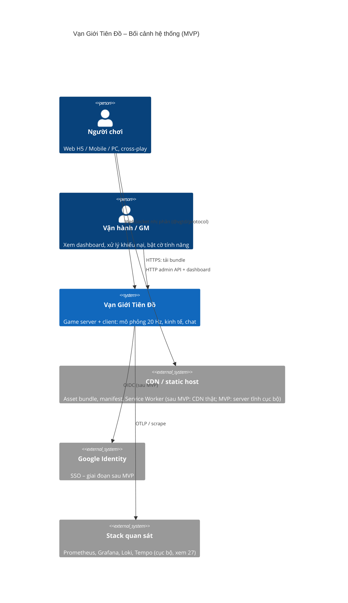
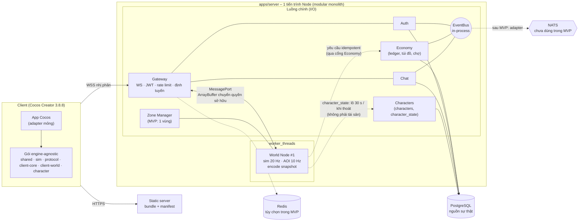
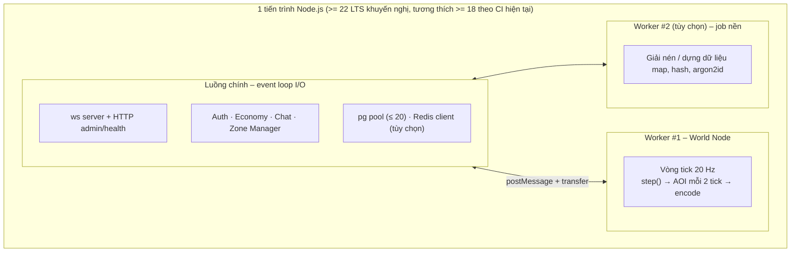
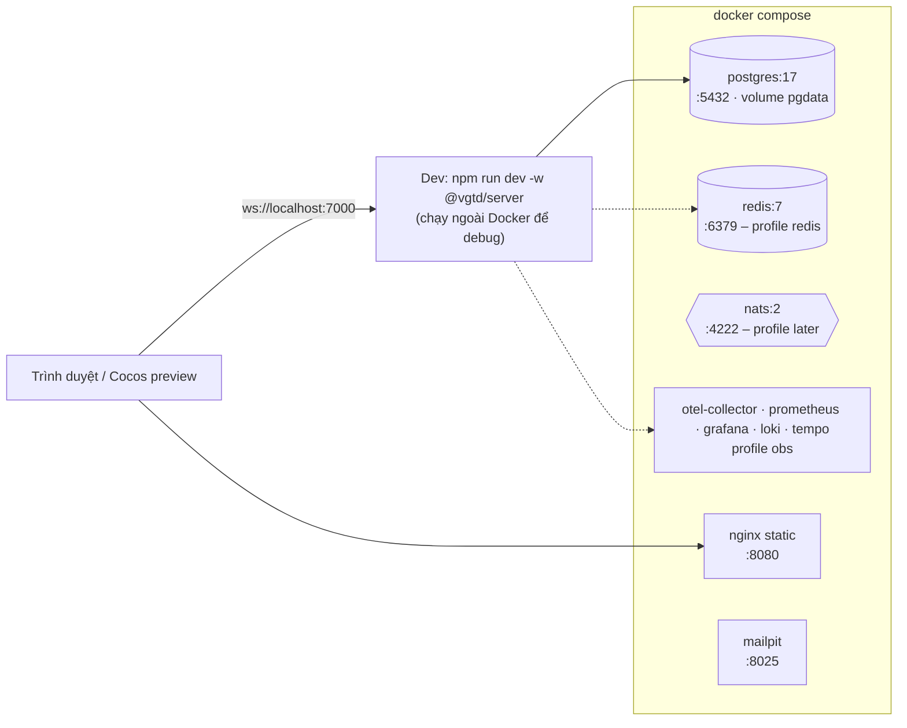

# Kiến trúc tổng thể – Vạn Giới Tiên Đồ

> **Trạng thái:** bản thiết kế kỹ thuật (chưa triển khai). Mọi mục ghi **"Đề xuất – chờ duyệt"** là quyết định mới, chưa có hiệu lực cho tới khi được ghi vào [DECISIONS.md](DECISIONS.md). Không mục nào trong tài liệu này thay đổi [00 §3–4](00-ho-so-tong-hop.md) hay D1–D15.
>
> **Phạm vi:** nhìn tổng thể hệ thống (C4 mức 1–2), ranh giới module của server MVP dạng _modular monolith_, ánh xạ sang microservice của [08 §7](08-server-architecture.md), mô hình tiến trình / luồng, và hạ tầng chạy cục bộ. Chi tiết từng phần: client → [21](21-kien-truc-client.md); module server → [22](22-server-modules.md); dữ liệu → [23](23-mo-hinh-du-lieu.md); giao thức → [24](24-giao-thuc-mang.md); bảo mật → [25](25-xac-thuc-bao-mat.md); kinh tế → [26](26-kinh-te-ledger.md); vận hành → [27](27-van-hanh-quan-sat.md); kiểm thử → [28](28-chien-luoc-kiem-thu.md); ADR → [29](29-adr.md).

## 1. Nguyên tắc chi phối

| #   | Nguyên tắc                                                          | Hệ quả thiết kế                                                                                                               | Nguồn                      |
| --- | ------------------------------------------------------------------- | ----------------------------------------------------------------------------------------------------------------------------- | -------------------------- |
| P1  | Server quyết định mọi thứ (vị trí, sát thương, hồi chiêu, tài sản)  | Client chỉ gửi **ý định**; không có thông điệp "đặt vị trí" hay "báo kết quả" trong giao thức                                 | 08 §4, §6                  |
| P2  | Một module `step()` thuần, xác định, dùng chung client và server    | `@vgtd/shared` + `@vgtd/sim` không phụ thuộc engine hay Node API; không `Math.random` / `Date.now`                            | skill sim-determinism      |
| P3  | World Node **không bao giờ ghi tiền tệ / vật phẩm**                 | Mọi thay đổi tài sản đi qua module Economy + sổ cái kép PostgreSQL                                                            | 08 §7                      |
| P4  | MVP là **modular monolith**, tách service là việc của giai đoạn sau | Mỗi module chỉ nói chuyện qua _port_ (interface TypeScript) và _event bus_ trừu tượng; không import chéo nội bộ               | Yêu cầu của chủ dự án      |
| P5  | Ngân sách là yêu cầu, không phải mong muốn                          | Tick 50 ms, băng thông 8 / 13 / 25 KB/s, RAM 500 MB, ≤ 80 draw call; mỗi tài liệu 21–28 quy ngân sách đó thành chỉ số đo được | 00 §3                      |
| P6  | Cùng một mã chạy cục bộ và trong CI                                 | `docker compose up` dựng toàn bộ phụ thuộc; không có bước thủ công                                                            | Chủ dự án (local, CI ngắn) |

## 2. C4 mức 1 – Bối cảnh hệ thống



Ngoài hệ thống (không xây trong MVP): cổng thanh toán, dịch vụ push notification, kho analytics bên thứ ba, CDN thương mại. MVP chạy hoàn toàn cục bộ (docker-compose), không CD; CI GitHub Actions chỉ chạy kiểm thử ([28](28-chien-luoc-kiem-thu.md)).

## 3. C4 mức 2 – Container (MVP)



Ghi chú đọc sơ đồ:

- Đường nét liền là bắt buộc trong MVP; nét đứt là tùy chọn hoặc sau MVP.
- `World Node` nhận input đã giải mã từ Gateway, trả về **buffer snapshot đã mã hóa** theo từng client; luồng chính chỉ ghi buffer ra socket. Cách này giữ việc mã hóa delta (CPU nặng nhất) ngoài luồng I/O.
- Không có đường nào từ World Node tới PostgreSQL: World Node nói với Economy qua `EconomyPort` cho **tài sản** (Economy mới chạm DB – nguyên tắc P3) và với module `characters` qua `CharacterPort` cho trạng thái **không phải tài sản** (`character_state`).

## 4. Ranh giới module của modular monolith

Mỗi module là một thư mục trong `apps/server/src/modules/<tên>/` với **một** file `index.ts` công khai (port + kiểu). Quy tắc kiểm tra bằng ESLint `no-restricted-imports` (xem [28 §9](28-chien-luoc-kiem-thu.md)): module A chỉ được import `modules/B` (không import `modules/B/internal/*`), và không module nào import `worker`/`world` ngoài `zone-manager` và `gateway`.

| Module                    | Sở hữu (dữ liệu / quyền)                                                                       | Cổng công khai (tóm tắt)                                                                                | Phụ thuộc cho phép                                  | Ánh xạ microservice tương lai ([08 §7](08-server-architecture.md))              | Cách tách                                                                                           |
| ------------------------- | ---------------------------------------------------------------------------------------------- | ------------------------------------------------------------------------------------------------------- | --------------------------------------------------- | ------------------------------------------------------------------------------- | --------------------------------------------------------------------------------------------------- |
| **gateway**               | Socket, vòng đời kết nối, bảng định tuyến nhân vật → node, rate limit                          | `ConnectionRegistry`, `Router`, `SessionGuard`                                                          | auth, zone-manager, world (qua port), chat, economy | **Gateway** (Rust/Go cho 20.000 kết nối/instance – quyết định sau MVP, ADR-014) | Đổi ngôn ngữ nhưng giữ nguyên `@vgtd/protocol` và hợp đồng định tuyến; hai đầu nói qua NATS/gRPC    |
| **auth**                  | `accounts`, `credentials`, `auth_sessions`, cờ khóa                                            | `AuthPort.login/register/refresh/revoke/verifyAccessToken`                                              | db                                                  | **Auth / Session**                                                              | Tách gần như nguyên khối; JWT xác thực không trạng thái nên Gateway chỉ cần khóa công khai          |
| **world** (node)          | Trạng thái thực thể trong RAM, AOI, snapshot; **không** sở hữu bảng DB nào                     | `WorldNodePort.join/leave/pushInput/castSkill/transferOut`, đầu ra là buffer snapshot                   | sim, shared, protocol; gọi `EconomyPort`            | **World Node** (StatefulSet)                                                    | Đã chạy trong `worker_threads`; chuyển thành tiến trình riêng = đổi `MessagePort` thành socket/NATS |
| **zone-manager**          | Bản đồ phân vùng chunk → node, tải node, lịch bí cảnh                                          | `ZonePort.assign/locate/reportLoad/planHandover`                                                        | world                                               | **Zone Manager**                                                                | Thêm Redis làm kho bản đồ phân vùng khi có ≥ 2 node                                                 |
| **characters**            | `characters`, `character_state` (vị trí, hp/mp, buff, hồi chiêu, exp – **không phải tài sản**) | `CharacterPort.load/saveBatch/create/softDelete`                                                        | db                                                  | _(gộp vào World/Auth khi tách; có thể thành dịch vụ riêng)_                     | Ghi theo lô ở luồng chính                                                                           |
| **economy**               | `ledger_*`, `item_*`, `market_*`, `mail`, `idempotency_keys`, `outbox`                         | `EconomyPort.grant/consume/transfer/listItem/buy/craft/…` (idempotent) — xem [26](26-kinh-te-ledger.md) | db, bus                                             | **Economy**                                                                     | Tách khi có nhiều node ghi; khóa theo nhân vật; outbox → NATS                                       |
| **chat**                  | Kênh, lịch sử ngắn, lọc từ, chống spam; `chat_messages` (tin riêng/tông môn)                   | `ChatPort.send/subscribe/history`                                                                       | auth (xác thực), bus, db                            | **Chat**                                                                        | Redis pub/sub làm fan-out khi ≥ 2 instance                                                          |
| _(dùng chung)_ `platform` | Cấu hình, logger, metrics, feature flag, EventBus, đồng hồ, tạo ID                             | `Clock`, `Logger`, `Metrics`, `Flags`, `EventBus`, `IdGen`                                              | —                                                   | Thư viện dùng chung                                                             | Không tách; là thư viện                                                                             |

### 4.1 Quy ước về cổng (port) và phát sự kiện

- Cổng là interface TypeScript, mọi tham số/kết quả là JSON-able (không truyền class, `Map`, hàm), để thay bằng RPC mà không đổi chữ ký.
- Mọi lệnh làm đổi tài sản có tham số `requestId` (idempotency key) – xem [26 §4](26-kinh-te-ledger.md).
- Sự kiện giữa module đi qua `EventBus` (`publish(topic, payload)`, `subscribe(topic, handler)`), tên topic theo mẫu `<module>.<đối tượng>.<động từ quá khứ>` (ví dụ `economy.auction.sold`, khớp [08 §7](08-server-architecture.md)). MVP: triển khai in-process; sau MVP: adapter NATS cùng interface.
- Sự kiện quan trọng (tiền, vật phẩm) đi qua bảng **outbox** trong cùng giao dịch DB rồi mới phát lên bus, để không mất sự kiện khi tiến trình chết ([23 §6](23-mo-hinh-du-lieu.md)).

### 4.2 Gateway có "logic" không?

Theo [08 §7](08-server-architecture.md): Gateway giữ kết nối nhưng không giữ logic game. Trong MVP Gateway làm: bắt tay + kiểm tra phiên bản, xác thực JWT, rate limit, định tuyến theo `peekHeader()` (không giải mã thân), backpressure hàng đợi gửi. Mọi luật game ở `world` / `economy`.

## 5. Mô hình tiến trình và luồng

### 5.1 Sơ đồ luồng (MVP)



| Quyết định                                                               | Lý do                                                                                                                                                                                                                                       | Trạng thái                    |
| ------------------------------------------------------------------------ | ------------------------------------------------------------------------------------------------------------------------------------------------------------------------------------------------------------------------------------------- | ----------------------------- |
| World Node chạy trong **`worker_threads`**, không chung event loop       | Một lần GC hoặc truy vấn DB chậm ở luồng chính không được làm trễ tick 50 ms; vẫn giữ 1 tiến trình để debug và triển khai đơn giản                                                                                                          | Đề xuất – chờ duyệt (ADR-006) |
| Mã hóa snapshot theo từng client nằm **trong worker**                    | Worker có sẵn trạng thái và baseline ACK; chuyển `ArrayBuffer` bằng transfer, không sao chép                                                                                                                                                | Đề xuất – chờ duyệt (ADR-006) |
| Băm mật khẩu (argon2id) chạy ở **thread pool riêng** (libuv hoặc worker) | argon2id tốn ~50–100 ms CPU/lần; không được chặn event loop khi nhiều người đăng nhập cùng lúc ([25 §3](25-xac-thuc-bao-mat.md))                                                                                                            | Đề xuất – chờ duyệt (ADR-007) |
| Một World Node duy nhất trong MVP                                        | Xem §5.3                                                                                                                                                                                                                                    | Đề xuất – chờ duyệt (ADR-005) |
| Vòng tick dùng bộ định thời **bù trôi** (drift-corrected)                | `setTimeout` lệch; vòng lặp tính `nextTickAt = start + n·50 ms`, nếu trễ ≥ 1 tick thì chạy bù tối đa 2 tick rồi bỏ phần còn lại và ghi metric `tick_overrun`. Đồng hồ chỉ ở rìa; bản thân `step()` chỉ biết số tick (skill sim-determinism) | Đề xuất – chờ duyệt (ADR-006) |

### 5.2 Ngân sách tick (tóm tắt – chi tiết ở [22](22-server-modules.md))

Tick 50 ms chia theo giai đoạn (mục tiêu ở tải 200 người + 300 quái trong một World Node): input + `step()` ≤ 12 ms, AI quái + kỹ năng ≤ 10 ms, AOI (mỗi 2 tick) ≤ 8 ms, mã hóa snapshot ≤ 12 ms, dự phòng ≥ 8 ms. Đây là **giả thiết cần đo** bằng loadbot 100v100 ([28 §6](28-chien-luoc-kiem-thu.md)); chưa có số đo thật.

### 5.3 Một World Node hay nhiều? (đề xuất: một)

| Phương án                                   | Ưu                                                                                           | Nhược                                                                                            | Kết luận         |
| ------------------------------------------- | -------------------------------------------------------------------------------------------- | ------------------------------------------------------------------------------------------------ | ---------------- |
| **A. 1 World Node cho cả bản đồ 256 × 256** | Không cần handover, ghost, epoch; ít lỗi nhất; đủ cho closed beta (≤ ~300 CCU trên 1 bản đồ) | Trần cứng theo 1 lõi CPU; chiến tranh tông môn 100v100 phải vừa trong 1 tick                     | **Chọn cho MVP** |
| B. N node theo khối chunk + handover        | Mở rộng ngang                                                                                | Toàn bộ giao thức handover/ghost của [08 §3](08-server-architecture.md) phải có và được kiểm thử | Giai đoạn 2      |
| C. Mỗi bí cảnh / đấu trường một node        | Cách ly tải                                                                                  | Cần vòng đời instance, dọn dẹp                                                                   | Giai đoạn 2      |

Để B và C không phải viết lại: (1) `WorldNodePort` đã có `transferOut/transferIn(snapshot, epoch)`; (2) mọi lệnh mang `epoch` quyền sở hữu ngay từ MVP (giá trị luôn bằng 1); (3) `ZonePort.locate(chunk)` luôn trả node duy nhất; (4) bộ kiểm thử có ca "hai node trong cùng tiến trình" dùng giả lập trước khi tách thật. **Chưa đo:** CCU thực tế trên 1 node – nằm trong [28 §6](28-chien-luoc-kiem-thu.md).

## 6. Địa hình triển khai cục bộ (docker-compose)

### 6.1 Quyết định về hạ tầng phụ thuộc

| Thành phần     | MVP                                                                                                                     | Lý do                                                                                                                                                                                                          |
| -------------- | ----------------------------------------------------------------------------------------------------------------------- | -------------------------------------------------------------------------------------------------------------------------------------------------------------------------------------------------------------- |
| **PostgreSQL** | **Bắt buộc**                                                                                                            | Nguồn sự thật cho sổ cái kép; giao dịch ACID là yêu cầu cứng ([26](26-kinh-te-ledger.md))                                                                                                                      |
| **Redis**      | **Tùy chọn** – profile `redis`, mặc định tắt; mọi dùng Redis đi qua interface `KeyValueStore`/`PubSub` có bản in-memory | Một tiến trình thì phiên, rate limit, lịch sử chat, bảng xếp hạng đều giữ được trong RAM + PG. Redis chỉ cần khi ≥ 2 instance Gateway/Chat hoặc muốn thử nghiệm đường mã gần sản xuất. CI chạy cả hai cấu hình |
| **NATS**       | **Không dùng trong MVP** – profile `later`, chỉ có file cấu hình mẫu                                                    | `EventBus` in-process đủ cho một tiến trình; thêm NATS chỉ thêm điểm hỏng. Adapter NATS được viết khi tách service đầu tiên                                                                                    |
| Stack quan sát | Profile `obs` (Prometheus + Grafana + Loki + Tempo + OTel Collector)                                                    | Bật khi cần, không chạy mặc định để máy dev nhẹ ([27](27-van-hanh-quan-sat.md))                                                                                                                                |
| Static server  | Một container nginx (hoặc `vite preview`) phục vụ `apps/client-cocos/build/web-mobile` và bundle                        | Mô phỏng CDN, Service Worker cần HTTPS hoặc `localhost`                                                                                                                                                        |
| Mailpit        | Profile `dev`: bắt email (xác minh, quên mật khẩu) cục bộ                                                               | Auth qua mật khẩu vẫn cần email khôi phục ([25 §2](25-xac-thuc-bao-mat.md))                                                                                                                                    |

### 6.2 Sơ đồ



### 6.3 Mẫu tệp (tham khảo; chưa tạo trong PR này vì PR chỉ chứa tài liệu)

```yaml
# docker-compose.yml (phác thảo)
services:
  postgres:
    image: postgres:17
    environment: { POSTGRES_USER: vgtd, POSTGRES_PASSWORD: vgtd, POSTGRES_DB: vgtd }
    ports: ['5432:5432']
    volumes: [pgdata:/var/lib/postgresql/data]
    healthcheck: { test: ['CMD-SHELL', 'pg_isready -U vgtd'], interval: 3s, retries: 20 }
  redis:
    image: redis:7
    profiles: [redis]
    ports: ['6379:6379']
  nats:
    image: nats:2
    profiles: [later]
volumes: { pgdata: {} }
```

Quy ước: cổng dịch vụ cấu hình bằng biến môi trường (`VGTD_*`, [27 §7](27-van-hanh-quan-sat.md)); dữ liệu dev là dùng-rồi-bỏ (`docker compose down -v`), có lệnh `npm run db:seed` nạp tài khoản và nhân vật mẫu.

## 7. Phân loại dữ liệu theo nơi lưu

Giữ nguyên bảng của [08 §7](08-server-architecture.md); bổ sung cột "MVP":

| Dữ liệu                           | PostgreSQL                              | Redis (khi bật)             | MVP không có Redis thì…                                         |
| --------------------------------- | --------------------------------------- | --------------------------- | --------------------------------------------------------------- |
| Phiên, online, định tuyến Gateway | `auth_sessions` (refresh token băm)     | Có, TTL                     | RAM của tiến trình + `auth_sessions`                            |
| Snapshot vị trí / máu             | Khi thoát, đổi vùng, sự kiện quan trọng | Mỗi 10 s                    | Ghi PG mỗi 30 s + khi thoát (xem [22 §3](22-server-modules.md)) |
| Linh thạch, túi đồ, giao dịch     | **Nguồn sự thật**, sổ cái kép           | Cache đọc, khóa idempotency | Chỉ PG (bảng `idempotency_keys`)                                |
| Niêm yết chợ, CPI                 | Bản ghi niêm yết, lịch sử bán           | Chỉ mục tìm kiếm            | Chỉ mục PG (`btree` + `GIN`), CPI tính theo job tuần            |
| Chat                              | Tin riêng / tông môn, giữ 30 ngày       | Pub/sub, 200 tin gần nhất   | Vòng đệm RAM 200 tin/kênh                                       |
| Bảng xếp hạng                     | Ảnh chụp hằng ngày                      | Sorted set                  | Truy vấn PG có index + cache RAM 10 s                           |

## 8. Lộ trình tách service (không thuộc MVP)

1. **Tách World Node thành tiến trình riêng** (đổi `MessagePort` → socket Unix/TCP, cùng khung gói). Điều kiện: đo thấy tick > 40 ms p99 hoặc cần ≥ 2 node.
2. **Bật Redis + NATS**, thêm adapter `EventBus`/`KeyValueStore`. Điều kiện: chạy ≥ 2 instance Gateway.
3. **Tách Gateway** sang Rust/Go nếu 1 instance Node không đạt ~20.000 kết nối ([08 §7](08-server-architecture.md)); giữ `@vgtd/protocol` làm hợp đồng (kèm bộ vector kiểm thử đa ngôn ngữ, [28 §3](28-chien-luoc-kiem-thu.md)).
4. **Tách Economy** (khóa theo nhân vật), rồi Chat, Auth.

Mỗi bước dùng cùng cổng đã định ở §4; không bước nào đòi viết lại logic game.

## 9. Ma trận trách nhiệm theo package (workspace)

| Package                               | Vai trò trong kiến trúc                                                          | Dùng ở                     |
| ------------------------------------- | -------------------------------------------------------------------------------- | -------------------------- |
| `@vgtd/shared`                        | Hằng số, toán iso, công thức, schema, **PRNG** (đề xuất [29 ADR-010](29-adr.md)) | client, server, tools      |
| `@vgtd/sim` _(PR #10, đang mở)_       | `step()` xác định, chống gian lận                                                | world node, client dự đoán |
| `@vgtd/protocol` _(PR #10)_           | Codec nhị phân + JSON, `validateMessage`                                         | gateway, client            |
| `@vgtd/character` _(PR #7)_           | Paperdoll, hướng, hitbox                                                         | client, server (hitbox)    |
| `@vgtd/client-core`                   | Input, A\*, HUD layout                                                           | client                     |
| `@vgtd/client-world` _(PR #9)_        | Streaming chunk, thứ tự vẽ                                                       | client                     |
| `@vgtd/server` _(mới, `apps/server`)_ | Modular monolith ở trên                                                          | —                          |
| `@vgtd/client-app` _(mới, đề xuất)_   | Logic ứng dụng client không phụ thuộc engine ([21 §2](21-kien-truc-client.md))   | client                     |

## Câu hỏi cần chốt

| #   | Câu hỏi                                                                            | Mặc định đề xuất                                                                       |
| --- | ---------------------------------------------------------------------------------- | -------------------------------------------------------------------------------------- |
| Q1  | MVP dùng modular monolith + World Node trong `worker_threads`, một node duy nhất?  | **Có** (ADR-005, ADR-006)                                                              |
| Q2  | Redis tùy chọn (profile), NATS không dùng trong MVP?                               | **Có**                                                                                 |
| Q3  | Ngôn ngữ Gateway: giữ TypeScript trong MVP, quyết định Rust/Go sau khi có số đo?   | **Có**, kiểm tra ở mốc loadbot ([28 §6](28-chien-luoc-kiem-thu.md))                    |
| Q4  | Node tối thiểu cho server: 22 LTS (CI hiện chạy 18 và 22)?                         | Server yêu cầu **≥ 22**; thư viện dùng chung giữ ≥ 18 vì client-core đang khai báo vậy |
| Q5  | Cần số CCU mục tiêu cho closed beta để chốt trần 1 World Node (giả thiết ~300 CCU) | Chủ dự án xác nhận; **chưa có số trong tài liệu nào**                                  |
| Q6  | Có cần hỗ trợ nhiều "kênh/shard" của cùng một bản đồ ngay từ MVP?                  | **Không** (một kênh); thêm cột `shard_id` vào `characters` từ đầu để khỏi di trú sau   |
