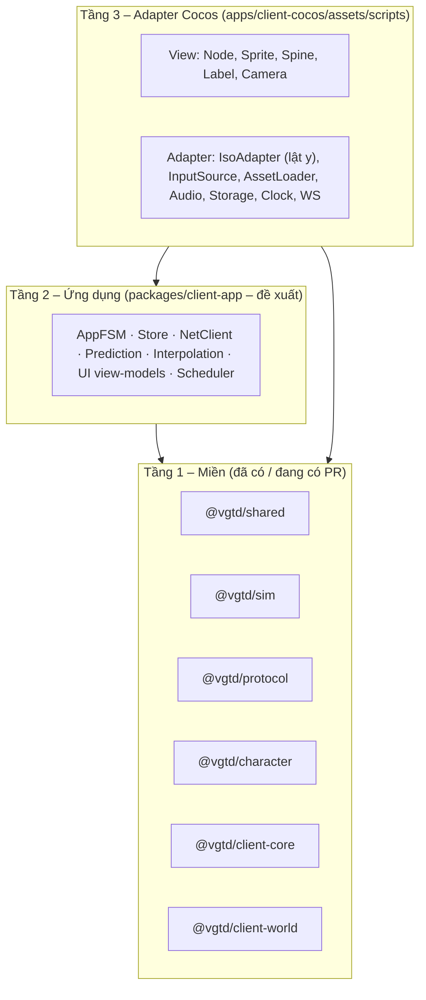
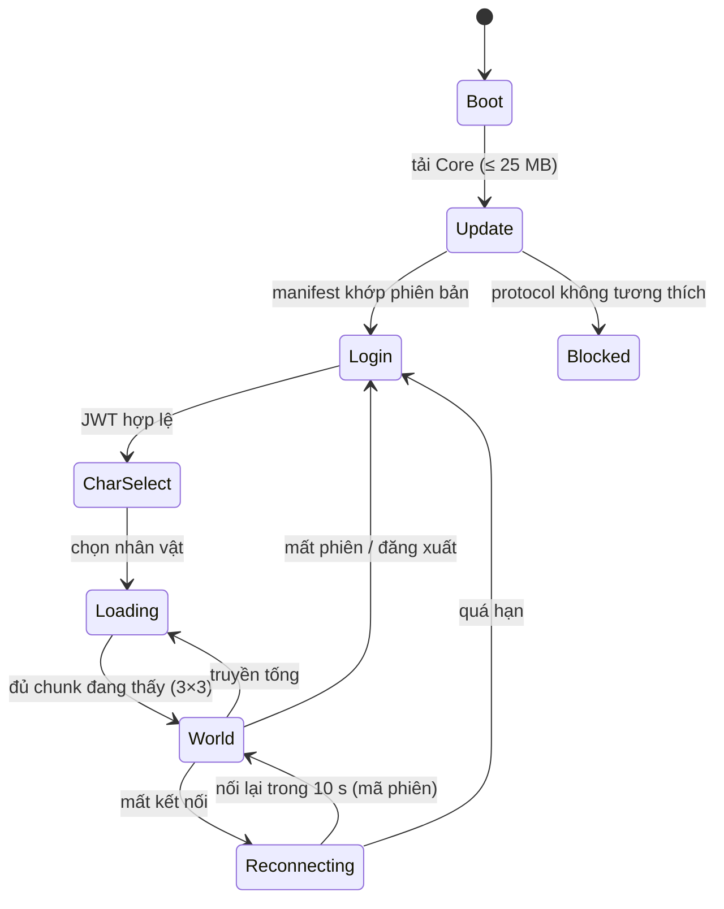

# Kiến trúc client – Cocos Creator 3.8.8

> **Trạng thái:** thiết kế kỹ thuật. Mục "Đề xuất – chờ duyệt" chưa có hiệu lực cho tới khi vào [DECISIONS.md](DECISIONS.md). Không đổi [00 §3–4](00-ho-so-tong-hop.md), D1–D15. Tổng quan hệ thống: [20](20-kien-truc-tong-the.md); giao thức: [24](24-giao-thuc-mang.md).
>
> **Giả định cần kiểm chứng bằng spike:** Cocos Creator 3.8.8 hỗ trợ runtime Spine **4.2** (các bản 3.8.x gần đây có; chưa xác minh trên máy thật cho paperdoll 15 lớp) và build `web-mobile` đạt ≤ 6 MB cho "Engine + code" ([02 – Ngân sách initial load](02-asset-matrix-2d.md)) khi đã gồm Spine WASM. Hai điều này là mục 1–2 của danh sách spike ở §12.

## 1. Mục tiêu và ràng buộc

| Ràng buộc                                                             | Giá trị (nguồn)                                                               |
| --------------------------------------------------------------------- | ----------------------------------------------------------------------------- |
| Nền tảng                                                              | Web H5/WebGL, iOS, Android, PC; cross-play (00 §3)                            |
| Khung thiết kế                                                        | 1280 × 720 logic (dọc 720 × 1280) (05 §1)                                     |
| Gói tải đầu Web                                                       | ≤ 25 MB, RAM tab ≤ 500 MB (texture 220 MB), draw call ≤ 80 (PC ≤ 150) (00 §3) |
| Spine cập nhật đầy đủ                                                 | ≤ 30 skeleton (Mobile/Web) (00 §3)                                            |
| Tick mạng                                                             | Gửi input 20 Hz (Mobile/Web) / 30 Hz (PC); nội suy 100 / 150–250 ms           |
| Toán iso dùng chung ở y hướng xuống; client lật y ở biên render (D15) | Tuyệt đối không viết lại công thức iso trong adapter                          |

## 2. Phân tầng: gói engine-agnostic và adapter Cocos



| Quy tắc                                                                                                                                                                                               | Cưỡng chế bằng                                                                                 |
| ----------------------------------------------------------------------------------------------------------------------------------------------------------------------------------------------------- | ---------------------------------------------------------------------------------------------- |
| Tầng 1 và 2 **không import `cc`** (Cocos) và không dùng API trình duyệt trực tiếp (`window`, `WebSocket`, `localStorage`); mọi thứ qua interface ở tầng 2 (`Clock`, `Transport`, `Storage`, `Assets`) | ESLint `no-restricted-imports` / `no-restricted-globals` trong `packages/**`                   |
| Tầng 3 chỉ _hiển thị_ và _đọc thiết bị_; không chứa luật game, công thức, giá trị hằng                                                                                                                | Review + test: grep hằng số bị cấm (kích thước ô, tick…) như quy tắc hiện hành trong CLAUDE.md |
| Mọi hằng số/công thức import từ `@vgtd/shared`                                                                                                                                                        | Quy tắc cứng hiện có                                                                           |
| Mã tầng 1–2 chạy được trong vitest Node (không cần Cocos) → kiểm thử nhanh trong CI ngắn                                                                                                              | [28 §2](28-chien-luoc-kiem-thu.md)                                                             |

**Đề xuất – chờ duyệt (ADR-015):** thêm package `@vgtd/client-app` (tầng 2) theo skill `vgtd-new-package`. Lý do: `client-core` hiện chỉ có input/pathfinding/HUD; vòng lặp dự đoán – đối soát – nội suy, FSM ứng dụng, store và `NetClient` cần chỗ ở không phụ thuộc engine để chạy được trong test replay và trong bot tải ([28 §6](28-chien-luoc-kiem-thu.md)). Nếu không tạo package mới, các phần này sẽ nằm trong `apps/client-cocos` và mất khả năng kiểm thử headless.

### 2.1 Adapter bắt buộc (interface ở tầng 2, hiện thực ở tầng 3)

| Interface      | Việc                                                               | Hiện thực Cocos                                         | Hiện thực test                      |
| -------------- | ------------------------------------------------------------------ | ------------------------------------------------------- | ----------------------------------- |
| `Clock`        | `now()` đơn điệu (ms), `rafSchedule`                               | `performance.now()` / `director` tick                   | Đồng hồ giả                         |
| `Transport`    | Mở/đóng/gửi/nhận khung nhị phân                                    | `WebSocket` (web), WebSocket native hoặc `cc.WebSocket` | Cặp bộ nhớ nối thẳng vào World Node |
| `Assets`       | `loadBundle`, `load<T>(path)`, `release`, tiến độ                  | `assetManager`                                          | Bộ nạp từ đĩa                       |
| `InputSource`  | Sự kiện Pointer/phím đã chuẩn hóa → `InputManager` của client-core | Pointer Events của Cocos (`Node.EventType`, `input`)    | Kịch bản sự kiện                    |
| `Storage`      | Khóa/giá trị bền (token, cài đặt)                                  | `sys.localStorage` / IndexedDB cho cache lớn            | Bản đồ RAM                          |
| `Renderer`     | Tạo/cập nhật/hủy "thực thể hiển thị" theo store                    | Node + Sprite/Spine                                     | Bản ghi lệnh                        |
| `PlatformInfo` | Chế độ nhập, safe area, mật độ điểm ảnh, cấp máy                   | `sys`, `screen`, `view`                                 | Giá trị cứng                        |

## 3. Cảnh (scene) và khởi động (bootstrap)



- **Ba cảnh Cocos** để giảm thời gian chuyển cảnh trên Web: `boot` (rất nhỏ, nằm trong Core), `login` (chỉ UI), `world` (thế giới + HUD). Không nạp cảnh mới cho từng bản đồ; truyền tống đổi dữ liệu trong `world` và che bằng màn mực loang ([06 §5](06-toi-uu-render.md)).
- **Thứ tự bootstrap** (mỗi bước có ngân sách thời gian và mã lỗi hiển thị):
  1. Tạo `Platform`, `Clock`, `Logger`, `Telemetry` (xem [27 §3](27-van-hanh-quan-sat.md)).
  2. Đọc `manifest.json` (hash nội dung) → so `PROTOCOL_VERSION` và `dataVersion` với server (`GET /version`); lệch → cảnh `Blocked` kèm nút tải lại/cập nhật.
  3. Nạp bundle `core` (UI lõi, font, Spine base, tile tân thủ) – thanh tiến độ theo byte.
  4. Đăng nhập (mật khẩu; SSO sau MVP): token lưu ở `Storage`; làm mới tự động ([25 §4](25-xac-thuc-bao-mat.md)).
  5. Mở WebSocket, bắt tay phiên bản, đồng bộ đồng hồ (8 ping/pong, lấy trung vị – [08 §5](08-server-architecture.md)).
  6. Chờ `aoi_enter` đầu + tải 3 × 3 chunk, rồi mới tắt màn che.
- Mọi lỗi chặn (mất kết nối, bundle hỏng) đưa về `AppFSM`, không ném ngoại lệ qua ranh giới adapter; `ErrorBoundary` ở tầng 3 chuyển sang `Telemetry.error` và hiện hộp thoại có mã.

## 4. Quản lý trạng thái

**Đề xuất – chờ duyệt (ADR-016):** một **store đơn nguồn** tự viết (~200 dòng, không phụ thuộc), có kiểu chặt.

| Thành phần     | Nội dung                                                                                                  | Quy tắc                                                                                 |
| -------------- | --------------------------------------------------------------------------------------------------------- | --------------------------------------------------------------------------------------- |
| `WorldState`   | Bảng thực thể theo `entityId` (mảng dày + chỉ số cục bộ 10 bit của snapshot), tập đang thấy, chunk đã nạp | Chỉ ghi bởi `NetClient` (từ snapshot / `aoi_*`) và `Prediction` (chỉ nhân vật của mình) |
| `SelfState`    | Trạng thái dự đoán, hàng đợi input chờ ACK, `renderOffset`                                                | Chạy `stepMove` dùng chung của `@vgtd/sim`; đối soát khi có snapshot (08 §5)            |
| `SessionState` | Tài khoản, nhân vật, đồng hồ server, RTT, jitter, chất lượng mạng                                         | —                                                                                       |
| `UiState`      | Cửa sổ đang mở, tab, vùng chọn, chế độ nhập                                                               | Chỉ UI đọc/ghi                                                                          |
| `DataTables`   | Dữ liệu tĩnh (realm_progression, elemental_matrix, định nghĩa vật phẩm, kỹ năng) đã nạp từ bundle         | Bất biến sau khi nạp; có `dataVersion`                                                  |

- **Luồng một chiều:** `Transport → decode → Reducer(action) → Store → selector → ViewModel → View`. View không sửa store trực tiếp; gửi `Command` (ví dụ `UseItem`, `CastSkill`), `NetClient` đổi thành thông điệp.
- **Phân biệt trạng thái dự đoán và trạng thái được xác nhận:** vị trí của mình dự đoán; kỹ năng phát animation ngay nhưng **số sát thương và hiệu ứng trúng chỉ hiện khi server xác nhận** ([08 §5](08-server-architecture.md)); túi đồ/Linh thạch **không bao giờ** dự đoán – UI hiện "đang chờ" tới khi có phản hồi.
- Selector có ghi nhớ theo tham chiếu; UI đăng ký theo selector nên chỉ vẽ lại phần đổi. Không dùng framework phản ứng bên ngoài trong MVP (giữ gói ≤ 6 MB).
- Bản ghi/phát lại: mọi `Action` có số thứ tự và mốc tick, ghi vào vòng đệm (≤ 5 MB) để đính kèm báo lỗi ([27 §5](27-van-hanh-quan-sat.md)) và để chạy **replay test** ([28 §4](28-chien-luoc-kiem-thu.md)).

## 5. Asset bundle và tải

Dựa trên bảng bundle của [02](02-asset-matrix-2d.md) và [06 §5–6](06-toi-uu-render.md); không đổi ngân sách.

| Bundle Cocos (tên)          | Nội dung                                            | Nạp khi                           | Mục tiêu       | Ghi chú Cocos                                                    |
| --------------------------- | --------------------------------------------------- | --------------------------------- | -------------- | ---------------------------------------------------------------- |
| `main` + `core`             | Engine, code, UI lõi, Spine base, tile/quái tân thủ | Trước khi vào game                | ≤ 25 MB tổng   | `core` đặt làm **Start Scene Asset Bundle**; priority cao nhất   |
| `class-<id>`                | Spine + VFX kỹ năng một lớp                         | Chọn lớp / gặp người chơi lớp đó  | 3–6 MB         | Có placeholder trong lúc chờ (bóng mờ + trang bị mặc định)       |
| `equip-<setId>`             | Attachment Spine của một bộ                         | Khi mặc / khi người mặc xuất hiện | 0,2–1 MB       | Đưa vào atlas động qua repack ([03 §2](03-nhan-vat-quai-vat.md)) |
| `zone-<id>`                 | Tileset dùng chung, quái, BGM vùng                  | Gần ranh giới vùng                | 8–15 MB        | Giữ đến khi rời vùng                                             |
| `chunks-<zone>` _(dữ liệu)_ | Dữ liệu ô + prop theo chunk 32 × 32                 | Stream theo camera                | 0,5–2 MB/chunk | Không phải bundle Cocos cho từng chunk (quá nhiều); xem §5.1     |
| `event-<id>`                | Tông môn, Linh Mạch, bí cảnh, sự kiện               | Theo lịch / khi vào               | 5–20 MB        | —                                                                |
| `audio-stream`              | BGM, ambience                                       | Sau thao tác đầu của người chơi   | stream         | Phát bằng media element, không giải mã cả bài                    |

### 5.1 Chunk streaming

- Thuật toán và thông số theo [06 §5](06-toi-uu-render.md): chạy mỗi 200 ms; tập đang thấy + vòng đệm 1 + tải trước theo vận tốc (2 s; 3 s khi ngự kiếm); tối đa 4 yêu cầu song song (2 khi đang chiến đấu); LRU khi texture vượt 90% ngân sách. Logic nằm ở `@vgtd/client-world` (`ChunkStreamer`, PR #9, đang tạm dừng); adapter chỉ cung cấp `Assets` và `Renderer`.
- **Cách đóng gói dữ liệu chunk (đề xuất):** gộp dữ liệu chunk của một vùng thành **một tệp nhị phân kèm bảng chỉ mục** (`zone-<id>.chunks.bin` + `.idx`) và đọc theo HTTP Range / `fetch` từng đoạn, thay vì một bundle Cocos mỗi chunk. Lý do: một bản đồ 256 × 256 có 8 × 8 = 64 chunk; 64 bundle làm tăng số request và manifest. Cần xác nhận bằng spike (§12). Giải nén brotli + dựng mesh tilemap chạy trong Web Worker; luồng chính chỉ nhận buffer.
- Hai điểm mở của PR #9 cần chủ thiết kế chốt (xem [29 – Phụ lục B](29-adr.md)): số chunk thực sự nhìn thấy (4–6 chứ không "tối đa 4") và các tầng `low`/`high` của vòng tải.

### 5.2 Nén texture và chọn bộ

- Web: KTX2 (ETC1S cho tile/prop, UASTC cho nhân vật/UI) + WebP dự phòng; Mobile: ASTC; PC: PNG ([00 §3](00-ho-so-tong-hop.md)). Cocos build theo `texture compress` preset cho từng nền tảng.
- Chọn @1x/@2x/@3x theo hệ số UI: ≤ 1,25 → @1x; ≤ 2,25 → @2x; lớn hơn → @3x (@3x chỉ PC, tải sau) – [05 §1](05-ui-ux-icon.md). Bộ @2x/@3x thay dần từng atlas sau khi ổn định.
- Không hỗ trợ định dạng nén nào → tự hạ @1x và giảm nửa cache (06 §6).

## 6. Khung UI trên AnchorLayout

`AnchorLayout` (đã có, `@vgtd/client-core`) tính vị trí widget theo neo 9 điểm, safe area, 16:9 / 19,5:9 / dọc, 3 bố cục mặc định (`DEFAULT_PROFILES`); là **thuần tính toán** → trả `LayoutResult`. Adapter Cocos chỉ áp kết quả lên `Node`.

| Lớp khung UI             | Việc                                                                                          | Ghi chú                                                       |
| ------------------------ | --------------------------------------------------------------------------------------------- | ------------------------------------------------------------- |
| `UiRoot`                 | Một `Canvas` (design resolution 1280 × 720, fit theo `SHOW_ALL` + safe area)                  | Hệ số UI = min(w/1280, h/720) × thanh trượt 80–120% (05 §1)   |
| `LayoutHost`             | Nạp `ProfileKey` (`pc-landscape`, `touch-landscape`, `touch-portrait`) từ `InputMode` + hướng | Đổi nóng khi `InputManager` phát hiện chuyển PC ↔ chạm        |
| `WindowManager`          | PC: cửa sổ nổi kéo thả, tối đa 4; Mobile: toàn màn hình dạng tab, một bảng một lúc            | Chồng cửa sổ có thứ tự z cố định; nút đóng bằng phím Esc/Back |
| `Widget` (view)          | Component mỏng: `bind(viewModel)`, `onLayout(rect)`                                           | ViewModel là thuần dữ liệu; test ở tầng 2                     |
| Danh sách cuộn           | Cắt bằng **scissor** hình chữ nhật, không dùng mask stencil                                   | Mask stencil làm vỡ batch ([06 §4](06-toi-uu-render.md))      |
| Chữ                      | Bitmap font trong atlas; không TTF động ở HUD                                                 | Mỗi label TTF = một texture → vỡ batch                        |
| 9-slice                  | 4 họ khung (gỗ, ngọc, thủy mặc, viền sáng) với inset chuẩn                                    | Kiểm thử bắt buộc theo [05 §4](05-ui-ux-icon.md)              |
| Vùng chạm tối thiểu      | PC 24 px logic; Mobile 44 pt                                                                  | Kiểm bằng test bố cục                                         |
| Tooltip/số sát thương L6 | Pool đối tượng; gộp số mỗi 100 ms/mục tiêu (08 §8)                                            | Không tạo node mới mỗi lần đánh                               |

Quy ước: mọi hằng số bố cục (kích thước chat 360 × 200, minimap 200 × 200 / 160 × 160…) lấy từ cấu hình bố cục trong `client-core`/`shared`, không rải trong prefab.

## 7. Chế độ nhập (Input modes)

- Một nguồn Pointer Events + bàn phím (đã có `InputManager`), tự chuyển **Touch ↔ Chuột** khi có sự kiện loại tương ứng; chọn **theo cách nhập, không theo thiết bị** ([05 §1](05-ui-ux-icon.md)). Người chơi ép chế độ trong Cài đặt.
- Chuỗi: `InputSource` (tầng 3) → `InputManager` → `toPacket()` → `inputPacketFrom()` (protocol) → `NetClient.sendInput`. Đồng thời cùng `MoveInput` được đưa vào `Prediction`.
- Click-to-move (PC): `IsoPathfinder` A\* 8 hướng → chuỗi hướng; server chỉ thấy một loại input ([08 §4](08-server-architecture.md)).
- Tần số gửi: 30 Hz PC, 20 Hz Mobile/Web (`NETWORK.INPUT_HZ_*`). Gom 1–3 input mỗi gói.
- Web: chặn menu chuột phải trong vùng game; nút Fullscreen; mất focus → dừng âm thanh, giảm tần số vẽ ([05 §3](05-ui-ux-icon.md)).
- Phím tắt 1–9 / Space / Shift+F1–F4 cấu hình được; cấu hình lưu `Storage`.

## 8. Adapter lật y (y-flip) – ranh giới duy nhất

Toán chung (`tileToScreen`, `screenToTile`, `compareDrawOrder`, …) ở y **hướng xuống**; Cocos Creator dùng y **hướng lên** cho cả `Node` và Spine. Quy tắc (D15):

```ts
// apps/client-cocos – IsoAdapter (phác thảo; chỉ file này được lật y)
import { tileToScreen, screenToTile, tileCenterToScreen } from '@vgtd/shared';
// Vị trí liên tục (thực thể, camera): KHÔNG cộng 0,5. (i, j) nguyên = đỉnh N (D15).
export function tileToWorld(i: number, j: number, elevation = 0): Vec3 {
  const p = tileToScreen(i, j, elevation); // y xuống
  return new Vec3(p.x, -p.y, 0); // lật y TẠI ĐÂY
}
export function worldToTile(x: number, y: number, elevation = 0) {
  return screenToTile(x, -y, elevation); // nghịch đảo đúng của tileToWorld
}
// Chỉ cho ô nguyên (i, j) nguyên: đặt sprite ô, vòng chọn ô…
export function cellCenterToWorld(i: number, j: number, elevation = 0): Vec3 {
  const p = tileCenterToScreen(i, j, elevation); // = tileToScreen(i + 0.5, j + 0.5)
  return new Vec3(p.x, -p.y, 0);
}
```

| Việc                             | Cách làm                                                                                                                                                                                        |
| -------------------------------- | ----------------------------------------------------------------------------------------------------------------------------------------------------------------------------------------------- |
| Vị trí node thực thể             | `tileToWorld(i, j, elevation)`; chiều cao z (khinh công, hất tung) cộng lên **sau** khi lật, không ảnh hưởng sort                                                                               |
| Thứ tự vẽ L3                     | `compareDrawOrder` (nhóm tầng → Y → X → id) → gán `siblingIndex`; chỉ sắp lại node đã dịch chuyển (insertion sort, dirty flag), tối đa 300 vật thể L3 trên Mobile ([02](02-asset-matrix-2d.md)) |
| Socket Spine / điểm neo trên đầu | Là tọa độ **y hướng lên trong không gian pivot** (khớp Spine và `Node` local); **không** lật; xem ADR-021 ([29](29-adr.md)) – giải quyết điểm mơ hồ socket của PR #7                            |
| Camera                           | Vị trí = `tileToWorld` của nhân vật cộng offset làm mượt; khung nhìn đổi sang ô bằng `worldToTile` cho `ChunkStreamer`                                                                          |
| Hit-test / pick                  | `worldToTile` → `screenToTileCell` → chọn thực thể theo pick box 48 × 100 px                                                                                                                    |
| Quy ước "ô nguyên = đỉnh N"      | Tâm ô là `(i + 0,5; j + 0,5)`; chỉ sprite/overlay của **ô nguyên** dùng `cellCenterToWorld` (`tileCenterToScreen`); vị trí liên tục của thực thể dùng `tileToWorld` (không dịch nửa ô)          |

Test bắt buộc (tầng 3 chạy trong Cocos headless hoặc mô phỏng): `tileToWorld` và `worldToTile` là nghịch đảo của nhau: `worldToTile(tileToWorld(i, j, e)) = (i, j)` với (i, j) thực bất kỳ, sai số < 1e-6 (test thuộc tính, xem [28 §2](28-chien-luoc-kiem-thu.md)); `cellCenterToWorld(i, j)` bằng `tileToWorld(i + 0,5; j + 0,5)`; không có `y = -` rải rác ngoài `IsoAdapter` (grep trong CI).

## 9. Tích hợp Spine 4.2 paperdoll

- **Một skeleton duy nhất cho mỗi hướng vẽ** (5 hướng + lật gương – D14); paperdoll 15 lớp (13 slot Spine + 2 sprite-node quỹ đạo) theo `@vgtd/character` (PR #7): `resolvePaperdoll(direction, equipped, options)` trả slot/attachment/draw order; adapter chỉ áp kết quả lên `sp.Skeleton`.
- **Lật gương** = `scaleX = −1` trên node cha của skeleton, kèm biến thể `weapon_R` đã lật; socket đảo dấu x.
- **Đổi trang bị** = đổi attachment theo slot trong skin tổ hợp (`Skin.addSkin`) rồi **repack** vào một texture 1024–2048 để giữ ≤ 2 draw call/nhân vật; trang chung 2048 chứa 16 nhân vật 512 × 512 @1x ([06 §4](06-toi-uu-render.md)). Repack chạy một lần khi đổi trang bị (không mỗi frame); kết quả cache theo băm bộ trang bị.
- **Ngân sách:** tối đa 30 skeleton cập nhật đầy đủ; xa/ngoài khung nhìn: đổi sang tần số cập nhật thấp (30/60 → 15 fps playback) hoặc đóng băng frame – theo bảng 60-30-15 của PR #7; boss 1–2 con ([03 §1](03-nhan-vat-quai-vat.md)).
- **Animation bất đối xứng (D14):** hướng nào cần vẽ đủ 8 tra từ `drawnInEight` theo từng animation; mặc định xem ADR-020.
- **Sự kiện Spine chuẩn** (footstep, hit, cancel_window, vfx_spawn…) đi qua `AnimationEventBus`; **hit** chỉ để phát âm thanh/VFX; kết quả trúng do server ([08 §5](08-server-architecture.md)). Chỉ số khung "frame 2 và 7" của `Run` đã được lưu nguyên văn trong `@vgtd/character`; quy ước 0/1-based xử lý ở ADR-020.
- **Bản quyền Spine:** cần giấy phép Spine Editor cho họa sĩ, và điều khoản runtime cho bản phát hành; ghi vào `docs/ASSET-LICENSES.md` khi có asset đầu tiên (OPEN-ITEMS §6).

## 10. Đo hiệu năng trong client

| Chỉ số                              | Nguồn                                                               | Ngưỡng (nguồn)                                                | Cách lấy                                                   |
| ----------------------------------- | ------------------------------------------------------------------- | ------------------------------------------------------------- | ---------------------------------------------------------- |
| Draw call / frame                   | Thống kê engine (`director.root.device.numDrawCalls` hoặc profiler) | ≤ 80 Mobile/Web, ≤ 150 PC (06 §4)                             | Chỉ số **chuẩn** của ngân sách (xem ADR-022 về định nghĩa) |
| Draw call theo lớp L0–L7            | Đếm theo lớp trong `Renderer`                                       | Bảng theo lớp của 06 §4                                       | Debug overlay                                              |
| Frame time p50/p95/p99, FPS         | `Clock`                                                             | Mục tiêu 60 / sàn 30 FPS (đề xuất)                            | Ring buffer 600 frame                                      |
| Bộ nhớ texture / JS heap            | Theo byte do `Assets` theo dõi; `performance.memory` nếu có         | Texture ≤ 220 MB (150 MB máy yếu); tổng ≤ 500 MB              | Cảnh báo ở 90% (06 §6)                                     |
| Số Spine cập nhật đầy đủ            | `Renderer`                                                          | ≤ 30                                                          | Gauge                                                      |
| Hạt VFX trên màn hình               | Hệ hạt                                                              | ≤ 1.000 (PC 3.000)                                            | Gauge                                                      |
| RTT, jitter, mất gói, `interpDelay` | `NetClient`                                                         | Cảnh báo mạng yếu RTT > 300 ms hoặc mất gói > 5% (Web/Mobile) | Gauge + sự kiện                                            |
| Sai lệch đối soát (`recon_error`)   | `Prediction`                                                        | < 0,15 ô thông thường                                         | Histogram; đẩy lên telemetry mẫu 1%                        |
| Thời gian chunk: yêu cầu → hiển thị | `ChunkStreamer`                                                     | —                                                             | Histogram                                                  |
| Thời gian tới khi chơi được (TTI)   | Bootstrap                                                           | —                                                             | Đo từ `navigationStart` tới `World` sẵn sàng               |

- **Debug overlay** (phím tắt / cờ build) hiển thị số liệu trên; **telemetry mẫu** (1–5% phiên) gửi p95 mỗi 60 s về `POST /telemetry` ([27 §3](27-van-hanh-quan-sat.md)) kèm nhãn `deviceTier`, `platform`, `gpu` (đã ẩn danh).
- **Ba cảnh chuẩn** theo [06 §4](06-toi-uu-render.md): chợ tông môn 50 người, Lôi Kiếp, chiến tranh 100 v 100. Vượt trần ở bất kỳ cảnh nào là lỗi chặn phát hành; tự động hóa bằng bot ([28 §7](28-chien-luoc-kiem-thu.md)).

## 11. Nền tảng build và phạm vi MVP

| Mục tiêu              | Công cụ                                                                                                                                         | Trong MVP?                                                                                | Ghi chú                                                                                                     |
| --------------------- | ----------------------------------------------------------------------------------------------------------------------------------------------- | ----------------------------------------------------------------------------------------- | ----------------------------------------------------------------------------------------------------------- |
| **Web (web-mobile)**  | Cocos Creator CLI build `web-mobile`, brotli, Service Worker                                                                                    | **Có – nền tảng chính**                                                                   | Chạy chuẩn trên Chrome/Edge/Safari iOS 16+; WebGL2 là yêu cầu, WebGL1 chỉ dự phòng; KTX2 chuyển mã ở worker |
| **Windows (PC)**      | Cocos build `windows` (hoặc Electron bọc web)                                                                                                   | **Phiên bản sớm sau MVP** (đề xuất: Electron/WebView bọc `web-desktop` trước, native sau) | Bản PC đóng sẵn Core + 1 Zone pack, @3x tải về (02)                                                         |
| **Android**           | Cocos build `android`                                                                                                                           | **Ngoài MVP**                                                                             | Giai đoạn 2; cần máy thật (ASTC)                                                                            |
| **iOS**               | Cocos build `ios` (cần macOS + Xcode)                                                                                                           | **Ngoài MVP**                                                                             | Giai đoạn 2; PWA "Thêm vào màn hình chính" là cầu nối                                                       |
| macOS / Linux desktop | —                                                                                                                                               | Ngoài phạm vi                                                                             | —                                                                                                           |
| Phụ trợ ngoài MVP     | WebTransport, QUIC native, tải thông minh theo mạng, hot-update native, đa ngôn ngữ giao diện ngoài VI/EN, hỗ trợ tay cầm, thanh toán trong app | **Ngoài MVP**                                                                             | Xem [24 §1](24-giao-thuc-mang.md) cho vận chuyển                                                            |

Build CI trong "CI ngắn" chỉ chạy kiểm thử tầng 1–2 trong Node; **không** build Cocos trong GitHub Actions ở MVP (Cocos Creator cần cài đặt cục bộ). Build Web phát hành chạy cục bộ bằng script; sinh `manifest.json` (hash nội dung) cho Service Worker. CD ngoài phạm vi (yêu cầu của chủ dự án).

## 12. Danh sách spike cần chạy trước khi khóa thiết kế client

| #   | Spike                                                                        | Tiêu chí đạt                                                      | Chặn việc gì                          |
| --- | ---------------------------------------------------------------------------- | ----------------------------------------------------------------- | ------------------------------------- |
| S1  | Build `web-mobile` rỗng + Spine 4.2 runtime + transcoder Basis               | Gói Engine + code ≤ 6 MB sau brotli                               | Ngân sách Core 25 MB                  |
| S2  | 1 nhân vật paperdoll 15 lớp, 30 bản sao đồng thời, trên điện thoại tầm trung | ≥ 30 FPS; ≤ 2 draw call/nhân vật; đo được theo định nghĩa ADR-022 | Ngân sách Spine, định nghĩa draw call |
| S3  | Tilemap procgen 3 × 3 chunk + Y-sort 300 vật thể                             | ≤ 80 draw call; sort ≤ 1 ms                                       | Mô hình sort, `client-world`          |
| S4  | Dữ liệu chunk: một bundle/vùng + Range so với bundle/chunk                   | Thời gian tải 3 × 3 và bộ nhớ                                     | §5.1                                  |
| S5  | `NetClient` + `Prediction` chạy trên Cocos với server giả                    | Sai lệch đối soát < 0,15 ô ở RTT 150 ms, jitter 50 ms             | Giao thức, prediction                 |

## Câu hỏi cần chốt

| #   | Câu hỏi                                                                                        | Mặc định đề xuất                                                                                 |
| --- | ---------------------------------------------------------------------------------------------- | ------------------------------------------------------------------------------------------------ |
| Q1  | Tạo package `@vgtd/client-app` cho tầng 2 (ADR-015)?                                           | **Có**                                                                                           |
| Q2  | Store tự viết thay vì thư viện (ADR-016)?                                                      | **Có**                                                                                           |
| Q3  | MVP chỉ phát hành Web; PC bằng bọc Electron sau MVP; Android/iOS native ngoài MVP?             | **Có**                                                                                           |
| Q4  | Dữ liệu chunk đóng thành một tệp/vùng có chỉ mục thay vì bundle Cocos mỗi chunk?               | **Có, chờ kết quả spike S4**                                                                     |
| Q5  | Có chạy build Cocos trong CI không?                                                            | **Không** trong MVP (CI ngắn); build cục bộ                                                      |
| Q6  | Ngưỡng FPS sàn trên máy tầm thấp (tài liệu hiện chỉ đặt ngân sách draw call/RAM, chưa đặt FPS) | 60 mục tiêu / 30 sàn; ma trận thiết bị ở [28 §7](28-chien-luoc-kiem-thu.md); cần chủ dự án duyệt |
| Q7  | Xác nhận Spine 4.2 chạy được trên Cocos 3.8.8 và giấy phép runtime Spine đã rõ                 | Spike S1–S2; chủ dự án kiểm tra điều khoản Spine                                                 |
