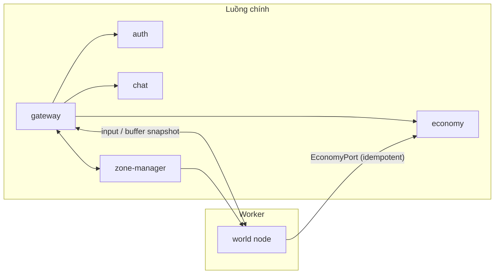

# Module server MVP

> **Trạng thái:** thiết kế kỹ thuật. Mục "Đề xuất – chờ duyệt" chưa có hiệu lực cho tới khi vào [DECISIONS.md](DECISIONS.md). Không đổi [00 §3–4](00-ho-so-tong-hop.md). Ranh giới module: [20 §4](20-kien-truc-tong-the.md). Số liệu tick, AOI, anti-cheat lấy từ [08](08-server-architecture.md) và `NETWORK` của `@vgtd/shared`; **các ngân sách thời gian (ms) trong tài liệu này là giả thiết chưa đo**, được kiểm chứng ở [28 §6](28-chien-luoc-kiem-thu.md).

## 1. Tổng quan

Quy ước chung cho mọi module (xem [20 §4.1](20-kien-truc-tong-the.md)): cổng là interface TS với tham số/kết quả JSON-able; lỗi trả về dạng `Result<T, ErrorCode>` (không ném ngoại lệ qua cổng); mọi lệnh đổi tài sản có `requestId`; đồng hồ lấy từ `Clock` được tiêm vào, **không** gọi `Date.now()` trong mã mô phỏng.

## 2. Gateway

| Mục            | Nội dung                                                                                                                                                                                                                                                                                                            |
| -------------- | ------------------------------------------------------------------------------------------------------------------------------------------------------------------------------------------------------------------------------------------------------------------------------------------------------------------- |
| Trách nhiệm    | Chấp nhận WebSocket (nhị phân); bắt tay phiên bản; xác thực JWT; giới hạn tần số; định tuyến gói theo `peekHeader(buf)` tới World Node / Chat / Economy; hàng đợi gửi có backpressure; giữ socket khi chuyển node (sau MVP); đóng kết nối khi vi phạm                                                               |
| Cổng công khai | `ConnectionRegistry.get(connId)`, `Router.route(conn, buf)`, `SessionGuard.admit(token) → AccountId`, `Gateway.kick(accountId, reason)`; **cổng ngoài**: WebSocket `/ws`, HTTP `GET /health`, `GET /version`, `POST /auth/*` (xem [25](25-xac-thuc-bao-mat.md)), `POST /telemetry`                                  |
| Trạng thái RAM | `Map<connId, Connection>` (socket, `accountId`, `characterId`, `lastSeq`, token bucket, hàng đợi gửi, thời điểm hoạt động cuối); bảng `characterId → nodeId` (MVP luôn node 1)                                                                                                                                      |
| Lưu bền        | Không. Phiên nằm ở `auth` (`auth_sessions`); bảng định tuyến tái dựng khi nối lại                                                                                                                                                                                                                                   |
| Ngân sách      | Không nằm trong tick 50 ms (luồng chính). Mục tiêu: xử lý 1 gói input ≤ 50 µs (p99), ≤ 200 kết nối ở MVP; sàn tăng tuyến tính theo kết nối. **Chưa đo**                                                                                                                                                             |
| Rate limit     | Token bucket theo kết nối và theo loại thông điệp ([24 §7](24-giao-thuc-mang.md)); mặc định thi triển kỹ năng ≤ 10 gói/s ([08 §6](08-server-architecture.md))                                                                                                                                                       |
| Backpressure   | Mỗi kết nối có ngưỡng byte chờ gửi (`socket.bufferedAmount`); snapshot quá hạn thì **bỏ** (client dùng delta mới nhất); sự kiện tin cậy không được bỏ → vượt ngưỡng tin cậy thì đóng kết nối kèm mã `SLOW_CONSUMER`                                                                                                 |
| Chế độ lỗi     | Gateway chết: client tự nối lại ≤ 10 s bằng mã phiên; World Node giữ nhân vật đứng yên trong thời gian đó ([08 §7](08-server-architecture.md)). Rò bộ nhớ socket: giới hạn số kết nối/IP; ping/pong 10 s, quá 30 s không nhịp tim thì đóng. Gói sai định dạng → `error` + tăng điểm vi phạm, 3 lần liên tiếp → đóng |

## 3. World Node

Tiến trình `worker_threads`, đơn luồng, **một** node cho cả bản đồ trong MVP ([20 §5.3](20-kien-truc-tong-the.md), ADR-005).

### 3.1 Trách nhiệm

Mô phỏng 20 Hz (`NETWORK.TICK_HZ`): áp input theo `seq`, di chuyển/va chạm, AI quái, kỹ năng, sát thương, buff, nhặt đồ (yêu cầu Economy), PvP; AOI 10 Hz; mã hóa snapshot theo từng client; chống speedhack/cooldown hack (module `anticheat` của `@vgtd/sim`); ghi nhật ký roll ngẫu nhiên.

### 3.2 Cổng công khai (`WorldNodePort`)

| Lệnh / sự kiện                                  | Hướng            | Ý nghĩa                                                                      |
| ----------------------------------------------- | ---------------- | ---------------------------------------------------------------------------- |
| `join(characterState, connId, epoch)`           | Gateway → World  | Đặt nhân vật vào thế giới (trạng thái từ DB)                                 |
| `leave(characterId)` → `PlayerSnapshot`         | Gateway → World  | Xóa; trả snapshot để ghi DB (qua `characters` ở [23](23-mo-hinh-du-lieu.md)) |
| `pushInput(characterId, packet)`                | Gateway → World  | Hàng đợi input đã giải mã                                                    |
| `castSkill(characterId, req)`                   | Gateway → World  | Yêu cầu thi triển (kiểm hồi chiêu ở server)                                  |
| `outbound(connId, ArrayBuffer)`                 | World → Gateway  | Buffer snapshot/sự kiện đã mã hóa, chuyển quyền sở hữu buffer                |
| `grantRequest({requestId, characterId, items})` | World → Economy  | Rơi đồ, thưởng nhiệm vụ… (idempotent; **không** ghi trực tiếp)               |
| `telemetry(event)`                              | World → platform | Số liệu và sự kiện cho [27](27-van-hanh-quan-sat.md)                         |
| `transferOut/In(state, epoch)`                  | World ↔ World    | **Sau MVP**, đã có chữ ký (xem §3.6)                                         |

### 3.3 Trạng thái trong RAM

| Cấu trúc                                        | Nội dung                                                                                                                                  | Kích thước tham chiếu (giả thiết) |
| ----------------------------------------------- | ----------------------------------------------------------------------------------------------------------------------------------------- | --------------------------------- |
| Bảng thực thể (mảng dày theo `entityId` nội bộ) | Vị trí (i, j) float, vận tốc, hướng, anim, hp/mp (số nguyên), buff, hồi chiêu `readyAt` (tick), hàng đợi input, trạng thái chống gian lận | ≤ 1.000 thực thể × ~300 B         |
| Lưới va chạm / walkability                      | `TileGrid` từ dữ liệu chunk, đọc-chỉ                                                                                                      | 256 × 256 ô × vài byte            |
| Spatial hash theo (u, w)                        | Mảng dày 32 × 32 ô hash, swap-remove O(1) ([08 §2](08-server-architecture.md))                                                            | nhỏ                               |
| Tập đang thấy theo client                       | Danh sách thực thể + chỉ số cục bộ 10 bit (≤ 1.024) + baseline snapshot ACK gần nhất                                                      | ≤ 200 người × (≤ 200 thực thể)    |
| Hàng đợi sự kiện đầu ra                         | Số sát thương gộp 100 ms/mục tiêu; sự kiện tin cậy                                                                                        | —                                 |
| Trạng thái PRNG                                 | Các dòng PRNG đặt tên (`combat`, `drop`, `ai`), nằm trong state và được băm trong `stateHash()` ([29 ADR-010](29-adr.md))                 | 16 B/dòng                         |

Thực thể được lặp theo `entityId` tăng dần (không lặp `Map`/`Set` theo thứ tự chèn) – skill `vgtd-sim-determinism`.

### 3.4 Vòng tick và ngân sách (giả thiết, tải 200 người + 300 quái trong một node)

| Giai đoạn                        | Ngân sách   | Ghi chú                                                                                                                                                               |
| -------------------------------- | ----------- | --------------------------------------------------------------------------------------------------------------------------------------------------------------------- |
| Input + `step()` (200 người)     | ≤ 12 ms     | Mỗi người tối đa số input tương ứng 50 ms × 1,25 ([08 §4](08-server-architecture.md)); phần dư giữ lại                                                                |
| AI + kỹ năng + sát thương + buff | ≤ 10 ms     | Quái ở xa mọi người chơi: AI giảm tần số (1/4) hoặc ngủ                                                                                                               |
| AOI                              | ≤ 8 ms      | Chỉ **tick chẵn**; 200 truy vấn × tối đa 42 ô hash; mục tiêu ≈ 40 µs/truy vấn                                                                                         |
| Mã hóa snapshot                  | ≤ 12 ms     | ~60 µs/client/tick; ở tick lẻ chỉ gửi delta cho vùng gần (20 Hz)                                                                                                      |
| Dự phòng                         | ≥ 8 ms      | Còn lại ≥ 16%                                                                                                                                                         |
| **Tổng**                         | **≤ 42 ms** | Mục tiêu vận hành closed beta (docs/10): tick p99 ≤ 40 ms ở 100 CCU; cảnh báo ở p99 > 40 ms, báo động > 45 ms; `tick_overrun` ≥ 1 tick → metric + giảm tải (xem §3.7) |

Giám sát: histogram `world_tick_duration_ms` (p50/p95/p99) và `world_tick_phase_ms{phase=…}`; kiểm tra vượt ngân sách trong test tải ([28 §6](28-chien-luoc-kiem-thu.md)). **Điều kiện thất bại để tách node:** p99 > 40 ms ở 100 v 100 → kích hoạt lộ trình [20 §8](20-kien-truc-tong-the.md).

### 3.5 AOI (10 Hz, tách khỏi tick 20 Hz)

Giữ nguyên [08 §2](08-server-architecture.md); mã dùng `aoiCell`, `inAoi`, `aoiCentre` của `@vgtd/shared`:

- Vùng: |u − u₀| ≤ 40 và |w − w₀| ≤ 45 (thoát 46 / 52 – OPEN-ITEMS A9: hằng số dùng 46/52, tài liệu làm tròn từ 1,15×); dịch tâm + vận tốc × 0,5 s khi bay.
- Trần gửi: **120** (Mobile/Web) / **200** (PC) thực thể; thứ tự ưu tiên: đồng đội, kẻ đang nhắm mình, người chơi, quái, NPC/linh thú, rồi theo khoảng cách.
- Tần số gửi theo vùng: gần 20 Hz; giữa 10 Hz; xa (> 80% bán kính) 5 Hz; đồng đội / mục tiêu đang chọn / kẻ tấn công mình luôn 20 Hz.
- Kết quả so với tập đang thấy → `aoi_enter` (trạng thái đầy đủ) / `aoi_leave` / delta qua `snapshot` ([24](24-giao-thuc-mang.md)).
- Khi một client bị cắt vì trần, mục đầu bị cắt không "nhấp nháy" nhờ độ trễ thoát 1,15×.

### 3.6 Handover – **quyết định cho MVP: một World Node, không handover**

| Việc                                    | Trong MVP                                                                                                       | Chuẩn bị cho sau MVP                                                                                                                                                                                                            |
| --------------------------------------- | --------------------------------------------------------------------------------------------------------------- | ------------------------------------------------------------------------------------------------------------------------------------------------------------------------------------------------------------------------------- |
| Chuyển quyền điều khiển giữa node       | **Không** (chỉ 1 node)                                                                                          | `transferOut/In(state, epoch)` có chữ ký; `epoch` có mặt trong mọi lệnh (hằng 1)                                                                                                                                                |
| Ghost / vùng đệm 1 bán kính AOI (~45 ô) | **Không**                                                                                                       | Bật khi `ZonePort` trả ≥ 2 node; ghost cập nhật 10 Hz ([08 §3](08-server-architecture.md))                                                                                                                                      |
| Truyền tống / vào bí cảnh               | **Có**, nhưng chỉ là đổi bản đồ **trong cùng World Node** (bản đồ khác = thể hiện `MapInstance` khác) + màn che | Instance riêng một node khi cần cách ly tải; docs/14 quy định **instance chiến tranh là World Node chuyên dụng** (tự hủy sau 5 phút trống), áp dụng khi bật chiến tranh (ngoài closed beta theo docs/10) và cần mở rộng ADR-005 |
| Điều kiện kích hoạt handover thật       | —                                                                                                               | p99 tick > 40 ms ở tải mục tiêu, hoặc CCU > trần đo được trên 1 node                                                                                                                                                            |

Lý do đầy đủ ở [20 §5.3](20-kien-truc-tong-the.md). Khi bật handover, bắt buộc có bộ kiểm thử: epoch cũ bị bỏ, B không ACK trong 200 ms → A giữ quyền, 3 lần thất bại → chặn ở biên + báo động Zone Manager ([08 §3](08-server-architecture.md)).

### 3.7 Chế độ lỗi

| Lỗi                                         | Phát hiện                              | Xử lý                                                                                                                                                  |
| ------------------------------------------- | -------------------------------------- | ------------------------------------------------------------------------------------------------------------------------------------------------------ |
| Tick vượt 50 ms                             | Bộ đo tick                             | Chạy bù tối đa 2 tick, bỏ phần còn lại; metric; nếu liên tục 5 s: giảm AI xa, hạ tần số gửi vùng giữa/xa; không bao giờ giảm độ chính xác của `step()` |
| Worker chết (ngoại lệ chưa bắt, OOM)        | `worker.on('error'/'exit')`            | Gateway giữ socket 10 s; khởi động lại worker; nạp lại nhân vật từ snapshot gần nhất (mất tối đa ~30 s tiến độ phi tài sản); tài sản an toàn vì ở PG   |
| Mất đồng bộ client/server (lệch trạng thái) | `lastProcessedSeq` + sai lệch > 2 ô    | Đặt lại vị trí client; ghi metric `desync`                                                                                                             |
| Backlog input vượt 32/người chơi            | Kích thước hàng đợi                    | Bỏ input cũ nhất, cộng điểm vi phạm (đã có trong `@vgtd/sim`)                                                                                          |
| Economy chậm / lỗi khi nhận lệnh `grant`    | Thời gian chờ 2 s                      | Giữ yêu cầu trong **hộp thư đi** có `requestId` và thử lại; vật phẩm hiển thị "đang chờ" (không đổi sim); không bao giờ cấp trong RAM                  |
| Rò bộ nhớ/GC dài                            | `process.memoryUsage`, GC pause metric | Đặt ngân sách đối tượng cấp phát mỗi tick (pool); cảnh báo > 70% heap                                                                                  |

### 3.8 Lưu trạng thái nhân vật

- **Chu kỳ:** ghi snapshot vị trí/máu vào bảng `character_state` mỗi **30 s** (MVP không có Redis; với Redis: mỗi 10 s vào Redis, PG khi thoát/đổi vùng/sự kiện quan trọng – bảng [20 §7](20-kien-truc-tong-the.md)). Ghi theo lô (một câu lệnh `UPSERT` nhiều dòng) ở luồng chính, **không** trong tick.
- **Khi thoát/đổi vùng/chết/đột phá/hoàn thành nhiệm vụ:** ghi ngay (đồng bộ với Economy nếu có thay đổi tài sản).
- Chủ sở hữu bảng `character_state` là module **`characters`** (`CharacterPort.saveBatch`, [20 §4](20-kien-truc-tong-the.md)), không phải Economy. Chỉ ghi các trường _không phải tài sản_ (vị trí, hp/mp, buff, hồi chiêu). Tài sản (túi đồ, tiền) chỉ đổi qua Economy.

## 4. Zone Manager

| Mục         | Nội dung                                                                                                                                                                                                                 |
| ----------- | ------------------------------------------------------------------------------------------------------------------------------------------------------------------------------------------------------------------------ |
| Trách nhiệm | Bản đồ phân vùng chunk → node; theo dõi tải (`reportLoad`); quản lý instance bí cảnh/đấu trường (vòng đời: tạo theo yêu cầu, tự hủy sau trống 5 phút – [08 §7](08-server-architecture.md)); điều phối handover (sau MVP) |
| Cổng        | `assign(chunkBlock) → nodeId`, `locate(chunk) → {nodeId, epoch}`, `createInstance(templateId) → instanceId`, `reportLoad(nodeId, metrics)`, `planHandover(nodeId)`                                                       |
| RAM         | Bản đồ phân vùng; danh sách instance; tải gần nhất của từng node                                                                                                                                                         |
| Lưu bền     | Cấu hình phân vùng là **dữ liệu tĩnh** trong repo; trạng thái instance là tạm thời (mất khi khởi động lại – chấp nhận ở MVP). Với ≥ 2 node: Redis                                                                        |
| Ngân sách   | Không nằm trong tick; xử lý ≤ 1 ms/lệnh                                                                                                                                                                                  |
| Lỗi         | Chủ/dự phòng (2 instance) chỉ có ý nghĩa khi ≥ 2 node; MVP: tiến trình chết = tất cả chết. Người chơi bị kẹt do instance bị hủy → đưa về điểm hồi sinh của bản đồ chính                                                  |

## 5. Auth

Chi tiết ở [25](25-xac-thuc-bao-mat.md). Tóm tắt phần module: cổng `AuthPort.register/login/refresh/revoke/verifyAccessToken`; không trạng thái RAM đáng kể ngoài cache khóa công khai JWT, bộ đếm đăng nhập sai (khóa tạm), danh sách thu hồi (deny-list) token truy cập còn hạn; lưu bền: `accounts`, `credentials`, `auth_sessions`, `account_bans` ([23](23-mo-hinh-du-lieu.md)). Băm argon2id ở thread pool riêng; ngân sách đăng nhập p95 ≤ 400 ms (giả thiết); lỗi: DB chậm → trả 503 và không cấp phiên.

## 6. Economy

Chi tiết ở [26](26-kinh-te-ledger.md). Phần module:

| Mục         | Nội dung                                                                                                                                                                                                                                                                |
| ----------- | ----------------------------------------------------------------------------------------------------------------------------------------------------------------------------------------------------------------------------------------------------------------------- |
| Trách nhiệm | Sổ cái kép; túi đồ (stack + instance); trang bị; Vạn Bảo Lâu; thư; kết quả luyện/chế; rơi đồ (nhận yêu cầu từ World Node, **kết quả roll do server quyết, xem 26 §6**); hậu quả kinh tế của nhiệm vụ/đột phá                                                            |
| Cổng        | `grant`, `consume`, `transfer`, `equip/unequip`, `listItem/cancelListing/buy`, `craft`, `mailSend/mailClaim`, `getInventory`; mọi lệnh ghi có `requestId`                                                                                                               |
| RAM         | Bộ nhớ đệm đọc túi đồ theo nhân vật (LRU, hết hạn khi ghi); không giữ số dư làm nguồn sự thật                                                                                                                                                                           |
| Lưu bền     | PostgreSQL (nguồn sự thật)                                                                                                                                                                                                                                              |
| Ngân sách   | Giao dịch ghi p95 ≤ 30 ms, p99 ≤ 100 ms (giả thiết, theo khóa nhân vật); **không** trong tick                                                                                                                                                                           |
| Lỗi         | Trùng `requestId` → trả kết quả cũ; thiếu tiền → `INSUFFICIENT_FUNDS`; deadlock → thử lại tối đa 3 lần với backoff và giữ thứ tự khóa (nhân vật theo UUID tăng dần); PG chết → từ chối mọi lệnh ghi (đóng băng kinh tế), thế giới vẫn chạy ở chế độ chỉ-đọc cho tài sản |

## 7. Chat

| Mục         | Nội dung                                                                                                                                                                                           |
| ----------- | -------------------------------------------------------------------------------------------------------------------------------------------------------------------------------------------------- |
| Trách nhiệm | Kênh Thế giới, Tông môn, Đội, Riêng, Hệ thống; lọc từ; chống spam; mute; lịch sử ngắn                                                                                                              |
| Cổng        | `ChatPort.send(sender, channel, text)`, `subscribe(connId, channel)`, `history(channel, n)`, `mute(account, until)`                                                                                |
| RAM         | Vòng đệm 200 tin/kênh; token bucket theo người gửi (ví dụ Thế giới 1 tin/5 s); danh sách từ cấm đã biên dịch (Aho–Corasick)                                                                        |
| Lưu bền     | `chat_messages` cho **tin riêng và tông môn, giữ 30 ngày**, ghi bất đồng bộ theo lô ([08 §7](08-server-architecture.md)); kênh Thế giới không lưu                                                  |
| Ngân sách   | ≤ 0,2 ms/tin; fan-out theo kênh, không đi qua tick                                                                                                                                                 |
| Lỗi         | DB ghi lỗi → giữ trong hàng đợi (tối đa 10.000 tin), bỏ cũ nhất và đếm metric; thông điệp quá 256 ký tự bị từ chối; nén `permessage-deflate` chỉ bật cho chat ([08 §8](08-server-architecture.md)) |

## 8. Platform (dùng chung)

`Clock` (đồng hồ rìa), `Logger` (JSON có `traceId`, `accountId` đã băm), `Metrics`, `Flags` (cờ tính năng – [27 §7](27-van-hanh-quan-sat.md)), `EventBus`, `IdGen` (UUIDv7 – [23 §3](23-mo-hinh-du-lieu.md)), `Config` (kiểm tra bằng schema khi khởi động; lỗi → không khởi động).

## 9. Thứ tự khởi động và tắt máy

1. Nạp cấu hình, kiểm tra kết nối PG (có migration đã chạy) → từ chối khởi động nếu phiên bản schema DB không khớp.
2. Nạp dữ liệu tĩnh (bảng cảnh giới, ma trận Ngũ hành, định nghĩa vật phẩm) và kiểm tra bằng schema (`@vgtd/shared` validators); băm `dataVersion` và công bố ở `/version`.
3. Khởi động World Node (nạp lưới va chạm, quái khởi tạo, hạt giống PRNG cho roll kinh tế lấy từ nguồn entropy bảo mật và lưu ở **kho hạn chế** (bảng `rng_seeds` do vai trò DB riêng đọc, hoặc secret store) để replay vẫn chạy được; **không bao giờ** ghi hạt giống vào log ứng dụng, chỉ ghi vân tay băm `seedId`; xem [27 §2](27-van-hanh-quan-sat.md)).
4. Mở cổng WebSocket sau cùng.
5. Tắt máy êm: ngừng nhận kết nối → ghi snapshot mọi người → xả hàng đợi chat/outbox → đóng pool.

## Câu hỏi cần chốt

| #   | Câu hỏi                                                                                            | Mặc định đề xuất                                                             |
| --- | -------------------------------------------------------------------------------------------------- | ---------------------------------------------------------------------------- |
| Q1  | MVP một World Node, không handover; chuẩn bị chữ ký `epoch`/`transferOut`?                         | **Có**                                                                       |
| Q2  | Chu kỳ lưu trạng thái nhân vật không phải tài sản: 30 s (không Redis)?                             | **Có**; mất tối đa 30 s vị trí/máu khi sập                                   |
| Q3  | Ngân sách pha trong tick (12 / 10 / 8 / 12 / 8 ms) làm mục tiêu thiết kế, kiểm chứng bằng loadbot? | **Có**                                                                       |
| Q4  | Khi Economy tạm thời không phản hồi: World hiển thị "đang chờ" và thử lại, không cấp trong RAM?    | **Có**                                                                       |
| Q5  | Trần người chơi mỗi bản đồ: docs/10 đặt mục tiêu closed beta 100 CCU                               | Mặc định 100 vận hành, trần cứng 300 (giả thiết), hàng đợi vào game khi vượt |
| Q6  | Kênh Thế giới có lưu lịch sử vĩnh viễn không?                                                      | **Không** (chỉ vòng đệm RAM 200 tin) – giảm rủi ro dữ liệu cá nhân           |
