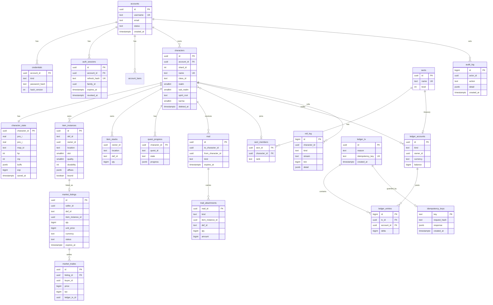

# Mô hình dữ liệu – PostgreSQL và Redis

> **Trạng thái:** thiết kế kỹ thuật. Mục "Đề xuất – chờ duyệt" chưa có hiệu lực cho tới khi vào [DECISIONS.md](DECISIONS.md). PostgreSQL là **nguồn sự thật** cho tài sản ([08 §7](08-server-architecture.md)). Sổ cái và luồng giao dịch chi tiết: [26](26-kinh-te-ledger.md). Tên bảng/cột dùng tiếng Anh `snake_case`; thuật ngữ miền (Linh Căn, Linh thạch…) nằm ở chú thích.

## 1. Nguyên tắc

| #   | Nguyên tắc                                                                                                                                                                        | Hệ quả                                                                                                                                                                            |
| --- | --------------------------------------------------------------------------------------------------------------------------------------------------------------------------------- | --------------------------------------------------------------------------------------------------------------------------------------------------------------------------------- |
| D1  | Tiền tệ chỉ đổi bằng bút toán sổ cái kép; số dư là bản **suy ra** có kiểm tra bất biến                                                                                            | Không `UPDATE wallets SET … = …` rải rác; xem [26](26-kinh-te-ledger.md). _(Mẫu SQL trong 08 §7 dùng `wallets` trực tiếp: đây là minh họa; thiết kế chuẩn dưới đây thay thế nó.)_ |
| D2  | Mỗi vật phẩm không xếp chồng là **một dòng** (instance); vật phẩm xếp chồng là **số lượng** trên một dòng ngăn                                                                    | Không nhân đôi vật phẩm do race; chuyển instance = đổi `owner_id`/`location` có khóa                                                                                              |
| D3  | Mọi thao tác ghi có `idempotency_key`                                                                                                                                             | Bấm hai lần không trừ hai lần                                                                                                                                                     |
| D4  | Dữ liệu tĩnh (định nghĩa vật phẩm, cảnh giới, kỹ năng, ma trận Ngũ hành) **không nằm trong PG** mà trong JSON của `@vgtd/shared`/bundle dữ liệu; DB chỉ lưu `def_id` dạng văn bản | Đổi cân bằng không cần migration; xem `dataVersion` ở [22 §9](22-server-modules.md)                                                                                               |
| D5  | Xóa mềm cho dữ liệu tài khoản/nhân vật; không bao giờ xóa vật lý bút toán sổ cái                                                                                                  | Kiểm toán và khiếu nại                                                                                                                                                            |
| D6  | Thời gian lưu `timestamptz` (UTC)                                                                                                                                                 | —                                                                                                                                                                                 |
| D7  | Mọi bảng thay đổi nhiều có `created_at`, `updated_at`; bảng chỉ-thêm (ledger, audit, roll log) chỉ có `created_at`                                                                | —                                                                                                                                                                                 |

## 2. Sơ đồ ERD (PostgreSQL)

Bảng phụ không vẽ để gọn: `outbox`, `chat_messages`, `leaderboard_snapshots`, `account_flags`, `rng_seeds` (hạt giống PRNG của roll kinh tế, **vai trò DB hạn chế**, không log; [29 ADR-010](29-adr.md)), `item_events` (nhật ký `MINT/BURN/MOVE` của vật phẩm, [26 §3.2](26-kinh-te-ledger.md)), `market_params` (tham số chợ theo tuần: CPI, τ, hệ số sửa chữa), `schema_migrations`.

## 3. Chiến lược ID

**Đề xuất – chờ duyệt (ADR-011):**

| Loại                                                                                | Kiểu                                                        | Lý do                                                                                                                                                          |
| ----------------------------------------------------------------------------------- | ----------------------------------------------------------- | -------------------------------------------------------------------------------------------------------------------------------------------------------------- |
| Thực thể hiển thị ra ngoài (tài khoản, nhân vật, vật phẩm, niêm yết, thư, tông môn) | **UUIDv7** (16 B, sinh ở ứng dụng; PG 18 có `uuidv7()` gốc) | Có thứ tự thời gian (chèn tốt vào B-tree, khác UUIDv4); không đoán được → chống liệt kê; hợp nhất được giữa nhiều node/shard; an toàn khi sau này tách service |
| Bút toán sổ cái, nhật ký roll, audit                                                | `bigint generated always as identity`                       | Khối lượng cực lớn, cần thứ tự chèn tăng, chỉ tham chiếu nội bộ                                                                                                |
| Danh mục tĩnh (`def_id`, `quest_id`, `map_id`, `class_id`)                          | `text` ổn định theo JSON (`pill_ket_kim_dan`…)              | Khớp dữ liệu schema của [07](07-cong-thuc-data-schema.md)                                                                                                      |
| Id thực thể trong thế giới (World Node)                                             | `uint32` nội bộ, cấp khi `join`; **không** lưu bền          | Gói tin cần nhỏ; id lưu bền (UUIDv7) chỉ xuất hiện ở bắt tay và UI, trong snapshot dùng chỉ số cục bộ 10 bit ([24 §5](24-giao-thuc-mang.md))                   |
| Mã yêu cầu (`requestId`) / khóa idempotency                                         | UUIDv7 do **bên gọi** sinh                                  | Thử lại cùng khóa = cùng kết quả                                                                                                                               |

Sinh UUIDv7 dùng `Clock` đã tiêm (rìa), tách khỏi mã mô phỏng; **không** gọi trong `step()`.

## 4. Chi tiết các nhóm bảng

### 4.1 Tài khoản và phiên

| Bảng            | Cột chính                                                                                                                                           | Ràng buộc / chỉ mục                                                                                                |
| --------------- | --------------------------------------------------------------------------------------------------------------------------------------------------- | ------------------------------------------------------------------------------------------------------------------ |
| `accounts`      | `id`, `username` (citext, duy nhất), `email` (tùy chọn ở MVP), `status` (`active/locked/banned/deleted`)                                            | `UNIQUE(lower(username))`                                                                                          |
| `credentials`   | `account_id`, `kind` (`password`, sau này `google`), `password_hash` (chuỗi argon2id đầy đủ gồm tham số + muối), `hash_version`, `external_subject` | `UNIQUE(account_id, kind)`; `UNIQUE(kind, external_subject)` cho SSO                                               |
| `auth_sessions` | `id`, `account_id`, `refresh_hash` (SHA-256 của refresh token), `family_id`, `expires_at`, `revoked_at`, `ip`, `ua`                                 | Chỉ mục `(account_id)`, `(family_id)`; xoay vòng refresh + phát hiện tái sử dụng ([25 §4](25-xac-thuc-bao-mat.md)) |
| `account_bans`  | `account_id`, `reason`, `until`, `issued_by`                                                                                                        | Chỉ mục `(account_id, until)`                                                                                      |

### 4.2 Nhân vật

- `characters`: `id`, `account_id`, `shard_id` (mặc định 1, [20 Q6](20-kien-truc-tong-the.md)), `name` (duy nhất không phân biệt hoa thường), `class_id`, `realm` (1–9), `sub_realm` (nấc), `spirit_root` (Linh Căn – dạng văn bản/JSON gọn theo [07 §5](07-cong-thuc-data-schema.md)), `karma` (Nghiệp Lực, −1000…1000), `dao_tam`, `created_at`, `deleted_at`.
- `character_state` (1–1, ghi thường xuyên, tách khỏi `characters` để giảm bloat): `pos_i`, `pos_j` (float), `map_id`, `hp`, `mp`, `buffs jsonb`, `cooldown_ready_at` (jsonb theo giờ server), `exp`, `saved_at`. Ghi theo lô ([22 §3.8](22-server-modules.md)).
- Giới hạn: tối đa N nhân vật/tài khoản (mặc định 4, chờ chốt).

### 4.3 Vật phẩm và túi đồ

| Bảng                           | Mục đích                                                                               | Cột chính                                                                                                                                                                                   |
| ------------------------------ | -------------------------------------------------------------------------------------- | ------------------------------------------------------------------------------------------------------------------------------------------------------------------------------------------- |
| `item_instances`               | Vật phẩm **duy nhất** (pháp bảo, trang bị, phi kiếm, đan phẩm cao có thuộc tính riêng) | `id`, `def_id`, `owner_id`, `location` (`bag/equip/bank/mail/market/escrow`), `slot`, `quality` (0–5 theo 6 phẩm D6), `durability` (0–100.00 lưu ×100), `affixes jsonb`, `bound`, `version` |
| `item_stacks`                  | Vật phẩm **xếp chồng** (nguyên liệu, đan thường, phù)                                  | khóa chính `(owner_id, location, def_id)`, `qty >= 0`; giới hạn xếp chồng tra ở dữ liệu tĩnh                                                                                                |
| `inventory_slots` _(tùy chọn)_ | Ánh xạ ô túi → instance/stack, để sắp xếp theo ô                                       | `(owner_id, slot)`; MVP có thể suy ra từ `slot` trong hai bảng trên                                                                                                                         |

Quy tắc: mỗi instance có đúng một `owner_id` và một `location`; chuyển vị trí = `UPDATE … WHERE id=$1 AND owner_id=$2 AND location=$3 AND version=$4` (kiểm tra mong đợi, tăng `version`) trong giao dịch; 0 dòng = đã bị đổi → lỗi. Hao mòn độ bền theo [07 §7](07-cong-thuc-data-schema.md) cập nhật `durability` trong giao dịch của sự kiện (chết, nhiều lần mỗi 30 phút).

### 4.4 Sổ cái tiền tệ (kép)

| Bảng              | Cột chính                                                                                                                                                                                                                                                                | Ràng buộc                                                                                                                    |
| ----------------- | ------------------------------------------------------------------------------------------------------------------------------------------------------------------------------------------------------------------------------------------------------------------------ | ---------------------------------------------------------------------------------------------------------------------------- |
| `ledger_accounts` | `id`, `kind` (danh sách đầy đủ và duy nhất ở [26 §2.2](26-kinh-te-ledger.md): `PLAYER_WALLET`, `SECT_TREASURY`, `ESCROW`, `SYSTEM_FAUCET_<nguồn>`, `SYSTEM_SINK_<kênh>`, `SYSTEM_GM`), `owner_id` (nhân vật/tông môn hoặc null), `currency`, `balance bigint`, `version` | `UNIQUE(kind, owner_id, currency)`; `CHECK balance >= 0` cho ví người chơi, **trừ** đồng `TIEN_NGOC` (được âm khi hoàn tiền) |
| `ledger_tx`       | `id`, `reason` (`AUCTION_BUY`, `DROP`, `REPAIR`…), `idempotency_key` (duy nhất), `created_at`, `meta jsonb`                                                                                                                                                              | `UNIQUE(idempotency_key)`                                                                                                    |
| `ledger_entries`  | `id`, `tx_id`, `account_id`, `delta` (có dấu, số nguyên đơn vị nhỏ nhất)                                                                                                                                                                                                 | Chỉ-thêm; **trigger** `DEFERRABLE INITIALLY DEFERRED` kiểm tra `SUM(delta)=0` theo `(tx_id, currency)` cuối giao dịch        |

Tiền tệ (`currency`): `LT_HA`, `LT_TRUNG`, `LT_THUONG` (Linh thạch ba phẩm), `TIEN_NGOC` (ví được phép âm khi hoàn tiền, docs/15), `CONG_HIEN`, `TOKEN_<sự kiện>` (tiền sự kiện) (Cống hiến); quy ước đơn vị nhỏ nhất: số nguyên, không số thập phân. Đổi phẩm Linh thạch (phí 5%) là một `ledger_tx` nhiều đồng tiền với tài khoản hệ thống đối ứng. Số dư người chơi là cột `balance` được **cập nhật cùng giao dịch** (khóa dòng `SELECT … FOR UPDATE` theo thứ tự id tăng dần để tránh deadlock) và đối chiếu định kỳ với `SUM(delta)` ([26 §3](26-kinh-te-ledger.md)). Tài khoản hệ thống `SYSTEM_SINK_*` cho từng kênh tiêu hao (thuế chợ, phí niêm yết, sửa chữa, truyền tống, đột phá…) để phục vụ tỷ lệ tiêu hao/sinh ra ([26 §7](26-kinh-te-ledger.md)).

### 4.5 Chợ (Vạn Bảo Lâu)

- `market_listings`: `id`, `seller_id`, `def_id`, `item_instance_id` (null nếu hàng xếp chồng), `qty`, `unit_price`, `currency`, `listing_fee` (đã thu), `status` (`active/sold/cancelled/expired`), `created_at`, `expires_at`, `version`. Chỉ mục `(status, def_id, unit_price)` cho tìm kiếm; `GIN` trên chuỗi tìm kiếm nếu cần.
- `market_trades`: `id`, `listing_id`, `buyer_id`, `price`, `tax`, `ledger_tx_id`, `created_at` (lịch sử bán; nguồn của CPI tuần).
- Hàng đang niêm yết được chuyển vào `location='market'` (escrow) để không dùng/chuyển nơi khác.

### 4.6 Tông môn, nhiệm vụ, thư

- `sects` (`id`, `name`, `level`, `treasury_account_id`, `linh_mach` json), `sect_members` (`sect_id`, `character_id`, `rank`, `contribution`, `joined_at`).
- `quest_progress` (`character_id`, `quest_id`, `state` `active/done/failed`, `progress jsonb`, `updated_at`); định nghĩa nhiệm vụ ở dữ liệu tĩnh – hệ nhiệm vụ do tài liệu game design (docs 10–19) quy định; bảng này chỉ lưu trạng thái.
- `mail` (`id`, `to_character_id`, `from_character_id` null=hệ thống, `kind`, `subject`, `body`, `read_at`, `claimed_at`, `expires_at`), `mail_attachments` (vật phẩm/stack/tiền). Nhận thư đính kèm = một giao dịch Economy (chuyển từ `location='mail'` về túi + bút toán).

### 4.7 Nhật ký, kiểm toán, outbox

| Bảng                    | Mục đích                                                                                              | Ghi chú                                                                                                                        |
| ----------------------- | ----------------------------------------------------------------------------------------------------- | ------------------------------------------------------------------------------------------------------------------------------ |
| `audit_log`             | Hành động nhạy cảm: đăng nhập thất bại/thành công, đổi mật khẩu, GM, khóa/mở, hoàn tác                | Chỉ-thêm; phân vùng theo tháng                                                                                                 |
| `roll_log`              | Mỗi lần roll quyết định kinh tế (drop, đột phá, Lôi Kiếp, chế tạo): `stream`, `tick`, số rút, kết quả | [07 §2](07-cong-thuc-data-schema.md): server roll bằng RNG có seed và ghi log từng lần để xử lý khiếu nại; phân vùng theo ngày |
| `outbox`                | `topic`, `payload`, `created_at`, `published_at`                                                      | Ghi cùng giao dịch; bộ đọc phát lên `EventBus`/NATS ([20 §4.1](20-kien-truc-tong-the.md))                                      |
| `idempotency_keys`      | `key`, `request_hash`, `response`, `created_at`                                                       | Trùng khóa **và** trùng `request_hash` → trả `response` cũ; trùng khóa khác băm → lỗi `IDEMPOTENCY_MISMATCH`                   |
| `chat_messages`         | Tin riêng và tông môn (giữ 30 ngày)                                                                   | Ghi bất đồng bộ; không lưu kênh Thế giới                                                                                       |
| `leaderboard_snapshots` | Ảnh chụp bảng xếp hạng hằng ngày                                                                      | —                                                                                                                              |

## 5. Công cụ migration và truy cập dữ liệu

**Đề xuất – chờ duyệt (ADR-012):**

| Lựa chọn                                | Ưu                                                                                                                             | Nhược                                                                | Quyết định |
| --------------------------------------- | ------------------------------------------------------------------------------------------------------------------------------ | -------------------------------------------------------------------- | ---------- |
| **node-pg-migrate** (chế độ tệp `.sql`) | Chạy bằng npm, không cần nhị phân ngoài (dev Windows); SQL thuần, đọc được bởi dịch vụ viết bằng ngôn ngữ khác; có `up`/`down` | Ít tính năng kiểm tra drift hơn Atlas                                | **Chọn**   |
| dbmate                                  | Một nhị phân, SQL thuần, rất đơn giản                                                                                          | Cần cài nhị phân/Docker trên máy dev                                 | Dự phòng   |
| Flyway / Liquibase                      | Trưởng thành                                                                                                                   | Cần JVM                                                              | Không      |
| Prisma / Drizzle Kit                    | Sinh kiểu tiện                                                                                                                 | Che SQL, khó kiểm soát khóa/trigger sổ cái; Prisma thêm runtime nặng | Không      |

- **Truy cập dữ liệu:** `pg` (node-postgres) + **Kysely** (trình dựng truy vấn có kiểu, sinh kiểu từ schema bằng `kysely-codegen`); SQL thô cho các giao dịch sổ cái để kiểm soát khóa. Không dùng ORM theo thực thể.
- **Quy tắc migration:** chỉ-tiến (không sửa migration đã chạy); mỗi migration nhỏ và có thể chạy lại được; việc đổi cột lớn theo mẫu _expand → backfill → contract_ để không khóa bảng lâu; CI chạy toàn bộ migration trên PG trống rồi chạy kiểm thử ([28 §5](28-chien-luoc-kiem-thu.md)).
- **Sinh kiểu và dữ liệu tĩnh** không qua migration (D4).
- **Phiên bản schema** kiểm tra khi khởi động ([22 §9](22-server-modules.md)).

## 6. Thiết kế Redis (khi bật – tùy chọn trong MVP)

Quy ước khóa: `vgtd:{env}:{miền}:{id}[:phần]`; mọi khóa có TTL trừ khi ghi chú; giá trị JSON gọn hoặc hash. Mọi truy cập qua `KeyValueStore`/`PubSub` (có bản RAM cho MVP không có Redis).

| Khóa                                      | Kiểu           | Nội dung / TTL                                                                          | Dùng cho                                                     |
| ----------------------------------------- | -------------- | --------------------------------------------------------------------------------------- | ------------------------------------------------------------ |
| `vgtd:{env}:sess:{accountId}`             | hash           | `connId`, `characterId`, `nodeId`, `epoch`, `lastSeen`; TTL 60 s, làm mới theo nhịp tim | Phiên online, định tuyến Gateway                             |
| `vgtd:{env}:route:{characterId}`          | string         | `nodeId:epoch`; TTL 60 s                                                                | Bảng định tuyến (khi ≥ 2 Gateway)                            |
| `vgtd:{env}:revoked:{jti}`                | string         | `1`; TTL = hạn còn lại của access token                                                 | Thu hồi access token tức thời                                |
| `vgtd:{env}:login-fail:{ip}` / `…:{user}` | string (đếm)   | TTL 15 phút                                                                             | Khóa tạm theo IP/tài khoản ([25 §3](25-xac-thuc-bao-mat.md)) |
| `vgtd:{env}:rl:{scope}:{id}`              | string / Lua   | Token bucket; TTL ngắn                                                                  | Rate limit phân tán                                          |
| `vgtd:{env}:char:{id}:snap`               | hash           | Snapshot vị trí/máu mỗi 10 s; TTL 10 phút                                               | Phục hồi sau sập World Node                                  |
| `vgtd:{env}:idem:{requestId}`             | string         | Kết quả gọn; TTL 24 h (PG vẫn là nguồn sự thật)                                         | Tăng tốc kiểm tra trùng                                      |
| `vgtd:{env}:inv:{characterId}`            | hash           | Cache đọc túi đồ; xóa khi có sự kiện ghi (outbox)                                       | Giảm tải PG                                                  |
| `vgtd:{env}:market:idx:{defId}`           | sorted set     | `unit_price` → `listingId`; cập nhật theo sự kiện                                       | Tìm kiếm chợ                                                 |
| `vgtd:{env}:market:cpi:{week}`            | hash           | Giá trung bình rổ hàng; TTL 14 ngày                                                     | Tính thuế τ ([26 §5](26-kinh-te-ledger.md))                  |
| `vgtd:{env}:chat:{channel}`               | list (cắt 200) | 200 tin gần nhất; không TTL cho kênh cố định                                            | Lịch sử ngắn                                                 |
| `vgtd:{env}:chat:pub:{channel}`           | pub/sub        | —                                                                                       | Fan-out                                                      |
| `vgtd:{env}:lb:{board}`                   | sorted set     | Bảng xếp hạng (điểm, id)                                                                | Xếp hạng                                                     |
| `vgtd:{env}:zone:map`                     | hash           | Bản đồ phân vùng chunk → node                                                           | Zone Manager (≥ 2 node)                                      |
| `vgtd:{env}:flags`                        | hash           | Cờ tính năng bản sao                                                                    | [27 §7](27-van-hanh-quan-sat.md)                             |

Chính sách bộ nhớ: `maxmemory-policy volatile-lru`; **không** đặt dữ liệu tài sản chỉ ở Redis; mất Redis chỉ gây giảm chất lượng (nối lại, tính lại cache), không mất tài sản. Bật AOF `everysec` nếu dùng Redis cho phiên quan trọng.

## 7. Lưu giữ dữ liệu và quyền riêng tư

| Dữ liệu                          | Thời hạn giữ                             | Cách xử lý                                                             |
| -------------------------------- | ---------------------------------------- | ---------------------------------------------------------------------- |
| `ledger_*`, `market_trades`      | **Vĩnh viễn** (kiểm toán)                | Lưu trữ lạnh theo phân vùng năm sau 12 tháng; không xóa                |
| `item_instances`, `characters`   | Tài khoản còn hoạt động; xóa mềm 30 ngày | Xóa nhân vật = ẩn; dữ liệu kinh tế được ẩn danh khi xóa vĩnh viễn      |
| `roll_log`                       | 90 ngày (mặc định, chờ chốt)             | Phân vùng theo ngày, `DROP PARTITION`; giữ lâu hơn nếu có khiếu nại mở |
| `audit_log`                      | 12 tháng                                 | Phân vùng theo tháng                                                   |
| `auth_sessions`                  | Hết hạn + 7 ngày                         | Job dọn dẹp hằng ngày                                                  |
| `chat_messages` (riêng/tông môn) | **30 ngày** (08 §7)                      | Job xóa theo lô                                                        |
| `mail`                           | 30 ngày sau khi hết hạn/nhận             | Vật đính kèm hết hạn quay về người gửi hoặc bị hủy (ghi sổ cái)        |
| `idempotency_keys`               | 7 ngày                                   | Job xóa                                                                |
| `outbox`                         | 7 ngày sau `published_at`                | Job xóa                                                                |
| `leaderboard_snapshots`          | 90 ngày                                  | —                                                                      |
| Log ứng dụng / telemetry         | Xem [27 §2](27-van-hanh-quan-sat.md)     | —                                                                      |

- Dữ liệu cá nhân tối thiểu: `username`, `email` (tùy chọn), IP gần nhất (băm/cắt octet cuối sau 30 ngày), user-agent. **Xóa tài khoản theo yêu cầu**: ẩn danh `accounts`/`credentials`, giữ sổ cái đã ẩn danh. Chính sách cuối cùng (GDPR/luật địa phương) cần xác nhận pháp lý – xem câu hỏi Q5.
- Sao lưu: `pg_dump` hằng ngày + WAL liên tục khi có môi trường thật; thử khôi phục hằng quý. **Ở MVP cục bộ chỉ cần `pg_dump` thủ công**; kế hoạch sao lưu thật nằm ngoài phạm vi MVP.

## 8. Chỉ số và phân vùng (ước lượng, chưa đo)

| Bảng              | Tốc độ tăng giả thiết                     | Biện pháp                                                                    |
| ----------------- | ----------------------------------------- | ---------------------------------------------------------------------------- |
| `ledger_entries`  | ≈ 3–6 dòng/giao dịch; vài chục/người/ngày | Phân vùng theo tháng khi > 50 triệu dòng; chỉ mục `(account_id, id)`         |
| `roll_log`        | Hàng trăm/người/giờ nếu log mọi roll      | Phân vùng theo ngày; chỉ log roll **kinh tế**, không log sát thương từng đòn |
| `character_state` | Ghi mỗi 30 s/người                        | `fillfactor=70`, cập nhật HOT; `autovacuum` mạnh hơn                         |

## Câu hỏi cần chốt

Đã gộp vào [31-bang-quyet-dinh.md](31-bang-quyet-dinh.md), nguồn duy nhất của câu hỏi mở: cột "Câu hỏi" ở đó ghi ID nguồn đã gộp (23 Q1–Q7). Nội dung gốc của mục này nằm trong lịch sử git.
