# Kinh tế và sổ cái (Economy)

> **Trạng thái:** thiết kế kỹ thuật. Mục "Đề xuất – chờ duyệt" chưa có hiệu lực cho tới khi vào [DECISIONS.md](DECISIONS.md). **Không đổi** bất kỳ giá trị kinh tế nào: thuế chợ, phí niêm yết, drop, tỷ trọng tiêu hao… lấy nguyên từ [07 §6–7](07-cong-thuc-data-schema.md) và [00 §3](00-ho-so-tong-hop.md) (mục tiêu tiêu hao/sinh ra 0,9–1,0 mỗi tuần). Đổi số = quy trình skill `vgtd-formula-change`. Mô hình bảng: [23](23-mo-hinh-du-lieu.md). Mẫu SQL trong [08 §7](08-server-architecture.md) là minh họa; thiết kế dưới đây là bản chi tiết thay cho `wallets` trực tiếp (xem [23 D1](23-mo-hinh-du-lieu.md)).

## 1. Nguyên tắc

| #   | Nguyên tắc                                                                                     | Hệ quả                                                                               |
| --- | ---------------------------------------------------------------------------------------------- | ------------------------------------------------------------------------------------ |
| E1  | World Node **không bao giờ ghi** tiền/vật phẩm; chỉ gửi **yêu cầu** có `requestId` tới Economy | Mô phỏng thế giới chết/lag không làm sai tài sản ([20 §1](20-kien-truc-tong-the.md)) |
| E2  | Mọi thay đổi tiền = một `ledger_tx` gồm ≥ 2 bút toán, **tổng delta = 0 theo từng đồng tiền**   | Không "tạo/hủy" tiền ngoài tài khoản hệ thống có tên (faucet/sink)                   |
| E3  | Mọi lệnh ghi **idempotent** theo `requestId`                                                   | Gửi lại/bấm hai lần = một kết quả                                                    |
| E4  | Vật phẩm không xếp chồng là **instance có id**; xếp chồng là **số lượng**                      | Không nhân đôi bằng race; kiểm kê được                                               |
| E5  | Faucet và sink đều **có tên và có tài khoản**                                                  | Tỷ lệ tiêu hao/sinh ra tính được trực tiếp từ sổ cái                                 |
| E6  | Mọi roll kinh tế do server thực hiện và ghi `roll_log`                                         | Giải quyết khiếu nại ([07 §2](07-cong-thuc-data-schema.md))                          |
| E7  | Tham số kinh tế là **dữ liệu** (JSON), nạp lại không cần cập nhật client                       | [07 §7](07-cong-thuc-data-schema.md): "Mọi hệ số điều chỉnh nằm trong file dữ liệu"  |

## 2. Mô hình sổ cái kép

### 2.1 Đồng tiền

| Mã                | Ý nghĩa                | Quy đổi ([07 §6](07-cong-thuc-data-schema.md))        | Ghi chú                                                                                                                                                                                                                             |
| ----------------- | ---------------------- | ----------------------------------------------------- | ----------------------------------------------------------------------------------------------------------------------------------------------------------------------------------------------------------------------------------- |
| `LT_HA`           | Linh thạch hạ phẩm     | 1                                                     | Đơn vị tính giá mặc định                                                                                                                                                                                                            |
| `LT_TRUNG`        | Linh thạch trung phẩm  | = 100 hạ                                              | Đổi lên phẩm: **phí 5%** (kênh "Phí đổi Linh thạch lên phẩm")                                                                                                                                                                       |
| `LT_THUONG`       | Linh thạch thượng phẩm | = 10.000 hạ                                           | —                                                                                                                                                                                                                                   |
| `TIEN_NGOC`       | Tiên Ngọc              | Theo docs/15 (1 Tiên Ngọc ≈ 100 ₫ trên Web, chờ chốt) | **Khóa tài khoản, không chuyển giữa người chơi, không đổi ra Linh thạch** (docs/15 Q2). Ví Tiên Ngọc **được phép âm** khi hoàn tiền/chargeback (docs/15) nên bỏ ràng buộc `balance ≥ 0` cho loại ví này; chi tiêu bị vô hiệu khi âm |
| `TOKEN_<sự kiện>` | Tiền sự kiện           | Theo từng sự kiện (docs/15)                           | Khóa tài khoản, hết hạn khi sự kiện kết thúc (bút toán hủy cuối sự kiện), không đổi sang Linh thạch                                                                                                                                 |
| `CONG_HIEN`       | Cống hiến (tông môn)   | Theo GDD                                              | Không chuyển nhượng được giữa người chơi (đề xuất)                                                                                                                                                                                  |

Số tiền là `bigint` không dấu đơn vị nhỏ nhất, **không số thập phân**. Phí/thuế tính bằng số nguyên với quy tắc làm tròn **cố định và ghi rõ** (làm tròn xuống phần của người bán, phần dư vào sink): `tax = ceil(price × τ_bps / 10000)`, người bán nhận `price − tax`.

### 2.2 Loại tài khoản sổ cái

| `kind`                  | Chủ                                   | Ràng buộc              | Dùng cho                                                                                                                                                 |
| ----------------------- | ------------------------------------- | ---------------------- | -------------------------------------------------------------------------------------------------------------------------------------------------------- |
| `PLAYER_WALLET`         | nhân vật                              | `balance ≥ 0`          | Ví                                                                                                                                                       |
| `SECT_TREASURY`         | tông môn                              | `balance ≥ 0`          | Quỹ tông môn (nạp Hộ Sơn Đại Trận, Linh Mạch)                                                                                                            |
| `ESCROW`                | giao dịch (chợ/đấu giá/đổi trực tiếp) | `balance ≥ 0`          | Giữ tiền trong lúc khớp lệnh                                                                                                                             |
| `SYSTEM_FAUCET_<nguồn>` | hệ thống                              | Có thể âm (nguồn sinh) | `DROP_MOB`, `DROP_ELITE`, `DROP_BOSS`, `QUEST_REWARD`, `EVENT_REWARD`, `NPC_SELL`…                                                                       |
| `SYSTEM_SINK_<kênh>`    | hệ thống                              | Chỉ tăng (tiền bị hủy) | `BREAKTHROUGH`, `MARKET_TAX`, `LISTING_FEE`, `REPAIR`, `SECT_UPKEEP`, `TELEPORT`, `CONVERT_FEE`, `TRADE_TAX`, `NPC_BUY_FEE`, `AUCTION_BURN`, `CRAFT_FEE` |
| `SYSTEM_FAUCET_IAP`     | hệ thống                              | Có thể âm              | Nạp tiền thật → ví Tiên Ngọc; biên lai xác thực **phía server**, khóa idempotency theo mã biên lai (docs/15); **ngoài** tỷ lệ tiêu hao/sinh ra           |
| `SYSTEM_GM`             | vận hành                              | Có thể âm/dương        | Chỉ bút toán `GM_ADJUST` có duyệt (§3.3); **loại khỏi** báo cáo faucet/sink nhưng báo cáo riêng                                                          |

Kênh sink tương ứng bảng "Cơ cấu tiêu hao mục tiêu" của [07 §7](07-cong-thuc-data-schema.md): đột phá và vật liệu đột phá 35%; thuế chợ + phí niêm yết 15%; sửa chữa 15%; nạp Hộ Sơn Đại Trận / duy trì Linh Mạch 15%; truyền tống 8%; đổi phẩm Linh thạch (5%) + khác 12%.

### 2.3 Cấu trúc và ví dụ

`ledger_tx(id, reason, idempotency_key, created_at, meta)` + `ledger_entries(id, tx_id, account_id, delta)`. Ví dụ **mua trên Vạn Bảo Lâu** (giá 1.000 hạ, thuế τ = 8%):

| Bút toán | Tài khoản                | Delta  |
| -------- | ------------------------ | ------ |
| 1        | ví người mua             | −1.000 |
| 2        | ví người bán             | +920   |
| 3        | `SYSTEM_SINK_MARKET_TAX` | +80    |
| **Tổng** |                          | **0**  |

Bất biến kiểm tra bằng **trigger hoãn** cuối giao dịch (`SUM(delta) = 0` theo `(tx_id, currency)`) **và** bằng job đối chiếu (§3.3). `balance` trong `ledger_accounts` được cập nhật trong cùng giao dịch (`UPDATE … SET balance = balance + $delta WHERE id=$1` với `CHECK` cho ví người chơi); là bản **suy ra** từ bút toán.

## 3. Bất biến, vật phẩm và đối chiếu

### 3.1 Vật phẩm: instance và stackable

| Loại          | Ví dụ                                                                               | Lưu                                                                             | Chuyển quyền sở hữu                                                                     |
| ------------- | ----------------------------------------------------------------------------------- | ------------------------------------------------------------------------------- | --------------------------------------------------------------------------------------- |
| **Instance**  | Pháp bảo, trang bị, phi kiếm, đan phẩm cao có thuộc tính riêng, bản vẽ phẩm Vàng–Đỏ | `item_instances` (1 dòng/vật), có `quality`, `durability`, `affixes`, `version` | `UPDATE … WHERE id AND owner_id AND location AND version` trong giao dịch; 0 dòng = lỗi |
| **Stackable** | Nguyên liệu, đan dược thường, phù lục                                               | `item_stacks (owner_id, location, def_id, qty)`                                 | Trừ ở nguồn (`qty ≥ n`) và cộng ở đích trong **cùng giao dịch**; `CHECK (qty ≥ 0)`      |
| **Tiền**      | Linh thạch…                                                                         | Sổ cái (§2)                                                                     | Bút toán kép                                                                            |

Định nghĩa vật phẩm (giới hạn xếp chồng, có thể giao dịch, `bound` khi nhặt/mặc…) nằm ở dữ liệu tĩnh ([23 D4](23-mo-hinh-du-lieu.md)).

### 3.2 Bất biến phải luôn đúng

| #   | Bất biến                                                                                                                   | Cách bảo đảm                                                           |
| --- | -------------------------------------------------------------------------------------------------------------------------- | ---------------------------------------------------------------------- |
| I1  | Với mỗi `ledger_tx` và đồng tiền: `Σ delta = 0`                                                                            | Trigger hoãn + test thuộc tính                                         |
| I2  | Ví người chơi `balance ≥ 0`                                                                                                | `CHECK` + câu lệnh `UPDATE … WHERE balance ≥ price`                    |
| I3  | `balance(account) = Σ entries.delta(account)`                                                                              | Đối chiếu định kỳ §3.3                                                 |
| I4  | Mỗi `item_instances.id` có đúng một `owner_id` và một `location`                                                           | Khóa chính + kiểm tra `version`                                        |
| I5  | Vật phẩm chỉ xuất hiện qua đường faucet hợp lệ (`DROP`, `CRAFT`, `QUEST`, `NPC_SELL`, `EVENT`) có `ledger_tx`/`item_event` | Bảng sự kiện vật phẩm (`item_events`: `MINT/BURN/MOVE`) cùng giao dịch |
| I6  | `Σ tiền hệ thống + Σ ví người chơi + Σ escrow` = tổng mint − tổng burn (theo đồng tiền)                                    | Đối chiếu §3.3                                                         |
| I7  | Niêm yết `active` ⇒ vật phẩm ở `location = 'market'` và thuộc người bán                                                    | Ràng buộc ứng dụng + truy vấn kiểm tra                                 |

### 3.3 Đối chiếu và giám sát

- **Mỗi 5 phút:** kiểm I3 cho các tài khoản đã thay đổi (theo `updated_at`); **mỗi đêm:** kiểm toàn bộ I1–I7. Lệch → cảnh báo mức cao + **đóng băng kinh tế** (chỉ-đọc) cho tài khoản/đồng tiền liên quan cho đến khi xử lý.
- Metric: `ledger_tx_total{reason}`, `ledger_invariant_violation_total`, `economy_tx_duration_ms`, `idempotency_replay_total` ([27 §3](27-van-hanh-quan-sat.md)).
- Công cụ GM chỉnh tài sản **chỉ** qua bút toán `GM_ADJUST` với tài khoản `SYSTEM_GM`, bắt buộc có lý do và người duyệt (`audit_log`).

## 4. Giao dịch idempotent

### 4.1 Hợp đồng

Mọi lệnh ghi nhận `requestId` (UUIDv7 do bên gọi sinh – client với `inv_cmd`/`market_*`, World Node với `grantRequest`). Quy tắc:

1. Chèn `idempotency_keys(key=requestId, request_hash)`; **trùng khóa + trùng `request_hash`** → trả `response` đã lưu, không thực thi lại; **trùng khóa khác `request_hash`** → `IDEMPOTENCY_MISMATCH` (client lỗi/gian lận).
2. Phần thực thi chạy trong **một giao dịch PostgreSQL** cùng với chèn khóa, bút toán, đổi vật phẩm, bản ghi `outbox` ([23 §4.7](23-mo-hinh-du-lieu.md)). Hoặc tất cả, hoặc không.
3. Phản hồi được lưu vào `idempotency_keys.response` cùng giao dịch.
4. Khóa sống 7 ngày (cache Redis 24 h nếu bật).

### 4.2 Thứ tự khóa để tránh deadlock

Luôn khóa theo thứ tự tăng dần của `(kind, id)`: ví theo `account_id`, rồi hàng `item_instances` theo `id`, rồi `market_listings`. Cặp người mua – người bán luôn khóa id nhỏ trước. Deadlock vẫn có thể xảy ra → thử lại tối đa 3 lần với backoff ngẫu nhiên nhỏ, vẫn dùng cùng `requestId`.

### 4.3 Mức cô lập

`READ COMMITTED` + khóa dòng tường minh (`SELECT … FOR UPDATE`) cho đường nóng; `SERIALIZABLE` chỉ cho job đối chiếu (đọc nhất quán). Lý do: dễ suy luận và hiệu năng đủ cho mức tải MVP; kiểm thử đồng thời bắt buộc ([28 §5](28-chien-luoc-kiem-thu.md)).

### 4.4 Rơi đồ và yêu cầu từ World Node

```mermaid
sequenceDiagram
  participant W as World Node
  participant E as Economy
  participant DB as PostgreSQL
  W->>W: Quái chết → roll drop bằng PRNG 'drop' (ghi roll_log buffer)
  W->>E: grantRequest{requestId, characterId, items[], source}
  E->>DB: BEGIN; idempotency; kiểm tra túi còn chỗ; chèn stack/instance + ledger_tx (FAUCET→ví)
  alt túi đầy
    E->>DB: chuyển vào thư hệ thống (mail) cùng giao dịch
  end
  DB-->>E: COMMIT
  E-->>W: ok{grantId}
  E-->>Client: inv_delta (qua Gateway, theo sự kiện outbox)
  Note over W,E: Nếu mất kết nối/timeout → W thử lại CÙNG requestId (an toàn)
```

- Yêu cầu chưa được xác nhận nằm trong hộp thư đi của World Node (RAM + ghi tạm) và được thử lại; nếu World Node chết trước khi gửi, phần thưởng **mất** (chấp nhận được cho rơi đồ thường; với phần thưởng có giá trị lớn như boss tuần, gửi yêu cầu **trước** khi báo cho người chơi và dùng `requestId` xác định theo `(bossInstanceId, characterId)` để chạy lại được).
- **Nhặt đồ:** `drop_pick` là ý định; World Node xác thực khoảng cách/quyền nhặt rồi gửi `grantRequest`; vật phẩm trên đất chỉ bị xóa **sau** khi Economy trả `ok`.

## 5. Chợ, đấu giá và thuế

Giá trị từ [07 §7](07-cong-thuc-data-schema.md); không đổi:

- Phí niêm yết **1%** giá đăng, **không hoàn**, tối thiểu 1 hạ phẩm → `SYSTEM_SINK_LISTING_FEE`.
- Thuế bán `τ = clamp(0,05 + 0,5·max(0, CPI_w − 1,02), 0,05, 0,10)` trừ vào tiền người bán nhận → `SYSTEM_SINK_MARKET_TAX`. `CPI_w` = giá trung bình tuần này của rổ hàng (đan đột phá, nguyên liệu phổ biến, bản vẽ phẩm thấp) / tuần trước.
- Giao dịch trực tiếp giữa người chơi: **3%** cố định.
- Mọi Linh thạch thu qua các kênh này **bị hủy**, không chuyển cho người chơi khác.

[Cập nhật D112: Vạn Bảo Lâu cơ bản đã cài ([docs/38](38-van-bao-lau.md)): thuế bán **cố định 5 %** trong beta, CPI tuần chạy bóng và không áp dụng; dạng số nguyên của phí / thuế (`listingFeeInt`, `marketTaxInt`, `sellerProceedsInt`, quy tắc làm tròn §2.1) đã có trong `@vgtd/shared` `formulas/market.ts`, nên "Khoảng trống" ở §5.3 về làm tròn đã đóng; hạng mục `SYSTEM_SINK_LISTING_FEE` / `SYSTEM_SINK_MARKET_TAX` đã có trong sổ cái. Hàng hết hạn về túi, rồi kho nhặt đồ (chưa có thư `mail`).]

### 5.1 Niêm yết – hủy – hết hạn

```mermaid
stateDiagram-v2
  [*] --> active: market_list (thu phí 1%, vật phẩm → location=market)
  active --> sold: market_buy thành công
  active --> cancelled: người bán hủy (không hoàn phí; vật phẩm về túi)
  active --> expired: hết hạn (vật phẩm về thư của người bán)
  sold --> [*]
  cancelled --> [*]
  expired --> [*]
```



### 5.2 Mua (một giao dịch)

Trình tự (thay cho mẫu SQL minh họa của 08 §7, dùng sổ cái đã định nghĩa):

1. `idempotency` (§4.1).
2. `SELECT … FROM market_listings WHERE id=$l AND status='active' FOR UPDATE` (nếu không còn → `LISTING_GONE`).
3. Khóa ví người mua và người bán theo thứ tự id (§4.2); kiểm tra người mua ≠ người bán, đủ tiền (`price = unit_price × qty`).
4. Tính `τ` từ **tham số tuần hiện hành** (đọc từ bảng cấu hình, không từ client); `tax = ceil(price × τ)`.
5. Bút toán: người mua −price; người bán +(price − tax); `SYSTEM_SINK_MARKET_TAX` +tax. Chuyển vật phẩm: `location='mail'` của người mua (đính kèm) hoặc vào túi nếu còn chỗ; cập nhật `status='sold'`; chèn `market_trades`.
6. `outbox`: `economy.auction.sold` → thông báo người bán, xóa cache, cập nhật CPI ([08 §7](08-server-architecture.md)).

Giá được **chốt từ bản ghi khóa** trong bước 2, không từ giá client thấy lúc bấm; nếu bản ghi đã đổi `version` thì lỗi (chống "đổi giá phút chót" – [25 §6.1](25-xac-thuc-bao-mat.md)). Giới hạn bảo vệ: giá niêm yết trong khoảng [P_ref/10, P_ref×10] theo giá tham chiếu (**đề xuất**, Q3).

### 5.3 CPI và điều chỉnh hằng tuần

- Job tuần tính `CPI_w` từ `market_trades` của **rổ hàng** (định nghĩa rổ là dữ liệu), **loại trừ** giao dịch bị gắn cờ wash trading ([25 §6.1](25-xac-thuc-bao-mat.md)); lưu `market_params(week, cpi, tau, repair_multiplier, ...)`.
- Vòng điều chỉnh: tỷ lệ tiêu hao/sinh ra < 0,9 trong **2 tuần liền** → nâng sàn τ thêm 1 điểm và nhân phí sửa chữa 1,1; > 1,05 trong 2 tuần liền → điều chỉnh ngược lại ([07 §7](07-cong-thuc-data-schema.md)). Job chỉ **đề xuất**, áp dụng khi có duyệt hoặc theo cờ tính năng (Q5).
- Tính τ ở **một chỗ** duy nhất: `marketSaleTax(cpi)` trong `@vgtd/shared` (đã có); phí niêm yết `listingFee(price)`, thuế trực tiếp `directTradeTax`, phí truyền tống `teleportFee`, sửa chữa `repairCost` cũng lấy từ đó – Economy không tự viết lại công thức. **Khoảng trống:** các hàm này trả số thực (ví dụ `sellerProceeds` = `price·(1−τ)`), còn sổ cái chỉ nhận số nguyên; quy tắc làm tròn ở §2.1 (`ceil` cho thuế) cần được thêm vào `@vgtd/shared` bằng quy trình `vgtd-formula-change` (ghi vào OPEN-ITEMS khi duyệt) trước khi cài Economy. Hàm nhận `cpi` là **tỷ số tuần này / tuần trước** (khác với "sàn τ" nâng bởi vòng điều chỉnh §5.3, hiện chưa có tham số trong shared).

### 5.4 Đấu Giá Hội (hủy tiền)

GDD ghi Đấu Giá Hội là kênh **hủy tiền** ([01 §10](01-gdd.md)); chi tiết luật chưa có trong docs → tạm thiết kế khung kỹ thuật, **đề xuất – chờ duyệt**:

- Mỗi phiên đấu giá: vật phẩm do hệ thống hoặc người chơi đưa (khi người chơi đưa: chuyển vào `ESCROW`).
- Đặt giá: tiền của người đặt giá cao nhất nằm trong `ESCROW` của phiên; bị vượt → hoàn ngay (`ESCROW → ví`) trong cùng giao dịch đặt giá mới (khóa theo thứ tự).
- Kết thúc: người thắng trả tiền → phần đã định **vào `SYSTEM_SINK_AUCTION_BURN`** (hủy), phần còn lại (nếu người bán là người chơi) vào ví người bán; vật phẩm chuyển cho người thắng. Tỷ lệ hủy là tham số dữ liệu – **chưa có số** (OPEN-ITEMS thiết kế Đấu Giá Hội).
- Chống sniping: gia hạn cố định khi có giá đặt ở N giây cuối (tham số).

### 5.5 Giao dịch trực tiếp

Hai bên mời → đặt vật phẩm/tiền → **khóa** (mỗi bên xác nhận hai bước; đổi nội dung thì hủy xác nhận) → server giữ đồ của hai bên trong `ESCROW` → một giao dịch hoàn tất: chuyển chéo + thuế 3% → `SYSTEM_SINK_TRADE_TAX`. Hết hạn 60 s không hoạt động thì hoàn trả. Tốc độ/giá trị tối đa/ngày để chống RMT: tham số.

[Cập nhật D102: đã làm ở `apps/server/src/trade` (`InventoryService.exchange`, ledger `TRADE`, `SYSTEM_SINK_TRADE_TAX`; thuế `directTradeTaxUnits` = làm tròn lên 3% mỗi chiều và mỗi loại tiền, chỉ trên Linh thạch). Vật phẩm không rời túi chủ tới bước thực hiện, nên không dùng tài khoản `ESCROW`; một bước trao đổi nguyên tử trong bộ nhớ thay cho việc giữ trong ESCROW. Trần tốc độ / giá trị / ngày chưa có.]

## 6. Rơi đồ, đột phá và nhật ký roll

- **Công thức/hằng:** `@vgtd/shared` (`formulas/economy.ts`, `combat.ts`, `breakthrough.ts`); Economy/World **truyền** số ngẫu nhiên vào, công thức không tự rút (như hiện tại).
- **PRNG:** theo ADR-010 ([29](29-adr.md)): thuật toán của `@vgtd/shared`, nhưng với roll **kinh tế** hạt giống là bí mật phía server (không đoán được từ số sát thương hiển thị), mỗi luồng đặt tên (`drop`, `breakthrough`, `tribulation`, `craft`) và **thứ tự rút cố định, có tài liệu**.
- **Log:** mỗi roll kinh tế ghi `roll_log(stream, tick, bộ đầu vào, số rút, kết quả)`; tối thiểu đủ để **tái hiện** kết quả từ trạng thái luồng. Bộ đếm **pity** (bản vẽ Vàng–Đỏ, đột phá) lưu **ở server** trong `character_state`/bảng riêng, không client.
- **Hệ số điều chỉnh** (quái thấp ×0,2/chỉ nguyên liệu, linh khí cạn kiệt ×0,5 sau 2 giờ, tổ đội 1/√n, boss rương tuần…) tính ở World/Economy khi roll theo [07 §6](07-cong-thuc-data-schema.md); `lowRealmFactor` trả `null` cho trường hợp "chỉ nguyên liệu" → **nơi gọi phải xử lý** (OPEN-ITEMS A11).
- **Chế tạo (docs/13):** Economy là nơi duy nhất ghi kết quả chế; roll hai bước (thành công, phẩm chất) chạy ở Economy với seed ở kho hạn chế, không log.
- **Ranh giới quyết định:** World Node quyết "rơi gì" (theo trạng thái trận đấu, hạn mức theo ngày), Economy quyết "cấp được không" (túi, hạn mức) và ghi sổ.

## 7. Faucet / sink và hạch toán theo CPI

### 7.1 Báo cáo hằng tuần (từ sổ cái)

Với tuần `w`: `faucet_w = Σ delta dương của SYSTEM_FAUCET_*` (quy ra hạ phẩm); `sink_w = Σ delta của SYSTEM_SINK_*` (mọi kênh ở §2.2 đều có dòng trong bảng dưới); `ratio_w = sink_w / faucet_w` (chỉ các đồng Linh thạch; **loại** `TIEN_NGOC` và `TOKEN_*`, docs/15) (mục tiêu **0,9–1,0**, [00 §3](00-ho-so-tong-hop.md)). Bảng theo kênh so với cơ cấu mục tiêu của [07 §7](07-cong-thuc-data-schema.md):

| Kênh sink                                                 | Tỷ trọng mục tiêu | Tài khoản hệ thống                                                                     |
| --------------------------------------------------------- | ----------------- | -------------------------------------------------------------------------------------- |
| Đột phá và vật liệu đột phá                               | 35%               | `SYSTEM_SINK_BREAKTHROUGH`                                                             |
| Thuế chợ + phí niêm yết (gồm thuế giao dịch trực tiếp 3%) | 15%               | `SYSTEM_SINK_MARKET_TAX`, `…_LISTING_FEE`, `…_TRADE_TAX`                               |
| Sửa chữa trang bị                                         | 15%               | `SYSTEM_SINK_REPAIR`                                                                   |
| Hộ Sơn Đại Trận / duy trì Linh Mạch                       | 15%               | `SYSTEM_SINK_SECT_UPKEEP`                                                              |
| Truyền tống                                               | 8%                | `SYSTEM_SINK_TELEPORT`                                                                 |
| Đổi phẩm Linh thạch (5%) và khác                          | 12%               | `SYSTEM_SINK_CONVERT_FEE`, `…_NPC_BUY_FEE`, `…_AUCTION_BURN`, `…_CRAFT_FEE`, `…_OTHER` |

- Phí truyền tống `Fee = 20·1,5^(r−1)·(1 + 0,5·d)`, miễn phí 1 lần/ngày về Sơn Môn; sửa chữa `RepairCost = V·0,004·Δ%` — **tính bằng hàm của `@vgtd/shared`**, Economy chỉ ghi sổ.
- **Vật phẩm** cũng có faucet/sink (rơi, chế tạo, phá hủy, độ bền về 0 không hủy món đồ – [07 §7](07-cong-thuc-data-schema.md)); theo dõi **tổng cung theo `def_id`** (`item_supply{def_id}`) để phát hiện lạm phát vật phẩm.
- Chỉ số bổ sung: tổng Linh thạch lưu hành, hệ số Gini ví, thời gian trung bình giữ tiền, độ sâu thị trường rổ hàng.

### 7.2 Cảnh báo

| Điều kiện                                              | Hành động                                            |
| ------------------------------------------------------ | ---------------------------------------------------- |
| `ratio_w < 0,9` hai tuần liền / `> 1,05` hai tuần liền | Đề xuất điều chỉnh theo §5.3                         |
| Một nguồn faucet tăng > 3σ so với 4 tuần trước         | Cảnh báo (nghi lỗi hoặc khai thác)                   |
| Vi phạm bất biến I1–I7                                 | Đóng băng + báo động tức thời                        |
| Một tài khoản có thu nhập/giờ > phân vị 99 ×3          | Hàng đợi xem xét ([25 §7.2](25-xac-thuc-bao-mat.md)) |

## 8. Kế hoạch mô phỏng kinh tế

Mục tiêu: **khóa các hệ số** (OPEN-ITEMS §1 mục 7) bằng dữ liệu trước closed beta; hiện **chưa có kết quả mô phỏng nào**.

| Giai đoạn | Nội dung                                                                                                                                                                              | Công cụ / đầu ra                                                                                    | Tiêu chí đạt                                                                                  |
| --------- | ------------------------------------------------------------------------------------------------------------------------------------------------------------------------------------- | --------------------------------------------------------------------------------------------------- | --------------------------------------------------------------------------------------------- |
| M0        | **Mô hình bảng tính/Node** tất định: tác nhân đại diện theo cảnh giới đánh quái (nhịp 150 con/giờ dã ngoại, 20 tinh anh/giờ), thu Linh thạch kỳ vọng (07 §6), chi theo cơ cấu (07 §7) | Gói `tools/econ-sim` (đề xuất) dùng `@vgtd/shared` + PRNG; chạy trong CI ngắn (< 30 s) ở quy mô nhỏ | `ratio_w` nằm trong [0,9; 1,0] ở các kịch bản chuẩn; kết quả lặp lại được                     |
| M1        | **Thêm hành vi:** đột phá thất bại + pity, chợ (cung–cầu đơn giản), thuế động CPI, sửa chữa, truyền tống, nhiều nhóm người chơi (ít/nhiều giờ chơi)                                   | Mô phỏng 10.000 tác nhân × 12 tuần; quét tham số (τ sàn, hệ số sửa chữa, tỷ lệ drop ±20%)           | Không lạm phát/giảm phát kéo dài; phân phối tài sản hợp lý (Gini mục tiêu do game design đặt) |
| M2        | **Kịch bản gian lận:** bot farm (×N thu nhập), RMT, wash trading, dup giả định                                                                                                        | Mô phỏng tác động lên CPI và `ratio_w`; thử các ngưỡng phát hiện ([25 §7](25-xac-thuc-bao-mat.md))  | Phát hiện trước khi lệch > 5% so với kịch bản gốc                                             |
| M3        | **Đối chiếu với dữ liệu thật:** closed beta đo `faucet/sink` theo kênh, so với M1, hiệu chỉnh                                                                                         | Báo cáo §7.1 hằng tuần                                                                              | Sai lệch mô hình/thực ≤ 15% cho các kênh chính                                                |

Ghi chú: M0–M2 phụ thuộc docs game design (nghề luyện đan/chế tạo, nhiệm vụ, kiếm tiền) chưa có; mô phỏng ban đầu dùng đúng bảng 07 §6–7 và đánh dấu tham số thiếu là **giả định**. Mọi tham số được đặt trong tệp dữ liệu có phiên bản để tái hiện.

## 9. Chế độ lỗi (tóm tắt, chi tiết [22 §6](22-server-modules.md))

| Lỗi                                      | Xử lý                                                                                                             |
| ---------------------------------------- | ----------------------------------------------------------------------------------------------------------------- |
| PostgreSQL không sẵn sàng                | Từ chối mọi lệnh ghi (`SERVICE_UNAVAILABLE`); thế giới chạy, túi đồ chỉ đọc từ cache; không bao giờ cấp trong RAM |
| Timeout giữa chừng (không rõ đã commit?) | Bên gọi thử lại **cùng `requestId`** → nhận kết quả cũ                                                            |
| Deadlock                                 | Thử lại ≤ 3 lần theo §4.2                                                                                         |
| Vi phạm bất biến                         | Đóng băng phạm vi ảnh hưởng, báo động, sửa bằng `GM_ADJUST` có duyệt                                              |
| Outbox kẹt                               | Cảnh báo theo tuổi bản ghi cũ nhất; bộ phát hành là "ít nhất một lần" → người nhận cũng idempotent                |

## Câu hỏi cần chốt

Đã gộp vào [31-bang-quyet-dinh.md](31-bang-quyet-dinh.md), nguồn duy nhất của câu hỏi mở: cột "Câu hỏi" ở đó ghi ID nguồn đã gộp (26 Q1–Q8). Nội dung gốc của mục này nằm trong lịch sử git.
