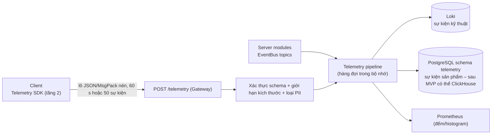

# Vận hành và quan sát (Observability)

> **Trạng thái:** thiết kế kỹ thuật. Mục "Đề xuất – chờ duyệt" chưa có hiệu lực cho tới khi vào [DECISIONS.md](DECISIONS.md). Mảng "Đo lường (telemetry, dashboard KPI)" đã có đề xuất ở **docs/17** (PR #69, chờ duyệt), là nguồn của **danh mục sự kiện, envelope và KPI**; bản này đã đối chiếu với docs/17 và **theo docs/17** khi khác nhau (§4). Tài liệu này chỉ định **hạ tầng** thực thi (đường truyền, lưu, cảnh báo kỹ thuật).
>
> **Phạm vi MVP:** chạy cục bộ (docker-compose profile `obs`, [20 §6](20-kien-truc-tong-the.md)); không có môi trường phát hành, không CD.

## 1. Nguyên tắc

| #   | Nguyên tắc                                                                                                     |
| --- | -------------------------------------------------------------------------------------------------------------- |
| O1  | Một định danh tương quan (`traceId`) đi từ client → Gateway → World/Economy → log và metric                    |
| O2  | Quan sát **không** nằm trong đường nóng của tick: ghi vào bộ đệm vòng, xuất ở luồng chính/job nền              |
| O3  | Không bao giờ log bí mật (mật khẩu, token, khóa) hay dữ liệu cá nhân thô; che trường nhạy cảm tại điểm ghi     |
| O4  | Mã mô phỏng không đọc đồng hồ để quyết định logic; đồng hồ chỉ dùng để đo (rìa) – skill `vgtd-sim-determinism` |
| O5  | Mọi ngân sách trong [00 §3](00-ho-so-tong-hop.md) có một chỉ số đo được và một ngưỡng cảnh báo                 |
| O6  | Công cụ cục bộ nhẹ: bật theo profile, mặc định tắt                                                             |

## 2. Log

**Đề xuất – chờ duyệt (ADR-018):** log có cấu trúc JSON một dòng bằng **pino**; ghi ra `stdout`; thu bằng **Loki** (cục bộ qua Promtail/Alloy), xem trong Grafana.

| Trường                    | Ý nghĩa                                                                           |
| ------------------------- | --------------------------------------------------------------------------------- |
| `ts`                      | RFC 3339 UTC (đồng hồ rìa)                                                        |
| `level`                   | `trace`, `debug`, `info`, `warn`, `error`, `fatal`                                |
| `msg`                     | Thông điệp ngắn, không nội suy dữ liệu động vào chuỗi cố định (dùng trường riêng) |
| `module`                  | `gateway`, `auth`, `world`, `zone`, `economy`, `chat`, `platform`                 |
| `traceId`, `spanId`       | Tương quan với trace                                                              |
| `accountId`/`characterId` | UUID (đã là mã không đoán được); IP **cắt octet cuối** hoặc băm có muối           |
| `tick`                    | Số tick (với log của World Node)                                                  |
| `err`                     | `{type, message, stack}`; stack chỉ ở `error`/`fatal`                             |

- **Mức log mặc định:** `info`; `debug` bật theo module bằng cờ cấu hình, **không** bật trong đường nóng của tick; log theo từng gói input/snapshot bị cấm ở `info`.
- **Lấy mẫu:** sự kiện lặp (gói sai định dạng, rate limit) gộp theo khóa trong 10 s với bộ đếm.
- **Che dữ liệu (redaction):** danh sách đường dẫn che cấu hình sẵn (`*.password`, `*.token`, `*.refreshToken`, `req.headers.authorization`, cookie, **`*.seed`, `*.rngSeed`, `*.rngState`** của luồng roll kinh tế; chỉ cho phép `seedId`).
- **Log kiểm toán** (đăng nhập, GM, can thiệp kinh tế) ghi vào bảng `audit_log` ([23](23-mo-hinh-du-lieu.md)), **không** chỉ vào file; log ứng dụng không thay thế.
- **Lưu giữ cục bộ:** Loki 7 ngày (dev). Hạn lưu thật: chờ chốt (Q5); log chứa mã định danh phải theo [23 §7](23-mo-hinh-du-lieu.md).

## 3. Metric

**Đề xuất – chờ duyệt (ADR-018):** `prom-client` (Prometheus text) trên cổng quản trị `/metrics` (tách khỏi cổng game), Prometheus thu mỗi 5 s (cục bộ), Grafana hiển thị. Quy ước tên: `vgtd_<module>_<đại lượng>_<đơn vị>`; nhãn ít chiều (tránh `characterId` làm nhãn).

### 3.1 Chỉ số cốt lõi theo ngân sách

| Chỉ số                                                         | Loại              | Ngưỡng / mục tiêu (nguồn)                                                 | Cảnh báo                                          |
| -------------------------------------------------------------- | ----------------- | ------------------------------------------------------------------------- | ------------------------------------------------- |
| `vgtd_world_tick_duration_ms` (histogram, nhãn `phase`)        | histogram         | p99 ≤ 40 ms (docs/10); tổng pha ≤ 42 ms ([22 §3.4](22-server-modules.md)) | p99 > 40 ms 1 phút                                |
| `vgtd_world_tick_overrun_total`                                | counter           | 0 ở tải mục tiêu                                                          | > 0 liên tục 5 s                                  |
| `vgtd_world_entities` (gauge, nhãn `kind`)                     | gauge             | ≤ ~1.000 (giả thiết)                                                      | > 80% trần                                        |
| `vgtd_world_aoi_duration_ms`                                   | histogram         | ≤ 8 ms mỗi lượt AOI                                                       | p99 > 8 ms                                        |
| `vgtd_gateway_connections` (gauge)                             | gauge             | ≤ trần CCU                                                                | > 90% trần                                        |
| `vgtd_gateway_downstream_bytes_per_s` (histogram theo kết nối) | histogram         | 8 / 13 / 25 KB/s theo tình huống ([00 §3](00-ho-so-tong-hop.md))          | p95 vượt ngân sách tình huống                     |
| `vgtd_gateway_upstream_bytes_per_s`                            | histogram         | < 1 KB/s (08 §8)                                                          | p95 > 1 KB/s                                      |
| `vgtd_gateway_send_queue_bytes`                                | histogram         | —                                                                         | Số kết nối bị `SLOW_CONSUMER`                     |
| `vgtd_gateway_rate_limited_total{type}`                        | counter           | —                                                                         | Tăng đột biến                                     |
| `vgtd_anticheat_violation_total{kind}`                         | counter           | Điểm 20 cảnh báo / 50 ngắt (08 §6)                                        | Tỷ lệ ngắt kết nối tăng                           |
| `vgtd_anticheat_disconnect_total{reason}`                      | counter           | —                                                                         | —                                                 |
| `vgtd_economy_tx_duration_ms{reason}`                          | histogram         | p95 ≤ 30 ms, p99 ≤ 100 ms (giả thiết)                                     | p99 > 100 ms                                      |
| `vgtd_economy_invariant_violation_total`                       | counter           | **0**                                                                     | > 0 → đóng băng ([26 §3.3](26-kinh-te-ledger.md)) |
| `vgtd_economy_idempotency_replay_total`                        | counter           | —                                                                         | Tăng bất thường (client lỗi?)                     |
| `vgtd_economy_faucet_sink_ratio` (gauge, theo tuần)            | gauge             | 0,9–1,0 ([00 §3](00-ho-so-tong-hop.md))                                   | Theo [26 §7.2](26-kinh-te-ledger.md)              |
| `vgtd_auth_login_total{result}`, `…_hash_ms`                   | counter/histogram | p95 băm ≈ 80–150 ms (mục tiêu)                                            | Thất bại > 20% / IP đột biến                      |
| `vgtd_db_pool_*`, `vgtd_db_query_duration_ms`                  | gauge/histogram   | —                                                                         | Hàng đợi pool > 0 kéo dài                         |
| `nodejs_eventloop_lag_seconds`, `nodejs_gc_*`, heap            | mặc định          | Lag luồng chính p99 ≤ 20 ms (giả thiết)                                   | p99 > 50 ms                                       |
| `vgtd_chat_messages_total`, `…_filtered_total`                 | counter           | —                                                                         | —                                                 |

### 3.2 Metric phía client (qua telemetry – §4)

`frame_time_ms` p50/p95/p99, `draw_calls` (theo lớp), `texture_mem_mb`, `js_heap_mb`, `spine_active`, `rtt_ms`, `jitter_ms`, `recon_error_tiles`, `chunk_load_ms`, `time_to_interactive_ms`, theo nhãn `platform`, `deviceTier`, `gpu` ([21 §10](21-kien-truc-client.md)).

## 4. Đường ống telemetry

- **Hai loại dữ liệu:** (1) _telemetry kỹ thuật_ (hiệu năng, lỗi, mạng): sự kiện `perf.sample`, `net.sample`, `client.load` của docs/17 §3 (lấy mẫu 100% trong closed beta, 10% sau đó); (2) _telemetry sản phẩm_ (hành vi, KPI): danh mục docs/17 §3.3, **không** định nghĩa lại ở đây.
- **Định dạng sự kiện:** dùng **đúng envelope của docs/17 §3.2** (`event_id` UUIDv7, `event_name` dạng `<domain>.<action>`, `schema_version`, `source`, `ts_server_ms`, `ts_client_ms`, `player_pid` = HMAC-SHA256(accountId, khóa bí mật), `session_id`, `seq`, `platform`…); JSON Schema 2020-12 kiểm bằng Ajv trong CI (như 07 §8). Server **loại** sự kiện không có trong danh mục. Khóa HMAC của `player_pid` là bí mật (không log, §2).
- **Quyền riêng tư:** theo docs/17 §7 và docs/19 (L10, L13: Nghị định 13/2023/NĐ-CP): không gửi nội dung chat, mật khẩu, IP đầy đủ, ID thiết bị phần cứng; dữ liệu **thiết yếu luôn bật**, **phân tích hành vi tắt được (opt-out, docs/17 Q4)**; xác minh tuổi/đồng ý người giám hộ theo docs/19. Chờ xác nhận pháp lý (Q4).
- **Đường truyền:** client gom ≤ 50 sự kiện hoặc 10 s (hàng đợi ngoại tuyến 200, bỏ cũ nhất, docs/17 §2) và gửi qua Gateway bằng thông điệp `telemetry_batch` ([24 §5](24-giao-thuc-mang.md)) trong phiên; trước đăng nhập (boot, lỗi tải) dùng `POST /telemetry`. Phía server, sự kiện đi qua `EventBus` với tên chủ đề `telemetry.<domain>` (in-process ở MVP, NATS sau MVP, khớp docs/17 §2) và mẫu outbox. **Chống lạm dụng:** 1 lô/10 s/phiên, ≤ 16 KB/lô (64 KB cho `POST`), bỏ qua nếu hàng đợi đầy (không chặn game).
- **Lưu giữ:** Loki 7 ngày cục bộ; bảng PG `telemetry_events` phân vùng theo ngày, log thô **90 ngày**, IP (nếu lưu) cắt /24 và xóa ≤ 30 ngày (docs/17 §2, §7); tổng hợp ẩn danh giữ lâu hơn; nâng lên kho cột khi vượt tải (docs/17 Q1).
- **Đối chiếu với docs/17 (đã làm):** (a) KPI kinh tế của docs/17 §5 đọc `ledger`/`SINK_*`/`SRC_*`; ở đây là `ledger_entries`/`SYSTEM_SINK_*`/`SYSTEM_FAUCET_*` ([26 §2.2](26-kinh-te-ledger.md)), cần bảng ánh xạ tên khi viết view tổng hợp; (b) Tiên Ngọc nằm **ngoài** tỷ lệ tiêu hao/sinh ra (docs/15 §6); (c) metric client ở §3.2 trùng `perf.sample`/`net.sample`. Mọi sự kiện ở docs/17 phải có schema trong CI.

## 5. Trace (vết phân tán)

- **OpenTelemetry SDK** (Node): span cho HTTP `/auth/*`, giao dịch Economy (theo `reason`), truy vấn DB, nối WS, thao tác `join`/`leave`; **không** tạo span cho từng gói input hay từng tick (chi phí); thay vào đó dùng histogram pha tick.
- Lan truyền ngữ cảnh: `traceparent` ở HTTP; với WS, `traceId` ngắn (8 byte) trong `hello_ack` và gắn vào log của kết nối; lệnh Economy từ World mang `traceId` của yêu cầu gốc.
- Xuất OTLP tới **OTel Collector** → **Tempo** (cục bộ). Lấy mẫu: 100% ở dev; `ParentBased(TraceIdRatio 0,05)` khi tải thật, luôn giữ span lỗi.
- Quy ước tên span: `module.operation` (ví dụ `economy.buy`, `auth.login`).

## 6. Dashboard cục bộ (Grafana, nạp sẵn bằng provisioning)

| Dashboard                 | Nội dung                                                                                                       | Dùng khi                                               |
| ------------------------- | -------------------------------------------------------------------------------------------------------------- | ------------------------------------------------------ |
| **Game Server Health**    | Tick p50/p95/p99 theo pha, số thực thể, lag event loop, GC, kết nối, băng thông xuống/lên theo tình huống      | Mọi phiên dev/loadbot                                  |
| **Network**               | RTT, jitter, mất gói (từ client), kích thước snapshot, tỷ lệ delta/full, `SLOW_CONSUMER`, rate limit           | Kiểm thử mạng xấu ([28 §6](28-chien-luoc-kiem-thu.md)) |
| **Economy**               | Giao dịch/giây, độ trễ, tỷ lệ idempotency replay, **faucet/sink theo kênh**, CPI, τ, tổng Linh thạch, bất biến | Mô phỏng và closed beta                                |
| **Security / Anti-cheat** | Đăng nhập thất bại theo IP, khóa tạm, vi phạm theo loại, ngắt kết nối, hàng đợi xem xét                        | Vận hành                                               |
| **Client Performance**    | Frame time, draw call, bộ nhớ, TTI theo thiết bị/nền tảng                                                      | Ma trận thiết bị ([28 §7](28-chien-luoc-kiem-thu.md))  |
| **Release Gate**          | Ba cảnh chuẩn (chợ 50, Lôi Kiếp, 100 v 100): draw call, băng thông, tick                                       | Trước khi phát hành                                    |

Cảnh báo (Alertmanager hoặc Grafana alerting) ở MVP gửi vào **thông báo cục bộ/log** – không có kênh ngoài; ngưỡng ở §3.1. SLO khởi điểm (chờ chốt, Q3): tỷ lệ tick ≤ 50 ms ≥ 99,9%; độ sẵn sàng đăng nhập ≥ 99% trong khung giờ test; giao dịch Economy thành công (không tính từ chối hợp lệ) ≥ 99,9%.

## 7. Báo cáo lỗi

| Nguồn                                   | Cách làm (MVP)                                                                                                                                                                                                                | Sau MVP                           |
| --------------------------------------- | ----------------------------------------------------------------------------------------------------------------------------------------------------------------------------------------------------------------------------- | --------------------------------- |
| Server (ngoại lệ chưa bắt, worker chết) | `process.on('uncaughtException'/'unhandledRejection')` → log `fatal` + metric + thoát có kiểm soát (trình giám sát khởi động lại); worker chết → khởi động lại ([22 §3.7](22-server-modules.md))                              | Sentry/GlitchTip                  |
| Client                                  | `window.onerror`, `unhandledrejection`, lỗi bên trong `Renderer` → `Telemetry.error` (có **ring buffer 5 MB** các `Action` gần nhất, bản dựng, thiết bị, trạng thái FSM) → `POST /telemetry` loại `error`, gom theo băm stack | Sentry (self-host) kèm source map |
| Lỗi giao thức                           | `ProtocolError` → `error` gửi client + log `warn` có hexdump ≤ 64 byte                                                                                                                                                        | —                                 |
| Lỗi dữ liệu tĩnh                        | Kiểm tra schema khi khởi động; lỗi → không khởi động                                                                                                                                                                          | —                                 |

Đề xuất – chờ duyệt: MVP **không** triển khai Sentry cục bộ (tốn tài nguyên); dùng đường telemetry + Loki và nhóm lỗi theo băm stack; đánh giá lại khi có người thử nghiệm thật (Q2).

## 8. Cấu hình và cờ tính năng

### 8.1 Cấu hình

- **Lớp cấu hình** (ưu tiên tăng dần): mặc định trong mã → tệp `config/<env>.json` → biến môi trường `VGTD_*` → cờ dòng lệnh. Kiểm tra bằng **schema** (JSON Schema/zod) khi khởi động; sai → không khởi động.
- **Môi trường:** `dev` (cục bộ), `test` (CI/integration), `loadtest`; (`prod` ngoài phạm vi MVP).
- **Phân loại:** (a) hạ tầng (cổng, DSN, pool) – chỉ qua env; (b) vận hành (rate limit, ngưỡng) – đọc lại khi nhận tín hiệu/endpoint admin; (c) **dữ liệu cân bằng** (hệ số kinh tế, drop) – tệp dữ liệu có `dataVersion`, nạp lại không cần phát hành client ([07 §7](07-cong-thuc-data-schema.md)).
- Bí mật chỉ qua env/tệp `.env` không commit; có `.env.example`.

### 8.2 Cờ tính năng (feature flags)

**Đề xuất – chờ duyệt (ADR-018):** hệ cờ tự viết, đơn giản, trong `platform`:

| Thuộc tính             | Thiết kế                                                                                                                                                                               |
| ---------------------- | -------------------------------------------------------------------------------------------------------------------------------------------------------------------------------------- |
| Lưu                    | Tệp `flags.json` (đọc lại khi đổi) + bản ghi ghi đè trong PG khi cần chỉnh nóng; Redis bản sao khi bật                                                                                 |
| Dạng                   | `{key, enabled, rollout (0–100), allow[], deny[], description, owner, expires}`; `rollout` quyết bằng băm `(key, accountId)` **xác định** (không `Math.random`)                        |
| Đánh giá               | `Flags.isOn(key, ctx)` – nhanh, không I/O; kết quả gửi cho client trong `hello_ack` (cờ dành cho client)                                                                               |
| **Quy tắc quan trọng** | **Không** dùng cờ để đổi hành vi của `step()`/công thức mà client dự đoán nếu không kèm tăng phiên bản dữ liệu; cờ chỉ bật tính năng, không đổi kết quả mô phỏng giữa client và server |
| Loại cờ                | `release` (bật dần, có hạn), `ops` (công tắc ngắt khẩn: tắt chợ, tắt chat Thế giới, tắt đột phá), `experiment` (sau MVP)                                                               |
| Quản lý nợ             | Mỗi cờ có `expires`; CI cảnh báo cờ quá hạn                                                                                                                                            |
| Công tắc ngắt          | `ops.market.enabled`, `ops.chat.world`, `ops.economy.writes` (đóng băng ghi), `ops.login.enabled`: kiểm tra ở đầu cổng module                                                          |

## 9. Sổ tay vận hành tối thiểu (runbook) cho MVP

| Tình huống                       | Kiểm tra đầu tiên                                       | Hành động                                                     |
| -------------------------------- | ------------------------------------------------------- | ------------------------------------------------------------- |
| Tick chậm                        | Dashboard Game Server Health → pha nào                  | Giảm tải (flag), kiểm GC, ghi hồ sơ CPU (`--cpu-prof`)        |
| Người chơi báo mất đồ / nhân đôi | `audit_log`, `ledger_tx` theo `characterId`, `roll_log` | Truy vết theo `requestId`; sửa bằng `GM_ADJUST` có duyệt      |
| Tăng đột biến đăng nhập thất bại | Dashboard Security                                      | Tăng ngưỡng khóa, chặn IP/ASN tạm                             |
| Bất biến sổ cái vi phạm          | Cảnh báo `invariant_violation`                          | Bật `ops.economy.writes=off`, điều tra, đối chiếu từ bút toán |
| PostgreSQL chậm / hết kết nối    | `vgtd_db_pool_*`                                        | Giảm tải, kiểm khóa dài, khởi động lại có kiểm soát           |

### 9.1 Sao lưu và khôi phục kho tệp _[Cập nhật D99, P5]_

Áp cho kho tệp của D92 (`STORE=file`, `DATA_DIR`, mặc định `./.vgtd-data`: `accounts.json`, `progression.json`, `inventories.json`, `ledger.json`). Kho PostgreSQL sau này dùng công cụ của chính nó (docs/08, docs/23); giao diện sao lưu / khôi phục này là mẫu cho kịch bản thử khôi phục.

**Bản sao lưu** là thư mục `backup-<id>/` (`<id>` = giờ UTC, xếp được theo thứ tự) gồm bốn tệp tài liệu và `manifest.json` (định dạng, phiên bản, giờ tạo, kích thước và SHA-256 từng tệp, **chỉ số lượng** tài khoản / nhân vật / túi / bút toán). Tệp tài liệu chứa **băm mật khẩu** (scrypt): thư mục sao lưu nhạy cảm như dữ liệu gốc (quyền 0600 / 0700); mọi dòng log và đầu ra lệnh chỉ in id, tên tệp và số lượng, không bao giờ in nội dung.

| Việc                                                   | Lệnh                                                                                                                                                                                | Ghi chú                                                                                                                                                                                                                                                                                |
| ------------------------------------------------------ | ----------------------------------------------------------------------------------------------------------------------------------------------------------------------------------- | -------------------------------------------------------------------------------------------------------------------------------------------------------------------------------------------------------------------------------------------------------------------------------------- |
| Sao lưu **khi server đang chạy**, nhất quán            | `BACKUP_EVERY_MIN=15 BACKUP_KEEP=10 STORE=file npm run dev -w @vgtd/server` (hoặc dòng `backup` trên stdin khi có `QUIT_ON_STDIN=1`; `BACKUP_ON_EXIT=1` thêm một bản khi dừng sạch) | Bản sao được dựng từ **bộ nhớ** của server: cả bốn tài liệu được tuần tự hóa trong **một lượt đồng bộ** (sau khi lưu túi người đang chơi), nên sổ cái và túi luôn cùng một thời điểm; không có tệp rách.                                                                               |
| Sao lưu từ thư mục dữ liệu (server tắt hoặc đang chạy) | `npm run backup -w @vgtd/server -- --data-dir D --keep 10`                                                                                                                          | Đọc lại cho tới khi hai lần đọc giống nhau; tệp hỏng được thay bằng `.bak`; từ chối nếu dữ liệu không nạp được. Khi server chạy, dùng sao lưu của server để chắc chắn nhất quán.                                                                                                       |
| Liệt kê / kiểm                                         | `npm run backups -w @vgtd/server -- --data-dir D`, `npm run verify -w @vgtd/server -- --from latest` (hoặc `--data-dir D` để kiểm tài liệu đang dùng)                               | Kiểm manifest, SHA-256, rồi mở các tài liệu bằng **chính bộ nạp của server** (phiên bản, lược đồ, sổ cái I1-I3, túi).                                                                                                                                                                  |
| Khôi phục                                              | **Dừng server**, `npm run restore -w @vgtd/server -- --from latest --yes --data-dir D`                                                                                              | Kiểm bản sao trước, chưa đụng dữ liệu nếu không đạt. Tệp hiện tại (kể cả `.bak`) được chuyển sang `D/pre-restore-<id>/` (bản an toàn), rồi tài liệu đã kiểm được đặt vào chỗ, kiểm lại SHA-256. Từ chối nếu tệp dữ liệu vừa được ghi trong 3 giây (server còn chạy) trừ khi `--force`. |
| Thử khôi phục (cổng P5)                                | `npm test -w @vgtd/server -- backup`                                                                                                                                                | Bài thử: chơi → sao lưu → chơi thêm → sập → khôi phục → trạng thái bằng bản sao chụp từng chữ (tài khoản kèm băm mật khẩu, nhân vật, túi, số dư sổ cái; đăng nhập cũ vẫn vào được).                                                                                                    |

Quy trình sự cố: (1) dừng server; (2) `verify --data-dir D` để xem tài liệu hiện tại có nạp được không; (3) nếu hỏng hoặc phải quay lại: `backups` rồi `restore --from <id> --yes`; (4) khởi động lại, kiểm đăng nhập và số dư; (5) giữ `pre-restore-<id>/` cho tới khi chắc chắn (có thể xem phần dữ liệu bị bỏ). Xoay vòng: chỉ giữ `BACKUP_KEEP` bản mới nhất (tối thiểu 1), sau khi bản mới ghi xong. Bản sao lưu nên được chép ra ổ / máy khác định kỳ: nằm trong `DATA_DIR/backups` thì mất cùng ổ đĩa.

## Câu hỏi cần chốt

Đã gộp vào [31-bang-quyet-dinh.md](31-bang-quyet-dinh.md), nguồn duy nhất của câu hỏi mở: cột "Câu hỏi" ở đó ghi ID nguồn đã gộp (27 Q1–Q7). Nội dung gốc của mục này nằm trong lịch sử git.
