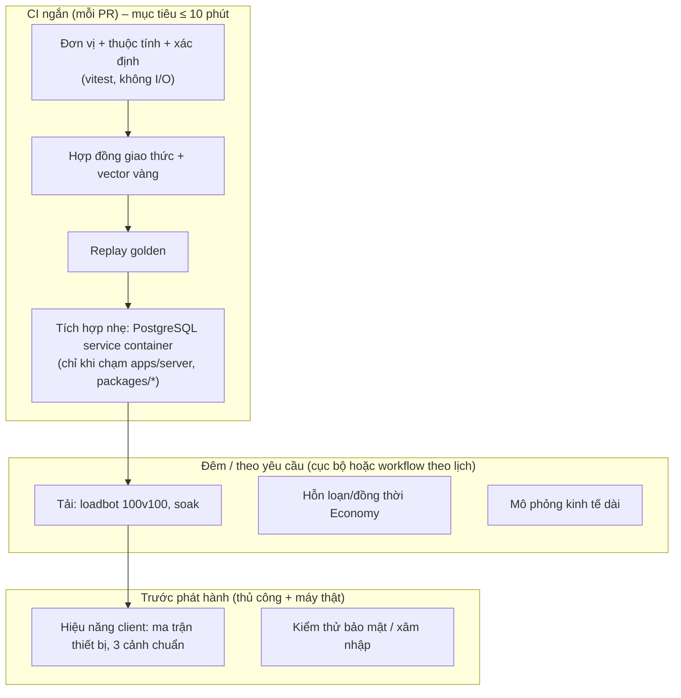

# Chiến lược kiểm thử

> **Trạng thái:** thiết kế kỹ thuật. Mục "Đề xuất – chờ duyệt" chưa có hiệu lực cho tới khi vào [DECISIONS.md](DECISIONS.md). Ràng buộc của chủ dự án: **CI ngắn** (GitHub Actions, không CD). CI hiện tại ([.github/workflows/ci.yml](../.github/workflows/ci.yml), job `verify`, Node 18 và 22): `npm ci` → `typecheck` → `test` → `build` → `lint`; quy tắc repo còn yêu cầu `format:check` trước khi push. Mọi con số **ngưỡng** dưới đây lấy từ [00 §3](00-ho-so-tong-hop.md)/[08](08-server-architecture.md) hoặc ghi rõ là đề xuất.

## 1. Mô hình kiểm thử

| Tầng                | Số lượng (tỷ lệ) | Tốc độ    | Chạy ở đâu                                |
| ------------------- | ---------------- | --------- | ----------------------------------------- |
| Đơn vị / thuộc tính | Nhiều nhất       | ms        | Mọi PR (CI)                               |
| Hợp đồng / replay   | Vừa              | giây      | Mọi PR (CI)                               |
| Tích hợp (PG)       | Ít               | chục giây | PR có đổi server (CI, lọc theo đường dẫn) |
| Tải / soak          | Rất ít           | phút–giờ  | Đêm hoặc cục bộ                           |
| Thiết bị thật       | Rất ít           | thủ công  | Trước mốc phát hành                       |

## 2. Kiểm thử đơn vị và thuộc tính

- **Khung:** vitest (đã dùng ở mọi package). Mã tầng 1–2 của client ([21 §2](21-kien-truc-client.md)) chạy trong Node, không cần Cocos.
- **Hiện có (tham chiếu):** `@vgtd/shared` tái hiện **các ví dụ tính toán trong [07](07-cong-thuc-data-schema.md)** (CLAUDE.md); `@vgtd/client-core` (A\*, AnchorLayout); PR #7 (106 test), #9 (41), #10 (55 + 46) khi hợp nhất.
- **Thuộc tính (property-based):** dùng `fast-check` (đề xuất – chờ duyệt, ADR-019) cho: codec round-trip; `step()` không xuyên tường ở mọi tốc độ; sổ cái `Σ delta = 0` với dãy giao dịch ngẫu nhiên; AOI so với vét cạn; thứ tự vẽ là **thứ tự toàn phần** (`compareDrawOrder`); `inAoi` đối xứng khi thoát/vào; **round-trip của `IsoAdapter`** (`worldToTile(tileToWorld(i, j, e)) = (i, j)` với (i, j) thực, sai số < 1e-6; `cellCenterToWorld(i, j) = tileToWorld(i + 0,5; j + 0,5)`); `lowRealmFactor` trả `null` được xử lý ở mọi nơi gọi.
- **Ví dụ vàng của công thức:** mỗi thay đổi công thức theo skill `vgtd-formula-change` phải cập nhật test tái hiện số trong tài liệu; sai lệch ≤ ngưỡng CI 1% đã nêu (OPEN-ITEMS A1–A2).
- **Quy tắc mã mô phỏng:** mọi mã trong `sim`/`shared` có test grep cấm `Math.random`, `Date.now`, `new Date`, `performance.now` (đã có ở PR #10, mở rộng cho thư mục mới).

## 3. Hợp đồng giao thức

| Kiểm thử                                                                                                                                                | Mục đích                                                 | Ở đâu                            |
| ------------------------------------------------------------------------------------------------------------------------------------------------------- | -------------------------------------------------------- | -------------------------------- |
| **Vector vàng**: tệp gói nhị phân + kết quả giải mã JSON, mỗi thông điệp 1+ ca                                                                          | Khóa định dạng; dùng chung cho hiện thực Go/Rust sau này | `packages/protocol/test/vectors` |
| Round-trip ngẫu nhiên 500+/loại; mã hóa chính tắc                                                                                                       | Phát hiện lệch                                           | CI                               |
| Cắt cụt mọi tiền tố; byte thừa; bit đệm ≠ 0                                                                                                             | Giải mã nghiêm ngặt                                      | CI                               |
| Fuzz: 50.000 buffer ngẫu nhiên + 20.000 gói bị đột biến; chỉ `ProtocolError`                                                                            | Không crash, không cấp phát vô hạn                       | CI (đã có ở PR #10)              |
| Kích thước tối đa mỗi thông điệp so với bảng [24 §9](24-giao-thuc-mang.md)                                                                              | Giữ ngân sách băng thông                                 | CI                               |
| `buf breaking` cho họ Protobuf ([24 §3](24-giao-thuc-mang.md))                                                                                          | Tương thích ngược                                        | CI (khi có `.proto`)             |
| **Client ⇄ server thật**: bộ test nối `NetClient` với `World Node` giả qua bộ nhớ                                                                       | Prediction/đối soát/nội suy đúng                         | CI                               |
| Hợp đồng cổng module (port) ([20 §4](20-kien-truc-tong-the.md)): mỗi port có bộ test dùng chung chạy trên hiện thực in-memory **và** hiện thực PG/Redis | Đảm bảo adapter thay được nhau                           | CI (PG service)                  |

## 4. Xác định (determinism) và replay

Đây là nền cho client prediction và cho tranh chấp. Theo skill `vgtd-sim-determinism`:

| Kiểm thử                 | Cách làm                                                                                                                                                               | Ngưỡng              |
| ------------------------ | ---------------------------------------------------------------------------------------------------------------------------------------------------------------------- | ------------------- |
| **Cùng vào, cùng ra**    | Chạy `step()` N tick hai lần từ cùng trạng thái + seed + danh sách input; so `stateHash()` và log sự kiện                                                              | Bằng nhau tuyệt đối |
| **Khác seed, khác ra**   | Đảm bảo PRNG không bị bỏ qua                                                                                                                                           | Khác                |
| **Độc lập thứ tự chèn**  | Xáo trộn thứ tự thêm thực thể/input không phụ thuộc; kết quả giống; đổi thứ tự `seq` thì **khác**                                                                      | —                   |
| **Chia nhỏ / replay**    | Chạy một lượt 10.000 tick so với chạy theo đoạn có ghi/khôi phục trạng thái                                                                                            | Băm giống nhau      |
| **Golden replay**        | Kịch bản input + băm kỳ vọng được **đóng phiên bản** trong repo; đổi băm cần tăng phiên bản + dòng DECISIONS (ví dụ băm vàng `8f33310212e6cd43` của PR #10)            | —                   |
| **Parity client/server** | Chạy `stepMove` (dự đoán) và `step` (server) trên cùng input; sai lệch vị trí nằm trong dung sai đã tài liệu hóa (< 1e-5 ô)                                            | < 1e-5 ô            |
| **Đa môi trường**        | Chạy bộ golden trên Node 18 và 22 (CI hiện có) **và** trong trình duyệt (Chromium/Firefox/WebKit qua Playwright) – kiểm tra khác biệt số học giữa V8 và JavaScriptCore | Băm giống nhau      |
| **PRNG**                 | Vector đầu ra theo seed (vài trăm số) khóa thuật toán; tách luồng đặt tên độc lập; thứ tự rút cố định                                                                  | Khớp vector         |

**Replay cho tranh chấp và hồi quy:** server ghi (tùy chọn, bật theo cờ) luồng input + seed + `dataVersion` của một phiên trận; công cụ `replay` chạy lại offline để tái hiện sát thương/rơi đồ. Phục vụ cả hai việc: bắt lỗi lệch client/server và xử lý khiếu nại ([23 `roll_log`](23-mo-hinh-du-lieu.md)).

## 5. Tích hợp với docker-compose

| Nội dung                                                                                                                                                                                         | Cách chạy                                                                                     |
| ------------------------------------------------------------------------------------------------------------------------------------------------------------------------------------------------ | --------------------------------------------------------------------------------------------- |
| Chạy toàn bộ migration trên PostgreSQL trống; kiểm tra `down`/`up`; kiểm tra schema khớp kiểu Kysely sinh ra ([23 §5](23-mo-hinh-du-lieu.md))                                                    | CI: **service container** `postgres:17` trong GitHub Actions (không cần docker-compose riêng) |
| Kiểm thử Economy trên PG thật: mua chợ, rơi đồ idempotent, thiếu tiền, trùng `requestId`, trigger cân bằng sổ cái                                                                                | CI (PG service)                                                                               |
| **Đồng thời (race)**: 50 luồng cùng mua một niêm yết; cùng dùng một instance; cùng gửi trùng `requestId`; kiểm tra **đúng một** thành công, bất biến I1–I7 giữ ([26 §3.2](26-kinh-te-ledger.md)) | CI (ít vòng) + đêm (nhiều vòng)                                                               |
| Kiểm tra chaos nhẹ: giết kết nối PG giữa giao dịch; `kill -9` World Node (worker chết); mất kết nối Gateway → resume trong 10 s                                                                  | Cục bộ/đêm bằng `docker compose` + script                                                     |
| Bật/tắt Redis (profile `redis`): bộ kiểm thử cổng chạy hai cấu hình                                                                                                                              | Đêm; CI chạy cấu hình không Redis                                                             |
| Smoke test end-to-end: `docker compose up` → đăng ký → đăng nhập → vào thế giới → di chuyển → nhặt đồ → bán chợ → đăng xuất, dùng bot headless                                                   | Đêm; một bản rút gọn trong CI nếu thời gian cho phép                                          |
| Kiểm thử bảo mật tự động: hết hạn token, reuse refresh, khóa đăng nhập, rate limit ([25](25-xac-thuc-bao-mat.md))                                                                                | CI (đơn vị + tích hợp)                                                                        |

## 6. Kiểm thử tải: loadbot

**Đề xuất – chờ duyệt (ADR-019):** gói `tools/loadbot` (Node, dùng `@vgtd/protocol`, `@vgtd/sim` và `@vgtd/client-app`) chạy N bot headless: bắt tay → vào thế giới → sinh input theo kịch bản → đo.

### 6.1 Kịch bản

| Kịch bản                         | Bot                                                            | Hành vi                                                     | Mục tiêu đo                                        |
| -------------------------------- | -------------------------------------------------------------- | ----------------------------------------------------------- | -------------------------------------------------- |
| **S1 – Đánh quái dã ngoại**      | 30 gần/20 giữa/20 xa (theo [08 §8](08-server-architecture.md)) | Di chuyển + kỹ năng 10 Hz                                   | Băng thông xuống/bot ≈ 8 KB/s (ngân sách); tick    |
| **S2 – Chợ tông môn đông**       | 50–120 bot                                                     | Đứng/đi chậm, chat, mở chợ                                  | ~13 KB/s; trần 120 thực thể                        |
| **S3 – Chiến tranh 100 v 100**   | 200 bot (2 phe)                                                | Giao tranh liên tục, kỹ năng vùng                           | ~25 KB/s; tick p99; CPU worker                     |
| **S4 – Bay ngự kiếm tốc độ cao** | 50 bot                                                         | 18 ô/s, đổi hướng                                           | AOI, streaming (phía server: AOI dịch tâm)         |
| **S5 – Soak**                    | 200 bot, 4–8 giờ                                               | Hỗn hợp                                                     | Rò bộ nhớ, trôi tick, độ ổn định PG                |
| **S6 – Mạng xấu**                | 50 bot                                                         | Mất gói 5%, trễ 300 ms, jitter 80 ms (bộ giả lập trong bot) | Đối soát, cảnh báo mạng yếu, tỷ lệ snapshot đầy đủ |
| **S7 – Bão đăng nhập**           | 500 đăng nhập/10 s                                             | argon2id                                                    | Hàng đợi băm, `503`, độ trễ                        |

### 6.2 Tiêu chí đạt (đều là ngưỡng thiết kế, chưa có số đo thật)

| Chỉ số                      | Ngưỡng                                                    | Nguồn                               |
| --------------------------- | --------------------------------------------------------- | ----------------------------------- |
| Tick p99 (S3)               | ≤ 40 ms ở 100 CCU (docs/10); không `tick_overrun` kéo dài | 08, [22 §3.4](22-server-modules.md) |
| Băng thông xuống (S1/S2/S3) | ≤ 8 / 13 / 25 KB/s mỗi bot                                | [00 §3](00-ho-so-tong-hop.md)       |
| Băng thông lên              | < 1 KB/s                                                  | 08 §8                               |
| Số thực thể tối đa gửi/bot  | ≤ 120 (Mobile/Web), ≤ 200 (PC)                            | 00 §3                               |
| Rò bộ nhớ (S5)              | Heap ổn định (± 5%) sau giờ thứ 2                         | Đề xuất                             |
| Độ trễ giao dịch Economy    | p99 ≤ 100 ms ở 50 giao dịch/s                             | [22 §6](22-server-modules.md)       |
| Bất biến sổ cái sau tải     | 0 vi phạm                                                 | [26 §3.2](26-kinh-te-ledger.md)     |

[Cập nhật D100: S5 soak và bot chơi thật (NetClient, gateway + World Node + kho tệp D92) đã có bằng `npm run soak -w @vgtd/server` (soak ngắn `--minutes`, soak dài `--hours` chạy tay, khói CI 20 bot × 60 giây trong `ci.yml`, chỉ chặn đúng đắn và tick p99 > 100 ms); ngưỡng, số đo đầu tiên (tick p99 ~100 ms trượt 40 ms trên máy dev chung, băng thông / thực thể / heap đạt) và việc mở: [docs/35](35-p5-load-test.md).]

[Cập nhật D106: cast được xét theo lúc đến server (`CastInput.ageMs`), kho tệp D92 ghi nền; `soak` có khối `tick profile`; xem [docs/35 §5](35-p5-load-test.md).]

Kết quả loadbot quyết định **kích hoạt lộ trình tách service** ([20 §8](20-kien-truc-tong-the.md)) và là mục "đo AOI với 100 vs 100" của [OPEN-ITEMS §1 #6](OPEN-ITEMS.md). Chạy cục bộ hoặc theo lịch (workflow `schedule`), **không** nằm trong CI mỗi PR.

## 7. Kiểm thử hiệu năng client trên ma trận thiết bị

Ngưỡng ngân sách (00 §3): draw call ≤ 80 (Mobile/Web) / ≤ 150 (PC); RAM tab Web ≤ 500 MB (texture ≤ 220 MB; máy yếu 150 MB); Spine cập nhật đầy đủ ≤ 30; hạt ≤ 1.000 (PC 3.000); gói đầu ≤ 25 MB. **FPS không có trong tài liệu hiện hành** → đề xuất (Q4): mục tiêu 60, **sàn 30** trên hạng "tầm thấp".

### 7.1 Ma trận (đề xuất – chủ dự án cung cấp máy thật; tên máy chỉ là hạng mục)

| Hạng         | Đại diện                                               | Nền tảng             | Kiểm tra bắt buộc                                           |
| ------------ | ------------------------------------------------------ | -------------------- | ----------------------------------------------------------- |
| Thấp         | Android 2–3 GB RAM, GPU Mali tầm thấp; Chrome mới nhất | Web (và native sau)  | 30 FPS sàn; RAM ≤ 500 MB; hạ @1x và texture 150 MB          |
| Trung        | Android 4–6 GB; iPhone cũ (Safari iOS 16+)             | Web                  | 60 FPS ở S1, ≥ 45 ở S3 (100v100 giảm mật độ VFX người khác) |
| Cao          | Điện thoại hàng đầu 2 đời gần đây                      | Web                  | 60 FPS ở cả ba cảnh chuẩn                                   |
| PC phổ thông | Laptop GPU tích hợp; Chrome/Edge/Firefox; màn 1080p    | Web                  | 60 FPS; @2x                                                 |
| PC cao       | GPU rời; màn 2K/4K                                     | Web, bản bọc desktop | @3x, trần 150 draw call; hạt ≤ 3.000                        |

Bao gồm WebGL2 (bắt buộc) và kiểm tra dự phòng khi thiếu KTX2/ASTC (RGBA8 → hạ @1x, cache nửa – 06 §6).

### 7.2 Quy trình

1. **Ba cảnh chuẩn** ([06 §4](06-toi-uu-render.md)): chợ tông môn 50 người; sự kiện Lôi Kiếp; chiến tranh 100 v 100 — chạy cảnh bằng **bot client** nối server giả hoặc replay đã ghi (tất định, lặp lại được).
2. **Đo:** draw call theo lớp, frame time p50/p95/p99, texture/heap, TTI, tải bundle, RTT; bằng debug overlay và telemetry ([21 §10](21-kien-truc-client.md)); Web chụp frame bằng Spector.js (06 §4).
3. **Cổng phát hành:** **vượt trần ở bất kỳ cảnh nào là lỗi chặn phát hành** (06 §4).
4. **Hồi quy:** lưu kết quả mỗi lần vào `docs/perf/` (tệp CSV/JSON, không ảnh) hoặc artifact; cảnh báo khi p95 frame time tăng > 10% so với mốc.
5. **Chưa có trong CI MVP:** build Cocos và đo thiết bị cần máy thật → thủ công trước mốc (Q3).

### 7.3 Kiểm thử hình ảnh và nội dung

- Y-sort/streaming/occlusion: ảnh chụp so sánh (golden image) trên cảnh procgen cố định; Cocos headless hoặc chế độ preview.
- Kiểm tra gói: tập lệnh đo kích thước `core` ≤ 25 MB và từng thành phần theo [02 – ngân sách](02-asset-matrix-2d.md) (`tools/procgen` đã có kiểm tra atlas); thất bại → CI đỏ khi có tệp build mẫu.

## 8. Các giai đoạn CI trong ràng buộc "CI ngắn"

| Giai đoạn (job)             | Nội dung                                                                                                                                             | Điều kiện                                                   | Thời gian mục tiêu |
| --------------------------- | ---------------------------------------------------------------------------------------------------------------------------------------------------- | ----------------------------------------------------------- | ------------------ |
| **verify** (hiện có)        | `npm ci`, `typecheck`, `test` (đơn vị, hợp đồng, replay, fuzz), `build`, `lint` — Node 18 và 22                                                      | Mọi PR/đẩy lên `main`                                       | ≤ 5 phút           |
| **format**                  | `npm run format:check` (quy tắc repo hiện yêu cầu trước khi push; nên thêm vào CI để khỏi lệ thuộc người đẩy)                                        | Mọi PR                                                      | < 1 phút           |
| **integration** _(đề xuất)_ | Job riêng có service container `postgres:17`: migration + test Economy/Auth + race ít vòng                                                           | PR đổi `apps/server`, `packages/**`, `docs` không kích hoạt | ≤ 5 phút           |
| **nightly** _(đề xuất)_     | Workflow `schedule`: race nhiều vòng, golden đa trình duyệt (Playwright), loadbot S1–S3 thu nhỏ, mô phỏng kinh tế M0 ([26 §8](26-kinh-te-ledger.md)) | Hằng đêm / thủ công                                         | ≤ 30 phút          |
| Thủ công (trước mốc)        | Ma trận thiết bị, S5 soak, kiểm thử bảo mật, S7                                                                                                      | Trước closed beta                                           | —                  |

Quy tắc giữ CI ngắn: (1) cache npm (đã có); (2) vitest chạy song song theo workspace; (3) không bài kiểm thử nào chờ thật (dùng đồng hồ giả); (4) test > 10 s phải đánh dấu `slow` và chuyển sang nightly; (5) chỉ chạy job `integration` khi thay đổi liên quan (lọc đường dẫn); (6) PR chỉ chứa tài liệu **không** kích hoạt job nặng (như PR này). **Chưa đo** thời gian thật vì chưa có `apps/server`.

## 9. Kiểm tra tĩnh và ranh giới kiến trúc

- **Ranh giới tầng client** ([21 §2](21-kien-truc-client.md)): ESLint `no-restricted-imports` cấm `cc`/`cc/*` trong `packages/**`; `no-restricted-globals` cấm `window`, `WebSocket`, `localStorage` ngoài adapter.
- **Ranh giới module server** ([20 §4](20-kien-truc-tong-the.md)): cấm import `modules/*/internal/*`; chỉ `zone-manager` và `gateway` import hiện thực `world`; kiểm bằng `eslint-plugin-boundaries` hoặc `dependency-cruiser` (đề xuất – ADR-019).
- **Hằng số lạ** (kích thước ô, tick, tier…) ngoài `@vgtd/shared`: grep trong test/lint (quy tắc cứng của repo).
- **`y = -` ngoài `IsoAdapter`** (D15): grep.
- **Không `Math.random`/`Date.now` trong mã mô phỏng** (§2).
- **Phụ thuộc:** `npm audit` theo lịch tuần; kiểm tra giấy phép asset (skill `vgtd-asset-pipeline`).
- **Kiểm tra dữ liệu:** schema JSON (A12 của OPEN-ITEMS đã nêu các lỗi nhỏ của schema mẫu) chạy trong CI.

## 10. Quản lý dữ liệu và khả năng lặp lại của kiểm thử

- Seed cố định trong mỗi tệp test; **không** lấy từ đồng hồ.
- Dữ liệu mẫu PG: `npm run db:seed` tất định (UUID cố định cho test).
- Đồng hồ giả (`Clock`) tiêm vào mọi nơi dùng thời gian; test Economy dùng thời gian giả để thử hết hạn niêm yết, TTL.
- Bộ mô phỏng mạng (trễ/mất/jitter) tất định theo seed.

## Câu hỏi cần chốt

Đã gộp vào [31-bang-quyet-dinh.md](31-bang-quyet-dinh.md), nguồn duy nhất của câu hỏi mở: cột "Câu hỏi" ở đó ghi ID nguồn đã gộp (28 Q1–Q7). Nội dung gốc của mục này nằm trong lịch sử git.
