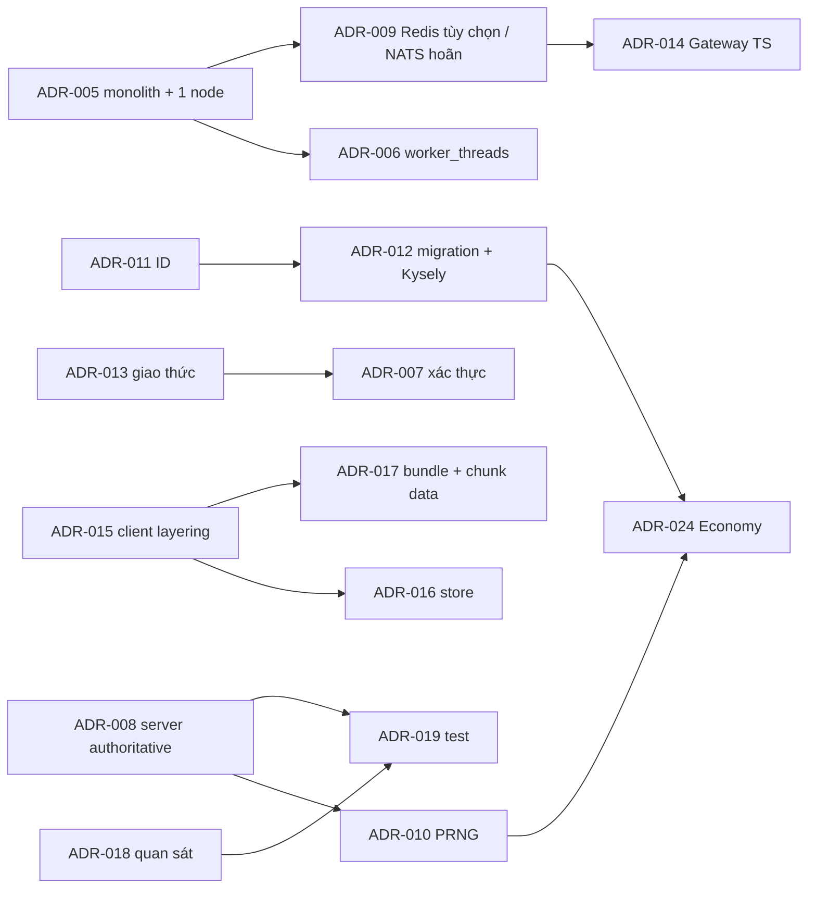

# Chỉ mục ADR (Architecture Decision Records)

> **Mục đích:** một chỗ liệt kê **mọi quyết định kỹ thuật** đến thời điểm này: những quyết định đã khóa (link tới [DECISIONS.md](DECISIONS.md) và tài liệu gốc) và những **đề xuất mới** từ bộ tài liệu 20–28. **Không** thay thế DECISIONS.md: một đề xuất chỉ có hiệu lực khi chủ dự án duyệt và được thêm thành dòng `D<n>` ở [DECISIONS.md](DECISIONS.md) (hàng mới, `D32` trở đi); quy trình đổi giá trị: skill `vgtd-formula-change`.
>
> Thứ tự ưu tiên khi mâu thuẫn (CLAUDE.md): DECISIONS D14+ › [00 §3–4](00-ho-so-tong-hop.md) › `@vgtd/shared` › các tài liệu chi tiết.

## 1. Cách đọc

| Trạng thái                       | Ý nghĩa                                                                                                       |
| -------------------------------- | ------------------------------------------------------------------------------------------------------------- |
| **Đã chốt**                      | Có trong DECISIONS.md hoặc 00 §3–4; không đổi ở đây                                                           |
| **Có trong tài liệu gốc**        | Được nêu trong [08](08-server-architecture.md)/02–07 (hiệu lực theo 00 §2) nhưng chưa có dòng DECISIONS riêng |
| **Đề xuất – chờ duyệt**          | Quyết định mới do bộ tài liệu 20–28 đề xuất; chưa có hiệu lực                                                 |
| **Chờ xác nhận (từ PR đang mở)** | Điểm mơ hồ phát hiện khi cài đặt, cần chủ tài liệu trả lời (Phụ lục A–B)                                      |

Mỗi ADR: **Bối cảnh → Quyết định → Phương án khác → Hệ quả**, ở dạng rút gọn một dòng/bảng; lập luận đầy đủ nằm ở tài liệu được link.

## 2. Các quyết định đã khóa (tham chiếu)

| #       | Quyết định (rút gọn)                                                                                                                                                                                                                                                                                 | Nguồn                                                     |
| ------- | ---------------------------------------------------------------------------------------------------------------------------------------------------------------------------------------------------------------------------------------------------------------------------------------------------- | --------------------------------------------------------- |
| D1      | 2D Isometric 2:1, thế giới mở chia chunk                                                                                                                                                                                                                                                             | [DECISIONS D1](DECISIONS.md), [02](02-asset-matrix-2d.md) |
| D2      | Engine: Cocos Creator 3.x (dự phòng Unity 2D, Godot 4)                                                                                                                                                                                                                                               | D2                                                        |
| D3      | Nền tảng: Web H5 + Mobile + PC, cross-play                                                                                                                                                                                                                                                           | D3                                                        |
| D4      | Asset: Sprite Sheet, Spine 2D, Tilemap diamond, Particle 2D, sprite shader                                                                                                                                                                                                                           | D4                                                        |
| D5      | Gói tải đầu Web 25 MB                                                                                                                                                                                                                                                                                | D5, [06 §6](06-toi-uu-render.md)                          |
| D6–D7   | 6 phẩm chất; icon nguồn 256 xuất 48/64/128                                                                                                                                                                                                                                                           | D6, D7                                                    |
| D8–D11  | Ngũ hành, đột phá, Lôi Kiếp (số và công thức)                                                                                                                                                                                                                                                        | D8–D11, [07](07-cong-thuc-data-schema.md)                 |
| D12–D13 | Lôi Kiếp procedural; Vạn Kiếm 1 sprite + instancing                                                                                                                                                                                                                                                  | D12, D13, [06](06-toi-uu-render.md)                       |
| D14     | Rig Spine Player/Boss **5 hướng + lật gương**; animation bất đối xứng có thể vẽ đủ 8                                                                                                                                                                                                                 | D14 (2026-11-05)                                          |
| D15     | Ô nguyên (i, j) = đỉnh N, tâm (i + 0,5; j + 0,5); toán y hướng xuống; Cocos lật y                                                                                                                                                                                                                    | D15 (2026-11-05)                                          |
| D16–D24 | Chốt các điểm mơ hồ A1–A13 của `@vgtd/shared`: làm tròn theo công thức (D16), Hộ Mạch Đan (D17), thứ tự giảm sát thương kiếp (D18), đột phá tiểu cảnh không đan/pity (D19), sort theo tầng (D20), pity drop (D21), drop cảnh giới thấp (D22), sửa schema `realm_progression` (D23), id đan chủ (D24) | D16–D24 (2026-11-05)                                      |
| D25–D27 | Spine runtime 4.2 _[Cập nhật D35: thay bằng DragonBones]_; MVP username/password, Google SSO sau; hosting hoãn, chỉ chạy local _[Cập nhật D35: D25 bị thay, hoạt cảnh xương dùng DragonBones]_                                                                                                       | D25, D26, D27                                             |
| D28–D31 | CI chỉ GitHub Actions, không CD (D28); `orchestrator.inc` là nhầm lẫn (D29); không tự sửa `.claude/settings.json` (D30); branch protection yêu cầu `verify (18)` + `verify (22)` (D31)                                                                                                               | D28–D31                                                   |

## 3. Chỉ mục ADR

Số ADR cố định (không dùng lại). ADR-001…004 ánh xạ D; 005+ là mới.

| ADR     | Tiêu đề                                                                                                                                                                                                                                                               | Trạng thái                                                                               | Tài liệu                                                             |
| ------- | --------------------------------------------------------------------------------------------------------------------------------------------------------------------------------------------------------------------------------------------------------------------- | ---------------------------------------------------------------------------------------- | -------------------------------------------------------------------- |
| ADR-001 | Engine Cocos Creator 3.x (client 3.8.8, Spine 4.2) _[Cập nhật D35: DragonBones, không còn Spine 4.2]_                                                                                                                                                                 | **Đã chốt** (D2); phiên bản cụ thể: xác nhận bằng spike                                  | [21](21-kien-truc-client.md)                                         |
| ADR-002 | 2D Isometric 2:1, đa nền tảng Web/Mobile/PC                                                                                                                                                                                                                           | **Đã chốt** (D1, D3, D4)                                                                 | [00 §3](00-ho-so-tong-hop.md)                                        |
| ADR-003 | Gốc iso và lật y ở biên render                                                                                                                                                                                                                                        | **Đã chốt** (D15)                                                                        | [21 §8](21-kien-truc-client.md)                                      |
| ADR-004 | Rig 5 hướng + lật gương; animation bất đối xứng 8 hướng                                                                                                                                                                                                               | **Đã chốt** (D14); mặc định animation nào bất đối xứng → ADR-020                         | [03](03-nhan-vat-quai-vat.md)                                        |
| ADR-005 | MVP: modular monolith (một tiến trình), **một World Node**, không handover                                                                                                                                                                                            | **Đề xuất – chờ duyệt**                                                                  | [20 §4–5](20-kien-truc-tong-the.md), [22 §3.6](22-server-modules.md) |
| ADR-006 | World Node trong `worker_threads`; mã hóa snapshot trong worker; vòng tick bù trôi; chuyển `ArrayBuffer` bằng transfer                                                                                                                                                | **Đề xuất – chờ duyệt**                                                                  | [20 §5](20-kien-truc-tong-the.md)                                    |
| ADR-007 | Xác thực mật khẩu: argon2id, chính sách NIST, JWT EdDSA 10 phút + refresh xoay vòng 30/90 ngày, thu hồi theo họ; Google SSO (OIDC + PKCE) sau MVP                                                                                                                     | **Đề xuất – chờ duyệt**                                                                  | [25](25-xac-thuc-bao-mat.md)                                         |
| ADR-008 | Server quyết định mọi thứ; `step()` dùng chung; prediction + đối soát + nội suy; anti-cheat theo ngân sách thời gian                                                                                                                                                  | **Có trong tài liệu gốc** ([08 §4–6](08-server-architecture.md)); cài ở PR #10 (đang mở) | [08](08-server-architecture.md), [22 §3](22-server-modules.md)       |
| ADR-009 | Dữ liệu: PostgreSQL là nguồn sự thật + sổ cái kép (**có trong 08 §7**); Redis **tùy chọn** (profile) và NATS **chưa dùng** trong MVP (**đề xuất**)                                                                                                                    | Một phần có sẵn / phần còn lại **Đề xuất – chờ duyệt**                                   | [20 §6–7](20-kien-truc-tong-the.md), [23](23-mo-hinh-du-lieu.md)     |
| ADR-010 | PRNG dùng chung trong `@vgtd/shared`: xoshiro128\*\* + luồng đặt tên; seed bí mật cho roll kinh tế                                                                                                                                                                    | **Đề xuất – chờ duyệt** (giải quyết OPEN-ITEMS §6)                                       | Phụ lục A.5                                                          |
| ADR-011 | ID: UUIDv7 cho thực thể hiển thị; `bigint identity` cho bút toán/log; `text` cho danh mục tĩnh                                                                                                                                                                        | **Đề xuất – chờ duyệt**                                                                  | [23 §3](23-mo-hinh-du-lieu.md)                                       |
| ADR-012 | Migration: node-pg-migrate (SQL thuần); truy cập dữ liệu: `pg` + Kysely                                                                                                                                                                                               | **Đề xuất – chờ duyệt**                                                                  | [23 §5](23-mo-hinh-du-lieu.md)                                       |
| ADR-013 | Giao thức: WebSocket nhị phân (MVP) → WebTransport sau; hai họ mã hóa (Nóng thủ công / Lạnh Protobuf); xác thực qua HTTPS; chính sách phiên bản                                                                                                                       | **Đề xuất – chờ duyệt** (mở rộng `@vgtd/protocol` v1 của PR #10, không phá vỡ)           | [24](24-giao-thuc-mang.md)                                           |
| ADR-014 | Gateway bằng TypeScript trong MVP; quyết định Rust/Go sau khi có số đo (trần 20.000 kết nối/instance của 08 §7)                                                                                                                                                       | **Đề xuất – chờ duyệt**                                                                  | [20 §8](20-kien-truc-tong-the.md)                                    |
| ADR-015 | Client phân tầng: engine-agnostic (tầng 1–2) / adapter Cocos (tầng 3); thêm package `@vgtd/client-app`                                                                                                                                                                | **Đề xuất – chờ duyệt**                                                                  | [21 §2](21-kien-truc-client.md)                                      |
| ADR-016 | Quản lý trạng thái client: store đơn nguồn tự viết, luồng một chiều, vòng đệm Action để replay                                                                                                                                                                        | **Đề xuất – chờ duyệt**                                                                  | [21 §4](21-kien-truc-client.md)                                      |
| ADR-017 | Asset bundle theo bảng 02/06 (đã chốt) + dữ liệu chunk đóng thành một tệp/vùng có chỉ mục (**đề xuất**, chờ spike S4)                                                                                                                                                 | Phần bundle: **Có trong tài liệu gốc**; phần dữ liệu chunk: **Đề xuất**                  | [21 §5](21-kien-truc-client.md)                                      |
| ADR-018 | Quan sát: pino (JSON) + Loki; Prometheus + Grafana; OpenTelemetry + Tempo; hệ cờ tính năng tự viết; không Sentry ở MVP                                                                                                                                                | **Đề xuất – chờ duyệt**                                                                  | [27](27-van-hanh-quan-sat.md)                                        |
| ADR-019 | Kiểm thử: fast-check, golden replay đa trình duyệt, `tools/loadbot`, `dependency-cruiser`; job CI `integration` (PG service) và `nightly`; thêm `format:check` vào CI                                                                                                 | **Đề xuất – chờ duyệt**                                                                  | [28](28-chien-luoc-kiem-thu.md)                                      |
| ADR-020 | Animation bất đối xứng mặc định của Player: `attack`, `cast`, `channel` được vẽ đủ 8 hướng; Boss theo cờ dữ liệu                                                                                                                                                      | **Đề xuất – chờ duyệt** (cần xác nhận của chủ art)                                       | Phụ lục A.1                                                          |
| ADR-021 | Tọa độ socket: không gian pivot, **y hướng lên** (khớp Spine/Cocos node cục bộ); không lật; chỉ lật ở `IsoAdapter`                                                                                                                                                    | **Đề xuất – chờ duyệt**                                                                  | Phụ lục A.2, [21 §8](21-kien-truc-client.md)                         |
| ADR-022 | Định nghĩa "draw call": số liệu chuẩn là draw call mỗi khung từ thống kê engine; tiêu chí "≤ 2 draw call/nhân vật" là ước lượng tĩnh theo trang atlas/blend                                                                                                           | **Đề xuất – chờ duyệt**                                                                  | Phụ lục A.3                                                          |
| ADR-023 | Quy tắc sort chữ V của Boss: người chơi **dưới** cạnh V (gần camera hơn) vẽ **sau** boss; sửa chú thích của 03                                                                                                                                                        | **Đề xuất – chờ duyệt**                                                                  | Phụ lục A.4                                                          |
| ADR-024 | Kinh tế: ba đồng Linh thạch + bút toán đổi; thuế làm tròn lên bằng số nguyên; nhật ký `item_events`; hàm kinh tế vẫn ở `@vgtd/shared` (cần thêm quy tắc làm tròn)                                                                                                     | **Đề xuất – chờ duyệt**                                                                  | [26](26-kinh-te-ledger.md), [23 §4.4](23-mo-hinh-du-lieu.md)         |
| ADR-025 | Anti-cheat mở rộng: tín hiệu hành vi và thang xử lý 5 nấc, không tự cấm theo một chỉ số                                                                                                                                                                               | **Đề xuất – chờ duyệt**                                                                  | [25 §7](25-xac-thuc-bao-mat.md)                                      |
| ADR-026 | Hoạt cảnh xương nhân vật dùng DragonBones (runtime `dragon-bones` của Cocos 3.8.8, MIT; dữ liệu JSON 5.5/5.6) thay Spine 4.2; giữ định nghĩa rig trung lập trong `@vgtd/character` để có thể xem lại Spine sau MVP; chi tiết [art/dragonbones.md](art/dragonbones.md) | **Đã chốt** (D35, chủ dự án 2026-11-06); hiệu năng/định dạng xuất: xác nhận bằng spike   |

## 4. Quan hệ phụ thuộc giữa các đề xuất

## 5. Tổng hợp quy trình phê duyệt

1. Chủ dự án (hoặc orchestrator được ủy quyền) đọc mục "Câu hỏi cần chốt" cuối mỗi tài liệu 20–28; trả lời từng ô (chấp nhận mặc định / đổi).
2. Với mỗi ADR được duyệt: thêm **một dòng** vào [DECISIONS.md](DECISIONS.md) (`D32`, `D33`, … — D1–D31 đã dùng), đổi trạng thái ở đây thành **Đã chốt (D<n>)**.
3. ADR nào chạm giá trị trong `@vgtd/shared` (ví dụ ADR-010 PRNG, ADR-024 làm tròn): theo skill `vgtd-formula-change` — DECISIONS trước, rồi `@vgtd/shared` + test, rồi cập nhật docs.
4. Không bắt đầu cài đặt phần phụ thuộc vào ADR chưa duyệt, trừ spike có đánh dấu rõ.

## Phụ lục A. Điểm mơ hồ của PR #7 (`@vgtd/character`) và OPEN-ITEMS §6

Nguồn: mô tả PR #7 mục "Spec ambiguities and choices" và [OPEN-ITEMS §6](OPEN-ITEMS.md). Cột "Cách xử lý": **Giải quyết** = đề xuất dứt điểm (vẫn chờ duyệt); **Leo thang** = cần người có thẩm quyền (art / game design) trả lời.

### A.0 Bảng tổng hợp

| #   | Điểm (PR #7)                                                  | Cách xử lý                           | Đề xuất                                                                                                                                            | Ai quyết          |
| --- | ------------------------------------------------------------- | ------------------------------------ | -------------------------------------------------------------------------------------------------------------------------------------------------- | ----------------- |
| 1   | Animation nào bất đối xứng (D14)                              | **Giải quyết** → ADR-020             | Mặc định `attack`, `cast`, `channel` của Player bất đối xứng (vẽ đủ 8); còn lại 5 + lật                                                            | Chủ art xác nhận  |
| 2   | Draw Order vs lật gương                                       | **Giải quyết**                       | Chấp nhận cách PR #7: SW/W/NW dùng preset riêng của chúng; lật chỉ áp lên hình; `mirrored` chỉ chọn biến thể lật                                   | —                 |
| 3a  | Socket y hướng nào                                            | **Giải quyết** → ADR-021             | Không gian pivot, y **lên**; khớp Spine/Cocos node cục bộ                                                                                          | —                 |
| 3b  | `head_top … theo cỡ nhân vật` chưa có công thức               | **Giải quyết** (tạm)                 | MVP: không scale; sẵn trường `socketsOverride` theo định nghĩa nhân vật; chốt khi có Boss                                                          | Chủ art           |
| 4   | Quỹ đạo ellipse "36 × 18": trục hay bán trục                  | **Leo thang** (mặc định đề xuất)     | Giữ cách PR #7: **chiều rộng/cao đầy đủ** 36 × 18 px (tỷ lệ 2:1 khớp phép chiếu); chủ art xác nhận kích thước                                      | Chủ art           |
| 5   | "Draw call" không được định nghĩa                             | **Giải quyết** → ADR-022             | Hai chỉ số (khung / ước lượng tĩnh)                                                                                                                | —                 |
| 6a  | Footstep `Run` "frame 2 và 7": 0 hay 1-based                  | **Giải quyết**                       | **0-based** (chỉ số khung Spine), dung sai ±1 khung khi kiểm; hai khung cách nhau nửa chu kỳ đúng với 10 khung                                     | —                 |
| 6b  | `hit`/`cancel_window`/`vfx_spawn` chưa có số khung            | **Leo thang**                        | Giữ làm neo pha; chủ game design/animation đặt số khung cho từng skill khi có dữ liệu kỹ năng                                                      | Game design + art |
| 6c  | Công thức 03 §1 nói "18 animation", bảng 13 dòng              | **Giải quyết**                       | 13 là tập chuẩn (bảng); "18" là hằng minh họa cũ trong phép tính bùng nổ; sửa chú thích tài liệu 03 bằng `[Cập nhật]`                              | —                 |
| 7   | Câu "nằm dưới cạnh thì vẽ trước boss" (sort chữ V)            | **Giải quyết** → ADR-023             | Người chơi dưới cạnh V vẽ **sau** boss (đứng trước boss)                                                                                           | —                 |
| 8   | Hitbox `elite` (192) và quái Spine không phải boss (xà, giao) | **Giải quyết** (tạm) + **Leo thang** | Elite dùng hàng 1 × 1 (như PR #7); quái Spine non-boss dùng giới hạn rig **Linh thú** (≤ 50 bone, ≤ 25 slot, ≤ 400 đỉnh) cho tới khi art đặt riêng | Chủ art           |
| 9   | `CANVAS_BY_FOOTPRINT` thiếu 8 × 8                             | **Giải quyết**                       | Chấp nhận: 8 × 8 ghép mảnh, canvas theo từng mảnh, `canvasSizeFor('8x8') = null`; không sửa shared                                                 | —                 |
| 10  | Boss 4 × 4: số HP/skill/drop/ngưỡng phase là chỗ giữ chỗ      | **Leo thang**                        | Giữ giá trị mẫu; thay bằng dữ liệu của game design (docs 10–19) khi có; không dùng để cân bằng                                                     | Game design       |

### A.1 ADR-020 – Animation bất đối xứng mặc định (điểm 1)

- **Bối cảnh:** D14 cho phép vẽ đủ 8 hướng cho animation bất đối xứng, "đánh dấu theo từng animation", nhưng không liệt kê animation nào. PR #7 mặc định `attack`, `cast`, `channel` (vũ khí tay phải).
- **Quyết định đề xuất:** (1) Player: `attack`, `cast`, `channel` bất đối xứng; 10 animation còn lại đối xứng (5 + lật). (2) Boss: mặc định **tất cả đối xứng**; cờ `asymmetric` đặt theo từng animation trong định nghĩa Boss khi họa sĩ yêu cầu. (3) Cờ nằm trong dữ liệu (`drawnInEight`), không trong mã.
- **Phương án khác:** (a) tất cả đối xứng – nhẹ nhất nhưng vũ khí tay phải bị đổi tay khi lật (xấu); (b) vẽ đủ 8 cho mọi animation – vi phạm D14 và ngân sách asset.
- **Hệ quả:** thêm 3 hướng × 3 animation = 9 bộ chuyển động riêng cho Player so với phương án "5 + lật" thuần; ngân sách dung lượng lớp Class pack cần cộng thêm (số lượng chưa được đo – ghi vào kế hoạch asset); `resolveDirection` đã hỗ trợ.

### A.2 ADR-021 – Socket y hướng lên (điểm 3a)

- **Bối cảnh:** bảng socket ([03 §4](03-nhan-vat-quai-vat.md)) cho `hand_R = (−18, 52)`, `head_top = (0, 104)`, nhất quán chỉ khi y **hướng lên** từ pivot; mâu thuẫn quy ước "y xuống màn hình" của `@vgtd/shared`. D15 áp dụng cho **toán iso trong thế giới**, không cho tọa độ cục bộ của xương.
- **Quyết định đề xuất:** tọa độ socket = **không gian pivot (gốc ở chân), x phải, y lên** – cũng là không gian cục bộ của Spine và của `Node` Cocos → áp thẳng, **không** lật. Hàm `pivotToCanvas` chỉ dùng cho công cụ chạy trên ảnh (`tools/procgen`, kiểm thử). Lật y chỉ xảy ra ở `IsoAdapter` khi đổi `(i, j)` → vị trí `Node` ([21 §8](21-kien-truc-client.md)).
- **Hệ quả:** thêm ghi chú `[Cập nhật ADR-021]` vào docs/03 §4 khi duyệt (hiện chưa sửa 03 vì PR này chỉ thêm tài liệu mới); `@vgtd/character` giữ nguyên.

### A.3 ADR-022 – Định nghĩa draw call (điểm 5)

- **Bối cảnh:** ngân sách "≤ 80 / ≤ 150" ([06 §4](06-toi-uu-render.md)) và "≤ 2 draw call/nhân vật" ([03 §2](03-nhan-vat-quai-vat.md)) chưa nói đo thế nào.
- **Quyết định đề xuất:**
  1. **Số liệu chuẩn cho ngân sách khung** = số draw call **do engine báo mỗi khung** (profiler/`device` stats; trên Web đối chiếu Spector.js) ở ba cảnh chuẩn; tách theo lớp L0–L7. Đây là số dùng để **chặn phát hành**.
  2. **Ước lượng tĩnh "≤ 2 draw call/nhân vật"** = số lần đổi (trang texture **hoặc** chế độ blend) giữa các slot liền nhau **trong thứ tự vẽ** của một skeleton; công cụ này là `checkRepack` của `@vgtd/character` (PR #7): `wing` coi là cộng (additive), node quỹ đạo sprite **loại trừ** (đếm riêng ở lớp L3/L4). Kiểm tra diện tích atlas (Σ diện tích có đệm ≤ size²) chỉ là điều kiện **cần**, không thay cho xếp gói thật.
  3. Ước lượng tĩnh chỉ để cảnh báo sớm trong CI; khi lệch với số đo chuẩn thì số đo chuẩn thắng.
- **Hệ quả:** thêm 1 spike (S2 ở [21 §12](21-kien-truc-client.md)) để hiệu chuẩn hai số; bảng ngân sách theo lớp của 06 không đổi.

### A.4 ADR-023 – Sort chữ V (điểm 7)

- **Bối cảnh:** [03 §6](03-nhan-vat-quai-vat.md): "người chơi đứng sát hai góc … Y nhỏ hơn đỉnh dưới nhưng về hình vẫn đứng trước sườn boss … nằm dưới cạnh thì vẽ trước boss". Câu cuối nếu hiểu "vẽ trước" = thứ tự vẽ đầu tiên (nằm **sau** trong ảnh) thì ngược với ý định.
- **Quyết định đề xuất:** theo **ý định**: nếu người chơi nằm ở phía **dưới** (gần camera hơn) cạnh trước của V thì được vẽ **sau** boss (che boss); ngược lại vẽ trước boss. Áp dụng cho Boss từ 4 × 4; nhỏ hơn dùng sort key thường. Khớp cách PR #7 (`isInFrontOfBoss`).
- **Hệ quả:** sửa chữ trong 03 khi duyệt ("nằm dưới cạnh thì vẽ **sau** boss"); thêm test góc ở `client-world`.

### A.5 ADR-010 – PRNG có seed trong `@vgtd/shared` (OPEN-ITEMS §6)

> [Cập nhật D63: đã chấp nhận và cài đặt trong `@vgtd/shared` (`src/rng.ts`); băm vàng mới của PR #10 là `b68019d6c5991f87`.]

- **Bối cảnh:** `@vgtd/shared` chưa có PRNG; công thức hiện nhận số ngẫu nhiên truyền vào. PR #10 đặt `mulberry32` (trạng thái 32 bit) trong `@vgtd/sim` với băm vàng `8f33310212e6cd43`. Skill `vgtd-sim-determinism` yêu cầu PRNG **sống trong `@vgtd/shared`**, không bản sao riêng; thứ tự rút là **một phần hợp đồng**.
- **Phân tích:** client chỉ dự đoán **di chuyển** (`stepMove`, không dùng ngẫu nhiên), nên PRNG chung chủ yếu phục vụ server `step()`, công cụ replay, loadbot, mô phỏng kinh tế (`tools/econ-sim`) và test. Điểm yếu của mulberry32: trạng thái 32 bit nên người quan sát chuỗi kết quả (số sát thương hiển thị, kết quả đột phá) có thể suy ra trạng thái và **dự đoán** roll tiếp theo – nguy cơ cho roll kinh tế (drop, đột phá, chế tạo).
- **Quyết định đề xuất:**
  1. Thuật toán: **xoshiro128\*\*** (trạng thái 4 × uint32 = 128 bit; chỉ dùng `Math.imul`, dịch bit, xoay – xác định trên mọi engine); gieo hạt bằng **splitmix32** từ một hạt 32 bit (kiểm thử/replay) hoặc từ 128 bit entropy (server).
  2. API thuần hàm trong `@vgtd/shared`: `rngSeed(seed) → RngState`, `rngNextU32(state) → [u32, RngState]`, `rngFloat`, `rngInt(state, n)` (lấy mẫu loại bỏ, không thiên lệch), `rngFork(state, label) → RngState` (luồng đặt tên, băm nhãn).
  3. **Luồng đặt tên:** `combat`, `ai`, `drop`, `breakthrough`, `tribulation`, `craft`; mỗi luồng có **thứ tự rút cố định và được tài liệu hóa**, không rút có điều kiện theo dữ kiện khác nhau giữa client và server.
  4. Roll **kinh tế** dùng hạt **bí mật phía server** (entropy hệ điều hành) và ghi `roll_log` ([23 §4.7](23-mo-hinh-du-lieu.md)); trạng thái luồng nằm trong state và được băm trong `stateHash()`.
  5. Ngẫu nhiên **chỉ để hiển thị** (VFX, âm thanh) ở client dùng bộ sinh riêng, **không** là mô phỏng.
- **Phương án khác:** (a) giữ mulberry32 – ít việc nhất nhưng yếu cho roll kinh tế; (b) `crypto.getRandomValues` cho mọi roll – không tái hiện được; (c) PCG32 – tương tự xoshiro nhưng cần phép nhân 64 bit (chậm hơn trong JS).
- **Hệ quả:** đổi băm vàng ở PR #10 (tăng phiên bản + DECISIONS), thêm vector kiểm thử; cần duyệt trước khi PR #10 hợp nhất. Ghi `[Cập nhật]` vào OPEN-ITEMS §6 sau khi `@vgtd/shared` có PRNG. Cần chủ dự án quyết định (ADR-010) vì đổi kết quả của mã đang chờ duyệt.

## Phụ lục B. Điểm mơ hồ phát hiện ở PR #9 và PR #10 (chờ xác nhận)

Không phải yêu cầu của nhiệm vụ này nhưng ảnh hưởng thiết kế 20–28; ghi lại để không mất.

| #   | PR  | Điểm                                                                                                  | Đề xuất                                                                                         | Ai quyết                 |
| --- | --- | ----------------------------------------------------------------------------------------------------- | ----------------------------------------------------------------------------------------------- | ------------------------ |
| B1  | #9  | Tầng stream `low`/`high` (3×3/5×5/7×7) là diễn giải                                                   | Giữ 3 × 3 nạp / 5 × 5 tải trước / 7 × 7 giải phóng cho mọi tầng ở MVP; tầng riêng khi có số đo  | Chủ render               |
| B2  | #9  | Camera thấy 4–6 chunk (không "tối đa 4")                                                              | Ghi erratum vào [06 §5](06-toi-uu-render.md); ngân sách không đổi vì luôn nạp 3 × 3             | Chủ render               |
| B3  | #9  | Tie-break `compareDrawOrder` (x tăng) đảo thứ tự láng giềng +j khi hòa; PR #9 tạm vá `staticSortBias` | Đưa quy tắc vào `@vgtd/shared` kèm test (một nguồn), thay vì vá cục bộ                          | Chủ shared               |
| B4  | #9  | Pivot mặt vách `(i + j + 1)·16` và vùng cấm prop cạnh vách (04 §3)                                    | Cần xác nhận của chủ tilemap/art                                                                | Chủ tilemap              |
| B5  | #9  | procgen chưa phát `elevation`/`objects[]`                                                             | Chấp nhận schema đề xuất của loader là hợp đồng; procgen phát theo đó                           | Chủ procgen/tilemap      |
| B6  | #10 | `qinggong` có cờ nhưng chưa có hiệu ứng tốc độ                                                        | Giữ nguyên cho tới khi game design cho số                                                       | Game design (docs 10–19) |
| B7  | #10 | Input vượt ngân sách bị **bỏ**, không xếp hàng lại                                                    | Chấp nhận; cập nhật chú thích 08 §6 khi duyệt                                                   | Chủ server               |
| B8  | #10 | "Kéo dài" của tỷ lệ > 1,03 hiểu là 2 cửa sổ liên tiếp                                                 | Chấp nhận                                                                                       | Chủ server               |
| B9  | #10 | Sai khác với mã giả 08: chia đôi đến điểm chạm + trượt tiếp tuyến ở góc                               | Chấp nhận (tất định, dùng chung client/server); ghi vào 08 như triển khai chuẩn                 | Chủ server               |
| B10 | #10 | Cờ bậc thang `+i/−i/+j/−j`; đổi tầng ở trung điểm                                                     | Cần xác nhận của chủ tilemap                                                                    | Chủ tilemap              |
| B11 | #10 | Bản ghi snapshot thêm 1 bit (37–44 bit)                                                               | Chấp nhận ([24 Q5](24-giao-thuc-mang.md))                                                       | Chủ server               |
| B12 | #10 | `Math.atan2` chỉ dùng khi đóng gói hướng ở client                                                     | Chấp nhận (đã lượng tử 256 mức); thêm test hai trình duyệt ([28 §4](28-chien-luoc-kiem-thu.md)) | Chủ server               |

## Phụ lục C. Đối chiếu với docs 10–19 (PR #69, #70)

Đối chiếu ngày viết; lúc đó các PR #69/#70 chưa vào `main` nên tài liệu 10–19 được nêu dạng tên, không link (nay đã vào `main`; cột "Đã xử lý" vẫn đúng). Kết quả: khi khác nhau, **docs 10–19 là nguồn về nội dung game design**, 20–28 là nguồn về thực thi.

| Nguồn        | Điều khoản                                                                                                           | Tác động lên 20–28                                        | Đã xử lý                                                                                                                                 |
| ------------ | -------------------------------------------------------------------------------------------------------------------- | --------------------------------------------------------- | ---------------------------------------------------------------------------------------------------------------------------------------- |
| docs/10      | Closed beta 100 CCU, tick p99 ≤ 40 ms, ≤ 8 KB/s/người                                                                | Thay giả thiết 300 CCU / 45 ms                            | [20 Q5](20-kien-truc-tong-the.md), [22 §3.4](22-server-modules.md), [27 §3](27-van-hanh-quan-sat.md), [28 §6](28-chien-luoc-kiem-thu.md) |
| docs/11      | `CastStart{caster, skillId, aim, serverStart, windupMs}`, AOE trên lưới ô                                            | Giao thức thiếu điểm nhắm và `cast_start`                 | [24 §5](24-giao-thuc-mang.md): id 27, 28                                                                                                 |
| docs/13      | Economy là nơi duy nhất ghi kết quả chế, seed RNG log                                                                | Roll chế tạo ở Economy, seed ở kho hạn chế                | [26 §6](26-kinh-te-ledger.md)                                                                                                            |
| docs/14      | Instance chiến tranh là World Node chuyên dụng; nút Báo cáo gửi 60 s log; bảng xếp hạng Redis + PG                   | Mở rộng ADR-005 khi bật chiến tranh; vòng đệm replay 60 s | [22 §3.6](22-server-modules.md), [28 Q7](28-chien-luoc-kiem-thu.md)                                                                      |
| docs/15      | Tiên Ngọc khóa tài khoản, một chiều, ví được âm khi hoàn tiền, ngoài tỷ lệ tiêu hao/sinh ra; tiền sự kiện hết hạn    | Loại đồng tiền và ràng buộc sổ cái                        | [26 §2](26-kinh-te-ledger.md), [23 §4.4](23-mo-hinh-du-lieu.md)                                                                          |
| docs/17      | Envelope sự kiện, `player_pid`, opt-out, log thô 90 ngày, IP ≤ 30 ngày, gửi qua Gateway, chủ đề `telemetry.<domain>` | Thay đề xuất telemetry của 27; thêm `telemetry_batch`     | [27 §4](27-van-hanh-quan-sat.md), [24 §5](24-giao-thuc-mang.md)                                                                          |
| docs/17 / 15 | Tên sổ cái `ledger`, `SRC_*`, `SINK_*`, `SRC_IAP`                                                                    | Khác tên với 26                                           | Ghi ở [27 Q1](27-van-hanh-quan-sat.md); chuẩn là tên của 26                                                                              |
| docs/19      | Nghị định 13/2023/NĐ-CP, xác minh tuổi, đồng ý người giám hộ                                                         | Ràng buộc cho 23 §7 và 25                                 | [27 §4](27-van-hanh-quan-sat.md); chờ pháp lý                                                                                            |

## Câu hỏi cần chốt

| #   | Câu hỏi                                                                                                                                                                                          | Mặc định đề xuất                                                                               |
| --- | ------------------------------------------------------------------------------------------------------------------------------------------------------------------------------------------------ | ---------------------------------------------------------------------------------------------- |
| Q1  | Chấp nhận **toàn bộ** ADR-005…025 như đề xuất, hay duyệt từng nhóm (server 005–009, dữ liệu 010–012, mạng 013–014, client 015–017, vận hành 018–019, nhân vật 020–023, kinh tế/bảo mật 024–025)? | Duyệt theo nhóm; nhóm chặn cài đặt: 005, 007, 010, 011, 012, 013                               |
| Q2  | ADR-010 (PRNG xoshiro128\*\*) có thay thế mulberry32 của PR #10 không?                                                                                                                           | **Có** (trước khi PR #10 hợp nhất)                                                             |
| Q3  | Ai là chủ art để xác nhận ADR-020, ADR-021, điểm A.0 #4, #6b, #8?                                                                                                                                | Chủ dự án chỉ định                                                                             |
| Q4  | Số `D<n>` tiếp theo khi ghi vào DECISIONS.md: bắt đầu từ **D32** (D1–D31 đã dùng), theo thứ tự duyệt?                                                                                            | **Có**                                                                                         |
| Q5  | Có sửa trực tiếp 03/06/08 (erratum) hay chỉ giữ trong DECISIONS cho tới khi nhóm tài liệu game design xong?                                                                                      | Giữ trong DECISIONS trước; cập nhật tài liệu gốc bằng một PR docs riêng sau khi docs 10–19 vào |
